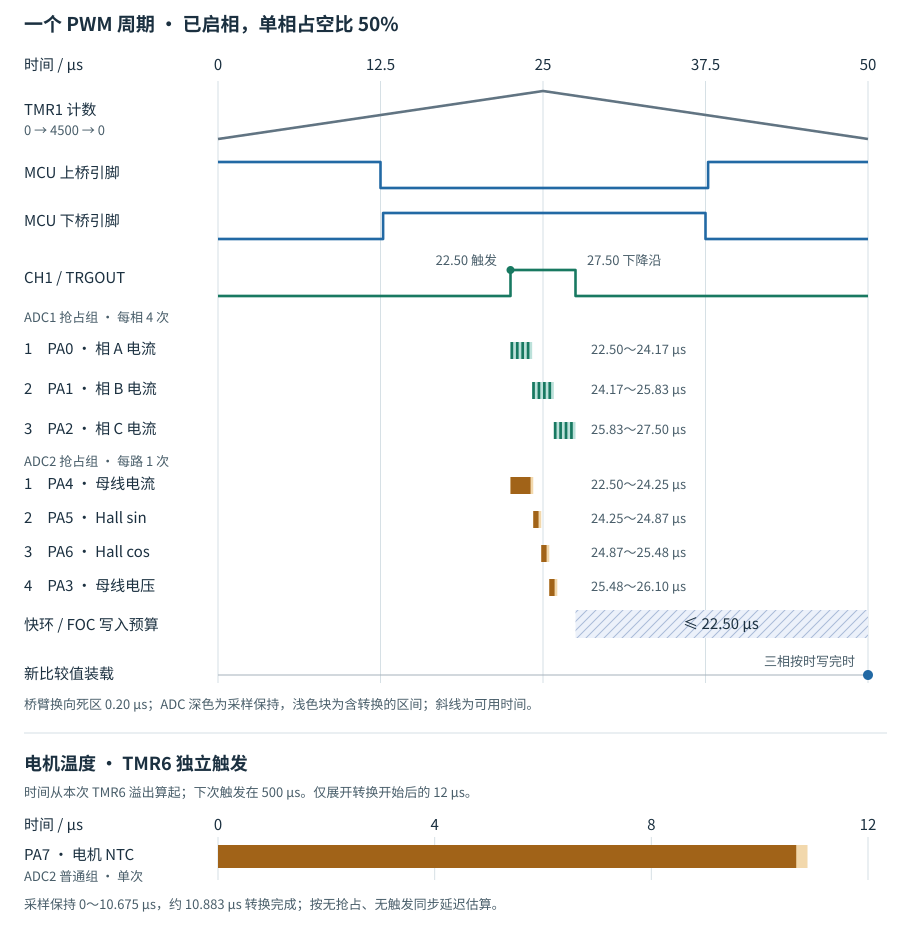

# AT32F456 电机驱动说明：PWM、ADC 与 FOC 时序

本文适用于 `the-system-refactor` 分支的 AT32F456 正式 APP，采样配置于 2026-11-09 核对。PA3 母线电压由 ADC2 抢占序列末位单次采样。时刻由外设配置推算。快采样以 TMR1 谷底为零点，NTC 慢采样以 TMR6 溢出为零点。

## 一个载波周期

TMR1 是三相 PWM 和快采样的共同时间基准。在一个 50 µs 周期内，CH1 于 **22.50 µs** 同时触发两只 ADC。三相电流按 A、B、C 的顺序转换，覆盖 **25.00 µs** 的载波峰值。ADC1 约在 **27.50 µs** 完成。运行态快环此后才取得本拍数据，计算并写入下一组三相占空比。

上图以 50% 占空比的一相桥臂为例。深色条为采样保持，浅色底块覆盖整个转换区间。行首数字表示该 ADC 抢占组内的转换顺序：ADC1 每相电流连续采四次，ADC2 依次对母线电流、Hall sin、Hall cos 和母线电压各采一次。快环阴影从 ADC1 标称完成时刻延伸到下一谷底。

下图以 TMR6 本次溢出为零点，展开 ADC2 普通组的 PA7 电机 NTC 单次转换。TMR6 的触发间隔为 500 µs，相当于十个 PWM 周期；图中未假定它与 TMR1 谷底重合。下图时间按普通组未被抢占时计算。

## 定时器、引脚与电平

| 资源 | 配置 | 作用 |
| --- | --- | --- |
| TMR1 时基 | 180 MHz，预分频 0，`PR=4500`，`TMR_COUNT_TWO_WAY_2` | 从 0 上数到 4500 再下数回 0，周期为 `2 × 4500 / 180 MHz = 50 µs` |
| CH2 / CH3 / CH4 | PWM 模式 A，主输出和互补输出均高有效 | A/B/C 相上桥分别接 PA9/PA10/PA11，下桥分别接 PB0/PB1/PB4 |
| CH1 | PWM 模式 B，比较值 4050，TRGOUT 选择 `C1ORAW` | 只生成片内 ADC 触发。上数匹配时上升，下数匹配时下降 |
| TMR6 | 2 kHz，溢出事件送 TRGOUT | 触发 ADC2 普通组测温，同时请求监督中断 |

双向计数模式 2 决定通道比较标志在哪个方向置位。ADC 硬件取 CH1 的参考电平，只接受其上升沿，因此一个载波周期产生一次快采样。三相 PWM 的极性由各自的模式 A 和输出极性位决定。[资源映射](../../firmware/platform/bsp/mcu/at32f456/mcu_resources.h) · [PWM 初始化](../../firmware/platform/bsp/mcu/at32f456/pwm.c)

### 峰值时上管为何关断

模式 A 上数时，`CNT < CxDT` 输出高，达到比较值后输出低；下数时，`CNT > CxDT` 输出低，回到比较值后输出高。以 50% 占空比为例，`CxDT=2250`。配置的死区为 36 个定时器时钟（200 ns），主输出和互补输出各自的**导通沿**延后。

| 观察对象 | 50% 示例中的边沿 | 在 25.00 µs 峰值的状态 |
| --- | --- | --- |
| 定时器内部相比较信号 `CxORAW` | 12.50 µs 变低，37.50 µs 变高 | 低，恰好处于原始低脉冲中点 |
| MCU 上桥输出 `CxOUT` | 12.50 µs 拉低，37.70 µs 拉高 | 低，引脚低脉冲中点是 **25.10 µs** |
| MCU 下桥输出 `CxCOUT` | 12.70 µs 拉高，37.50 µs 拉低 | 高，两次换向各留出 0.20 µs 双关断时间 |
| 上管栅源电压 `VGS` | FD6288Q 的 HIN 与 HO 同相，HO 相对浮动节点 VS 驱动栅极 | 按接线和逻辑推断，上管处于关断区间。实际边沿受驱动延迟和栅极充放电影响 |

引脚电平来自定时器配置。判断功率管实际开关时刻，应观察栅极相对源极的电压。器件依据见雅特力手册 TMR1/TMR8 的「输出模式」及「死区发生器」，以及峰岹资料的引脚定义。[AT32F456 手册下载入口](https://www.arterytek.com/cn/product/AT32F456.jsp) · [FD6288Q 数据手册，第 6 页](https://static.qingshow.net/fortiortech/file/1597746094397.pdf) · [板级功率器件](../hardware/at32f456_configuration_v1.md)

## 双 ADC 与有效采样窗口

两只 ADC 都使用 60 MHz 时钟及 12 位分辨率。CH1 在上数到 4050 时同时启动两组抢占转换，到下数 4050 时其下降沿不触发转换。ADC1 对每一相连续转换四次，硬件累加，读取时乘 0.25。每次采样保持约 0.208 µs，每次含转换约 0.417 µs，每相共约 1.67 µs。以谷底为起点，各相占用区间依次为 A **22.50～24.17 µs**、B **24.17～25.83 µs**、C **25.83～27.50 µs**。

同一时间，ADC2 依次对母线电流、Hall sin、Hall cos、母线电压各转换一次，约在 26.10 µs 结束，比 ADC1 早约 1.40 µs。PA7 的电机 NTC 走 ADC2 普通组，每 500 µs 由 TMR6 触发。普通组单次含转换约 10.88 µs，监督中断入口不等待这次温度结果。[各通道采样周期、rank 和原码读取](sampling_chain_v1.md#at32采样时序配置) · [ADC 实现](../../firmware/platform/bsp/mcu/at32f456/adc.c)

**母线电压 PA3。** 当前配置启用母线电流和两路 Hall，PA3 对应 ADC2 通道 3，排在抢占序列第 4 项。以 PWM 谷底为零点，前三项完成后约在 **25.48 µs** 开始采样保持，经过 24.5 个 ADC 时钟，约在 **25.89 µs** 结束保持；再经过 12.5 个时钟，约在 **26.10 µs** 将单次 12 位结果写入 `ADC2->pdt4`。快环确认两组完成后，`MotorVoltage_Update` 读取 `BSP_ADC_BUS_VOLTAGE`，BSP 用原码直接乘 `BSP_ADC_VBUS_V_PER_COUNT` 换算为伏特；快环随后更新 `bus_voltage_v` 与滤波值 `bus_voltage_filtered_v`。[结果寄存器映射](../../firmware/platform/bsp/mcu/at32f456/mcu_resources.h) · [快环电压读取](../../firmware/motor/sensing/motor_voltage.c)

触发位置固定，开关沿随占空比移动。令 D 为某相在本周期内稳定的占空比（0～1），则该相的比较边沿的标称时刻为 `25 × D` 和 `50 − 25 × D` µs。D 为 90% 时，两个边沿落在整个三相转换区间的两端；D 继续增加，边沿就进入该区间。分析电流毛刺时，应把发生切换的桥臂与受影响通道的四段采样保持逐一对齐，并计入死区和模拟前端建立时间。

## 快环执行与占空比装载

1. **接收完成事件。** 仅 ADC1 开抢占序列完成中断（优先级 0）。`BspAdc_CompleteFast` 检查两只 ADC 的 PCCE 标志；两者都置位才清标志并执行本拍。只有 ADC1 完成时，软件清 ADC1 标志并跳过本拍。完成标志没有序号，异常迟到时无法据此证明两个结果属于同一触发。
2. **取反馈并计算。** `MotorAxis_SampleFast` 先启动编码器 SPI 传输，使它与母线和相电流处理重叠，再更新编码器反馈。`MotorAxis_ControlFast` 按状态执行控制；运行态 FOC 由 `Foc_Prepare` 计算三相占空比，`BspPwm_SetDuty` 顺序写 CH2/3/4，随后 `Foc_Complete` 更新诊断和积分跟踪。入口在快环返回后才递增 `g_app_fast_samples`。[中断入口](../../projects/at32f456/application/main.c) · [轴快环](../../firmware/app/motor_axis.c) · [FOC 写入顺序](../../firmware/motor/control/foc_output.c)
3. **硬件装载。** 三个比较通道启用缓冲，TMR1 的重复计数器保持复位值 0。峰值和谷底都可发生装载。27.50 µs 收齐本拍后，最近的一次装载是 **50.00 µs 谷底**。要让三相在此一起生效，最后一个比较值也要在谷底前写完。从 ADC1 标称完成算起，上限为 **22.50 µs（4050 个内核周期）**，其中还要容纳中断响应、反馈处理和 FOC 计算。

若三次写入都发生在 50 µs 谷底与 75 µs 峰值之间，它们可在该峰值一起装载；若写入横跨谷底，则可能部分相先装载，其余相等到下一次装载。装载更新的是比较阈值，对应的开关边沿由后续计数匹配产生。逆 Park 使用的 `1.5 × FOC_TS_S` 是角度预测量；实际装载时刻要看写入落在哪两个更新事件之间。[PWM 写入](../../firmware/platform/bsp/mcu/at32f456/pwm.c) · [逆 Park 与 SVPWM](../../firmware/motor/control/foc.c)

AT32 每五个成功快拍派发一次 PendSV 外环，标称 4 kHz；TMR6 独立提供 2 kHz 监督节拍。PendSV 和监督中断优先级均为 2，可被 ADC 中断抢占。因此，跳过一个快拍会推迟外环派发，TMR6 的硬件节拍仍按自身计数运行。[分频配置](../../firmware/config/config.h) · [定时器和中断配置](../../firmware/platform/bsp/mcu/at32f456/system.c)

## 启动、关相与暂停采样

| 操作 | 硬件动作 | 可以观察到什么 |
| --- | --- | --- |
| 初始化和启动 | 设置三相初值 50%，关闭相输出和总输出。校准 ADC，配置 CH1 后，由 `Adc_Start` 清标志、开放触发，再启动 TMR1 和 TMR6 | 上电关相时已有快拍，IDLE 中可累计电流零偏 |
| 启相 / 关相 | 启相先开六路再开总输出；关相先关总输出再关六路。二者都不停止 TMR1 | 关相后 CH1 和快采样继续，示意图中的桥臂波形仅适用于输出已使能时 |
| 停机写 Flash | 实际擦写前关闭 ADC 外部触发、停止转换并等待结束。Flash 控制器未锁存阻塞时恢复触发 | 停采期间不能用寄存器旧值代表新拍；恢复后的新拍须由下一次触发重新完成 |

实现见 [BSP 启动](../../firmware/platform/bsp/mcu/at32f456/system.c)、[ADC 启停](../../firmware/platform/bsp/mcu/at32f456/adc.c)和[Flash 擦写](../../firmware/platform/bsp/mcu/at32f456/flash.c)。

## 核对边界

软件侧可用 [AT32 原生 ADC 测试](../../tests/unit/native/at32f456_adc_test.c) 检查通道顺序、触发边沿、过采样、完成标志和停采恢复。既有停机回读记录支持 ADC 通道配置及约 20 kHz 的快拍频率，见[采样链路记录](sampling_chain_v1.md)。

带载时还有两个独立的测量量：上桥引脚到实际 `VGS` 的传播延迟，以及最后一次比较寄存器写入相对下个谷底的余量。本轮未测量这两项。历史[关相中断耗时报告](../reports/2026-10/adc_irq_timing_at32_20261029.md)记录的是旧基线的中断主体耗时，用它无法确定当前运行态的写入截止余量。
