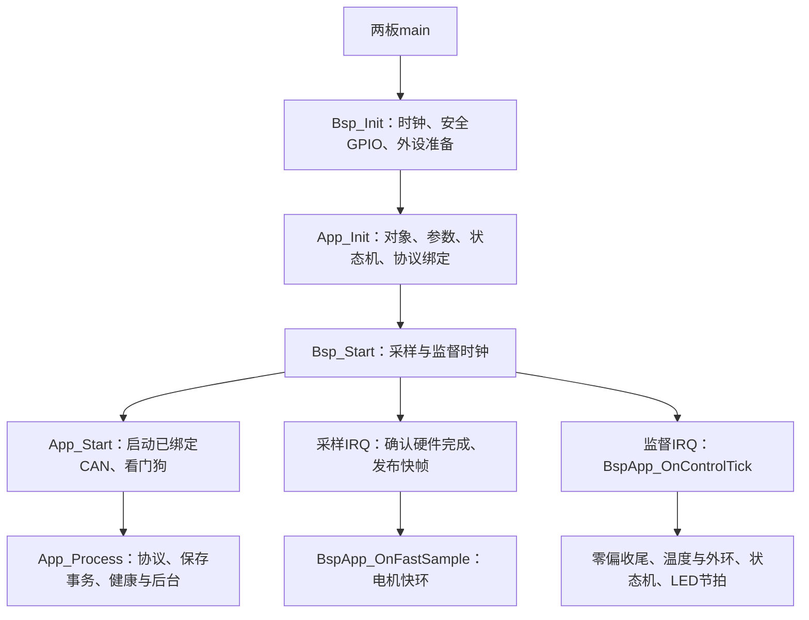

# BSP逻辑、文件与依赖架构 v1

本页是当前BSP文件和职责的唯一总图。公开函数、单位和错误契约见[BSP接口](bsp_interfaces_v1.md)与[头文件包](bsp_api_v1/README.md)。
本阶段只做离线整理、编译和回归；统一实机验收后置，不把构建通过写成台架通过。
前一阶段离线验收已完成，源码快照、九工程构建及回归证据见[验收报告](../reports/2026-10/bsp_architecture_offline_20261026.md)。
后续私有头合并及直接查询调整见[本轮报告](../reports/2026-10/bsp_private_headers_20261026.md)。
最新MCU目录命名、职责与测试残留清理见[整理报告](../reports/2026-10/at32_bsp_cleanup_20261026.md)，本次未烧录。

## 设计边界

BSP向应用提供功能，而非向应用复刻厂商HAL：电流/模拟量、三相PWM、编码器、LED、通信、存储与系统服务。
MCU内部初始化覆盖实际使用的时钟、看门狗、ADC、GPIO、PWM/TIMER、SPI/DMA、CAN和Flash；UART当前未绑定。
同一套功能接口、数据单位、错误语义和使能规则适用于两板。差异只落在板配置、MCU操作和真实器件协议。
bsp_internal.h只合并必要跨文件声明，不含函数实现、可变状态定义或板配置值；单文件辅助函数保持static。
不设运行时驱动注册表，不要求每块板拥有相同数量的私有文件，也不为没有的硬件造空驱动。

```text
firmware/platform/
├─ bsp/
│  ├─ include/
│  │  ├─ boot_hw.h
│  │  ├─ bsp.h
│  │  ├─ bsp_adc.h
│  │  ├─ bsp_can.h
│  │  ├─ bsp_encoder.h
│  │  ├─ bsp_flash.h
│  │  ├─ bsp_led.h
│  │  ├─ bsp_pwm.h
│  │  ├─ bsp_system.h
│  │  ├─ bsp_uart.h
│  │  ├─ fast_loop_profile.h
│  ├─ bsp_internal.h
│  ├─ mcu/at32f456/
│  │  ├─ at32f45x_conf.h
│  │  ├─ boot.c
│  │  ├─ temperature.c
│  │  ├─ can.c
│  │  ├─ encoder_spi.c
│  │  ├─ flash.c
│  │  ├─ led.c
│  │  ├─ pwm.c
│  │  ├─ adc.c
│  │  ├─ system.c
│  ├─ mcu/stm32g4/
│  │  ├─ boot_hw_stm32g4.c
│  │  ├─ boot_hw_unavailable.c
│  │  ├─ temperature.c
│  │  ├─ can.c
│  │  ├─ encoder_spi.c
│  │  ├─ flash.c
│  │  ├─ generated/Core/{Inc,Src}/  原生成外设初始化与IRQ
│  │  ├─ led.c
│  │  ├─ pwm.c
│  │  ├─ adc.c
│  │  ├─ system.c
│  ├─ bsp_adc.c
│  ├─ bsp_can.c
│  ├─ bsp_encoder.c
│  ├─ bsp_led.c
│  ├─ bsp_pwm.c
│  ├─ bsp_uart.c
│  ├─ can_frame_codec.c
│  ├─ can_frame_codec.h
├─ devices/                    器件协议，与bsp同级
│  ├─ encoder_protocol.h
│  ├─ encoder_spi.h
│  ├─ encoder_mt6835.c
│  ├─ encoder_tle5012b.c
├─ config/
│  ├─ bsp_config.h
│  ├─ sampling_scale.h
│  └─ boards/{at32f456,stm32g4}.h
└─ sdk/                         厂商原始目录，保持各自格式
```

以下表格中include、mcu和bsp_*.c相对于bsp；devices相对于platform。

## 每组文件负责什么

| 文件/模块 | 唯一职责 | 不放在这里的内容 |
| --- | --- | --- |
| include/bsp.h | 初始化/启动与应用事件声明 | 电机对象、协议处理器 |
| include/bsp_system.h；mcu/*/system.c | 时间、临界区、UID、复位、看门狗及启动顺序、IRQ接线 | 电机状态转换 |
| mcu/at32f456/system.c | 系统时钟、时基、看门狗、初始化顺序；APP与台架复用 | PWM引脚表和ADC私有状态 |
| bsp_adc.c；bsp_internal.h | 快帧/慢量缓存、原码/物理量、有效位、年龄与偏置发布 | 硬件rank、控制保护阈值 |
| mcu/*/adc.c | ADC配置、DMA、IRQ、原码、故障及存储暂停/恢复；私有状态不出文件 | 电流滤波、零偏累计 |
| mcu/*/temperature.c | 内部温度/VREF与实际NTC换算；保留各自校准和有效性 | 电机过温策略 |
| bsp_encoder.c | 采样阶段、采样/配置互斥、成功序号和诊断结果 | SPI寄存器与多圈速度估计 |
| devices/encoder_protocol.h；devices/encoder_*.c | MT6835/TLE5012B命令、状态、CRC及原始角度解析 | 片选、电气方向和DMA |
| devices/encoder_spi.h；mcu/*/encoder_spi.c | SPI时序、CS、MOSI方向、DMA/轮询、超时收尾 | 器件角度含义 |
| bsp_pwm.c；bsp_internal.h | 合法占空比、提交窗口、永久关相、实际输出状态及失败收尾 | 运行请求和一次性测试窗口 |
| mcu/*/pwm.c | 计数器/通道、CCR、六路启停及真实读回 | 应用允许何时运动 |
| bsp_can.c；bsp_internal.h | 帧与64位软件票据、超时/终态、溢出和恢复节流 | 业务类型、CRC和参数写入 |
| mcu/*/can.c | 控制器、FIFO、物理发送槽、IRQ标志、恢复 | 协议队列与电机命令 |
| can_frame_codec.c/.h | 两板共有的DLC/长度及帧元数据校验 | HAL句柄和应用协议 |
| bsp_led.c；bsp_internal.h | 统一闪烁、呼吸与颜色契约 | 根据电机模式选择颜色 |
| mcu/*/led.c | 实际GPIO或DMA波形，不含测试专用指示命令 | 电机状态所有权 |
| bsp_uart.c | 当前未绑定时统一返回NOT_SUPPORTED | 假的硬件收发成功 |
| bsp_internal.h；mcu/*/flash.c | 范围/别名检查、关相核对、暂停采样、擦写/读回和恢复 | 参数格式、修订号和保存请求去重 |
| include/boot_hw.h；mcu/*/boot*.c | 现有APP/Loader交接；不可用板明确报告 | 将Loader实现并入APP |
| include/fast_loop_profile.h | 原有可选分段测时契约 | 生产控制逻辑 |
| at32f456/at32f45x_conf.h | 厂商驱动模块选择 | 应用模式 |
| stm32g4/generated | 原生成外设设置，手工改动仅在USER CODE区 | 公共算法和应用对象 |

Adc_IsHealthy和BspPwm_ArePhasesDisabled由对应MCU直接实现，已删除公共纯转发；公共PWM保护状态没有复制。

R40前缀只保留在板级配置常量中，不再定义另一套APP可调用的采样、PWM、编码器或CAN接口。
AT32的系统准备与启动直接在system.c实现；PWM引脚准备/复用归pwm.c，调用顺序不变。
ADC的初始化、运行及Flash暂停恢复共用文件私有状态，不再通过私有头和转发函数拼接。

## 配置的三种含义

| 位置 | 内容 | 例子 |
| --- | --- | --- |
| platform/config/boards | 物理接线、器件、采样比例、时钟、已实现能力 | 分流电阻、放大倍数、PWM通道、编码器型号 |
| platform/config/bsp_config.h、sampling_scale.h | 板选择、能力/使能一致性检查、物理换算派生 | 不能使能不存在的传感器；原码到A/V |
| app/config | 产品功能选择、控制周期、应用限流、测试许可 | current_sense_limits.h、pwm_output_config.h、targets/* |

BSP_SUPPORTED表示确有硬件实现；BSP_ENABLED表示本次构建使用；BSP_REQUIRED是应用准入要求。
关闭可选功能时同名入口仍存在，返回未支持或无效结果，不伪造成功；完整电机APP不能关闭自身必需的相电流/PWM等依赖。
当前UART与硬件版本采样没有资源绑定，保持未支持。三相电压没有采样电路，已从接口删除。

永久关相由构建目标给出BSP_PWM_HARD_LOCK，BSP直接拒绝启相。应用仍区分普通、永久关相和限时模式，并校验模式与硬件锁一致。
限时窗口只在app/runtime/pwm_power_window.c拥有状态；BSP不包含pwm_output_config.h，也不认识窗口期限。
控制周期由app/config/control_config.h给出构建期时基，MCU据此配置定时器；这是纯数值输入，不是调用应用逻辑。
板配置不再保存命令电流上限、标定电流上限和软件过流阈值；它们在app/config/current_sense_limits.h保持原值。

## 启动与运行顺序



失败路径先保持/确认关相，停止后续启动。重复Init/Start不重置正在运行的状态。
Bsp_Init只初始化硬件；控制器绑定完成之前不把接收事件交给业务。
BootHw在早期只初始化一次，应用后续使用只读IsAvailable，不重写VTOR或重置试运行时间。

### 采样与零偏

1. PWM硬件事件触发采样；MCU确认完整帧和硬件错误。
2. 公共ADC发布原码及采样序号/时间，按偏置与板比例提供物理量和逐信号有效位。
3. 快环消费快帧；原20k帧整数累加域不变。满窗口后冻结，不继续累加。
   电压与电流处理共用Axis在本拍读取的一份局部快照，不重复读取或跨拍缓存。
4. 2kHz监督计算均值并复核原范围、关相条件，短临界区发布三相偏置和完成标志。
5. 发布前物理电流无效，发布后下一快拍才换算；自检通过才能进入待机，待机仍不自动启相。

AT32母线电流来自同PWM触发的ADC2注入采样；STM32无独立传感器时保持对应有效位为零。
辅助NTC和内部温度/VREF有各自序号与有效性，不把慢缓存伪装为同步快样本。

两个AT32 APP采用相同SRAM快环布局，CAN收发事务及其SDK实现也在SRAM执行，
避免其屏蔽中断期间的Flash等待挤占PWM提交窗口。启动所需代码保留在Flash；
这属于应用链接配置，不新增BSP转发层、不修改SDK源码或放宽硬件保护。
实际时序与边界见[AT32关相实测](../reports/2026-10/bsp_private_at32_hil_20261026.md)。

### PWM、故障与许可

应用所有者决定是否允许运行或消费测试窗口；BSP检查输入、硬件永久锁和真实输出结果。
非法占空比返回错误且不写硬件；提交窗口超时、部分启相失败及硬件故障由BSP先关相。
APP检查返回值，按既有路径关闭输出、锁存并推进故障状态；错误参数本身不伪装成硬件提交成功。
关闭输出不等于自动清故障或重新获得一次性许可；清故障也不代表可以跳过启动准入。

### 编码器与通信

编码器固定三阶段调用使用共同事务所有者；器件协议不操作寄存器，SPI不解释机械角度。
MT6835保留CRC与状态检查；TLE当前只取角度字，明确不宣称有安全字/CRC证明。
CAN硬件确认IRQ，公共层管理帧结果和票据，应用处理公司协议；三者不互相持有另一层的状态。

CAN票据只保存跨调用必需的状态：保留物理槽的目标拥有active/terminal/result，
另一模式拥有恢复失败标志；success仅在终态判断时计算。终态设置与失败取消由
bsp_can.c的私有入口集中处理，100ms发送期限、1s恢复限频及后端查询顺序保持。
取消尚未释放的槽、未消费的票据不能提前复用；精简不把硬件空闲当作发送成功。
本轮范围与离线对照见[CAN状态精简记录](../plans/active/2026-10-29-bsp-can-simplification-v1.md)。

### 保存事务

应用确认保存会话、去重、参数schema和修订号；BSP确认存储范围、实际关相、硬件忙以及采样暂停/恢复。
失败后BSP锁存输出故障并保持关相，应用记录保存失败。Flash操作不更新协议/电机对象，不恢复电机输出。

## 审查与验收

离线验收检查公共头自包含、完整API、无反向硬件依赖、项目源文件唯一、原数值及错误路径等价、双板构建及资源/热段。
已有原生测试覆盖两板SPI、ADC、PWM实际寄存器/HAL路径以及配置禁用和错误场景；目录看起来整齐不算验收。
单板实测最后统一进行：上电零偏、采样/编码器时序、关相状态、CAN读写边界与参数保持；不自动扩展到启相或转动。
当前台架存在未完成下载，继续保持暂停和关相；整理后的候选通过离线检查后再单独完成可靠下载与实测。
