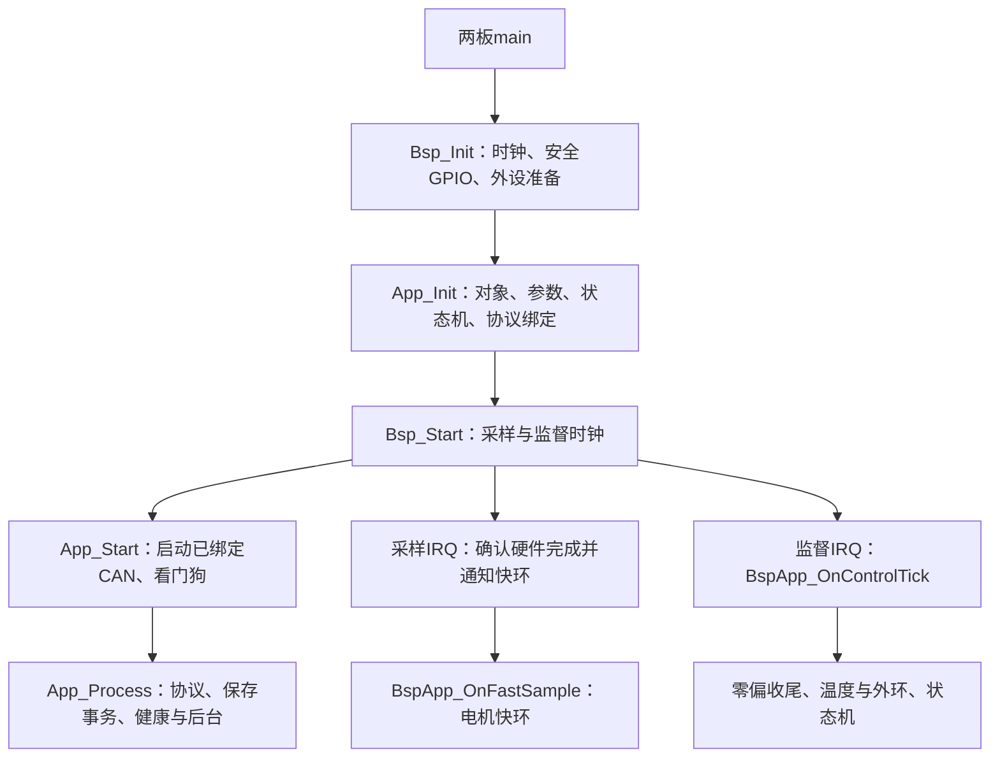

# BSP逻辑、文件与依赖架构 v1

当前范围：保留PWM、ADC、Encoder（SPI）、CAN与Flash及必要系统支撑。LED、UART已删除，
不保留接口、占位实现或工程引用。见[删除记录](../plans/active/2026-10-30-remove-led-uart-v1.md)。

本页是当前BSP文件和职责的唯一总图。公开函数、单位和错误契约见[BSP接口](bsp_interfaces_v1.md)与[头文件包](bsp_api_v1/README.md)。
本阶段只做离线整理、编译和回归；统一实机验收后置，不把构建通过写成台架通过。
前一阶段离线验收已完成，源码快照、九工程构建及回归证据见[验收报告](../reports/2026-10/bsp_architecture_offline_20261026.md)。
后续私有头合并及直接查询调整见[本轮报告](../reports/2026-10/bsp_private_headers_20261026.md)。
最新MCU目录命名、职责与测试残留清理见[整理报告](../reports/2026-10/at32_bsp_cleanup_20261026.md)，本次未烧录。

当前分层以[全BSP硬件边界核对](../plans/active/2026-10-30-bsp-hardware-boundary-audit-v1.md)为准：
ADC/PWM的换算和全部硬件实现均归对应MCU；BSP保留统一声明，本轮未测试或编译。

## 设计边界

BSP向应用提供功能，而非向应用复刻厂商HAL：电流/模拟量、三相PWM、编码器、CAN、存储与系统服务。
MCU内部初始化覆盖实际使用的时钟、看门狗、ADC、GPIO、PWM/TIMER、SPI/DMA、CAN和Flash。
同一套功能接口、数据单位、错误语义和使能规则适用于两板。差异只落在板配置、MCU操作和真实器件协议。
include只有8个功能头，BootHw_Init及台架单相PWM声明不对应用公开。
bsp_internal.h位于BSP根目录，只合并必要跨文件声明，不含函数实现、可变状态定义或板配置值；单文件辅助函数保持static。
不设运行时驱动注册表，不要求每块板拥有相同数量的私有文件，也不为没有的硬件造空驱动。

```text
firmware/platform/
├─ bsp/
│  ├─ include/
│  │  ├─ boot_hw.h
│  │  ├─ bsp.h
│  │  ├─ bsp_adc.h
│  │  ├─ bsp_can.h
│  │  ├─ bsp_encoder.h
│  │  ├─ bsp_flash.h
│  │  ├─ bsp_pwm.h
│  │  ├─ bsp_system.h
│  ├─ bsp_internal.h
│  ├─ mcu/at32f456/
│  │  ├─ at32f45x_conf.h
│  │  ├─ boot.c
│  │  ├─ can.c
│  │  ├─ encoder_spi.c
│  │  ├─ flash.c
│  │  ├─ pwm.c
│  │  ├─ adc.c
│  │  ├─ system.c
│  ├─ mcu/stm32g4/
│  │  ├─ boot_hw_stm32g4.c
│  │  ├─ boot_hw_unavailable.c
│  │  ├─ can.c
│  │  ├─ encoder_spi.c
│  │  ├─ flash.c
│  │  ├─ generated/Core/{Inc,Src}/  原生成外设初始化与IRQ
│  │  ├─ pwm.c
│  │  ├─ adc.c
│  │  ├─ system.c
├─ devices/                    器件协议，与bsp同级
├─ config/
│  ├─ bsp_config.h
│  ├─ sampling_scale.h
│  └─ boards/{at32f456,stm32g4}.h
└─ sdk/                         厂商原始目录，保持各自格式
```

以下表格中include、mcu和bsp_*.c相对于bsp；devices相对于platform。

## 每组文件负责什么

| 文件/模块 | 唯一职责 | 不放在这里的内容 |
| --- | --- | --- |
| include/bsp.h | 初始化/启动与应用事件声明 | 电机对象、协议处理器 |
| include/bsp_system.h；mcu/*/system.c | 毫秒时间、同步原语、UID、看门狗及启动顺序、IRQ接线 | 电机状态转换 |
| mcu/at32f456/system.c | 系统时钟、时基、看门狗、初始化顺序；APP与台架复用 | PWM引脚表和ADC私有状态 |
| mcu/at32f456/adc.c | ADC初始化、DMA、触发启停、原码读取、IRQ及内部量校准 | 电机逻辑、故障及Flash恢复状态 |
| mcu/stm32g4/adc.c | ADC初始化、触发启停、原码读取、HAL回调及内部量校准 | 电机逻辑、采样缓存或存储状态 |
| include/bsp_encoder.h | 统一Begin/ReadAngle声明和65536计数域 | 板型分支、厂商类型、状态码 |
| mcu/*/encoder_spi.c | 各板初始化、GPIO/SPI/DMA读写及启停，直接实现统一接口 | 事务状态、CRC/超时、诊断缓存 |
| mcu/at32f456/pwm.c | 初始化GPIO/TMR1、读周期、写比较值、启停和通道查询 | 电机逻辑、软件状态或保护 |
| mcu/stm32g4/pwm.c | 初始化TIM1、读周期、写比较值、启停和通道查询 | 电机逻辑、软件状态或保护 |
| mcu/*/can.c | CAN初始化、寄存器收发、启停和接收IRQ，直接实现统一BspCan接口 | 协议队列、票据、超时和恢复状态 |
| bsp_internal.h；mcu/*/flash.c | 范围/别名检查、关相核对、暂停采样、擦写/读回和恢复 | 参数格式、修订号和保存请求去重 |
| include/boot_hw.h；mcu/*/boot*.c | 现有APP/Loader交接；不可用板明确报告 | 将Loader实现并入APP |
| at32f456/at32f45x_conf.h | 厂商驱动模块选择 | 应用模式 |
| stm32g4/generated | 原生成外设设置，手工改动仅在USER CODE区 | 公共算法和应用对象 |

AT32 ADC不再提供Adc_IsHealthy；采样完整性只由完成标志决定，不承担故障保护。
两板ADC/PWM统一数值与直接写入接口；BspPwm_ArePhasesDisabled直接读取各板映射的通道位。

AT32 前缀用于板级配置常量，不再定义另一套APP可调用的采样、PWM、编码器或CAN接口。
AT32系统先配置时钟，再由单个McuPwm_Init初始化PWM引脚和TMR1；原PreparePins/ConnectPins入口删除。
两板ADC初始化、读数、换算、零偏、启停与IRQ均在MCU层。
Flash直接调用Adc_Stop/Start，不保留ADC存储状态机。

## 配置的三种含义

| 位置 | 内容 | 例子 |
| --- | --- | --- |
| config/boards | 物理接线、器件、采样比例、时钟、已实现能力 | 分流电阻、放大倍数、PWM通道、编码器型号 |
| config/board_config.h、sampling_scale.h | 板选择、能力/使能一致性检查、物理换算派生 | 不能使能不存在的传感器；原码到A/V |
| config/application | 产品功能选择、控制周期、应用限流、测试许可 | current_sense_limits.h、pwm_output_config.h、targets/* |

BSP_SUPPORTED表示确有硬件实现；BSP_ENABLED表示本次构建使用；BSP_REQUIRED是应用准入要求。
关闭可选功能时同名入口仍存在，返回未支持或无效结果，不伪造成功；完整电机APP不能关闭自身必需的相电流/PWM等依赖。
当前硬件版本采样没有资源绑定，保持未支持。三相电压没有采样电路，已从接口删除。

AT32 PWM不再使用BSP_PWM_HARD_LOCK；Enable直接写输出位。Off/限时目标的原应用约束仍由应用负责，不能表述为PWM硬件锁。
限时窗口只在app/runtime/pwm_power_window.c拥有状态；BSP不包含pwm_output_config.h，也不认识窗口期限。
控制周期由app/config/control_config.h给出构建期时基，MCU据此配置定时器；这是纯数值输入，不是调用应用逻辑。
板卡配置选择配套的软件电流策略头；应用配置提供命令、标定电流上限和软件过流阈值，并由 `config/application_config.h` 校验和引用。这些策略不从传感器量程自动放宽。

## 启动与运行顺序



失败路径先保持/确认关相，停止后续启动。重复Init/Start不重置正在运行的状态。
Bsp_Init只初始化硬件；控制器绑定完成之前不把接收事件交给业务。
BootHw在早期只初始化一次，应用后续使用只读IsAvailable，不重写VTOR或重置试运行时间。

### 采样与零偏

1. PWM硬件事件触发采样；两板由MCU处理完成事件和寄存器读取。
2. 两板读取直接返回数值，不保存快帧、序号、时间或有效位。
3. 快环以相同调用读取电压和三相电流，测量搬运函数接收数值。
   原20k帧整数累加域不变，满校零窗口后冻结。
4. 2kHz监督计算均值并复核原范围、关相条件，短临界区发布三相偏置和完成标志。
5. AT32未设置零偏时电流按公式为NAN；BSP不检查标定资格，应用保持已有校零流程。

AT32母线电流来自同PWM触发的ADC2注入采样；STM32无独立传感器时保持对应有效位为零。
AT32的NTC和内部温度/VREF直接读取DMA，没有采样序号或有效位。

两个AT32 APP采用相同SRAM快环布局，CAN收发事务及其SDK实现也在SRAM执行，
避免其屏蔽中断期间的Flash等待挤占PWM提交窗口。启动所需代码保留在Flash；
这属于应用链接配置，不新增BSP转发层、不修改SDK源码或放宽硬件保护。
历史时序见[AT32关相实测](../reports/2026-10/bsp_private_at32_hil_20261026.md)，不代表本轮ADC简化已验证。

### PWM、故障与许可

两板PWM写入接口为void；各MCU直接换算占空比并操作寄存器，不校验占空比、不检查提交窗口、不锁存故障、
不验证启停结果，也不返回状态结构或关相序号。三相比较值是三个独立写入，不保证跨更新事件整体生效。
两板PWM均只提供直接操作。应用现有运行/测试窗口由原所有者保留，不往其它层新增PWM保护。
限时窗口观察当前通道是否关闭，不能发现两次观察之间发生的关闭再开启。
本轮实现尚未运行测试、编译或硬件验证，见[PWM硬件与逻辑分离v2](../plans/active/2026-10-30-pwm-hardware-boundary-v2.md)。

### 编码器与通信

两板编码器使用相同Begin/ReadAngle接口，均直接返回65536计数域；MT6835 DMA和TLE5012B换向仅在BSP内部。
没有事务所有者、阶段码、CRC或器件状态检查，方向、LUT和速度估计仍归motor/feedback。
两板CAN共用公开头，DLC换算直接放入各MCU收发实现。
各MCU的can.c直接实现BspCan收发、启动、硬件忙/完成查询及RX通知；工程选择MCU源。
收发返回bool，忙/完成查询直接读硬件；没有软件票据、故障锁存、超时或自动恢复。
协议层已有的队列和升级握手继续持有业务状态；升级回复实际发送完成前不发送下一帧。
STM32与AT32均只允许一帧在途，不再保留旧接口分支。
见[CAN硬件与逻辑分离v2](../plans/active/2026-10-30-can-hardware-boundary-v2.md)。

### 保存事务

应用确认保存会话、去重、参数schema和修订号；BSP确认存储范围、实际关相、硬件忙以及采样暂停/恢复。
失败后BSP锁存输出故障并保持关相，应用记录保存失败。Flash操作不更新协议/电机对象，不恢复电机输出。

## 审查与验收

离线验收检查公共头自包含、完整API、无反向硬件依赖、项目源文件唯一、原数值及错误路径等价、双板构建及资源/热段。
已有原生测试覆盖两板SPI、ADC、PWM实际寄存器/HAL路径以及配置禁用和错误场景；目录看起来整齐不算验收。
单板实测最后统一进行：上电零偏、采样/编码器时序、关相状态、CAN读写边界与参数保持；不自动扩展到启相或转动。
当前台架存在未完成下载，继续保持暂停和关相；整理后的候选通过离线检查后再单独完成可靠下载与实测。
