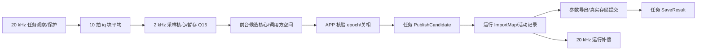

# 齿槽核心、标定任务与运行边界 v2

日期：2026-10-08。本页描述实际生产所有者；公开 `FocCogging_*` 入口及记录布局保持。

| 所有者 | 显式输入 → 输出 | 唯一可写状态 / 执行上下文 |
| --- | --- | --- |
| `cogging_calibration` | 位置 rad、连续速度 rad/s、块平均 iq A、饱和事实 → 点资格、双向 int16 Q15 表及结束原因 | 调用方 `CoggingCalibration` 对象；2 kHz，不读 FOC/电机全局、不访问 I/O |
| `cogging_map` | Q15 表、满量程 A、编码器身份 → 去均值/舍入的 CQG1 记录、签名/CRC/有效性 | 调用方候选记录；有界纯计算，成表/CRC 仅前台；1024 点/2064 B ABI 保持 |
| `foc_cogging_calibration` | FOC/编码器/电机事实 → 20 kHz 安全门/块平均、2 kHz 核心推进与保持控制、PREPARED/RUNNING/FINALIZE/FAILED | 暂存采样对象、斜坡/PI 配套状态、认领/取消/保存挂起标志；不持有活动表或运行补偿状态 |
| `foc_cogging_runtime` | 当前运行事实、补偿请求、完整记录 → 总 iq A、guard 跳闸和同拍遥测 | 活动 `s_cogging_map`、补偿台账/请求、torque guard/握手/计数；前台准入与20 kHz 应用，不读标定状态 |
| 既有 `cogging_compensation` | 准入事实/身份、角度 Q15、指令/限值 A、tick s → 插值/渐变/总限流 | 既有控制对象及私有准入身份缓存；只由运行适配调用，既有接口/布局/数学不变 |
| APP 维护/主状态机/MotorAxis/参数服务 | 功能结果、epoch、真实关相/资源事实 → 功率许可、取消、工作区借还、真实存储提交 | 唯一生命周期与存储所有者；本轮不修改这些模块 |

保持控制仍在任务：既有速度斜坡、迟滞测速、阻尼与 PI 运算顺序保持；采样核心只接收
事实，不接收完整 FOC 或电机运行对象。启动预载及终态清理保留上一批实现，实际启相/
停相由 APP 结果消费者执行；任务不拥有功率许可或 Flash。

候选借用期间由任务认领/取消标志约束构建/发布，APP 仍在同一短临界区复核 epoch、
无故障和关相。发布用已有 `ImportMap` 完整值复制交给运行所有者，随后置保存挂起；
运行模块看不到标定阶段。发布不表示保存，取消不能回滚已发布 RAM，工作区必须由 APP
真实归还；`SaveResult(true)` 仍只对应有效认领下真实存储提交。

旧 `foc_cogging_calibration.h` 包含运行声明以保留调用方兼容，新运行实现只包含
`foc_cogging_runtime.h`，不依赖采样状态机。运行/补偿头只依赖记录值类型；无第二生命周期。
活动表、补偿和 guard 变量名保持；原 Keil 配置未改，新增源登记交 ROOT 应用。

调用/删除/工程输入与验收见[报告](../reports/2026-10/cogging_core_decoupling_20261008.md)，
目标与回退见[计划](../plans/completed/2026-10-08-cogging-core-decoupling-v2.md)。
