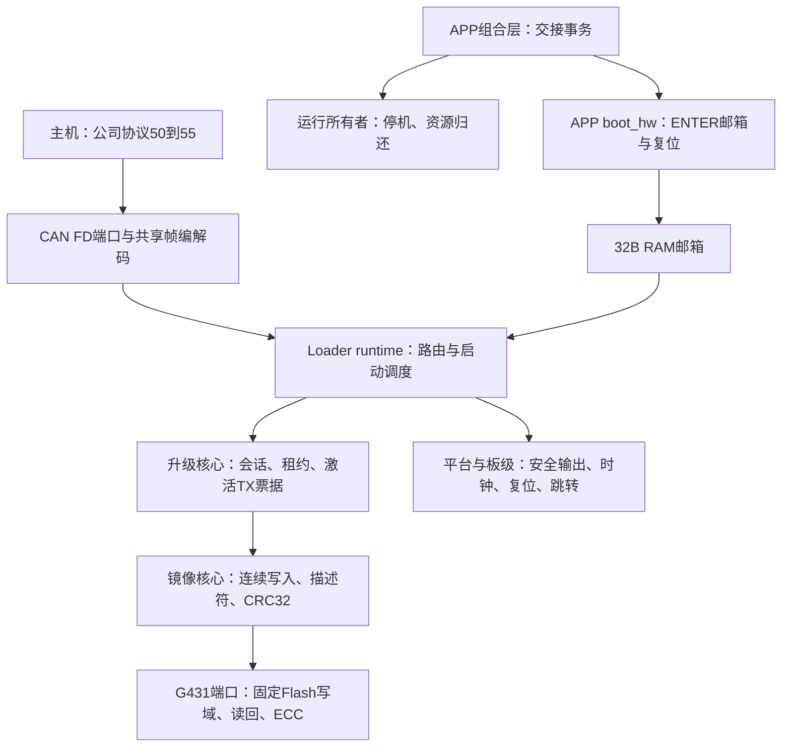
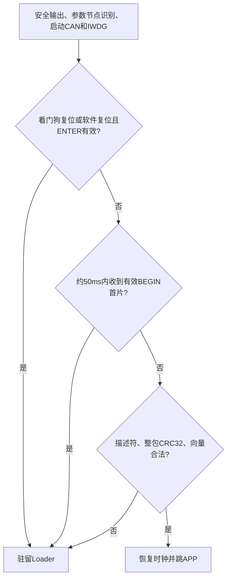
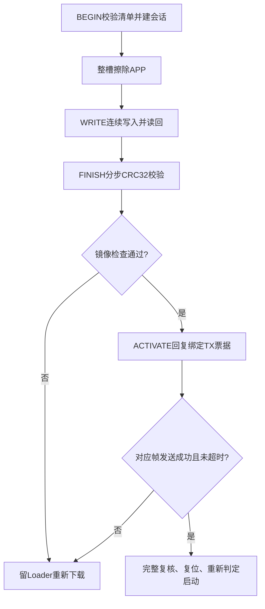
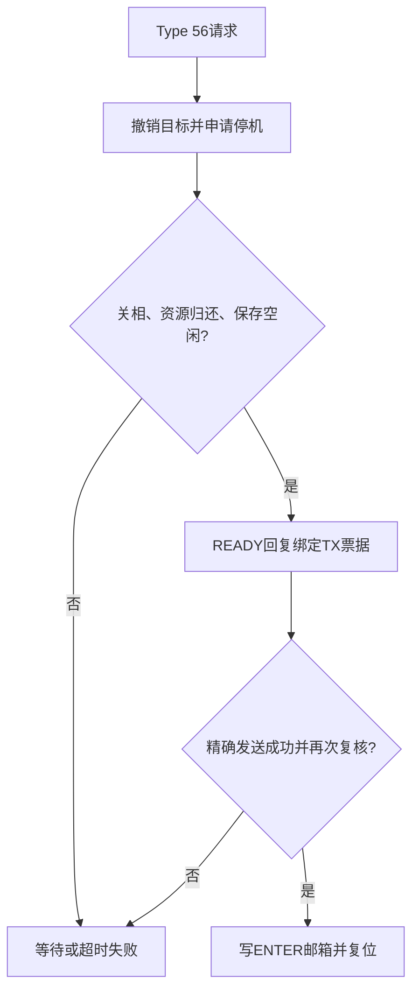

# Loader 独立产品设计与实现 v2（简化候选）

版本日期：2026-09-28。本文按 codex/capacity-fit 的简化提交 95f1aa0a 更新，比较基线 abc3b45a。
文件名保留为现有文档入口。审查发现已完成源码修复，当前仍为**待发布验收的候选实现**。
发现、修复顺序与离线证据见[简化审查记录 v1](../../plans/active/2026-09-28-loader-simplification-review-v1.md)。

## 设计目标与本次取舍

目标是独立 Loader、APP、参数三段布局：通过 CAN FD 接收 APP，限制 Flash 写入范围，
跳转前检查完整镜像，APP 在安全停机和精确回复发送完成后交出控制权。
硬件细节位于端口与板级，升级核心不依赖电机运行态、HAL 或 MCU 寄存器。

本次删除 boot 双页日志、镜像记录页、SHA256、试运行确认及首次 boot 供应工具，
改为 RAM ENTER 邮箱与 CRC32 校验。相对上一版 20KiB Loader + 86KiB APP，为 APP 释放 6KiB，
形成 92KiB APP 槽；这是分区变化，不等于已测得同等代码缩减。
原先就没有旧 APP 自动回滚；本次进一步取消未确认 APP 的持久救援判定与跨复位启动号隔离。
这属于功能取舍，不能称为行为等价简化。

## 软件框图与所有权

- loader/runtime/main.c 独占产品调度；loader/core/upgrade.c 独占升级事务与租约。
- shared/image/image_transfer.c 通过 Flash 回调擦写 APP、校验向量和描述符，当前不再由 APP 调用。
- shared/protocol 保留单份纯编解码；Loader 不链接 APP 路由或电机运行态。
- loader/ports/stm32g4 拥有 CAN、Flash/ECC、时钟和跳转；板级拥有引脚与安全初始化。
- APP 交接事务从独立 boot_handoff 服务移入 firmware/app/board_config.c，
  通过 BootEntryService 绑定通信层、通过运行所有者核对停机。
- 无 USB 或 UART 升级实现。UART 仍为后续传输适配，不能登记为已支持能力。

## Flash 与 RAM

唯一几何输入为 shared/targets/vector_mini_st_g431.json，当前目标 STM32G431CBUx。

| 区域 | 起始地址 | 大小 | 权限与用途 |
| --- | --- | --- | --- |
| Loader | 0x08000000 | 20KiB / 20480B | 离线安装；线上不可擦写 |
| APP 单槽 | 0x08005000 | 92KiB / 94208B | Loader 整槽擦除、连续 8B 单元写入 |
| raw11 参数区 | 0x0801C000 | 16KiB / 16384B | Loader 只读，APP 参数服务负责写入 |
| 普通 RAM | 0x20000000 | 32736B 上限 | 各镜像的数据、栈、堆合计 |
| ENTER 邮箱 | 0x20007FE0 | 32B | APP 写、Loader 一次性读并清除 |

APP 向量在槽首，描述符位于 0x08005200、固定 64B，代码区从 0x08005240 开始。
旧 0x08006800 或 0x08008800 布局镜像不可直接使用；standalone APP 是另一独立构建目标。
旧 boot/record 地址已归 APP，部署时必须按配套布局安装 Loader 与打包后的 APP。

Loader 栈预留 3072B、堆 512B，当前不动态分配；CAN 软件环 8 槽（可用 7），
TX 票据 3 槽，协议重组缓冲 146B。完整 ROM/RAM、加载跨度和栈峰值须以新 map 验收；
当前修复的构建、测试与资源证据统一记录在审查计划末尾；历史产物不能代替当前验证。

2026-09-28 修复后 Keil 离线重建：Loader 加载跨度 13,520B，静态 RAM（含预留栈/堆）4,952B；
配套 APP map 的保守未压缩跨度 91,032B，RW/ZI 31,616B，普通 RAM 余 1,120B。
APP 链接 BIN 90,580B，打包后 90,584B，槽余 3,624B；压缩 RW 与固定段间隙使数值不同。
上述静态结果不证明最坏中断栈峰值，RAM 余量仍须实测；不是正式发布验收。

TARGET_HARDWARE=1 是历史 identity.hardware=1 沿用的镜像硬件兼容 profile，
来源为提交 0f617a5af4e2043793e2f724778e6ca8fb6443b2 的历史目标配置。
它不是实测 PCB revision；设备信息缺少权威板卡数据时应报告未知。

## 启动与升级流程

拆为三个短图，分别说明启动、下载与 APP 交接。

### 启动判定

邮箱仅在符合软件复位来源时强制驻留，掉电后不依赖 RAM 邮箱。
参数空白或不可信时采用救援节点 1；当前不以参数识别结果限制跳 APP，
完整参数合法性与电机准入仍由 APP 自身负责。
IWDG/WWDG 复位单独驻留救援，不重跳同一故障 APP；掉电/选项字节/低功耗来源不套用此判断。
不能把所有软件复位都视为故障：正常 ACTIVATE 复位仍需启动 APP。

### 下载与激活

WRITE 接受 8..128B、8B 对齐连续偏移；相同已写内容只比较，不重复编程。
失败后不得向已编程或不确定 ECC 单元补写，应重新整槽下载。
租约 5s、激活回复期限 500ms；仅对应物理 TX 成功事件能触发复位，入队或 FIFO 空不能替代。

当前没有持久激活标记：**完整镜像在 FINISH/ACTIVATE 前就可能满足冷启动检查**。
完整写入后掉电再上电可能运行该镜像，ACTIVATE 不再是跨复位唯一启动门槛。
若保留这一门槛，可将一个 8B 启动有效单元留至激活时最后写入；需另行定义版本、CRC、
ECC 写入及掉电规则，不能原位改写已编程单元。此方案当前未实现。

### APP 安全交接

期限 1s；READY 表示具备交接条件，不表示已复位。失败后继续保持停机所有权，
不自动恢复旧运动目标。内部票据采用 v2 主机提供的非零随机 nonce，
不代表旧版设备可信启动身份；主机每个新事务产生新值，同事务重试保持它。

BootHw_Init 按实际链接向量地址识别偏移 APP 并设置 VTOR，不再核对邮箱、镜像或持久记录；
它只能判断布局，不能证明由某个 Loader 版本实际启动。
APP 组合层每 100ms 调用 BootHw_Watchdog：要求 2kHz 所有者已完成新监督拍、
基础采样新鲜、未 FATAL、通信初始化成功、协议链路就绪和本地 CAN 健康。
所有者只读接口不授权运动或 Flash；不要求主机在线，监督停滞和采样失效停止喂狗。

## 邮箱、镜像与协议兼容性

RAM 邮箱当前为 v4、32B、小端：magic、version、ENTER、node 各 4B，12B 保留零，
末 4B 为前 28B 的 CRC32。不携带 token/epoch/TRIAL/NORMAL。APP 最后发布 magic 并读回，
Loader 读后立即清零。APP 写本机节点，Loader 仍以参数读取的本机节点为权威，
尚不消费邮箱 node；该字段仅保留交接来源，不作为节点配置或权限。

镜像仍为 96B 清单和 64B 描述符，大端字段，当前候选规则如下。

| 对象 | 字节偏移 | 含义 |
| --- | --- | --- |
| 清单 | 48..51 | 镜像 CRC32 |
| 清单 | 52..95 | 全零 |
| 描述符 | 44..47 | 含 8B 补齐的镜像长度 |
| 描述符 | 48..51 | 镜像 CRC32 |
| 描述符 | 52..63 | 全零 |

CRC32 使用反射多项式 0xEDB88320、初值与末异或 0xFFFFFFFF。
覆盖完整补齐镜像，描述符 CRC 字段按零参与，长度字段参与计算。
它检查偶发损坏，不提供签名、发布者认证或恶意篡改防护。

package_image.py 现在补齐并回填长度/CRC，输出 image.bin 和 manifest.bin。
用于升级或偏移 APP 安装的是**打包后的 image.bin**；原始链接 BIN/HEX 中占位字段为零，
不满足启动判据，不能直接作为部署包。

当前 YGI_PROFILE=0x53593449、描述符版本 2、TARGET_LAYOUT=4、包格式 loader-image-v2-crc32。
旧 profile/布局/描述符版本和维护 role=2 显式拒绝；打包、C 解码和协议使用同一黄金镜像。

Type 50..55 字节布局沿用公司载荷 v1，升级语义明确版本化为
[载荷 v2](../../protocols/yg_protocol_upgrade_wire_v2.md)：回复 flags bit2=HOST_NONCE，
空 STATUS 可返回 boot_epoch=0，主机新建非零随机 nonce，成功 BEGIN 后绑定并回显。
活动 BEGIN 必须同时匹配 source、nonce、完整清单；跨复位 session/ticket 计数不持久保存。
旧 v1 主机发现设备启动号的流程不兼容，须配套适配，不能宣称持久报文隔离或防恶意重放。

## 掉电、故障 APP 与参数权限

| 情况 | 当前行为 | 边界 |
| --- | --- | --- |
| BEGIN 受理但尚未擦除时掉电 | 旧 APP 若仍完整可再次启动 | 无持久事务标志 |
| 擦除或部分写入后掉电 | 描述符/CRC/向量不合法则留 Loader | 重新整包下载，无跨复位续传 |
| 写完整但未 FINISH/ACTIVATE 就掉电 | 新镜像通过检查即可启动 | 无持久激活门槛 |
| CRC 正确但 APP 卡死、采样停滞或不喂狗 | 看门狗复位后驻留 Loader | 无旧镜像自动回滚 |
| APP 本地 CAN 故障 | 健康喂狗条件失败，超时后驻留 | 实际超时及恢复矩阵待实测 |
| APP 业务通信坏但基础健康仍全部成立 | 复位后利用约 50ms BEGIN 窗口救援 | 不能保证业务级故障均触发看门狗 |
| Loader 被离线误刷或启动入口破坏 | 线上升级不能恢复 | 需 SWD 等离线恢复 |

看门狗驻留策略已实现并通过真实 runtime 的离线复位模型；实机复位标志归属仍待台架验收。
Flash 端口补齐全部 SR 错误位、1s 软件等待上限、写前失败退出、双字写屏障和缓存恢复。
单 bank Flash 停顿若使 CPU 无法继续取指，软件计时不能保证执行，此时依靠 IWDG 兜底；
软件桩测试不能替代真实掉电/ECC/写擦时序验证。

参数保留现有 4304B raw11 记录与完整 16KiB 区域；Loader 只识别外形和节点，
不提供参数或任意地址擦写。SN、类型字段和权限服务未在此批新增，不能宣称已实现。
参数合法性、校准和电机使能由 APP 所有者负责。
本轮只支持普通 APP，打包器、清单、描述符和构建宏均拒绝维护 role=2；
未来恢复维护镜像时必须单独实现可靠的角色来源与禁止运动契约。

## 更换 MCU 与后续验收

新 MCU 增加目标配置、端口与板级安全实现，内核不添加型号分支。
核对 Flash/RAM、擦除页、编程/ECC 单位、异常与复位来源、CAN 精确 TX 完成及时基。
当前逻辑仅支持 8B 写单元，16B 硬件单元不能伪装成可独立 8B 补写。
UART 后续适配应复用会话和镜像层，并定义准确发送完成与链路错误契约。

本轮修复覆盖升级内核、真实 runtime 启动路径、监督所有者、APP 喂狗调度、Flash 等待和实际打包 CLI。
具体 PR/release、Keil 构建及资源结果见[修复验收记录](../../plans/active/2026-09-28-loader-simplification-review-v1.md)。
尚未烧录、CAN/J-Link 或电机操作，不把离线模型当作实机通过。

发布前闭合仓库 PR/release 门禁，完成明确授权的掉电、故障 APP、ECC、CAN FD 测试。
按用户选择，后续硬件测试结束恢复测试前固件和**完整原参数**，保留校准和空 SN；
读回比对备份，不能确认输出关闭或恢复状态时停止测试。
