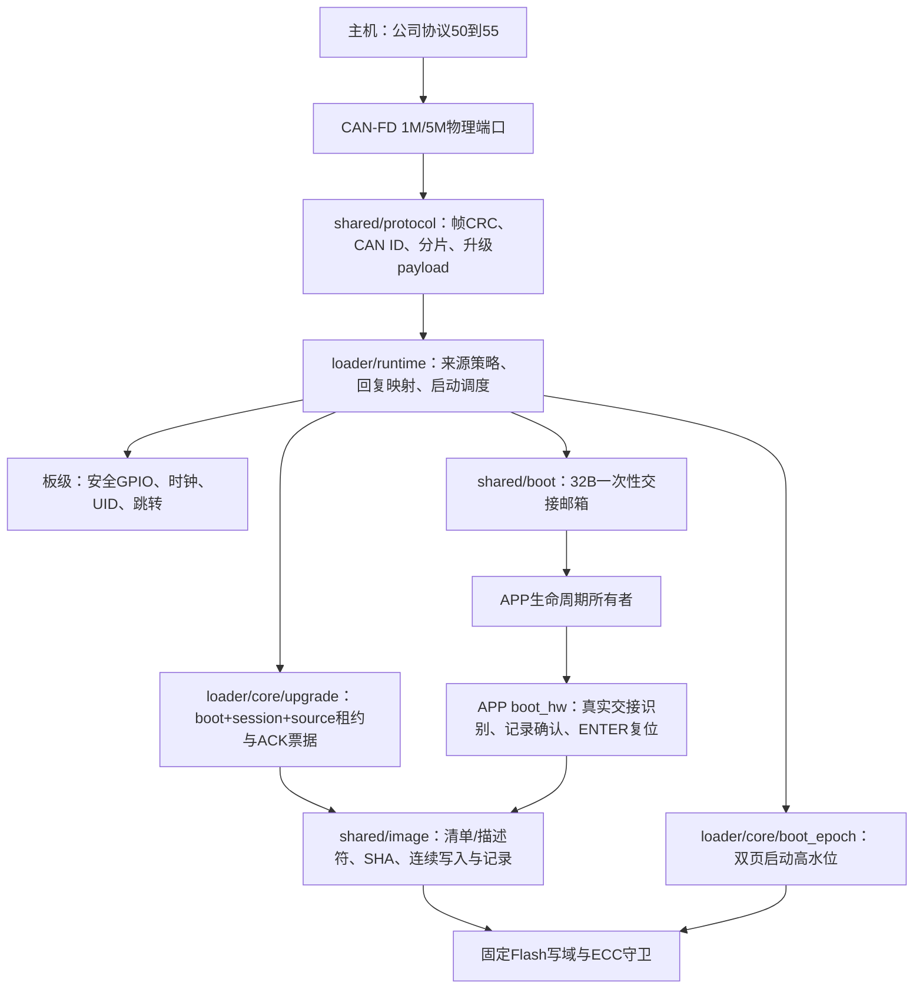

# Loader 独立产品实现 v1

版本日期：2026-09-28。状态：源码已实现、集成中；本轮按用户要求不构建、不测试、不操作硬件。
本文描述当前代码，不把历史报告或设计预算当作本次验收。首次实际目标为STM32G431CBUx。

## 软件框图与所有权

- Loader前台独占升级状态。ISR每次最多搬3个CAN帧，不做CRC、擦写、复位或电机控制。
- `shared/protocol`由H维护；APP与Loader共用单份纯codec，Loader不链接APP router/runtime。
- `shared/image`有两个真实调用方：Loader接收/启动，APP完整身份校验与trial确认。所有Flash经回调，
  不包含HAL、地址常量或GPIO。当前镜像profile要求8B写单元和schema11，不宣称任意MCU无需适配。
- `loader/ports/stm32g4`拥有CAN寄存器、Flash写域/ECC、时钟和跳转；`boards/vector_mini_st`拥有引脚与时钟。
- 无USB、CLI或UART实现，也不承载旧YI/Y3/B1线上格式。UART是后续传输适配，不能标为已交付能力。

## Flash与RAM

几何的唯一输入为 `shared/targets/vector_mini_st_g431.json`；生成共享头、Loader/APP scatter和独立Keil工程。

| 区域 | 起始地址 | 大小 | 写者/用途 |
| --- | --- | --- | --- |
| Loader | 0x08000000 | 28KiB | 离线安装；线上不可写 |
| boot双页 | 0x08007000 | 4KiB | Loader分配启动号；UID绑定、双页持久见证 |
| 镜像记录 | 0x08008000 | 2KiB | Loader提交/标记试启动；APP仅能写确认 |
| APP单槽 | 0x08008800 | 78KiB | Loader整槽擦除、顺序写入 |
| raw11参数保留区 | 0x0801C000 | 16KiB | 保留现有4304B参数；Loader只读 |
| 普通RAM | 0x20000000 | 32736B上限 | 各独立镜像的数据、栈、堆合计 |
| 交接邮箱 | 0x20007FE0 | 32B | APP/Loader共同保留；不被启动清零或普通RAM分配 |

APP向量位于槽首，描述符位于APP+0x200、固定64B，代码从APP+0x240开始。
链接文件对槽与RAM上限给出硬限制。Loader复用ST启动汇编的3072B栈/512B堆预留；当前代码不动态分配。
CAN软件环8个物理帧槽（环算法可用7个），3个TX票据槽；协议重组缓冲146B。其余C结构大小/链接填充、
调用栈峰值及真实ROM/RAM必须由后续map和统一测试给出，不能将缓冲相加视为全部RAM。

固定基线a174e00既有摘要为APP ROM98980B、RAM32608B。ROM比78KiB槽多19108B；该数值不是
重构后结果。当前布局**尚未证明容纳完整APP**，不能生成或声称存在可发布的组合固件。
后续统一构建若仍超限，应由总工调整实际功能/布局，不能截断固件、缩减标定区或虚报尺寸。

## 升级与故障流程

1. 冷启动先将六路门极输出拉低；确认G431 DEV_ID=0x468、Flash=128KiB，启动IWDG。
2. 消费并清除邮箱；识别raw11外形和CAN节点。参数不可信时用登记的救援节点1，不改参数。
3. 从双页分配本次boot epoch。双页历史未知或损坏则只允许诊断回复，不猜floor或自动格式化。
4. CAN启动后开放50ms等待窗口。有效主站2的BEGIN首片使Loader驻留，避免分片期间跳APP。
   有效软件复位ENTER也强制驻留；否则校验持久镜像和参数外形后尝试启动一次。
5. BEGIN完整校验96B清单，分配本次session；逐页先擦镜像记录再擦APP。正常参数区从不参与擦除。
6. WRITE仅接受8..128B、8B对齐连续偏移；每8B写后读回。重复偏移只比较，内容不同拒绝，
   不对已经写过或失败的ECC单元补写。FINISH逐64B计算SHA并验证向量/描述符。
7. ACTIVATE返回ACCEPTED并分配内部u64票据。只在对应物理TX成功、500ms ACK期限与5s租约内，
   重新完整校验镜像、持久提交ready记录，再复核关相/链路并发布START邮箱复位。
8. 首次跳APP前把ready(1)改为attempted(2)。APP自检、通信健康及生命周期准入通过后，
   由唯一owner调用 `BootHw_Confirm` 写confirmed(3)。通信健康采用本机初始化、后台推进和控制器状态，
   不以在线主机往返为前提，支持无主机独立启动。attempted未确认后再复位必驻留救援。

线上seq16只关联回复，不能作为跨分片逻辑消息的去重键；不同WRITE块尾片seq相同合法。
会话身份为source+boot epoch+session，WRITE再校验offset和原数据。超时、bus-off、接收溢出或关相失效
撤销当前会话；bus-off端口不自动复活旧票据，需要复位重新建链。数字关相失败走致命停机。

单槽掉电策略是重新下载：擦除或写入中断后记录无效；试启动标记/确认页改写掉电也可能丢记录。
均留在Loader等待完整重传，**不提供旧镜像自动回滚、跨复位断点续传或签名认证**。
ERROR保留独立的已读回字节计数，供诊断；该值不授予失败后的继续编程权限。

SHA256/CRC用于完整性；公司升级v1回复始终标记INTEGRITY_ONLY。清单和描述符的未知保留位/版本拒绝。
主站地址过滤不是密码认证，不能据此声称有设备授权或抗恶意升级能力。

## APP交接与参数权限

`BootHw_Init`在main最早、HAL_Init/开中断前调用：仅实际 `__Vectors==APP槽起点` 才接触邮箱，
消费本次TRIAL/NORMAL并匹配持久记录状态、token、完整SHA/描述符。只有成功才发布真实boot epoch。
独立APP链接0x08000000时返回不可用；旧记录、固定常量或芯片UID都不能替代本次交接证明。

56的业务值契约为 `shared/boot/loader_entry.h`，线上由H负责。E生命周期owner负责STOP/revoke、
worker归还、save空闲、数字关相与截止。PENDING仅等待；READY必须携带u64内部ACK票据；
通信把对应帧真实完成回传后，E再次复核才调用 `BootHw_EnterLoader`。接口返回READY不表示已经复位。
`BootHw_Confirm`仅授权记录页写入，持久确认前不允许任意循环无限喂继承IWDG；确认后仍由健康监督
显式调用 `BootHw_Watchdog(healthy)`。首次IWDG配置标称约32s，实际期限依赖LSI误差，待实测。
本机健康不能证明端到端通信正确；若坏APP满足本机检查并已确认但协议不能通信，仍需复位并
利用50ms窗口进入Loader重新升级，不能声称所有无法通信的APP都会自动回退。

Loader只识别schema/magic/节点与区域可读性；不替代APP对校准值、类型、物理限值和可使能条件的检查。
首版没有引入SN存储、类型写服务或双STABLE参数日志，不能伪造空SN为已登记。参数读写权限仍归APP服务，
Loader命令不提供任意地址/参数擦写功能；原16KiB保持完整。

## 更换MCU

先确认目标实际Flash/RAM、擦除单位、编程/ECC单位和启动语义，增加目标配置与对应端口/板级实现；
不在升级内核添加型号分支。端口必须提供有界Flash读/整页擦/单位编程及读回、包含Flash停顿的时间、
唯一UID、掉电持久启动号、安全输出状态和精确TX完成。现有profile只支持8B逻辑写单元；若新MCU不能
提供同等掉电/ECC语义，应定义新的目标profile和版本化契约，不能把16B硬件单位伪装为可独立8B补写。
重新生成APP/Loader/主机配置并在后续统一执行同一故障矩阵。当前只实现G431，其他MCU尚未验收。

## 集成与后续验收

- 独立工程：`loader/targets/vector_mini_st_g431/YG2026_ESC_LOADER.uvprojx`；不含APP对象或自动下载配置。
- APP使用生成的 `app.sct`、编入 `shared/targets/vector_mini_st_g431_app_descriptor.c`，显式定义
  `YG_APP_LOADER_IMAGE=1`、`YG_APP_IMAGE_VERSION`（u32）、`YG_APP_IMAGE_ROLE`（1普通/2维护）。
- APP编入 `boot_hw_stm32g4.c`、mailbox及shared/image三个C；E负责上述真实生命周期接点，ROOT负责工程接入。
- `loader/tools/package_image.py`只校验已链接BIN，补FF到8B并把补齐字节计入SHA；不修改描述符或猜地址。
- `loader/tools/provision_boot.py`仅为明确UID/floor/完整备份SHA、且boot双页全FF生成供应数据；
  旧独立APP初次转换有非空boot地址时明确拒绝，须另行审核完整部署，不覆盖旧启动高水位。
- 首次安装、实际升级、断电、故障APP、ECC/NMI归属及32s看门狗链路均未在本轮执行。
- 后续须运行PR/release验证、当前产物哈希核对、CAN1M/5M实际帧/ACK事件测试和掉电矩阵。
  新增纯内存用例源码与黄金字节向量只是待执行输入，不是通过证据。
- 按用户选择，硬件测试结束恢复测试前固件和**完整原参数**，保留校准和空SN；读回比对备份。
  未恢复或不能确认输出关闭必须报失败并停止，不能自动继续试验。
