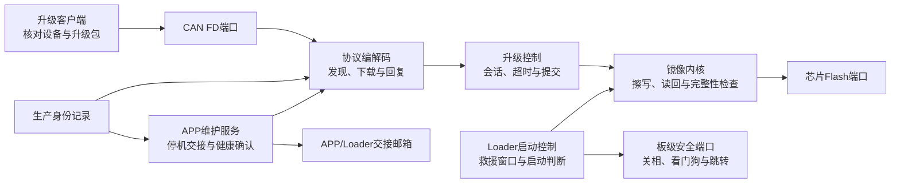
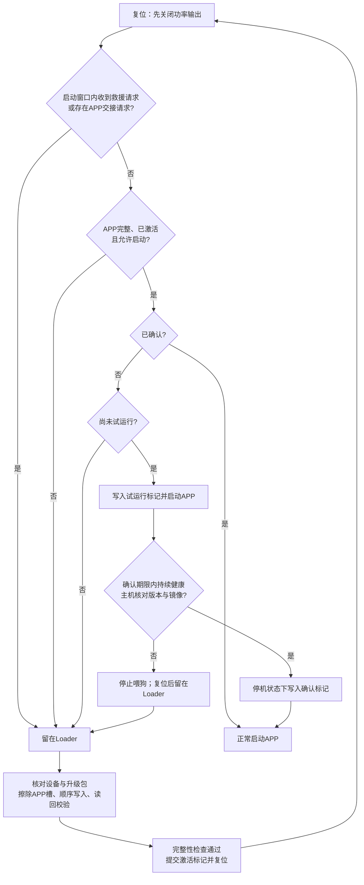

# Loader 设计：启动、升级与存储

更新：2026-10-20。本文说明当前 G431 Loader 设计。实现支持 CAN FD 升级；
UART 和其他 MCU 尚未实现。layout 6 将 Loader 缩为 16 KiB、APP 扩为 96 KiB，
新配套包需重新构建及实机验证，不能复用旧布局的测试结论。

## 设计目标

- 升级期间保持电机功率输出关闭。任何校验、写入或启动条件失败，都不能自动恢复运动。
- 只允许 Loader 改写 APP 槽。校准参数和生产身份独立保存，升级不擦写这两块区域。
- 断电或故障 APP 后仍可进入 Loader 重新下载。当前只有一个 APP 槽，擦除后无法回滚旧 APP。
- 将镜像校验、升级状态和协议规则留在通用代码中；芯片和板级差异由端口及目标配置承担。

USB 不在本设计范围内。通信优先实现 CAN FD；UART 是后续需要新增的传输端口。

## 软件结构

| 代码位置 | 负责什么 | 移植时怎样处理 |
| --- | --- | --- |
| `shared/image`、`shared/boot`、`shared/protocol` | 镜像格式、启动标记、邮箱与通信契约 | 尽量复用；契约变化时先更新版本、文档和测试 |
| `loader/core` | 单次升级事务、会话绑定、提交与超时 | 不接触 HAL、寄存器或板级引脚 |
| `loader/runtime` | 组织启动判断、升级命令和只读设备信息 | 接入目标芯片的端口，核对安全顺序 |
| `loader/ports`、`loader/boards` | Flash、CAN、时钟、看门狗、关相与跳转 | 为新 MCU/板卡重新实现并验证 |
| `shared/targets` 与工程输入 | 分区、擦写几何、版本和链接配置 | 为 Loader 和配套 APP 同时生成并构建 |

通信端口和 Flash 端口是不同边界。新增 UART 不应修改镜像内核；更换 MCU 必须重新检查
Flash 擦写粒度、ECC 行为、启动向量、看门狗和关相实现。若新芯片的编程粒度与当前镜像契约
不一致，需要版本化协议，不能只替换地址常量。

## 启动和升级

正常升级由 APP 先停机，等待参数保存结束，发送交接回复，再通过一次性 RAM 邮箱请求复位
进入 Loader。邮箱只表达“这次复位要进入 Loader”；它不是升级进度、生产身份或永久确认。
如果设备已经在 Loader，客户端先识别设备，再开始下载。

Loader 收到下载请求后检查目标、版本与会话，擦除整个 APP 槽并顺序写入。写入时读回校验；
下载完成还要检查镜像 CRC、描述符和启动向量。只有全部通过，才写入持久激活标记。
受理回复或 CAN 发送成功都不等于升级成功。客户端还需重新识别同一设备上的新 APP，
核对版本和镜像 CRC，发送确认请求，并读回已确认状态。确认过程不使能电机。

APP 首次启动属于试运行。只有健康状态持续满足要求，且输出已关闭、参数保存空闲，APP
才接受主机确认。试运行失败或未确认时停止喂狗；看门狗复位后 Loader 不再尝试自动启动
这个未确认镜像。这里的“确认期限”不是“复位完成时间”，后者取决于看门狗配置和时钟。

| 中断或故障发生的位置 | 下次启动行为 |
| --- | --- |
| 擦除 APP 前 | 原 APP 若仍完整有效，可按正常启动条件运行 |
| 擦除或下载期间 | 镜像不完整，留在 Loader；重新开始完整下载 |
| 激活标记写入期间 | 标记无效或读取失败，留在 Loader；重新下载 |
| 已激活但试运行未确认 | 仅允许一次试运行；随后复位留在 Loader |
| APP 已确认 | 正常按启动条件运行；仍需保持输出默认关闭 |

故障 APP 无法响应交接请求时，客户端在**人工复位前**持续发送只读救援探测，捕获 Loader
的短暂启动窗口。探测本身不擦除 Flash，也不创建下载会话。进入 Loader 后仍须重新核对
设备身份和升级包；客户端不能把超时或回复丢失当作成功，也不控制复位硬件。

## Flash 与 RAM 分配

下表是当前 G431 目标的**分区约定**，不是构建后的实际占用。地址来自
[`shared/targets/vector_mini_st_g431.json`](../../../shared/targets/vector_mini_st_g431.json)；
更换 MCU 时由目标配置和两端链接工程共同调整。

| 区域 | 地址 | 预留容量 | 用途和写入权限 |
| --- | --- | ---: | --- |
| Loader | `0x08000000..0x08003FFF` | 16 KiB | 上电入口；通过受控 SWD 部署，CAN 升级不能改写 |
| APP 槽 | `0x08004000..0x0801BFFF` | 96 KiB | 唯一允许 Loader 擦写的固件区 |
| 校准与用户参数 | `0x0801C000..0x0801F7FF` | 14 KiB | APP 按现有停机和校验规则保存；Loader 只读 |
| 生产身份页 | `0x0801F800..0x0801FFFF` | 2 KiB | 保存电机 SN 和类型；普通 CAN 只读，生产 SWD 写 |
| 普通 RAM | `0x20000000..0x20007FDF` | 32,736 B | APP 和 Loader 各自使用，跳转后不共享普通变量 |
| 交接邮箱 | `0x20007FE0..0x20007FFF` | 32 B | 跨复位传递一次性进入 Loader 请求 |

当前 schema14 参数记录为 2,288 B；14 KiB 参数区中还有 12,048 B 不属于记录。
Flash 每页 2 KiB，该记录覆盖两个页：末页内余 1,808 B，另有五个完整可用页，共 10 KiB。
末页余量不能作为独立擦除区使用。旧版第三页可能残留历史内容，并未自动清空。
生产身份页另外保留，不计入这些余量。

APP 槽内依次放启动向量、镜像描述符和代码。描述符还包含“已激活、已试运行、已确认”
三个独立提交标记；它们与 APP 槽一起擦除，不额外占用参数页。CRC 校验时对这些会变化的
字段按固定规则归一化，避免确认动作改变固件身份。标记只写一次，半写或 ECC 读取失败
均拒绝启动。准确偏移、字节序和 CRC 规则见[升级协议与镜像格式](../../protocols/yg_protocol_upgrade_wire_v3.md)。

### 实际资源占用

以下是 **2026-10-20 紧凑参数配套候选**（源码 `b7067cd8`）的实际占用，
对应 Loader v2.1.0、APP v1.5.0。
Flash 按链接器区域计；RAM 数字包含静态数据及链接器预留的栈/堆，但不代表运行时栈峰值。

| 工程 | Flash 已用 / 分区 | RAM 已用 / 可用 | 当前余量 |
| --- | ---: | ---: | --- |
| Loader | 14,492 / 16,384 B | 4,344 / 32,736 B | Flash 尚余 1,892 B |
| 配套 APP | 80,448 / 98,304 B | 18,576 / 32,736 B | Flash 尚余 17,856 B |

本候选完整 release 验证、SWD 安装及启动检查通过；CAN 适配器未能打开，尚未完成新版本升级。
原始固件和参数已经恢复，见[本轮优化记录](../../reports/2026-10/loader_storage_optimization_20261020.md)。
旧配套正常升级记录见[2026-10-20 实测记录](../../reports/2026-10/loader_layout6_upgrade_20261020.md)。
历史 layout 5 升级结论见[旧包记录](../../reports/2026-09/loader_app_upgrade_bench_20260930.md)。

## 参数与生产权限

| 数据 | 保存位置 | 普通 CAN 权限 | 生产权限 |
| --- | --- | --- | --- |
| 电机 SN、电机类型 | 独立生产身份页 | 可查询，不可改写 | 受控 SWD 工装写入 |
| 电机 CAN ID | 现有参数记录 | 按原有停机、校验和保存规则读写 | 使用受控参数流程 |
| 校准数据与电机模型 | 现有参数记录 | 按已定义接口和状态守卫处理 | 身份工装不改写 |
| MCU UID、固件版本、镜像 CRC | 芯片或配套构建产物 | 可查询，不可通过参数命令改写 | 由芯片或构建决定 |

SN 不等于 MCU UID。SN 或类型未配置、身份记录损坏时，对外报告身份无效，不补造默认值。
电机类型用于追溯，不自动切换控制参数。CAN ID 只保存在参数记录，不在身份页重复保存。

生产身份工具默认只生成离线文件。实际写入需指定设备与探针，先停机、确认输出关闭并备份
Flash；只写身份页，随后读回并核对保护区。失败时保持停机，不自动恢复运动。

## 配套关系与验收

旧布局 Loader 不能接收 layout 6 镜像。首次迁移需通过受控 SWD 同时安装配套 Loader
与新址 APP；之后才能使用 CAN FD 升级同布局 APP。构建工具分别编译两端，并生成
合并 HEX、CAN 包、清单及哈希；离线检查不会连接设备。
具体命令和线上字段见 [Loader 使用说明](../../../loader/README.md)与
[升级协议](../../protocols/yg_protocol_upgrade_wire_v3.md)。

硬件修订号、APP 版本和 Loader 版本统一由共享目标清单配置。构建后，硬件修订号和 APP
版本写入 APP 描述符，Loader 同时固化硬件修订号与自身版本；维护查询按这些镜像信息上报。
它们不占用用户参数记录。当前硬件修订号为编译期指定，尚未从独立板卡记录自动识别。

2026-10-20 已在本板验证从 APP 主动交接 Loader、下载、校验、激活和 APP 持久确认。
实测修正了 READY 回复的队列读写位置；回复到达主机后，仍必须等待对应的真实发送完成
才能交接。测试没有使能电机，结束后恢复原始固件和参数。
同日[连续二十轮正常升级](../../reports/2026-10/loader_repeat20_20261020.md)全部通过，
轮间不通过 SWD 重刷或人工复位帮助通过。

真实断电、Flash ECC 注入、运行中 CAN 错误、故障 APP 救援及栈高水位仍需分别验收；
正常升级通过不能替代这些结果。原板 schema10 参数不会自动迁移；新候选提供带快照哈希核对的离线迁移。

## 本轮紧凑参数候选

APP v1.5.0 / Loader v2.1.0 删除退役齿槽表，参数仍单份，详见
[schema14存储与迁移](../../protocols/parameter_schema14_storage_v1.md)。旧schema12/13只读兼容，
显式保存才写新格式；schema10须离线迁移。布局地址和升级期间不写参数的规则不变。

Loader 改用较小的 C 运行库，未缩减栈或删除安全检查。前面的二十轮实测属于旧配套版本；
新候选的资源、离线和实机结果分别记录在[优化计划](../../plans/active/2026-10-20-loader-storage-optimize-v1.md)。
升级客户端现在拆分发送、等待和重试耗时，发送统计包含外部调试检查，不能当作纯总线速度。
