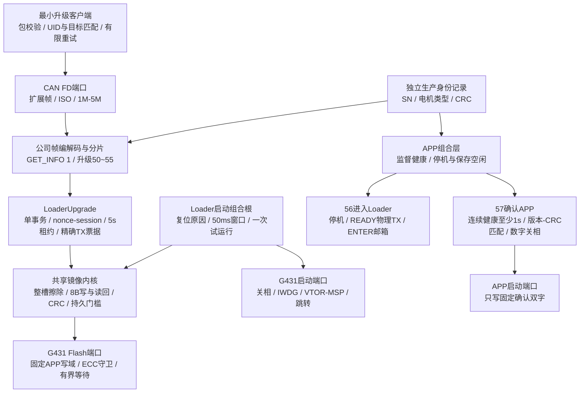
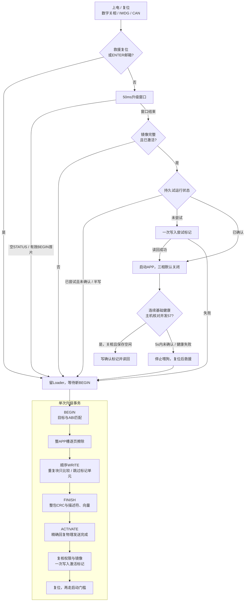

# Loader 软件设计 v3：CAN FD 产品闭环

日期：2026-09-29。本页为当前实现，替代 v2 中“无持久激活、无试运行确认、生产身份未实现”的说明。
升级时没有电机运行权限。仅一个 APP 槽，升级失败后停留 Loader 全擦重传，不承诺恢复旧 APP。
本轮按用户要求仅作代码与离线验证，不连接正在验证 APP 的实机。

## 软件框图与所有者

通用 C 内核只接收显式状态、Flash几何、安全权限与物理端口。它不包含 HAL、引脚、CAN句柄或
MCU条件分支。芯片更换时适配 Loader ports、APP platform ports、启动汇编和目标清单；新的
Flash编程单元若不是8B，需调整镜像契约并版本化，不能仅改一个地址宏宣称支持。
当前仅G431及CAN FD端口已实现；UART与其他MCU仍为后续工作。

## 启动与升级流程

收到 ACTIVATE 的受理回复不代表写标记或启动已经成功。主机随后必须读到相同 UID 的新 APP、
正确版本与CRC，发送57，并重新读到 page1 的已确认状态。任何失败不自动发送使能或继续运动。
如果激活回复丢失，客户端只可通过上述完整核对判定成功，不能根据“CAN发送成功”推测。

故障 APP 无法响应 Type 56 时，`--rescue-window` 在复位前开始反复发送空 Type 53，
捕获 Loader 的 50ms 窗口并让其驻留。空 STATUS 不擦除、不创建下载会话；随后仍需完整
GET_INFO 身份、版本和目标检查。主机不控制复位硬件，本轮只验证此逻辑的离线模型。
正常升级也先短暂探测空 STATUS，防止三页查询期间 Loader 自动跳转造成角色竞态；
APP不响应STATUS时转为正常Type56交接。Type56回复丢失也必须重新识别同UID的配套Loader。

5s是未确认试运行停止喂狗的期限，不能据此宣称5s内已复位。当前继承IWDG配置为
PR=6、RLR=4095；按工程LSI标称32kHz，其超时约32.768s，实际复位时间受LSI和最后喂狗
时刻影响，须实机验收。救援窗口工具应配合明确的人工复位，不能假定10s等待覆盖看门狗复位。

## Flash 与 RAM 分配

| 区域 | 地址范围 | 容量 | 权限与用途 |
| --- | --- | --- | --- |
| Loader | 0x08000000..0x08004FFF | 20KiB | SWD部署，CAN升级不可写 |
| APP槽 | 0x08005000..0x0801BFFF | 92KiB | Loader升级唯一擦写域 |
| 校准/用户参数预留 | 0x0801C000..0x0801F7FF | 14KiB | 当前schema12记录4304B；APP保存，Loader只读 |
| 生产身份页 | 0x0801F800..0x0801FFFF | 2KiB | 独立64B记录，生产SWD写，CAN只读 |
| 普通RAM | 0x20000000..0x20007FDF | 32736B | APP与Loader分别链接，启动后不共享普通RAM |
| ENTER邮箱 | 0x20007FE0..0x20007FFF | 32B | APP→Loader一次性请求，不是持久确认或身份 |

APP向量区512B，描述符96B固定在0x08005200，代码从0x08005260开始。描述符中64、72、80
偏移分别为激活、尝试、确认双字；对应地址0x08005240、0x08005248、0x08005250。
这三个双字随APP槽一起擦除，没有额外启动记录页。保留区域必须为0，提交单元在下载包中必须为FF。
每个提交双字为大端识别字及其逐位反码，任何非完整值或ECC读取失败均拒绝启动。

CRC32按全镜像长度计算，描述符48..51按0，64..87按FF归一化。程序从不对FF提交单元先写FF，
从而保留真实擦除态的ECC单元；重复下载不重复编程。半写单元只能随下一次整槽擦除清除。
参数区边界未移动、schema12与4304B布局不变；APP保存增加独立生产页保护。

当前资源以配套构建MAP和`build_loader_bundle`的`summary.json`为准。不得用ROM/RAM静态总量
推断栈峰值或实时安全余量；普通APP和偏移APP必须分别构建，92KiB容量不能通过截断适配。

2026-09-29离线集成构建的实测值如下；Flash区域按链接器Load Region统计，RAM包含静态
数据及链接器预留的栈/堆。APP初值经链接器压缩后下载BIN较小，不等于可以占用更多链接空间。

| 工程 | Flash链接区域 | 下载BIN | RAM区域 | 分区剩余 |
| --- | ---: | ---: | ---: | --- |
| Loader | 15,100B | 15,100B | 4,952B | Flash 5,380B；RAM 27,784B |
| 配套APP | 93,952B | 93,608B | 31,736B | Flash链接余量256B；RAM 1,000B |

APP下载包到92KiB边界剩余600B，链接余量更小；新增功能前必须重新检查MAP，不能按该600B
估算可增加的代码。上述RAM余量不代表运行时栈峰值已测试。本轮不进行实机时序或栈高水位验收。

## 参数与生产权限

| 内容 | 权威存储/所有者 | 普通CAN读 | 普通CAN写 | 生产写 |
| --- | --- | --- | --- | --- |
| 电机SN | 独立生产身份页 | GET_INFO page1 | 拒绝，无对应参数ID | 明确SWD工装 |
| 电机类型 | 同一生产记录，非零u32型号编码 | page1 | 拒绝 | 明确SWD工装 |
| CAN ID | schema12 node_id，现有参数所有者 | page1 / 参数读取 | 原有停机、校验与保存规则 | 原有受控参数流程 |
| 校准、LUT、模型 | schema12参数所有者 | 已定义的参数接口 | 原有权限与状态守卫 | 不由身份工装改写 |
| MCU UID、版本、布局、CRC | 芯片与配套构建输入 | GET_INFO page0..2 | 拒绝 | 构建或物理芯片决定 |

SN不是MCU UID；未配置或CRC损坏时SN/类型输出0、identity_valid=0，不猜测SN或默认型号。
SN允许1..16位ASCII字母、数字和连字符，短串0补齐。电机类型是生产追溯信息，本轮不据此
自动切换FOC参数、标定或硬件配置。CAN ID不在两份记录中重复存储。

`factory_identity.py`默认只离线生成身份页。显式SWD生产写须指定探针和UID、独占设备与
无电机动力条件；先halt、核对数字关相并备份全部Flash，再只下载最后一页，读回比较所有
保护区。覆盖非空页须显式标志。失败保持halt、不自动复位或恢复运动。
这是物理SWD生产权限边界，没有宣称CAN节点号或固定口令提供身份认证。

## 工具、兼容与验收

- [升级线路v3](../../protocols/yg_protocol_upgrade_wire_v3.md)规定只读页、57及新镜像契约。
- `python tools/run.py build_loader_bundle --uv4 ... --fromelf ... --token ... --output outputs/...`
  独立构建两个工程，冻结当前版本、schema12、包及所有工件哈希，不接触设备。
- `python host_app/upgrade_client.py inspect --package outputs/.../app-package`完整离线检查。
- `upgrade`动作须显式传入SDK、UID、节点与无动力独占台架条件。默认验证和CI不调用它。
- 原v2容器、64B描述符与layout4不兼容。先SWD更新配套Loader，才能接收v3包；旧独立APP
  或占位BIN/HEX不能直接当成升级镜像。没有维护角色、断点续传、A/B回滚或签名认证。
- 黄金向量、真实C内核+Python客户端、所有写入/提交切点以及APP健康/看门狗桩验证属于离线证据。
  它们不证明实机ECC、断电电压波形、CAN总线错误处理时序或启动稳定性；实机验收保留待验证。

实施与回退记录：[P0/P1计划](../../plans/active/2026-09-29-loader-p0-p1-v1.md)。
