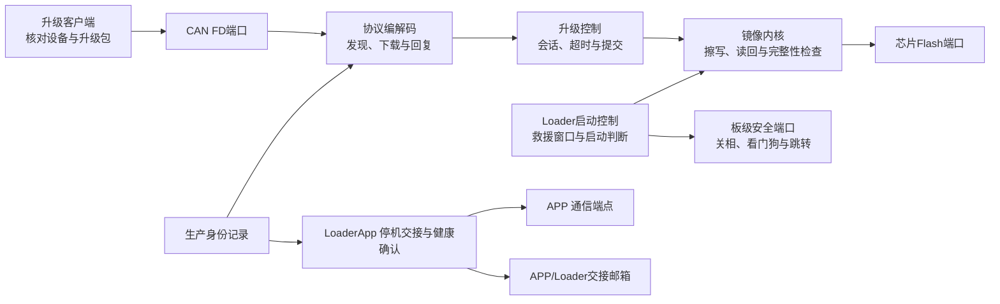
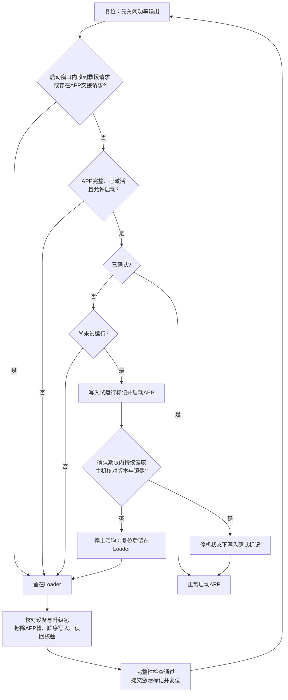
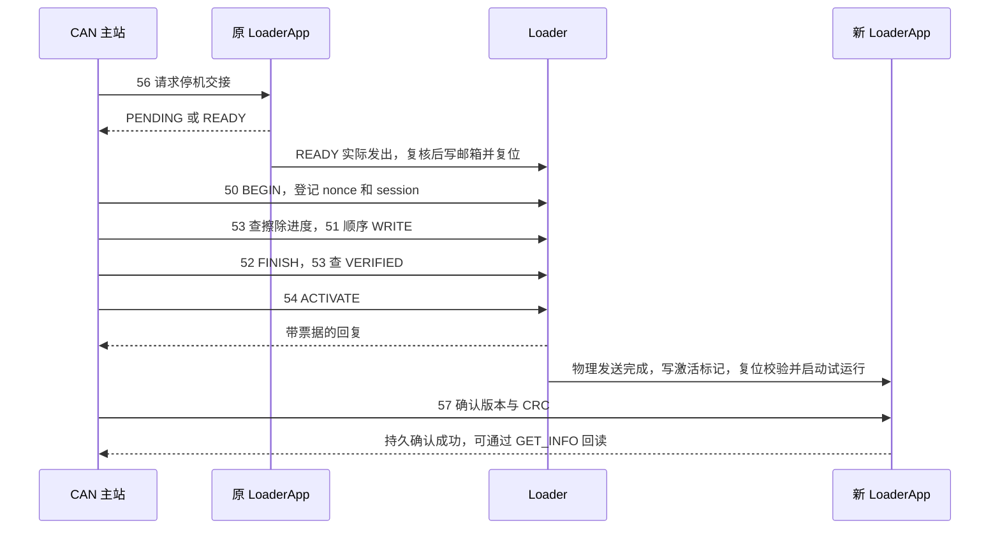

# Loader 设计：启动、升级与存储

核对基线：176f3c7e。本文说明两板共用的Loader设计。G431为layout 6，
新增AT32F456CCU7为layout 7，分别编译MCU/板级端口；UART尚未实现。
两板均采用前128 KiB中的16 KiB Loader、96 KiB APP和16 KiB参数/身份区。
新配套包需重新构建及实机验证，不能复用旧布局的测试结论；
操作流程及新目标边界见[双板指南](../../guides/dual_board_loader.md)。

AT32的APP启动端口仅依赖BSP内部接口、共享邮箱/镜像格式和目标常量。
这些依赖由`harness.toml`显式许可；不允许BSP依赖APP、电机或通信业务。
运行态Flash写域仍只有APP，首次参数迁移归独立SWD维护工具所有。

## 设计目标

- 升级期间保持电机功率输出关闭。任何校验、写入或启动条件失败，都不能自动恢复运动。
- 只允许 Loader 改写 APP 槽。校准参数和生产身份独立保存，升级不擦写这两块区域。
- 断电或故障 APP 后仍可进入 Loader 重新下载。当前只有一个 APP 槽，擦除后无法回滚旧 APP。
- 将镜像校验、升级状态和协议规则留在通用代码中；芯片和板级差异由端口及目标配置承担。

USB 不在本设计范围内。通信优先实现 CAN FD；UART 是后续需要新增的传输端口。
更换 MCU 或板卡时，按[适配指南](../../guides/loader_mcu_porting_v1.md)准备资料、
核对当前实现限制并完成分阶段验收。

## 软件结构

| 代码位置 | 负责什么 | 移植时怎样处理 |
| --- | --- | --- |
| `shared/image`、`shared/boot`、`shared/protocol` | 镜像格式、启动标记、邮箱与通信契约 | 尽量复用；契约变化时先更新版本、文档和测试 |
| `loader/core` | 单次升级事务、会话绑定、提交与超时 | 不接触 HAL、寄存器或板级引脚 |
| `loader/runtime` | 组织启动判断、升级命令和只读设备信息 | 接入目标芯片的端口，核对安全顺序 |
| `loader/ports/include`、`loader/ports/stm32g4`、`loader/ports/at32f456` | 公共接口及现有 Flash、CAN、看门狗、跳转驱动 | 接口独立于 HAL；新 MCU 实现对应端口 |
| `loader/product`、`loader/boards` | 参数节点策略、板级关相与状态核对 | 参数策略不混入芯片驱动；安全状态随板卡验证 |
| `shared/targets` 与工程输入 | 分区、擦写几何、版本和链接配置 | 为 Loader 和配套 APP 同时生成并构建 |

通信端口和 Flash 端口是不同边界。新增 UART 不应修改镜像内核；更换 MCU 必须重新检查
Flash 擦写粒度、ECC 行为、启动向量、看门狗和关相实现。若新芯片的编程粒度与当前镜像契约
不一致，需要版本化协议，不能只替换地址常量。

## 启动和升级

正常启动保留 50 ms 救援窗口。看门狗复位、带有效 ENTER 邮箱的软件复位、受理的驻留发现等条件使 Loader 留在启动端。窗口结束后核对输出、链路、镜像及激活/尝试/确认标记，符合条件才跳入 APP。邮箱含请求和节点；当前 Loader 打开 CAN 时重新从参数区选节点，识别失败沿用救援节点。G431 APP 在记录 CRC 损坏时回退默认节点，而 Loader 仍可能接受记录中的节点。[启动入口](../../../loader/runtime/main.c) · [节点识别](../../../loader/product/parameters.c)

### 下载状态与跨镜像交接

镜像阶段为 IDLE → READY → ERASING → RECEIVING → VERIFYING → VERIFIED，失败可进入 ERROR。50 建立写会话；Poll 逐页擦除、分段校验，51 写入并读回。53 可发现或查询会话，55 撤销事务。54 的票据属于当前会话，CAN 入队后还须收到对应物理发送完成事件。三个持久标记分别记录激活、已尝试启动和已确认。合法载荷、回复码与各时限见[升级协议](../../protocols/README.md#upgrade)。

当前实现有两个边界条件：AT32 单发送槽忙时重发 54，第二次提交失败会撤销在途票据；最终锁内再次计算整包 CRC 时，标记写入可跨过票据截止。分析提交顺序时一并查看 [LoaderUpgrade_TxComplete](../../../loader/core/upgrade.c) 与 [LoaderImage_Activate](../../../shared/image/image_transfer.c)。

| 中断或故障发生的位置 | 下次启动行为 |
| --- | --- |
| 擦除 APP 前 | 原 APP 若仍完整有效，可按正常启动条件运行 |
| 擦除或下载期间 | 镜像不完整，留在 Loader；重新开始完整下载 |
| 激活标记写入期间 | 标记无效或读取失败，留在 Loader；重新下载 |
| 已激活但试运行未确认 | 仅允许一次试运行；随后复位留在 Loader |
| APP 已确认 | 正常按启动条件运行；仍需保持输出默认关闭 |

故障 APP 无法响应交接请求时，客户端在**人工复位前**持续发送只读救援探测，捕获 Loader
的短暂启动窗口。探测本身不擦除 Flash，也不创建下载会话。进入 Loader 后仍须重新核对
设备身份和升级包；客户端不能把超时或回复丢失当作成功，也不控制复位硬件。

## Flash 与 RAM 分配

两套配套工程均使用 Flash 前 128 KiB，目标 layout 分别为 G431 的 6 和 AT32F456 的 7。Flash 地址相同，MCU 身份、RAM 和链接输入按板型选择。[G431 清单](../../../shared/targets/vector_mini_st_g431.json) · [AT32 清单](../../../shared/targets/yg_esc_v1_at32f456.json)

| 区域 | 地址 | 预留容量 | 用途和写入权限 |
| --- | --- | ---: | --- |
| Loader | `0x08000000..0x08003FFF` | 16 KiB | 上电入口；通过受控 SWD 部署，CAN 升级不能改写 |
| APP 槽 | `0x08004000..0x0801BFFF` | 96 KiB | 唯一允许 Loader 擦写的固件区 |
| 校准与用户参数 | `0x0801C000..0x0801F7FF` | 14 KiB | APP 按现有停机和校验规则保存；Loader 只读 |
| 生产身份页 | `0x0801F800..0x0801FFFF` | 2 KiB | 保存电机 SN 和类型；普通 CAN 只读，生产 SWD 写 |
| G431 交接邮箱 | `0x20007FE0..0x20007FFF` | 32 B | 保留在普通 RAM 上界之后 |
| AT32F456 交接邮箱 | `0x20016FE0..0x20016FFF` | 32 B | 链接脚本同时保留快代码执行区 |

APP 在参数区起始处读写完整轴记录；生产身份位于独立页。具体记录长度、CRC 及兼容读取由[参数存储契约](../../../firmware/parameters/README.md#storage)维护。

APP 槽内依次放启动向量、镜像描述符和代码。描述符还包含“已激活、已试运行、已确认”
三个独立提交标记；它们与 APP 槽一起擦除，不额外占用参数页。CRC 校验时对这些会变化的
字段按固定规则归一化，避免确认动作改变固件身份。标记只写一次，半写或 ECC 读取失败
均拒绝启动。准确偏移、字节序和 CRC 规则见[升级协议与镜像格式](../../protocols/README.md#upgrade)。

## 参数与生产权限

| 数据 | 保存位置 | 普通 CAN 权限 | 生产权限 |
| --- | --- | --- | --- |
| 电机 SN、电机类型 | 独立生产身份页 | 可查询，不可改写 | 受控 SWD 工装写入 |
| 电机 CAN ID | 现有参数记录 | GET_INFO 第 1 页上报活动节点 | 使用受控完整参数流程，重启后装载 |
| 校准数据与电机模型 | 现有参数记录 | 按已定义接口和状态守卫处理 | 身份工装不改写 |
| MCU UID、固件版本、镜像 CRC | 芯片或配套构建产物 | 可查询，不可通过参数命令改写 | 由芯片或构建决定 |

SN 不等于 MCU UID。SN 或类型未配置、身份记录损坏时，对外报告身份无效，不补造默认值。
电机类型用于追溯，不自动切换控制参数。CAN ID 只保存在参数记录，不在身份页重复保存。

生产身份工具默认只生成离线文件。实际写入需指定设备与探针，先停机、确认输出关闭并备份
Flash；只写身份页，随后读回并核对保护区。失败时保持停机，不自动恢复运动。

## 配套关系与验收

旧布局 Loader 不能接收 layout 6 镜像。首次迁移需通过受控 SWD 同时安装配套 Loader
与新址 APP；之后才能使用 CAN FD 升级同布局 APP。构建工具分别编译两端，并生成
合并 HEX、CAN 包、清单及哈希；离线检查不会连接设备。
具体命令和线上字段见 [Loader 使用说明](../../../loader/README.md)与
[升级协议](../../protocols/README.md#upgrade)。

硬件修订号、APP 版本和 Loader 版本统一由共享目标清单配置。构建后，硬件修订号和 APP
版本写入 APP 描述符，Loader 同时固化硬件修订号与自身版本；维护查询按这些镜像信息上报。
它们不占用用户参数记录。当前硬件修订号为编译期指定，尚未从独立板卡记录自动识别。

双板的维护与验证证据按目标、镜像及日期记录。G431 历史资源占用与升级批次见[优化记录](../../reports/2026-10/loader_storage_optimization_20261020.md)，AT32 的配套使用与压力测试入口见[双板指南](../../guides/dual_board_loader.md)。
