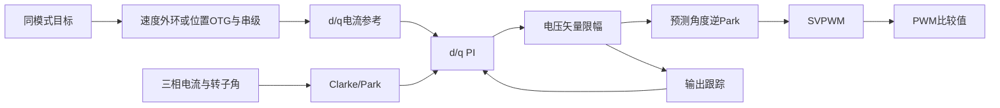

# 电机控制算法设计

适用：STM32G431与AT32F456共用APP。本文描述实际计算、单位、状态所有权与约束，
不记录调参过程。参数数值以当前活动配置及所属源码为准。

## 控制链与执行环境



MotorAxis拥有配置、FOC、编码器及外环对象。主状态机决定准入、运行代际和功率启停；
算法只计算，不自行启相、迁移主状态或写Flash。
20kHz快拍执行采样和FOC；AT32外环标称4kHz，STM32外环标称2kHz，均以配置分频为准。
位置段表在前台构造，外环只采样并在约定拍交接。调用顺序和硬件延迟见[采样设计](sampling_chain_v1.md)。

| 模式 | 参考与角度 | 实际控制律 |
| --- | --- | --- |
| CURRENT | d/q电流参考；编码器或获准的磁链观测器角度 | d/q电流PI |
| SPEED | 速度目标→外环；编码器电角度 | 速度PI产生Iq，Id为0，快环执行电流PI |
| POSITION | OTG位置/速度→位置串级；编码器电角度 | 位置PD和速度PI产生Iq，快环执行电流PI |
| VQ | 目标Vq，编码器电角度 | d轴电流PI保持Id=0，q轴直接给电压；不等于两轴完全开环 |
| OPEN_CURRENT | 频率积分得到电角度，给定d/q电流 | 角度开环、电流闭环 |
| OPEN_VOLTAGE | 频率积分得到电角度，给定d/q电压 | 电压开环，仍执行实测电流限额检查 |

实现入口：[MotorControl_Step](../../firmware/motor/control/motor_control.c)、
[Foc_Step](../../firmware/motor/control/foc_output.c)。

## 单位和电机模型

算法内部使用SI浮点量：角度rad、速度rad/s、电流A、电压V、电阻Ω、电感H、磁链Wb。
机械量与电角量通过极对数p换算：`θe=pθm+零位修正`、`ωe=pωm`。
编码器历史命名q15在此表示65536 counts/圈，不是32768 counts/圈。
`rpm=ωm×60/(2π)`，输出轴速度为电机机械速度除减速比。
通信整数缩放只在[协议边界](../protocols/README.md)处理，不能混入控制器。

Id=0的永磁同步电机转矩模型为 `Te=1.5 p ψ Iq`，因此 `Kt=1.5 p ψ`。
Kt为电机轴转矩/Iq幅值，不是母线电流或相电流RMS口径。
转子惯量属于电机轴；不能因输出轴减速比再次缩放已给定的电机参数。
当前速度前馈使用显式配置的A/(rad/s²)增益，不自动由惯量构造。

## 电流变换和FOC

按源码相序：

```text
iα = ia
iβ = (ib - ic) / √3
id = iα cosθ + iβ sinθ
iq = -iα sinθ + iβ cosθ
```

电流闭环先将d/q参考按向量等比缩放到活动电流限额；标定模式还受标定电流预算约束。
电压模式不靠参考电流限幅保护，另检查实测d/q电流平方和，越限报告过流。
电流PI分别产生Vd/Vq；代码未在该路径叠加独立的交叉耦合解耦或反电势前馈。

母线为滤波后的Vdc。最大调制幅值 `mmax=0.95×√3/2`，单轴PI电压限幅为
`Vmax=mmax×Vdc/1.5`。随后以 `mdq=1.5×Vdq/Vdc` 得到调制矢量；
若矢量幅值超过mmax，按同一比例缩小d/q，保持方向。母线无效时清调制并复位电流PI。

逆Park使用预测角 `θ+ωe×1.5Ts`，再按扇区计算三相SVPWM占空比。
Foc_Step只提交一次PWM，随后执行输出跟踪；提交比较值不代表功率已经获准或同时更新。
`voltage_dq_v` 是限幅后的命令电压估计，不是相电压传感器测量。
原理与实现见[foc.c](../../firmware/motor/control/foc.c)，硬件装载见[PWM时序](at32f456_pwm_adc_driver.md)。

## PI离散化与抗饱和

对误差 `e=r-y`，比例项 `P=Kp e`，积分候选 `I*=I+Ki e Ts`。
只有 `P+I*` 在输出范围内，或误差方向能使饱和输出回落时，才接受积分候选。
最终输出 `u=clamp(P+I, umin, umax)`。
执行器或下级再次限幅后，`TrackOutput(u_applied)` 令
`I←clamp(I+u_applied-u, umin, umax)` 并记录实际命令。
Configure只修改增益、周期和限值，不清积分；Reset清动态值而保留配置。
每个PI由调用方持有，调用必须串行。见[PI实现](../../firmware/motor/control/pi_controller.c)。

FOC的Kp单位为V/A、Ki单位为V/(A·s)。常用连续RL模型起点为
`Kpd=Ld ωc`、`Kpq=Lq ωc`、`Kid=Kiq=R ωc`；Ki在参数中不预乘Ts。
该式是设计起点，不证明实际闭环带宽：采样保持、计算/PWM延迟、母线限制及电机运动都会改变闭环。
应分别验证离散稳定性、电流矢量饱和、幅相与工作点，不能把ωc直接称作已达成带宽。

## 速度环与可选前馈

默认速度环先推进参考斜坡。数值上升使用加速度配置、下降使用减速度配置；
只有两者均大于0才启用，否则直接采用目标。每步最多推进对应限制乘Ts，并截在目标处。
速度PI的输出是归一化值，乘配置电流上限Icfg得到Iq。
因此该增益口径下改变Icfg会改变以安培计的等效环路增益，不只是改变饱和上限。

启用SpeedFeedforward时，从初始实测速度建立状态，以限jerk、限加速度整形目标：

```text
ωn = min(100, jerk_limit / (2 acceleration_limit))
j = clamp(ωn² (vtarget-v) - 2ωn a, ±jerk_limit)
a_next = clamp(a+j Ts, ±acceleration_limit)
v_next = v+a_next Ts
Iff = clamp(Kff a_next, ±min(configured_ff_limit, 0.5 Iavailable))
```

前馈占用同一电流预算：归一化PI范围为
`[(-Iavailable-Iff)/Icfg, (Iavailable-Iff)/Icfg]`。
最终Iq按总额度限幅，再将实际PI份额回送TrackOutput。无效配置返回失败；
可用电流为0时清参考和PI。该路径不因前馈存在而取消状态机或快环保护。
实现见[speed_control.c](../../firmware/motor/control/speed_control.c)和[speed_feedforward.c](../../firmware/motor/control/speed_feedforward.c)。

## 位置OTG与位置/速度串级

PositionOtg以最多七段恒jerk多项式生成位置、速度、加速度连续的参考，终点速度和加速度为0。
短行程可省略恒加速度或巡航段；目标落在制动距离内或反向时，先制动再折返。
规划速度取位置配置与轴记录上限的较小值，加速度取加/减速度的较小值，
jerk由 `Amax/POSITION_OTG_ACCEL_RISE_TIME_S` 得到。

目标改变时，前台预测4ms交接点的p/v/a并建表；旧轨迹继续采样，外环在指定拍按代际接收新表。
过期会话不发布；截止时未得到可用表按现有超期/参数故障路径处理。
这是有界前台工作与快环实时性的分工，不允许把求解迭代放入ADC中断。

位置串级计算：

```text
ep = preference - pmeasured
vcommand = clamp(vreference + Kp_pos ep - Kd_pos vfiltered,
                 ±min(1.5 vmax_plan, speed_limit))
Iq = PI_speed(vcommand - vfiltered)
```

速度反馈可选一阶滤波，`α=(2π fc Ts)/(1+2π fc Ts)`。
位置串级速度PI按 `speed_kp×Icfg`、`speed_ki×Icfg` 直接输出安培，再受可用电流限幅及跟踪。
最终到位要求OTG已结束、目标一致、位置误差在窗口内且速度足够低；不是仅看规划时间结束。
位置目标、反馈、轨迹与限位使用同一坐标系。显式不限位主机会话只改变该会话的行程资格，
不更改Flash配置、电流限制或其他故障保护。
实现见[position_control.c](../../firmware/motor/control/position_control.c)、[position_otg.h](../../firmware/motor/control/position_otg.h)。

## 编码器与磁链观测

转子采样经方向、LUT和零位修正后进入控制。20kHz二阶PLL估计机械速度，
环形误差取最短角差；首帧或重启按当前角重建并清速度，不把旧估计带入新会话。
基础PLL用于电角预测，配置的独立速度PLL可用于速度/位置环；二者状态不能互相覆盖。
慢路径负责多圈位置及消费速度，不重新建立另一份竞争的快PLL速度所有权。
PLL频率是估计器参数，不是已验证的机械闭环带宽。

磁链观测器只接收电机模型和αβ电流、电压值；输入电压由上拍调制与本拍滤波母线估算。
无感角只在获准的模式/启动路径使用。输出Hall用于关节初始定位及输出位置跟踪，
当前常规限位和串级反馈仍使用电机编码器；不能把输出遥测等同于独立输出轴闭环。
对主机的108/124位置与速度反馈在输出坐标v2能力下使用输出轴连续跟踪位置及方向/减速比
换算后的机械速度，参考量也使用相同输出原点。机械零位命令只配置输出零位；
位置/速度目标也按相同原点反算到内部电机坐标，内部电机编码器位置原点保持。无效/过期及旧设备兼容规则见[协议](../protocols/README.md#输出坐标反馈-v2)。
外环在发布输出跟踪样本时写入 `OutputEncoder.speed_rad_s`，与角度一同进入反馈快照。
Keil 可通过 `g_app.axis.output_encoder.speed_rad_s` 读取该值，单位为 rad/s。
算法见[编码器反馈](../../firmware/motor/feedback/encoder_feedback.c)、[磁链观测](../../firmware/motor/feedback/flux_observer.c)。

### 速度PLL离散式

`e=wrap(θmeasured-θestimated, -π, π)`，`ωn=2πf`，按以下顺序推进：

```text
θnext = θestimated + Ts ωestimated + 2ζ ωn Ts e
ωnext = clamp(ωestimated + ωn² Ts e, ±ωmax)
```

随后将角度回绕到单圈。ζ由实现固定，f和速度限额以对应配置为准。
小速度死区只用于规定的输出语义，不等于删除PLL内部连续状态。
基础PLL与独立测速PLL从同一实测角输入，允许不同带宽，但不互相回写积分状态。

### 非线性磁链观测

采用平均电感 `L=(Ld+Lq)/2`，每拍以旧积分状态计算
`η=x-Li`、`ε=ψ²-|η|²`，然后更新
`xnext=x+Ts(v-Ri+γeff η ε)`。
`γeff=min(γ, 0.2/(Ts ψ²))` 限制单拍修正尺度；模型磁链不足或状态非有限时重置。
以更新后的 `xnext-Li` 方向求atan2电角度，解绕后差分并滤波得到电角速度。
这一路依赖参数模型和命令电压估计，不能等同于直接测得转子绝对位置。

## 复位、失败和验证契约

切模式、STOP、故障或代际变更按[状态机设计](motor_state_machine_v1.md)重建或取消运行状态；
单纯更新目标不应任意清除积分。有限值、配置和限额在所属输入边界验证，
下级失败报告给状态所有者，不自行恢复功率或重放旧命令。

算法修改至少验证单位、稳态与动态参考、饱和回退、反向和短距离轨迹、连续改目标、
旧代拒绝以及不同实例交错；实时预算和带载稳定性需要匹配硬件另行验证。
测试入口见[tests](../../tests/README.md)，参数来源见[参数设计](parameter_ownership_v1.md)。
