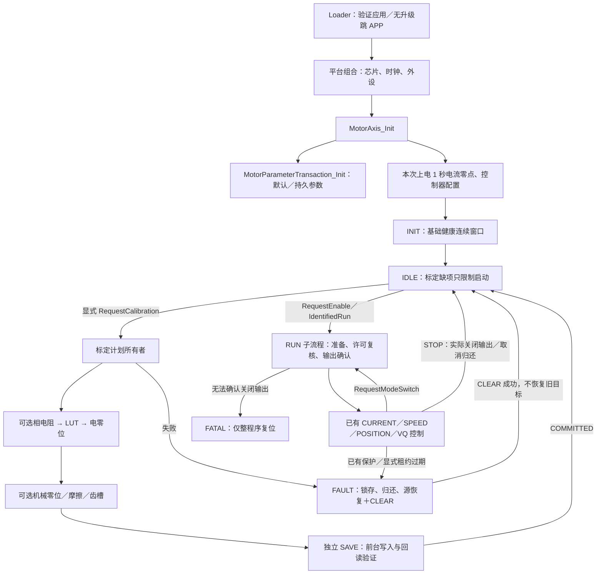

# 整机主流程与运行／标定子流程 v1

日期：2026-10-08。实施基线为 ROOT 发布候选 `7f44bd0`；本批只接线已有算法。
计划见[平台流程 v7](../plans/active/2026-10-08-motor-platform-lifecycle-v7.md)，
接口和兼容见[业务契约 v1.3](../protocols/yg_protocol_motor_lifecycle_v1_3.md)。

## 真实调用与所有权

`MotorAxis_SupervisorTick` 先更新编码器和外环，再调用 `MotorStateMachine_Tick`；
主所有者消费真实结果、推进子流程、提交输出。20 kHz 快环执行既有控制／叶算法，
`CheckFastFaults` 与 `FastFaultStop` 保留快速关断。SAVE／齿槽整理在原前台后台接口执行，
任何取消都等待原认领归还，不复用仍被借用的单份维护区。
新的运行启动／模式切换使用真实快环计数确认关相期间已预载中性 PWM，再提交启相，
避免重新开启旧模式的占空比；仅等待了毫秒而无快环进展不放行。
串联步骤与运行切换要求关断后两次快环完成，让中性预载跨过完整 PWM 周期。

主状态、子流程进度和原始任务结果均归 `motor_state_machine`，没有可变主状态副本。
`GetFlowState` 是六类只读视图；底层八状态和原线上反馈继续表达真实准备／收尾边界。
外环状态仍由 `MotorOuterLoop` 拥有，叶算法保留各自内部状态机；不把它们移入主状态机。
`motor_maintenance` 继续只调度真实算法，协议／GUI通过值请求与进度查询接入。
待切模式是单槽业务请求，只包含四种控制模式，STOP／故障会撤销；不是旧生命周期 next_mode 镜像。

生产身份由 `board_config` 的 `DeviceIdentity` 装载和发布，不参与标定计划选择。
SN、芯片 UID、CAN node_id 是不同字段；motor_type 当前不自动选择多电机 profile。

## 已实现与未实现

| 项目 | 当前准确范围 |
| --- | --- |
| 初始化和参数 | 沿已有事务、控制器初始化、关相零点及健康窗口；未标定未请求标定仍 IDLE |
| 整计划标定 | 显式选步骤；顺序满足已有算法依赖；每步独立票据；最后独立 SAVE，回读成功才完成 |
| 标定完整性 | completed_steps 只证明所选支持步骤完成；ENC_CALIB_ALL 仅 LUT＋电零位，机械零位可选 |
| 电机参数 | 相电阻／摩擦／齿槽已有；相电阻结果不自动覆盖只读模型 R；电感、磁链自动辨识未实现，LUT 仍要求已有合法模型 R/L/磁链；保存限于既有 schema 字段，不猜值或虚构成功 |
| 运行控制 | 已有 CURRENT(A)、SPEED(rad/s)、POSITION(rad)、VQ(V)；受控模式切换清旧目标，关相后重新准备 |
| Nm 力矩 | 未新增 Nm→Iq 换算；CURRENT 是 A，不能在 GUI 改名冒充 Nm 控制 |
| 全模式远程业务 | 新 IdentifiedRun 复用身份／序号／STOP 屏障并原子登记租约；旧 SPEED 入口保持，CAN 新命令适配尚待 H |
| 保护 | 既有相过流、母线、电流零点及 MCU 内温度保护保持；未宣称具备绕组／MOS 温度实测或母线电流实测 |
| 通信超时 | 新业务入口要求明确租约毫秒；20 kHz 核对过期并锁 CAN_DISCONNECTED；原线路未接租约时不宣称已有控制看门狗 |
| 恢复 | 新鲜来源证明＋源恢复＋明确 CLEAR；保持关相与新命令才启动；FATAL 无软件出口 |
| GUI | 当前 Qt 演示未接本批；页面可切模式不代表设备已支持该线路，也不构成实机完成证明 |

## 协议／GUI 接入清单

- H：新启动传来源、原始序号、四种实际模式及明确 `timeout_ms`，调用 IdentifiedRun；
  合法心跳用原启动身份刷新租约。旧 Type／45B／schema12 不变，不直接发送内部枚举。
- H：整计划请求传支持步骤位，分别使用 RequestCalibration、ReadCalibration、CancelCalibration；
  父 ticket、子 step_ticket、requested／completed_steps、step、result、effects 必须区分。
  需要新的远程计划幂等记录；单项维护接口及其原重试缓存不可冒充整计划入口。
- F：显示真实启动受限位、可用步骤 `0x7b`、当前步骤、保存确认和明确拒绝原因。
  将业务六类视图和既有线上八状态分开；不把 SAVE 的旧 IDLE 投影解释成任务已完成。
- F：显示 CURRENT 的 A、SPEED 的 rad/s、POSITION 的 rad、VQ 的 V；Nm 尚不提供。
  显示缺失电感／磁链辨识和配置依赖，禁止“一键全部完成”的空成功状态。

本批不占用新参数编号、不猜超时阈值、不扩大 Flash 槽、不修改其他任务的通信／GUI代码。
单项既有维护保持原自动保存种类；整计划只在最后保存，失败或 STOP 不继续后续步骤。

缺失的电感／磁链算法后续至少需要：显式试验配置和 A／V／rad/s 采样输入，
有界 step／取消／真实归还接口，H／Wb 的实际结果与质量判据，再由参数事务应用并重配控制器。
本批没有这些算法或模型更新的成功占位；电阻实测结果与只读模型 R 的应用政策也须单独确认。
