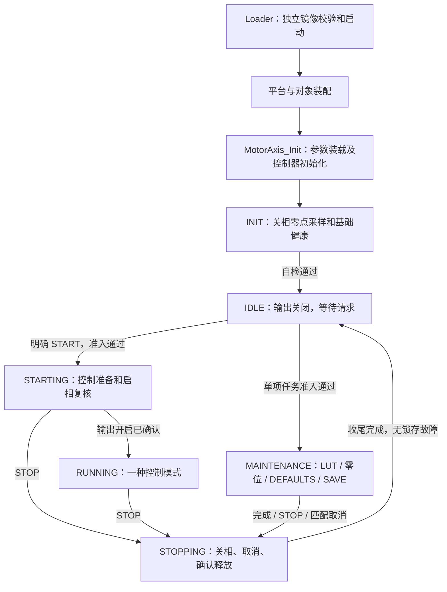

# 整机启动、控制、维护与状态机调用流程

更新日期：2026-10-09。按核心 APP v1.3.0 描述实际调用，配合[八状态主说明](motor_state_machine_v1.md)
和[全部状态跳转](motor_state_flow_simplification_v1.md)阅读。
旧 v7 组合标定、六类业务视图、运行租约及在线模式切换已退役。

## 启动和通常执行路径

INIT／IDLE STOP 各自保持原状态。上图只画正常路径，故障去向统一为：
非 FATAL 状态的有效故障 → FAULT；不可恢复内部错误 → FATAL。
FAULT 源恢复、完整基础健康与明确 CLEAR 满足后直接 IDLE；FATAL 没有软件出口。

参数确认或标定缺项只限制对应启动，可在 IDLE 等待，不自动创建标定计划。
切模式使用 STOP → IDLE → 新 START，RUNNING 的 116 仅更新同模式目标。
SAVE 是独立 MAINTENANCE 会话，RAM 完成不等于持久保存。

## 真实调用和所有权

| 执行位置 | 调用／动作 | 所有者 |
| --- | --- | --- |
| 装配初始化 | 装载默认／持久参数，清本次零点资格，初始化控制对象和 INIT 上下文 | composition、MotorAxis、参数事务及状态机各拥有各自数据 |
| 20 kHz 快拍 | 感测、已有保护、执行获准控制／单项维护，提交原代际结果 | MotorAxis 调度；叶模块持有算法内部阶段 |
| 2 kHz 监督拍 | 更新编码器与外环，再执行 `MotorStateMachine_Tick` | 外环报告就绪；状态机独占许可及功率动作 |
| 前台 | 通信、SAVE 导出参数记录、写 Flash 和回读 | 协议请求所有者；存储完成真实认领后归还 |

`MotorStateMachine_Tick` 收敛主状态、结果、释放、恢复及最终启相许可。
`CheckFastFaults`／`FastFaultStop` 保留快速关断，不等监督拍才请求关相。
叶任务不切主状态、不调度下一任务、不拥有持久保存完成资格。

原任务、独立 SAVE、控制目标和启动进展分别保留身份。
内部 epoch 只作运行期匹配，来源在启动实际受理后绑定；被拒绝来源不能占用控制权。
迟到结果可归还原资源，不能恢复旧目标或补造成功。

## 当前业务入口

| 业务 | 当前入口及边界 |
| --- | --- |
| 四种控制启动 | `RequestEnable`／`RequestIdentifiedEnable`；零参考或当前位置参考，准备后实际确认启相 |
| 同模式目标 | `SubmitControl`；只在 RUNNING 接受同模式合法 SI 目标，不启相或切模式 |
| 停止 | `RequestRemoteStop`／`RequestIdentifiedStop`；撤销旧意图及目标，原 STOP 序号屏障保持 |
| 清错 | `RequestClear`；FAULT 全部恢复条件满足后直接 IDLE，FATAL 不可清除 |
| 单项维护 | `RequestMaintenance`／带来源身份请求、票据查询及定向取消，只支持五项核心任务 |
| SAVE 前台 | `BeginBackground`／`BackgroundValid`／`FinishBackground`；只认领当前 SAVE，真实归还后记录结果 |
| Loader 交接 | `RequestBootStop`／`BootHandoffReady`；持票据禁止新工作，IDLE 或 FAULT 下确认关相及释放后交接 |

载荷见[普通启动 v0.2](../protocols/yg_protocol_ordinary_start_wire_v0_2.md)、
[单项维护 v1.2](../protocols/yg_protocol_calibration_wire_v1_2.md)及[状态反馈 v1.2](../protocols/yg_protocol_motor_state_v1_2.md)。
控制量分别为 A、rad/s、rad、V；CURRENT 不代表新增 Nm 力矩换算。

## 退役和验证边界

没有 `RequestCalibration` 整计划、`RequestModeSwitch`、`RequestIdentifiedRun`、
运行租约刷新或 `GetFlowState` 六类视图。
相电阻、摩擦、齿槽及其前台整理已删除，兼容枚举占位不是支持能力。
独立任务间保存仍由原所有者衔接，不增加主流程镜像或组合计划。

生产身份由 `board_config` 的 `DeviceIdentity` 装载／发布，SN、UID 与 CAN 节点是不同字段。
本次文档更新不改变 schema12、协议帧、保护阈值或时基。
旧实现及结果见[平台 v7 历史记录](../reports/2026-10/motor_platform_lifecycle_v7_20261008.md)，
当前发布／实机边界见[核心 v1.3.0 候选](../releases/architecture-app-v1.3.0-candidate.md)。
