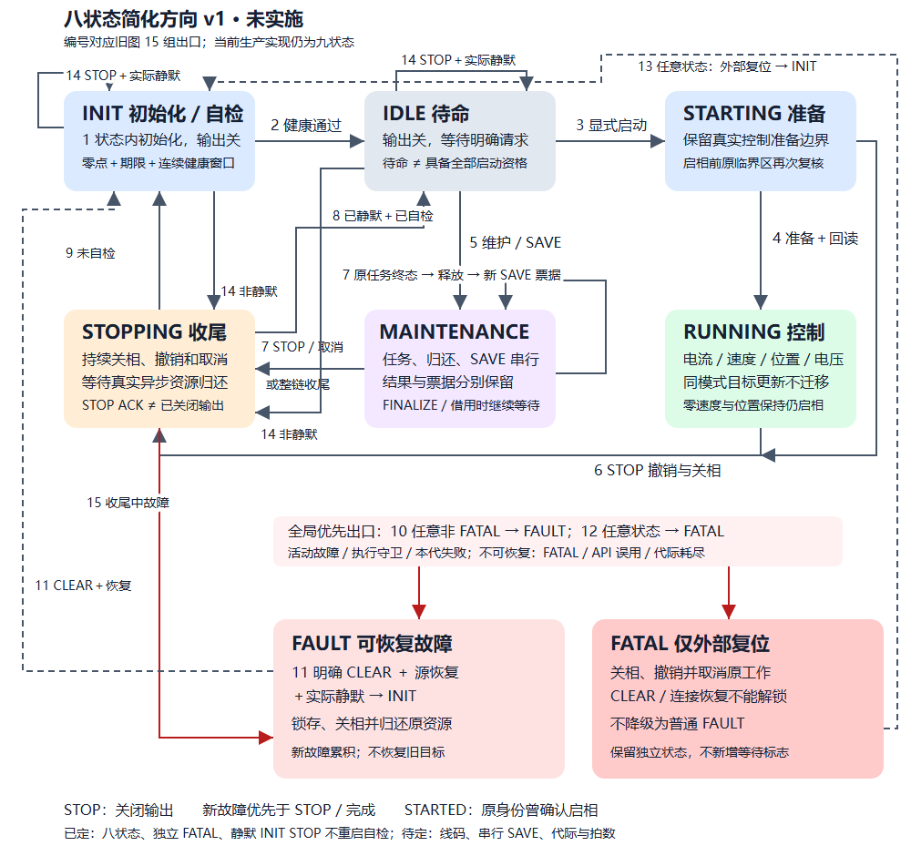

# 电机 APP 状态流转简化设计 v1

日期：2026-10-08。状态：已选八状态方向；九状态仍是生产契约。
本文以[当前总图与 15 组出口](motor_state_machine_v1.md)为旧实现，
给出完整对照、职责和伪代码。执行与证据见[专项计划 v2](../plans/active/2026-10-08-motor-state-flow-simplification-v2.md)。

## 1. 设计结论与范围

先删同一事实在规则里的重复处理，再实施已决定的状态删减。用户已选择八状态：INIT、IDLE、
STARTING、RUNNING、MAINTENANCE、STOPPING、FAULT、FATAL；INIT 中实际静默的 STOP
不重启自检期限或连续健康窗口。它涉及可观察行为变化，尚未实施。
第一批等价删除只处理维护失败的重复出口，保留全部九状态、动作位和事件优先级。

STARTING 目前必须保留。`MotorAxis_SupervisorTick` 先调用外环，再调用状态机；
启动受理先写模式，监督拍消费启动意图后进入 STARTING，启相前重新读取外环就绪。
速度、位置控制的准备由外环所有者消费复位并验证输入，不能把同样的等待改成
`prepare_pending` 后宣称删除了状态。电流、电压控制可以同拍准备，不代表全部模式均可同步。

减少往返的重点是：已关相且无借用的初始化／待命 STOP 不再经过 STOPPING；
维护任务与派生 SAVE 在同一 MAINTENANCE 内串行，整条流程最终只退出一次。
STOPPING 保留给真实关相与异步资源归还。用户选择保留独立 FATAL；不把仅复位资格
改成隐藏的等待标志或新恢复策略字段。原七状态合并方向仅作为设计演进保留。

保留编码器 FOC，电流、速度、位置、电压控制，编码器 LUT、电零位、机械零位、
齿槽、相电阻、摩擦、默认参数、补偿服务及 SAVE；保留 CAN 与 Loader 交接。
不修改控制数学、保护阈值、20 kHz／2 kHz 时基、参数 schema12、协议载荷、
真实输出回读、STOP 序号屏障或已有任务身份。本轮不进行硬件操作。

## 2. 全部状态同时可见的候选总图



[可放大八状态总图](../assets/motor_state_machine/state-simplification-eight-v1.svg)；
[原七状态候选图，历史未实施](../assets/motor_state_machine/state-simplification-draft-v1.svg)。

蓝色：初始化／控制准备；灰色：待命；绿色：控制；紫色：维护；橙色：停止归还；
红色：FAULT 和 FATAL；FATAL 独立且只能外部复位。
任意状态都有故障和外部复位出口；实线用于普通迁移，虚线用于 CLEAR／复位。
箭头编号继续引用旧图，1 为状态内初始化，14 为有条件的原地 STOP。

## 3. 旧出口逐项对照

“候选”均需设计决策及验证后实施；第一批等价删除保持本表的旧出口不变。

| 旧编号与出口 | 八状态方向处理 | 必须保留的动作、确认和差异 |
| --- | --- | --- |
| 1 BOOT → SELF_TEST | INIT 内建立上下文并开始自检，取消主状态边界 | 初始化在中断启用前仅执行一次；首次关相失败为仅复位故障；保留首次零点采样、1.5 s 初次期限及连续窗口。不得新增 `boot_done` 镜像来模拟旧状态 |
| 2 SELF_TEST → READY | INIT → IDLE | 八项基础健康连续 4 个监督拍、输出关闭、资源释放；未确认参数／未完成标定可待命，不能启相 |
| 3 READY → STARTING | IDLE → STARTING | 显式请求；格式、来源、序号、参数确认、模式标定、位置边界、健康、电压、占用均通过；零参考或当前位置参考；原身份 PENDING |
| 4 STARTING → RUNNING | 原路径保留 | 控制准备完成后，在原短临界区重新核对 STOP、升级票据、故障、健康、启动许可，并核对数字启相回读；原身份才可记 STARTED |
| 5 READY → MAINTENANCE | IDLE → MAINTENANCE | 按具体维护任务准入，创建独立票据；SAVE／DEFAULTS 不要求与出力标定相同的反馈条件；齿槽 PREPARED 后才启相 |
| 6 STARTING／RUNNING → STOPPING | 原路径保留 | STOP 撤销待启动及目标、关相、取消控制；不得改成零速度保持输出；序号屏障及原身份终态不变 |
| 7 MAINTENANCE → STOPPING | STOP／匹配活动票据取消仍进入 STOPPING；自然完成先在 MAINTENANCE 关相归还，再串行 SAVE，最后进入 STOPPING | 原任务先发布 RAM 终态；SAVE 单独票据及结果。取消旧终态票据不能停止后继 SAVE；保存失败不能改写原任务成功；已提交 Flash 不回滚 |
| 8 STOPPING → READY | STOPPING → IDLE | 输出、目标／结果、功能、前台、固定工作区均确认静默，取消已确认、无锁存故障；既有自检完成记录有效 |
| 9 STOPPING → SELF_TEST | STOPPING → INIT | 未完成自检仍需自检；停止不能绕过健康检查。是否重新开始计时必须按第 7 节定案 |
| 10 任意非 FATAL → FAULT；FAULT 内累积 | 原出口保留；FATAL 不降级回 FAULT | 故障优先于 STOP 和完成；维护失败先记实际效果、首故障及累积锁存；关相先于取消；继续接收合法资源归还 |
| 11 FAULT → SELF_TEST | 恢复允许的 FAULT → INIT | 明确 CLEAR、对应源恢复、采样有效、输出关闭、资源归还、取消已确认；代际耗尽仍不能清锁存；CLEAR 后普通期限 500 ms，不恢复目标 |
| 12 任意状态 → FATAL | 原出口保留，FATAL 独立 | API 缺少事实／事件、代际耗尽、显式 FATAL、初始化无法关相仍不可 CLEAR；无需新增恢复策略字段 |
| 13 FATAL → BOOT，外部复位 | FATAL 经外部复位重新构造 INIT | 不是规则中的 CLEAR／LINK_RECOVERED 事件；复位清易失身份，参数重新按原政策装载；普通运行状态同样可能被外部复位 |
| 14 BOOT／SELF_TEST／READY → STOPPING | INIT／IDLE 只有实际关相且无待归还资源时保持原状态；否则进入 STOPPING 或 FAULT | 仍撤销意图、目标、派生 SAVE、进展并更新 STOP 屏障；不能用状态名称证明已关相。用户已决定静默 INIT STOP 不重启期限／窗口；票据数值变化仍需对照 |
| 15 STOPPING → FAULT | 原路径保留；按故障策略锁存 | 收尾中活动故障或停止确认时仍有锁存故障不能回 IDLE；无法确认输出关闭不得自动继续试验 |

### 不迁移、拒绝与资源归还

| 当前事件／情况 | 候选保持的结果 |
| --- | --- |
| RUNNING 同模式目标更新、位置到位、零目标 | 仍 RUNNING；目标格式及 SI 范围归控制模块；单槽 PENDING／APPLIED 独立于启动 PENDING／STARTED |
| 新请求不具备资格、格式非法、冲突重试、旧序号 | 返回原拒绝优先级；不因普通拒绝锁故障、不启相；不建立新任务 |
| RUNNING 直接请求维护／切换模式 | 拒绝；先停止回待命，再显式请求；不新增自动模式切换 |
| MAINTENANCE 等待采样、齿槽 FINALIZE、前台借用 | 保持 MAINTENANCE，输出按具体任务契约；Finalize 已关相；资源仍归原认领票据 |
| STOPPING／FAULT 的 CANCEL_DONE | 原取消代际、维护类别、实际效果及静默全部通过才确认；持续故障下仅独立归还事件可处理，新请求仍拒绝 |
| 迟到 worker／前台结果 | 原身份失效后只归还实际借用；不补造成功、不产生 SAVE、不恢复旧目标；旧 Flash 效果允许 UNKNOWN |
| 无事件轮询、LINK_RECOVERED | 不启动、不 CLEAR；活动执行守卫仍可产生故障；STOPPING 继续核对归还 |
| READY／SELF_TEST 无故障重复 CLEAR | 保留纯规则幂等语义；公开入口是否受理仍按现有状态与占用政策，不能扩大入口 |
| FATAL 的 STOP、取消、CLEAR | 仅复位资格保持；重复关断／取消可重试，普通命令不能解除锁存 |
| 同拍完成＋新请求；任务失败＋STOP／CANCEL | 完成不连带受理请求；有效失败优先锁存。多个普通完成仍按原身份／事件格式拒绝 |
| Loader 停机／健康查询／交接 | 升级票据撤销请求、阻止新任务；仅待命或可恢复故障且实际静默才交接；仅复位故障仍拒绝原普通交接 |

## 4. 简化后的主流程伪代码

以下是候选的责任划分，不是可编译实现，也不是第二个运行规则表。
实际顺序继续由同一所有者执行；每次功率动作、资源归还后读取当前事实。

```text
2 kHz 调度：
    编码器慢估计
    外环消费模式／复位并更新控制参考
    唯一主状态机监督拍
    温度换算

监督拍：
    记录本拍快采样进展；取出 STOP 和匹配原身份的功能结果
    若已处 FATAL 或发生不可恢复错误：保持／进入 FATAL，关相、撤销并取消
    否则若已有故障或本代功能失败：记录效果与锁存，关相，撤销并取消，进入 FAULT
    否则若 STOP：
        撤销请求与 SAVE 意图；序号屏障在受理入口已经更新
        INIT／IDLE 且实际静默：原地确认，不重启自检期限或窗口，保留检查义务
        其他状态：进入 STOPPING，要求关相与实际归还
    处理独立维护／SAVE 结果及原取消身份的资源归还
    更新故障源恢复证据；此步骤不自动 CLEAR

    按唯一主状态推进：
        INIT：持续关相；超时／失败走 FAULT；连续基础健康通过后进入 IDLE
        IDLE：串行受理维护或显式启动；不自动恢复旧目标
        STARTING：守卫通过且控制准备完成后，短临界区复核、启相、回读，进入 RUNNING
        RUNNING：持续运行守卫；原临界区复核并应用同模式单槽目标
        MAINTENANCE：按本次任务推进，见下段
        STOPPING：继续关相与取消；真实静默且取消确认后回 IDLE／INIT／FAULT
        FAULT：继续关相与归还；仅显式 CLEAR＋当前源恢复才回 INIT
        FATAL：关相并拒绝普通恢复；仅外部复位重新构造 INIT

    更新原身份的启动进展、指示与监督计数

MAINTENANCE：
    任务仍运行：只调度已获准的功能
    齿槽采集 FINALIZE：关相，等待原前台认领归还，不发布虚假完成
    任务自然完成：关相，发布原票据 RAM 终态，等待该任务实际释放
    全部释放后：
        若原任务策略要求自动 SAVE 且未 STOP／故障：
            在原子边界复核保存准入，推进代际，建立新的 SAVE 票据，主状态保持
        否则：进入 STOPPING 并确认最终静默
    SAVE：写入和回读仍在前台；监督只消费结果
        成功：仅 SAVE 票据 COMMITTED，最终 STOPPING → IDLE
        失败：SAVE 票据失败／效果 UNKNOWN，走 FAULT；原任务终态保留
    STOP／匹配当前活动票据取消：不创建后继 SAVE，走 STOPPING
```

自动保存策略沿用当前实现：LUT、电零位、机械零位、DEFAULTS 及成功发布齿槽候选后
派生 SAVE；相电阻、摩擦保持 RAM-only，显式 SAVE 才持久化。原任务终态票据重复取消
只确认旧身份，不能取消后继 SAVE。SAVE 开始不能早于旧实现的实际释放／仲裁条件；
取消和失败仍禁止同拍自动重启。精确监督拍与瞬时状态反馈的改变须独立验收。

不增加维护阶段枚举或多个等待布尔量。运行与结果直接由已有具体任务、
`operation_result`、原后台认领记录及真实释放事实区分；交换任务身份时只保留
原终态记录与新活动 SAVE，不让两个任务同时借用资源。若这些事实不足以证明串行边界，
保留旧路径，不凭新增“已整理／待保存／可退出”镜像推进。

## 5. 函数职责收敛

| 现有函数组 | 唯一职责和后续处理 |
| --- | --- |
| `MotorStateMachine_Tick` | 监督顺序、原身份结果消费和状态推进；不做控制数学或 Flash；保持一个监督入口 |
| `MotorStateRules_Step`／优先级／按状态分支 | 纯规则、状态、拒绝原因和动作请求。第一批让维护失败只有优先级入口拥有，普通 MAINTENANCE 只处理成功 |
| `dispatch_state_event` | 绑定原请求／完成／取消身份，短临界区提交并执行动作、发布结果；这是安全边界，不能当多余胶水直接绕开 |
| `state_apply_actions`／`clear_running_data` | 关相先于取消，清参考／控制器，释放功能；不宣称硬件已经完成。后续合并故障状态只共用这里已有的动作 |
| `read_state_conditions`／`build_self_test_checks`／`state_start_blockers` | 分别提供当前事实、八位诊断和公开启动拒绝原因；在一次合法读取中复用，不能跨动作或跨中断缓存许可 |
| `RequestEnable`／`begin_requested_control`／`enable_prepared_control` | 请求准入、进入 STARTING、最终启相三个时刻；保留启相临界区内动态复核，外层准备查询不能替代它 |
| `state_process_task_outcome`／`finish_maintenance_or_release`／`start_requested_save` | 候选统一到已有按状态推进的维护分支；删除 READY 往返与 `save_requested` 镜像的前提是结果和串行政策已定案 |
| STOP／定向取消／CLEAR 公开入口 | 参数、来源、重试、STOP 屏障和原票据语义归入口；主规则不再重复协议解析；CLEAR 仍核对具体源恢复 |
| `BeginBackground`／`BackgroundValid`／`FinishBackground` | 原认领能力的授予、复核及归还；迟到归还不能被当作新任务的有效结果 |
| `MotorOuterLoop_SlowTick`／`MotorExecution_ControlStep` | 各自保留控制计算和唯一参考写者；状态机不持有第二份控制器就绪或控制模式 |
| `MotorMaintenance_*`／具体 worker | 按实际功能准入／执行／取消及归还；标定内部采样与拟合阶段继续由功能拥有 |
| `yg_protocol_*_adapter`／Loader 组合层 | 映射公开值与所有者结果，不拥有新的生命周期；新状态反馈须版本化设计后再改 |

## 6. 变量归属与删除依据

状态及跨上下文邮箱仍由 `s_context` 唯一拥有，Watch 符号可见不代表允许旁路写入。

| 字段组 | 必要事实／归属 | 候选处理 |
| --- | --- | --- |
| `rules.state` | 唯一主状态，状态机 | 九状态先保留；新契约定案后才收敛 |
| `motor->control_mode`、参考与 PI／位置控制内部状态 | 控制模式归电机对象，控制数学归执行模块 | 不复制到规则；STOP 仍置 NONE 并撤销参考 |
| `rules.tested`、`self_test_started_ms/timeout_ms/stable_ticks` | 自检完成资格、期限和当前稳定窗口，状态机 | 语义不同，不能用一个“ready”替代；合并 INIT 不增加 BOOT 阶段标志 |
| `enable_pending`、`stop_pending` | 前台与监督的请求交接，状态机 | 保留邮箱义务；不是新增主状态替身，不用于伪装同步启动 |
| `pending_control/control_epoch/has_pending_control/control_progress` | 单槽目标与原目标终态，状态机 | 保留 PENDING／APPLIED／REJECTED；受理检查和应用时复核均必要 |
| `pending_outcome/outcome_epoch/has_latched_outcome` | 快环原身份结果，状态机 | 保留故障覆盖普通结果和迟到丢弃；基础采样进展另计 |
| `rules.maintenance_kind/maintenance_active/operation_result/operation_effects` | 具体任务、活动身份和结果／真实提交效果，状态机 | 候选直接驱动串行维护，不增加阶段布尔；是否活动不能由最近任务名推导 |
| `operation_epoch/cancel_epoch/rules.epoch` | 原任务、取消确认和主代际，状态机 | 保留各自身份；STOP 使旧代完成失效，前台晚归还仍认原 claim |
| `last_maintenance/last_maintenance_request` | 原任务终态、来源重试和票据，状态机 | 必须保留以跨派生 SAVE 查询原结果；不能与 SAVE 终态共用单槽 |
| `background_claim/background_busy`、固定维护工作区 | 原前台借用及真实资源所有权，APP／资源模块 | 与任务完成是两件事；保留实际借用账目，不从 MAINTENANCE／STOPPING 名称推导释放 |
| `maintenance_runnable` | worker 获准执行；FINALIZE 后不能再执行采集，状态机 | 后续只在已证明可由任务结果等价推导时删除；不能未经覆盖先删 |
| `save_requested` | 当前 READY 往返期间的派生 SAVE 意图，状态机 | 串行候选按原任务成功＋保存政策决定后可删除；STOP／故障直接离开该流程 |
| `save_finish` | 前台 Flash 回读结果的跨上下文邮箱，状态机 | 必须保留独立结果或复用明确的同语义邮箱；不能当作 `save_requested` 的等价替身 |
| `configuration_reading` | 补偿前台借用，状态机与调用方 | 保留受理启动与后台服务互斥，不能只检查功率输出 |
| `recovery`、业务故障、`first_fault/latched_faults` | 源恢复证据及锁存记录，各原所有者 | 不缓存 CLEAR 许可；保留 FATAL 独立状态，不新增“仅复位”镜像字段 |
| `latest_start/active_start/remote_source/stop_sequence` 与 valid 字段 | 新近重试、原活动身份、来源及 STOP 序号屏障，状态机 | 不能用一个“started”布尔或当前主状态替代；历史 STARTED 不代表当前输出或机械运动 |
| `boot_stop_ticket/boot_maintenance_only/supervisor_epoch` | 升级隔离票据、维护角色和健康进展，状态机 | 保留 Loader 停机及健康接口，不把升级变成新主状态 |
| `fast_sample_epoch/observed_fast_sample_epoch/fast_samples_fresh` | 当前监督拍采样有进展，状态机 | 同拍多次提交复用采样进展；不是连续健康资格，不能与 tested 合并 |

## 7. 实质待决项

| 决策 | 建议与原因 | 实施边界 |
| --- | --- | --- |
| D1 INIT／IDLE 名称与状态反馈 | 用户已决定：合并 INIT、改 IDLE；INIT=3，0 保留为退役值，文档升级 v1.1。IDLE=5、FAULT=8、FATAL=9 保持 | 不用旧枚举兼容头或隐藏初始化阶段伪造旧反馈；新版协议文档、golden vectors、状态消费方、Watch 和 Loader 全部对照 |
| D2 INIT 原地 STOP | 用户已决定：实际静默时 STOP 不重启自检期限或稳定窗口；仅撤销命令并核对真实静默 | 这与旧 SELF_TEST→STOPPING→SELF_TEST 重启窗口不同，作为已确认公开行为变化单独验证；异常输出／占用仍收尾 |
| D3 维护内串行 SAVE | 建议保留当前自动 SAVE 种类、独立票据、原任务终态和前台回读，取消旧票据仍不取消 SAVE | 确定任务完成到 SAVE 之间的状态反馈及同拍仲裁；保留不早于旧条件的保存起点和 Loader 交接禁止 |
| D4 FAULT/FATAL 合并 | 用户已决定：保留独立 FATAL，采用八状态 | 不新增恢复策略字段，不放宽 CLEAR；七状态合并方向保留为未实施历史 |
| D5 六状态／同步准备 | 本阶段不采用；保持 STARTING | 需先证明各模式准备可在当前监督调度同步、有界完成，ISR 顺序、零矢量、控制输出及 STARTED 均等价 |
| D6 收尾时序与代际 | 建议减少主状态往返但保留代际、资源实际归还及 STOP 失效边界 | 删除迁移会改变票据序列、瞬时反馈及某些拍数；不能称为逐拍等价重构。另建差异验收矩阵 |

用户决定已解决状态数、名称、线上反馈和静默 INIT STOP 政策；维护内 SAVE 和
精确代际／拍数对照仍需完成。它们不阻止本轮已经授权的等价重复删除，后续独立实施。

## 8. 第一批等价删除的证明边界

`detected_faults` 已在普通事件入口之前处理当前 MAINTENANCE、匹配完成代际和
活动维护类别的 OPERATION_FAILED：先写 FAILED／实际效果，再锁存故障并关相。
正常分支再次处理相同失败是不可达的。失败若未命中优先级入口，进入普通分支时
只可能为陈旧代际或错误任务类别；继续返回原拒绝，不能把它当成功。

本批删除普通 MAINTENANCE 的失败写入／二次故障出口，只保留错误身份的拒绝及
OPERATION_DONE 的成功收尾。冻结摘要、专门失败矩阵、完整生产所有者以及 PR profile
比较见专项计划。现有优先级中的 FAILED 不被 STOP 吞掉、实际提交效果、代际耗尽
和输出动作均保持。该删除不证明七状态候选已实现或实机通过。
