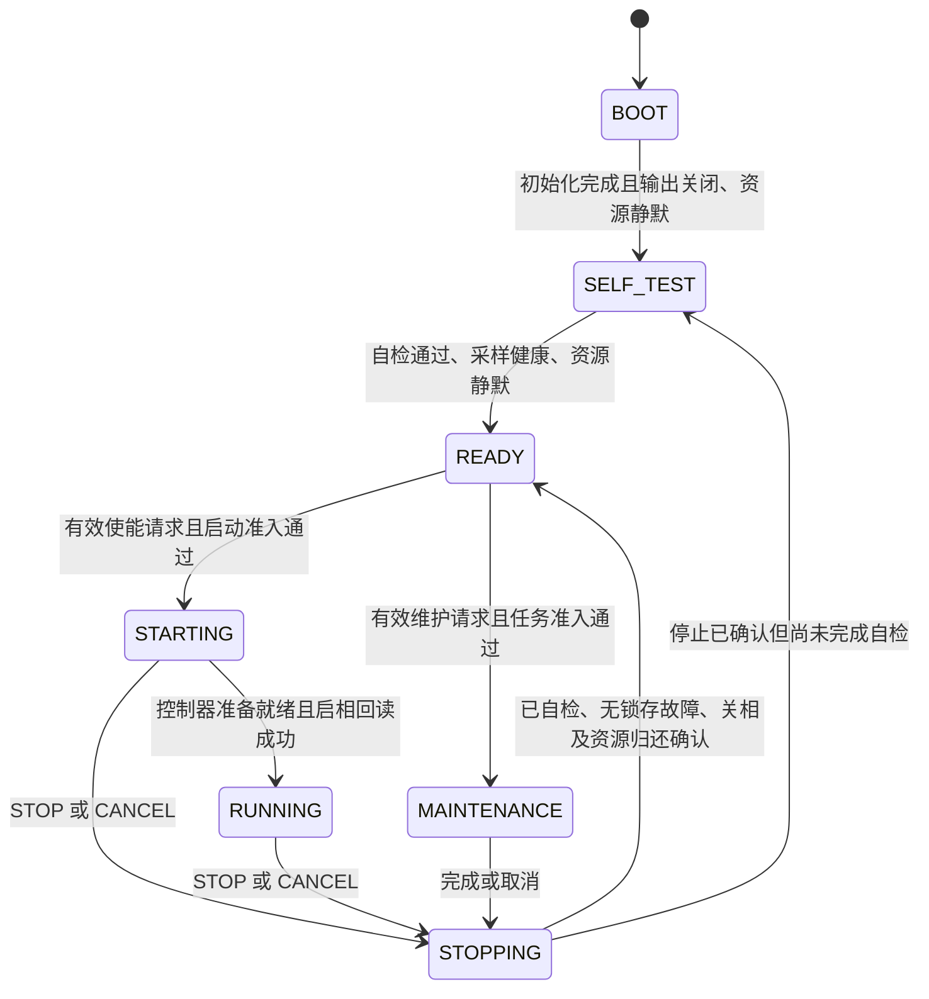
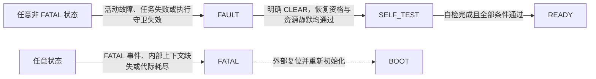

# 功能任务驱动的主状态机 v1

2026-09-28，基准 fda84c2c。当前实现删除旧模式体系，生命周期使用已验证的
AppLifecycle 纯转换核心，唯一实际所有者为 APP 的 motor_state_machine。
本轮不新增受控停止、双编码器或上位机功能，不改变 CAN Payload 和参数 schema11。

## 四类状态与代码归属

| 维度 | 状态与所有者 | 作用 |
| --- | --- | --- |
| 生命周期 | AppLifecycle：BOOT、SELF_TEST、READY、STARTING、RUNNING、STOPPING、MAINTENANCE、FAULT、FATAL | 纯规则计算迁移和动作，无硬件访问 |
| 控制模式 | motor_state_machine 选择 CURRENT、SPEED、POSITION、VQ、NONE | motor_execution 按已受理模式执行控制 |
| 维护任务 | motor_state_machine 持有 kind、原始 epoch、执行资格和后台认领 | SAVE、DEFAULTS、机械零位、编码器 LUT、电零位、相阻、摩擦、齿槽串行执行 |
| 功能内部阶段 | 各标定或辨识模块私有 | 对齐、采样、拟合等算法阶段，不决定主状态或下一任务 |

```text
firmware/app/
  motor_axis.c             私有电机对象、快慢环组合、参数活动版本、前台服务
  motor_state_machine.c/h   请求、真实守卫、正常功率许可、结果消费和保存衔接
  motor_execution.c/h       电流/速度/位置/vq_v 执行和有界外环
  motor_maintenance.c/h     实际维护功能调用、准入原因和定向取消
  yg_protocol_*_adapter.c   线上值与一致快照边界
firmware/services/lifecycle/
  app_lifecycle.c/h         唯一纯生命周期转换规则
  motor_control_command.h   SI 单位目标值命令
  motor_lifecycle_request.h 维护类型、来源序号、原始票据和进展
firmware/motor/
  motor_control_mode.h      四种控制与 NONE，不包含维护或清错命令
  motor_task_result.h       功能事实；不携带下一模式、功率动作或保存指令
  identification/           具体功能和私有内部阶段
```

已删除 foc_run、foc_run_state、foc_mode_dispatch、motor_work 和旧模式枚举，不保留
兼容头、别名或基于模式变化推断事件的路径。SWD 必须使用同版 ELF 字段。
正常启相只在 motor_state_machine；功能任务没有正常输出使能权。快速故障关断保留。

## 状态转换关系与条件

2026-09-29 补齐转换关系；依据 [AppLifecycle 纯核心](../../firmware/services/lifecycle/app_lifecycle.c)
和 [状态及事件定义](../../firmware/services/lifecycle/app_lifecycle.h)。
下表描述核心允许的迁移，APP 的公开请求入口还会按模式、维护种类和资源状态进一步拒绝请求。
控制模式和维护种类均不是额外的主状态。

正常启动、运行及维护路径：



故障和不可恢复路径单独画出；图中两个中文说明节点表示适用范围，不是新增主状态：



### 完整迁移表

“资源静默”要求同时满足：数字关相回读、控制邮箱/结果已清空、维护功能已释放、
前台借用已归还。“健康”要求采样新鲜、故障源已恢复且没有活动故障。
请求还须通过当前代际与时效校验；完成通知须匹配创建时代际和维护身份。
执行守卫失效转故障只适用于 STARTING、RUNNING 和 MAINTENANCE；
READY 的新请求准入不通过通常只是拒绝，APP 如上报了具体故障则另走故障路径。

| 原状态 | 目标状态 | 事件或触发 | 必须满足的条件与动作 |
| --- | --- | --- | --- |
| BOOT | SELF_TEST | BOOT_DONE | 当前完成身份有效且资源静默；推进代际，保持关相并开始自检 |
| SELF_TEST | READY | SELF_TEST_DONE | 自检通过、健康、资源静默；只就绪，不启相 |
| SELF_TEST | FAULT | SELF_TEST_DONE 校验失败 | 锁存守卫故障，执行关相与取消；尚无完成通知时可继续等待自检 |
| READY | STARTING | ENABLE | 请求有效、健康、资源静默、无锁存故障、模式有效且启动获准；选择模式并开始准备 |
| STARTING | RUNNING | START_DONE | 启动守卫持续有效、控制准备已确认且数字回读显示已启相 |
| STARTING | FAULT | START_DONE 校验失败 | 未准备就绪或仍为关相状态，不得宣称启动成功；关相并锁存故障 |
| READY | MAINTENANCE | BEGIN_OPERATION | 请求及操作种类有效、健康、资源静默、无锁存故障、维护获准；创建独立任务身份 |
| MAINTENANCE | STOPPING | OPERATION_DONE | 完成身份/种类/效果有效；SAVE 必须 COMMITTED；记录任务结果，关相并收尾 |
| MAINTENANCE | FAULT | 当前任务 OPERATION_FAILED | 保留失败事实与提交效果，锁存故障，撤销执行资格并取消任务 |
| BOOT、SELF_TEST、READY、STARTING、RUNNING、MAINTENANCE | STOPPING | 已受理的 STOP 或 CANCEL | 无同拍更高优先级故障；先请求关相，撤销目标与执行资格，取消当前操作 |
| STOPPING | READY | 空事件轮询或取消确认 | 资源静默、无待确认取消、无锁存故障，且此前已经通过自检 |
| STOPPING | SELF_TEST | 空事件轮询或取消确认 | 资源静默、无待确认取消、无锁存故障，但尚未通过自检；停止不能跳过自检 |
| STOPPING | FAULT | 停止确认或新故障 | 停止确认时仍有锁存故障，或收尾期间出现活动故障；不得回 READY |
| FAULT | SELF_TEST | CLEAR | APP 已核对故障源恢复资格；核心确认健康、资源静默且无待确认取消，再清锁存并重新自检 |
| 任意非 FATAL 状态 | FAULT | FAULT 或活动故障 | 故障优先；若已在 FAULT，只累积锁存并继续要求关相 |
| STARTING、RUNNING、MAINTENANCE | FAULT | 执行守卫失效 | 健康、运行许可或任务守卫失效；RUNNING 无停止事件却回读为关相也视为异常 |
| 任意状态 | FATAL | FATAL 事件、内部上下文缺失或代际耗尽 | 关闭输出并撤销控制/维护；普通 CLEAR 无法退出 |
| FATAL | BOOT | 外部复位后重新初始化 | 属于重新启动，不是 AppLifecycle_Step 的普通事件迁移 |

STOPPING 可以是短暂状态：同一次核心调用会先进入 STOPPING，再检查停止确认；
如果资源已经静默且无待确认取消，返回快照可能直接是 READY、SELF_TEST 或 FAULT。
因此“不曾在遥测中看到 STOPPING”不能用于推断跳过了关相和资源检查。

### 保持状态、拒绝请求与同拍优先级

- READY 等待请求时保持 READY；STARTING 等待控制准备时保持 STARTING；
  RUNNING 更新当前模式目标时保持 RUNNING。位置到位由位置算法内部处理，不自动关相。
- MAINTENANCE 在功能未结束或前台整理未完成时保持；齿槽 FINALIZE 先关相，
  仍保持 MAINTENANCE，等待前台发布结果后才提交完成事件。
- STOPPING 等待实际关相、取消确认或资源归还；FAULT 等待恢复和明确 CLEAR；
  FATAL 对普通事件保持 FATAL。断线后重新连接不会清错或恢复旧目标。
- 核心事件优先级为 FATAL > FAULT > STOP > CANCEL > 完成通知 > 新请求。
  当前维护失败按故障处理，不能被同拍 STOP 吞掉；陈旧失败不能污染新任务。
- 同拍完成和新请求不能连成一次自动启动；完成可被处理，但新请求被拒绝。
  陈旧身份、非法事件、未满足准入的请求被拒绝，不因此进入 STARTING 或 MAINTENANCE。
- 纯核心对无故障 READY/SELF_TEST 的重复 CLEAR 为无动作；公开入口仍按自己的状态规则受理。
  已处 FAULT 时 STOP/CANCEL 不清锁存；匹配的 CANCEL_DONE 只能确认归还。
- 不允许 RUNNING 直接切入维护，也不允许 FAULT 直接恢复 RUNNING。
  切换运行模式必须按当前入口规则停机回 READY，再重新请求启动。

维护后的自动保存是新任务：标定/零位/默认参数按既定策略完成后，先经过停止确认返回 READY，
再创建新的 SAVE 身份进入 MAINTENANCE；SAVE 回读验证完成后再次收尾回 READY。
这条衔接不会恢复运行模式或运动目标。STOP 仍表示关闭输出；受控减速停车模式尚未加入。

## 结果与调度契约

| MotorTaskResult | 功能报告 | 主状态机处理 |
| --- | --- | --- |
| RUNNING | 未终结；无错误 | 继续当前有界周期，同时登记快环采样进展 |
| PREPARED | 齿槽功能已配置零矢量 | 复核当前 epoch、未 STOP、健康、采样和输出守卫；成功启相，否则故障终止；重复就绪不重复启相 |
| COMPLETED | 功能完成，结果在 RAM | 撤销执行资格、关相、清控制参考；记录原任务完成，再按策略衔接独立 SAVE |
| FINALIZE | 齿槽采集结束，需前台整理 | 关相并保留 MAINTENANCE，等待同身份前台认领、整理、发布和归还 |
| STOP_REQUESTED | 控制保护要求关闭输出 | 进入统一停止路径，不自动重新启动 |
| FAILED | 失败和明确故障码 | 同快环锁存并紧急关相，监督拍对齐 FAULT、取消及资源归还 |

20 kHz 快环只运行一个获准控制或维护功能。2 kHz 监督拍消费结果、提供真实守卫、
执行迁移。Flash 和表整理在前台执行。各算法计算、抽点频率和外环准备策略保留。
2026-09-29 起，实际快环选择归 `motor_axis.c`：故障时跳过功能和预载；可执行维护
直接进入 `MotorMaintenance_Step`；STARTING/RUNNING 调用 `MotorExecution_ControlStep`；
其余无故障状态预载三相 0.5 占空比。执行模块不读取生命周期或选择维护任务，
零矢量预载不授权功率使能。
结果邮箱绑定创建时 epoch，保留首个终态，FAILED 可覆盖尚未消费的成功。
消费时在同一临界区撤销维护执行资格，防止中断再次调用已结束算法。

STOP 先撤销目标和执行资格；陈旧、取消后的结果不能复活任务或请求 SAVE。
故障优先于完成与取消；CLEAR 不恢复旧目标。硬件数字关相、功能静默和前台实际归还
是独立证据，缺一不能 READY。电压保护在实际输出尚未关闭时持续工作。
数字关相回读不能代替物理栅极测量；停止运动仍需独立控制模式，本轮未添加。

## 保存、取消与反馈

| 完成任务 | 原任务效果 | 后续策略 |
| --- | --- | --- |
| 编码器 LUT、电零位、机械零位、默认参数 | COMPLETED + UNCOMMITTED | 主状态机创建新 SAVE 票据 |
| 齿槽 | 前台候选发布 RAM 后 COMPLETED + UNCOMMITTED | 主状态机创建新 SAVE 票据 |
| 相电阻、摩擦 | COMPLETED + UNCOMMITTED | 保持原 RAM-only 策略，显式 SAVE 才持久化 |
| SAVE | Flash 写入及回读验证后 COMMITTED | 不启动其他功能或运动 |

前台认领使用原始 `{epoch, kind}`，最终发布或写入前在同一短临界区复核。
取消只作用于当前功能；借用没有归还时保持 STOPPING/FAULT。迟到结果只能归还，
不能标为 COMMITTED。原始标定票据与派生 SAVE 票据分别可查；同来源序号重试
复用原票据，不再次执行。维护准入只返回原因，由所有者锁存原有拒绝故障。

线上状态仅在 yg_protocol_status_adapter 映射：CURRENT/SPEED/POSITION/VQ
为 1/2/3/6；编码器/电零位/齿槽为 7；相阻/摩擦为 8。其他维护为 0。
状态与测量、维护 kind 来自同一临界快照，内部枚举不直接作为线上数值。

## 验收入口

[执行计划与回退](../plans/completed/2026-09-28-motor-state-machine-v1.md)记录基准和证据。
原生真实所有者测试覆盖请求、功率失败、过期结果、取消借用、任务与保存身份；
结构检查禁止旧状态契约与功能侧正常启相；协议固定编号和原有黄金向量继续验证。
本轮只做离线构建和测试，未烧录、未修改设备参数、未控制电机。

[本批验收、资源和未验证项](../reports/2026-09/motor_state_machine_refactor_20260928.md)。
