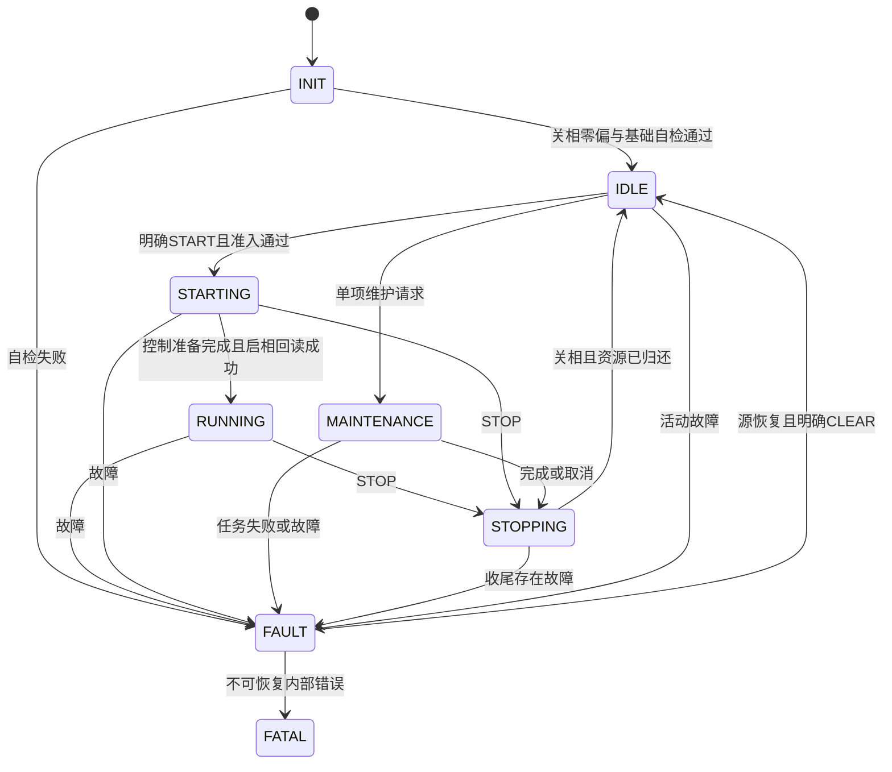

# 核心电机主状态机

更新：2026-10-09。描述v1.3.0八个实际执行状态，不再介绍退役组合计划或运行租约。

## 先看通常路径



图表示通常路径。不可恢复事件可从任意状态进入FATAL，普通命令不能退出FATAL。
没有独立BOOT主状态；Loader是上电前的独立产品，跳转后APP从INIT开始。

| 状态 | 只负责什么 |
| --- | --- |
| INIT | 输出关闭，等待新鲜采样、电流零偏和基础健康；完成不自动启动 |
| IDLE | 输出关闭，等待明确的控制或单项维护请求 |
| STARTING | 保留已准入的模式，准备控制器，启相前重新检查条件 |
| RUNNING | 执行一种模式，更新同模式目标；到位或零速度不会自动关相 |
| MAINTENANCE | 执行单项标定、默认值或SAVE；任务自己推进内部阶段 |
| STOPPING | 撤销目标、关相、取消并等待真实资源归还 |
| FAULT | 锁存故障、关相、等待源恢复及明确CLEAR |
| FATAL | 不可恢复锁存；没有普通软件清错出口 |

用户日常理解为“初始化、待机、运行、标定/保存、故障”。
STARTING/STOPPING是实际启停边界，保留它们才能区分请求受理与输出动作已完成。

## 状态、模式、任务分开管理

主状态回答现在能做什么，模式回答RUNNING运行哪种控制，维护任务回答本次做哪一项。
它们不是三份状态机：主状态由APP持有；位置PI状态和LUT采样阶段由对应模块持有。
参数不完整或未标定可以在IDLE等待，不会自行启动标定。
启动是否允许由当前健康、参数确认、模式所需标定、电压和资源共同决定。

| 入口 | 当前行为 |
| --- | --- |
| START / 117 | IDLE明确启动CURRENT/SPEED/POSITION/VQ；初始目标为零或当前位置 |
| SET_CONTROL / 116 | 只接受RUNNING同模式目标，不使能、不切模式 |
| STOP / 110 | 撤销旧目标、请求真实关相和收尾；INIT/IDLE保持原状态 |
| CLEAR / 107 | FAULT源恢复、基础健康及收尾满足后回IDLE，不恢复旧目标 |
| 单项维护 / 160 | 只在准入满足时受理；不自动串联全部标定 |
| 升级交接 / 56 | 配套LoaderApp先停机并阻止新工作，确认关相/归还后交接 |

切控制模式使用STOP → IDLE → 新START，不使用隐含模式切换。
重复请求按原身份返回进展，过期任务结果不能恢复新任务。
内部epoch是运行期代际，用于拒绝迟到结果；不是已删除的持久启动计数。

## 标定成功与保存分别完成

```text
IDLE → MAINTENANCE〔LUT/电零位/机械零位/DEFAULTS〕
     → STOPPING → IDLE
     → 后续MAINTENANCE〔独立SAVE〕 → STOPPING → IDLE
```

任务COMPLETED表示RAM结果完成。主状态机关相并归还后，后续监督拍受理独立SAVE。
前台实际导出、写Flash和回读；成功才发布持久完成。
取消或故障会撤销派生保存意图；不能将标定完成回复解释成保存已提交。
SAVE不进入运动，不创建组合计划。原任务和SAVE各自有结果身份。

## 快慢拍分工与故障优先级

20kHz快拍采样、运行保护、执行一拍控制/维护并提交结果；快故障立即请求关相。
2kHz监督拍收敛主状态、故障锁存、任务结果、停止确认和启动许可。
前台负责Flash和通信，ISR不执行存储。
同拍优先处理不可恢复错误/故障，再处理停止、完成与新请求。
健康恢复不自动CLEAR，CLEAR不自动START；监督停摆时不能声称本模块仍能处理超时。
故障阈值与恢复判定仍由[保护模块](../../firmware/motor/protection/foc_errhandle.c)实现。

## 从这几个文件读起

| 文件/符号 | 职责 |
| --- | --- |
| [motor_state_machine.c](../../firmware/app/motor_state_machine/motor_state_machine.c) / `s_context` | 请求入口、当前事实、功率动作、结果与SAVE衔接；唯一主状态上下文 |
| [motor_state_rules.c](../../firmware/app/motor_state_machine/motor_state_rules.c) | 纯迁移判定，只修改显式传入的规则上下文 |
| [motor_state_internal.h](../../firmware/app/motor_state_machine/motor_state_internal.h) | 内部事件/动作/事实，不是外部公共接口 |
| [motor_axis.c](../../firmware/app/runtime/motor_axis.c) | 装配对象、快慢拍、状态快照与前台调度 |

阅读顺序：Tick主流程 → 请求入口 → 内部规则 → 功率动作 → 任务/后台结果。
Watch可见上下文供定位，跨模块修改仍使用请求接口，不直接改ModeNow或上下文成员启动。
本页描述当前接线；实机与发布边界见[v1.3.0候选](../releases/architecture-app-v1.3.0-candidate.md)。
