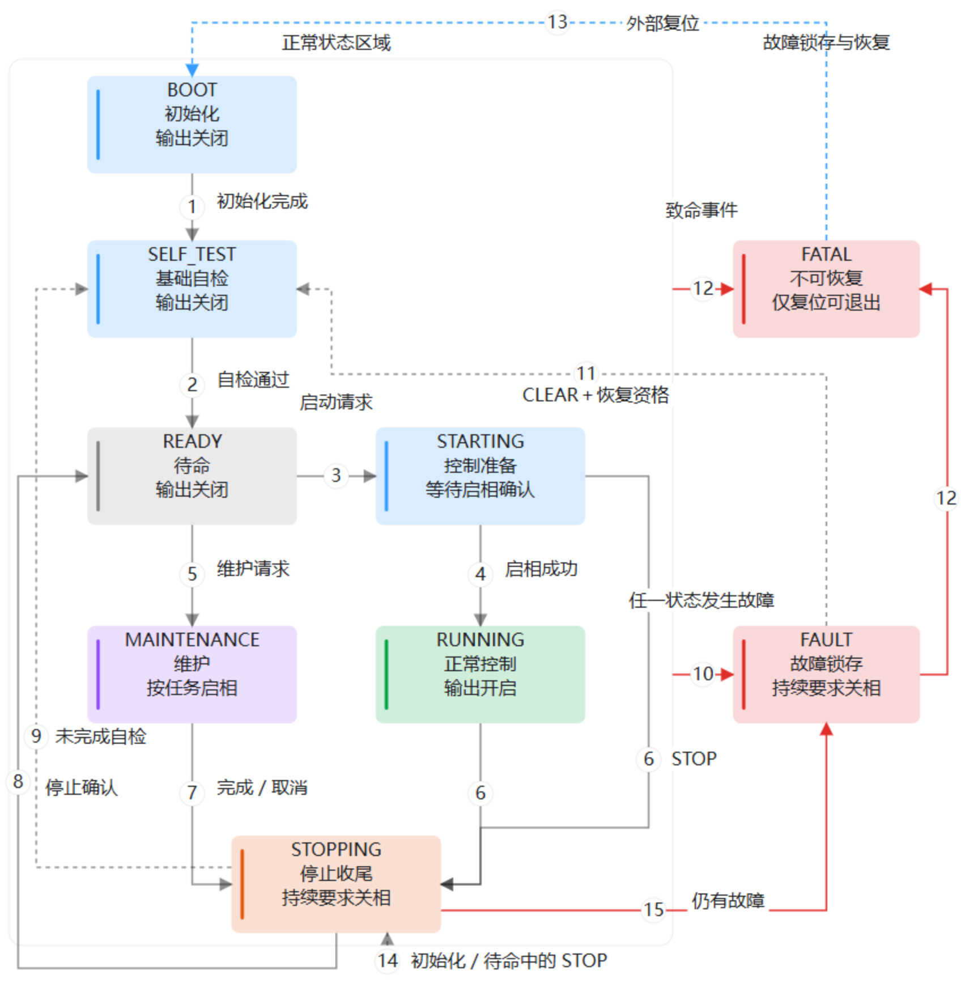

# 电机主状态机说明 v1

更新日期：2026-10-08。本文说明当前九状态实现、状态间的跳转条件和源码阅读入口；第 8 节单独记录尚未实施的简化方向。

主状态机由 APP 的 `motor_state_machine` 唯一拥有。STOP 表示关闭输出；零速度、位置保持等仍属于运行控制。READY 表示输出关闭并等待命令，是否允许启动还要检查参数、标定和当前健康。

## 1. 完整状态转移总图



[打开可缩放的 SVG 图](../assets/motor_state_machine/state-transition-map.svg) · [打开交互总图](../assets/motor_state_machine/state-transition-map.html)

蓝色表示初始化或控制准备，灰色表示待命，绿色表示运行，紫色表示维护，橙色表示停止收尾，红色表示故障。区域边界不是额外状态；图中 10 号连线适用于所有非 FATAL 状态，12 号连线适用于任意状态，包括 FAULT。

箭头编号对应第 3 节。虚线表示条件恢复或外部复位。一次监督拍可能经过多次迁移，STOPPING 也可能同拍完成；未在遥测中看到中间状态不等于跳过了检查。

## 2. 九个状态各自负责什么

| 状态 | 职责和输出 | 等待内容与出口 |
| --- | --- | --- |
| BOOT 初始化 | 建立运行上下文，保持输出关闭 | 初始化和资源静默确认后进入 SELF_TEST；异常进入 FAULT，初始化阶段无法关相进入 FATAL |
| SELF_TEST 基础自检 | 在关相状态等待采样、电流零点及基础健康 | 连续通过后进入 READY；未齐继续等待，超时或故障进入 FAULT |
| READY 待命 | 输出关闭，接受符合条件的配置、启动和维护请求 | 启动通过进入 STARTING，维护通过进入 MAINTENANCE；拒绝请求通常保持 READY |
| STARTING 控制准备 | 已选定模式，等待控制器准备并执行启相 | 准备完成且数字启相回读成功进入 RUNNING；STOP 进入 STOPPING，异常进入 FAULT |
| RUNNING 正常控制 | 输出开启，执行电流、速度、位置或电压控制 | 同模式目标更新保持 RUNNING；STOP 进入 STOPPING，故障或持续保护条件失效进入 FAULT |
| MAINTENANCE 维护 | 串行执行标定、辨识、保存、默认参数或零位任务；输出按任务决定 | 未完成或后台整理期间保持；完成或取消进入 STOPPING，失败进入 FAULT |
| STOPPING 停止收尾 | 持续要求关相，撤销目标、取消任务并等待实际归还 | 已自检且无故障回 READY，未自检继续 SELF_TEST，有故障进入 FAULT；条件未齐继续等待 |
| FAULT 故障锁存 | 关闭输出，保留故障，完成控制与维护清理 | 故障源恢复、资源释放且明确 CLEAR 后进入 SELF_TEST；STOP 或重新连接不能清锁存 |
| FATAL 不可恢复故障 | 关闭输出，拒绝普通启动和清错 | 只有外部复位重新初始化到 BOOT |

RUNNING 不代表转子必然旋转：零速度、位置保持或零电流目标都可以处于 RUNNING。停止运动与关闭输出是不同操作；当前 STOP 使用后者。

参数数值有效但未确认、编码器未标定或部分标定时，基础健康通过后可以留在 READY。它们是启动受限原因，不是额外主状态；非法基础参数和实际采样故障仍走自检失败或故障路径。

## 3. 每条箭头的事件和条件

| 编号 | 从哪里到哪里 | 触发、条件和动作 |
| --- | --- | --- |
| 1 | BOOT → SELF_TEST | 初始化完成，输出关闭、控制和维护资源静默；开始基础自检 |
| 2 | SELF_TEST → READY | 八项基础自检连续通过、采样健康、资源静默且无活动故障；保持关相 |
| 3 | READY → STARTING | 明确启动请求通过模式、身份、参数确认、标定、反馈、电压和占用检查；建立零目标或当前位置参考 |
| 4 | STARTING → RUNNING | 控制器准备完成，启相前重新复核许可，数字回读确认输出开启 |
| 5 | READY → MAINTENANCE | 明确维护或 SAVE 请求通过该任务的参数、反馈及资源条件；创建独立任务身份 |
| 6 | STARTING／RUNNING → STOPPING | STOP 请求；撤销待启动及控制目标，请求关闭输出，进入统一收尾 |
| 7 | MAINTENANCE → STOPPING | 任务正常完成、STOP 或定向取消；关闭输出并保留结果。SAVE 成功必须已经写入及回读确认 |
| 8 | STOPPING → READY | 输出关闭、目标和结果已清理、功能与后台资源已释放，无待确认取消和锁存故障；此前自检已完成 |
| 9 | STOPPING → SELF_TEST | 停止已经确认且无故障，但此前尚未完成自检；STOP 不能绕过自检 |
| 10 | 任意非 FATAL → FAULT | 活动故障、当前任务失败，或 STARTING／RUNNING／MAINTENANCE 的执行保护条件失效；锁存并关相。已处 FAULT 时继续累积锁存 |
| 11 | FAULT → SELF_TEST | 明确 CLEAR，故障源恢复、采样有效、输出关闭，功能及后台资源已归还且无待确认取消；清锁存后重新自检 |
| 12 | 任意状态 → FATAL | 明确 FATAL 事件、有效上下文缺少事件或事实等 API 误用、内部代际耗尽，或初始化阶段无法关闭输出 |
| 13 | FATAL → BOOT | 外部复位后重新初始化；不是状态规则中的普通事件迁移 |
| 14 | BOOT／SELF_TEST／READY → STOPPING | 当前实现收到 STOP 也进入停止收尾；确认后回 READY 或继续 SELF_TEST |
| 15 | STOPPING → FAULT | 收尾期间出现活动故障，或停止确认时仍有锁存故障；不能回正常待命 |

新请求条件不满足通常只是拒绝，不因此启相。提交 SELF_TEST_DONE 或 START_DONE 时条件失效会转 FAULT；任务失败不能被同拍 STOP 吞掉。新故障和持续运行保护优先于普通停止，初始化、待命状态不套用运行中的持续守卫。

不跳转的情况：RUNNING 更新同模式目标或位置到位仍在 RUNNING；MAINTENANCE 等待采集或后台整理；STOPPING 等待关相、取消确认和资源归还；FAULT 等待源恢复及 CLEAR；FATAL 对普通命令保持锁存。

不允许 RUNNING 直接进入维护，也不允许 FAULT 直接恢复 RUNNING。按当前入口切换运行模式须先停止回 READY，再重新启动。纯规则支持通用 CANCEL，公开维护取消入口仍要求匹配原票据，不能把它解释成任意远程切换命令。

## 4. 四组条件和处理优先级

| 条件组 | 检查什么 | 不包含什么 |
| --- | --- | --- |
| 基础健康 | 快环采样有进展，电压、电流和温度测量有效，温度新鲜，基础参数有效；自检还确认编码器在线与关相、资源释放 | 不要求所有编码器标定完成或参数已经确认 |
| 启动资格 | 当前健康、参数确认、模式所需标定、反馈、启动电压窗口、状态和资源占用 | 请求受理不表示已经启相 |
| 停止确认 | 数字输出关闭，待处理目标／结果已清理，功能任务和前台借用实际释放 | STOP ACK 不代表已关相；取消不回滚已提交 Flash |
| 故障恢复资格 | 对应故障源满足恢复条件，采样有效，输出关闭、资源释放，并收到明确 CLEAR | 重新连接不清错，清错不恢复旧目标 |

基础自检连续满足 4 个 2 kHz 监督拍后完成。普通自检期限为 500 ms；当前上电路径先在关相状态进行 1 秒电流零点采样，初次期限相应增加到 1.5 秒。CLEAR 后使用普通自检期限。监督调度停摆时，本任务不能自行执行超时判断。

启动滤波母线窗口为 25.6～33.8 V，原始母线还须低于 34.5 V 硬过压线。运行中的电压保护有独立采样与确认逻辑，不能把启动窗口当作整个运行期间的唯一电压规则。详细诊断位见[基础自检与模式就绪](motor_readiness_v1.md)，故障恢复见[保护实现](../../firmware/motor/protection/foc_errhandle.c)。

同次规则处理的优先级为：FATAL → 有效故障／执行保护 → STOP／CANCEL → 完成通知 → 新请求。完成和新请求不能通过同一事件组合自动启动；迟到结果须匹配原始身份，不能污染新任务。READY 中无故障重复 CLEAR 是无动作确认。

## 5. 典型流程和维护保存策略

### 普通控制

```text
BOOT → SELF_TEST → READY → STARTING → RUNNING → STOPPING → READY
```

READY 接受启动只建立意图和初始目标；监督拍在控制准备完成后启相。正式有身份的速度启动复用这一路径，首次受理与 STARTED 区分。STARTED 仅证明原身份曾达到 RUNNING 且数字输出开启，不表示机械运动或当前仍在运行。

当前线上 101 enable=1 仍是低侧制动候选，116 只更新 RUNNING 的同模式目标。候选 117 的线路状态见[普通启动提案](../protocols/yg_protocol_ordinary_start_proposal_v0_1.md)，接线实现不能代替产品定版或实机验收。

### 维护完成后保存

```text
READY → MAINTENANCE〔执行任务〕 → STOPPING → READY
      → MAINTENANCE〔独立 SAVE〕 → STOPPING → READY
```

| 完成任务 | 结果及保存策略 |
| --- | --- |
| 编码器 LUT、电零位、机械零位、默认参数 | 先完成 RAM 结果，再创建独立 SAVE |
| 齿槽 | 采集结束先关相，保持 MAINTENANCE 等待前台整理；发布 RAM 候选后创建 SAVE |
| 相电阻、摩擦 | 完成时保持 RAM-only 策略，显式 SAVE 才持久化 |
| SAVE | 写入及回读验证后才记录 COMMITTED，不启动运动 |

这些是逻辑阶段，不保证各阶段都占用独立监督拍。`start_requested_save` 依据 stopped、operation_finished 和 READY 决定是否开始保存，不能笼统声称所有完成路径都延后一拍。标定原票据与 SAVE 票据分别保留结果，原任务完成不代表保存完成。

### 取消、故障和升级

```text
维护取消：MAINTENANCE → STOPPING → 等待资源释放 → READY
故障恢复：当前状态 → FAULT → 明确 CLEAR → SELF_TEST → READY
```

快环故障先请求关相，监督拍随后对齐 FAULT。后台已经认领的资源没有归还时，保持 STOPPING 或 FAULT；迟到结果可归还资源，但不能恢复任务或补造保存成功。恢复后必须用新的启动请求，不恢复旧模式和目标。

升级没有独立主状态。升级停机票据撤销当前请求并禁止新启动和维护；在 READY 或 FAULT 下确认实际输出关闭、资源归还后才允许交接及复位。

## 6. 状态、模式、任务和核心变量

主状态回答“设备现在在做什么”，控制模式回答“运行哪种控制”，维护任务回答“本次做什么工作”；标定内部的对齐、采样和拟合阶段由功能模块自己拥有。

| 变量或字段组 | 作用 |
| --- | --- |
| `s_context.rules.state` | 唯一主状态 |
| `motor->control_mode` | CURRENT、SPEED、POSITION、VQ 或 NONE，维护不占用控制模式 |
| `rules.maintenance_kind`、`maintenance_active` | 当前或最近维护种类，以及会话是否仍有效 |
| `enable_pending`、`stop_pending` | 等待监督处理的启动／停止意图 |
| `motor->fault_code`、`rules.first_fault`、`latched_faults` | 业务故障及规则锁存，不是额外主状态 |
| `rules.tested` | 唯一自检完成记录；稳定计数只证明本次连续窗口 |
| `rules.epoch`、`operation_epoch`、`cancel_epoch` | 主状态代际、原任务身份与取消确认身份，不能互相替代迟到结果 |
| 控制／启动进展、后台认领、保存完成标志 | 请求终态与资源交接记录；受理、已应用、已启动和已保存分别表达 |

`s_context` 是唯一状态机上下文；当前为 Watch 提供可见符号，写入仍通过本模块入口串行化。规则不保存独立实例或第二份控制模式；派生事实只在当前读取中校验，不长期缓存许可。源码中的协议序号用于易失重试记录，不能冒充跨复位启动身份。

## 7. 阅读源码的顺序和函数职责

```text
firmware/app/motor_state_machine/
  motor_state_machine.c/h  请求、事实、功率动作、结果及保存衔接
  motor_state_rules.c      状态迁移规则，只修改所有者提供的上下文
  motor_state_internal.h   内部事件、动作、事实；业务模块不引用
firmware/app/runtime/
  motor_axis.c             运行对象、快慢环调度、参数及后台服务
  motor_execution.c/h      普通控制和有界外环
  motor_maintenance.c/h    维护准入、功能调用和定向取消
firmware/app/composition/
  yg_protocol_*_adapter.c  协议值、请求和一致快照映射
```

表中公开入口省略 `MotorStateMachine_` 前缀；私有函数名按源码原名列出。

| 阅读入口 | 职责 |
| --- | --- |
| `MotorStateMachine_Tick` | 监督主流程：STOP、结果、维护归还、恢复、自检、保存、启动、目标和进展 |
| `MotorStateRules_Step`、`handle_priority_events`、`handle_state_event` | 公共优先级与各状态的出口；输出关闭约束统一补齐 |
| `dispatch_state_event`、`state_apply_actions` | 绑定原身份、提交规则并执行关相、取消等实际动作 |
| `read_state_conditions`、`build_self_test_checks`、`state_start_blockers` | 当前事实、自检诊断、启动拒绝原因；不执行控制算法 |
| `RequestEnable`、`RequestIdentifiedEnable`、`ReadEnableProgress` | 原启动准入、有身份重试及原身份的启动进展 |
| `begin_requested_control`、`enable_prepared_control` | 进入准备阶段，并在启相临界区重新复核实际许可 |
| `RequestRemoteStop`、`RequestIdentifiedStop`、`state_request_stop` | 撤销请求，带身份 STOP 还推进序号屏障；监督执行停止与确认 |
| `RequestClear`、`FastFaultStop` | 核对恢复并清错；快环紧急关相，不恢复旧请求 |
| `RequestMaintenance`、`finish_maintenance_or_release` | 任务准入、保存结果和取消资源归还确认 |
| `state_process_task_outcome`、`start_requested_save` | 消费功能结果，并按任务策略衔接独立保存 |
| `SubmitControl`、`apply_pending_control` | 接收和应用同模式目标；目标格式及 SI 范围归 `MotorExecution_ValidateTarget` |
| `BeginBackground`、`BackgroundValid`、`FinishBackground` | 认领、复核及归还前台保存或候选整理资源 |

20 kHz 快环采样并执行唯一获准功能；失败时先锁故障和关相。2 kHz 监督拍按下列顺序处理：

```text
采样进展 → STOP → 功能结果／故障 → 维护完成与归还 → 更新恢复条件
→ 当前状态进展 → 派生保存 → 待启动请求 → 最终启相复核
→ 应用目标 → 更新启动进展 → 指示与监督计数
```

Flash 和表整理在前台执行。正常启相由主状态机拥有，功能只报告 RUNNING、PREPARED、COMPLETED、FINALIZE、STOP_REQUESTED 或 FAILED。PREPARED 供齿槽任务报告零矢量已准备；FINALIZE 表示等待前台整理，不是新主状态。

## 8. 简化方向 尚未实施

当前仍是九状态。下表是本轮讨论的方向，不能当作已经变更的状态契约。

| 当前复杂点 | 简化方向 | 实施前须保留或确定的行为 |
| --- | --- | --- |
| BOOT 和 SELF_TEST 分开 | 合并为 INIT | 上电零点、基础自检、期限和首次关相失败处理 |
| READY 名称暗示全部就绪 | 改为 IDLE | 待命仍可未确认参数／未标定；启动资格独立判断 |
| 已关相状态收到 STOP 仍往返 | INIT／IDLE 中 STOP 保持状态 | 仍撤销请求并确认输出关闭，不能跳过自检 |
| 维护完成退出，再进入 SAVE | 在维护流程内串行完成任务与保存 | 任务结果和保存结果分开；保留取消、后台归还和真实提交效果 |
| FAULT 和 FATAL 有重复关断动作 | 一个 FAULT 加明确恢复资格 | 不可恢复故障仍只能复位，不能放宽 CLEAR |
| STARTING 等待外环准备 | 准备可同步完成后再考虑删除 | 不能改成隐藏等待标志或提前启相；尚需验证快慢环顺序 |

较稳妥的第一阶段草案为七状态：INIT、IDLE、STARTING、RUNNING、MAINTENANCE、STOPPING、FAULT。只有把控制准备收敛成可同步完成的步骤后，才讨论六状态版本。

STOPPING 保留异步资源归还的用途；减少状态数量不能变成把相同等待藏到更多布尔标志中。下一轮先冻结完整出口、伪代码和保存／取消策略，再决定实现。讨论、待决项和接受条件见[状态流转简化记录 v1](../plans/active/2026-10-08-motor-state-flow-simplification-v1.md)。

## 9. 设计演进和验证记录

| 时间 | 已记录的变化 | 原始记录 |
| --- | --- | --- |
| 2026-09-28 | 删除旧模式推断路径，功能报告事实，主状态机拥有实际启停 | [原执行计划](../plans/completed/2026-09-28-motor-state-machine-v1.md)、[重构验收](../reports/2026-09/motor_state_machine_refactor_20260928.md) |
| 2026-09-29 | 基础自检与参数／标定资格分开；未准备完整的设备仍可待命 | [就绪契约](motor_readiness_v1.md)、[自检计划](../plans/completed/2026-09-29-self-test-readiness-v1.md) |
| 2026-09-29 | 规则和动作收归同一 APP 模块，集中上下文和提交入口 | [模块收敛计划](../plans/completed/2026-09-29-motor-state-unification-v1.md)、[验收](../reports/2026-09/motor_state_unification_20260929.md) |
| 2026-09-29 | 按状态展开、去掉 goto，删减镜像字段，划清检查职责 | [可读性验收](../reports/2026-09/motor_state_readability_20260929.md)、[冗余删减验收](../reports/2026-09/motor_state_core_20260929.md)、[条件精简验收](../reports/2026-09/motor_state_conditions_20260929.md) |
| 2026-09-30 | 有身份速度启动与 STOP 序号屏障进入所有者和候选线路接线 | [所有者计划](../plans/active/2026-09-30-identified-speed-start-owner-v1.md)、[普通启动提案](../protocols/yg_protocol_ordinary_start_proposal_v0_1.md) |
| 2026-10-08 | 梳理九状态全部出口，修正过时路径与期限，统一总图和 15 组迁移编号；简化草案仍待确定 | [本轮过程与接受条件](../plans/active/2026-10-08-motor-state-flow-simplification-v1.md) |

各历史报告只证明其冻结基线，不能作为当前工作区或以后简化版本的实机通过证明。本次为文档与图片整理，九状态、控制逻辑、协议编号和设备参数均未在本轮修改。
