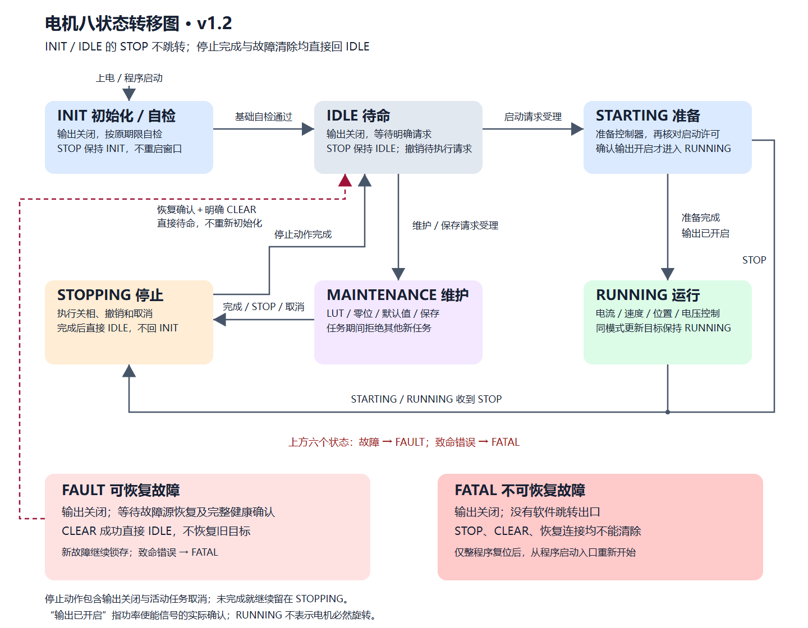

# 电机主状态机：八状态职责与执行流程

更新日期：2026-10-21。继续精简主流程；八状态、线路取值及恢复行为保持不变。
本页说明状态职责，逐状态输入和全部迁移见[状态跳转与命令处理](motor_state_flow_simplification_v1.md)。

## 当前总图



[可缩放 SVG](../assets/motor_state_machine/state-transition-exits-v1-2.svg)。
图下方故障注释适用于上方六个状态，不是额外状态或需要经过的中间节点。
FAULT 新故障继续锁存，致命错误进入 FATAL；FATAL 没有软件跳转出口。
上电或整程序复位重新构造 INIT，不画作 FATAL → INIT 迁移。

通常控制路径：`INIT → IDLE → STARTING → RUNNING → STOPPING → IDLE`。
维护路径：`IDLE → MAINTENANCE → STOPPING → IDLE`。
故障恢复：`当前非 FATAL 状态 → FAULT → 恢复确认＋明确 CLEAR → IDLE`。

## 先看五条核心流程

| 流程 | 只做什么 | 源码入口 |
| --- | --- | --- |
| 上电 | 关相完成当前启动的采样、自检和稳定窗口，成功后待机 | `advance_initialization` |
| 待机 | 等明确启动或单项维护；已有自动保存意图优先派发，不自动运行电机 | `dispatch_idle_work`、`RequestEnable`、`RequestMaintenance` |
| 运行 | 准备完成后复核并启相；仅接受当前模式的新目标 | `enable_prepared_control`、`apply_pending_control` |
| 标定 | 叶任务推进自己的采集阶段，主状态机消费完成/失败，退出后独立保存 | `begin_operation`、`state_process_task_outcome` |
| 停机与故障 | 先关相、撤销旧目标并确认归还；可恢复故障须明确CLEAR，致命故障锁存 | `state_apply_actions`、`FastFaultStop`、`RequestClear` |

`MotorStateMachine_Tick`按“消费输入→推进状态→待机派发/启相复核→运行目标和反馈”顺序阅读。
STARTING、STOPPING是启动和停止尚未确认的真实阶段，不能合并成一个使能变量。
速度、位置控制计算和标定内部步骤留在各自模块；这里不重复实现其子状态机。

## 八个状态各自负责什么

| 状态 | 输出和职责 | 正常出口 |
| --- | --- | --- |
| INIT 初始化／基础自检 | 输出关闭，等待本次上电电流零点、新鲜采样和基础健康；按原期限推进 | 基础自检通过 → IDLE |
| IDLE 待命 | 输出关闭，等待明确启动或单项维护；未确认参数或未标定仍可待命 | 启动准入通过 → STARTING；维护准入通过 → MAINTENANCE |
| STARTING 控制准备 | 准备已受理模式的控制器及初始参考，启相前再次复核许可 | 准备完成、输出开启已确认 → RUNNING；STOP → STOPPING |
| RUNNING 运行 | 输出开启，执行 CURRENT／SPEED／POSITION／VQ 中一种控制；接受同模式目标更新 | STOP → STOPPING |
| MAINTENANCE 维护 | 执行一项 LUT、电零位、机械零位、DEFAULTS 或 SAVE；输出按任务决定 | 完成、STOP 或匹配活动票据的取消 → STOPPING |
| STOPPING 停止 | 撤销目标、关闭输出、取消任务并确认实际释放；未完成继续停留 | 收尾完成且无锁存故障 → IDLE |
| FAULT 可恢复故障 | 输出关闭，保留故障并完成清理；等待源恢复、完整基础健康及明确 CLEAR | CLEAR 条件全部满足 → IDLE |
| FATAL 不可恢复故障 | 输出关闭并锁存，拒绝普通清错和启动 | 无软件出口；仅上电重启或整程序复位重新开始 |

上方六个状态的有效故障进入 FAULT，致命错误进入 FATAL。FAULT 新故障不解除原锁存；
FATAL 不降级到 FAULT。参数未确认、标定缺项或新请求不符合条件，通常只拒绝请求。

## STARTING 为什么保留

START 受理与实际启相分为两步。受理时选择模式、清旧目标，电流／速度／VQ
初始目标为零，位置初始参考为当前位置；监督拍随后进入 STARTING。

速度和位置需要外环消费复位、验证输入并报告就绪。
`MotorAxis_SupervisorTick` 先执行外环，再执行状态机，新受理的准备可能延续到下一监督拍。
电流和 VQ 可以同拍准备完成，因此有时遥测不会看到 STARTING。

就绪后在临界区重新核对 STOP、升级停机票据、故障、健康及启动许可，
再调用平台启相，实际数字输出状态确认已开才进入 RUNNING。
“启相回读”指功率使能状态的数字确认，不是转子旋转、达到目标或功率管电气正常的证明。
STARTING 表达准备及确认过程；START 受理不能直接解释为电机已经运行。

## STOPPING 为什么可能等待

STOP 表示关闭功率输出；零速度、零电流或位置保持仍可处于 RUNNING。
只有 STARTING、RUNNING、MAINTENANCE 进入 STOPPING。
INIT／IDLE STOP 保持状态，不重启自检期限、连续窗口或主状态代际；撤销排队请求。

“输出关闭、任务和后台资源归还”是停止完成的判据：

- 输出关闭：平台回读确认三相使能已经关闭。
- 控制与任务结束：旧目标／待处理结果已撤销，维护任务已停止并释放固定工作区。
- 前台归还：若 SAVE 已认领参数记录，必须等写入工作结束并交还借用，才能复用同一内存。

没有活动借用且关相已确认时，STOPPING 可以同拍完成并直接回 IDLE。
取消未确认或前台仍占用时继续 STOPPING；收尾有故障则进入 FAULT。
没有 STOPPING → INIT 或 IDLE → STOPPING 的正常路径。
STOP 受理、输出已关、资源释放及机械静止是不同事实。

## CLEAR 和 FATAL

FAULT 先核对对应源恢复、八项基础健康、输出关闭、任务释放及取消完成，再处理明确 CLEAR。
成功直接 IDLE，清故障锁存，不重新初始化、不恢复旧目标。
恢复条件自行满足、通信重新连接或 STOP 都不会自动清错。
IDLE 无故障重复 CLEAR 为无动作确认；公开 CLEAR 在 INIT 不受理，不改变自检。

FATAL 的 STOP、CLEAR、连接恢复及迟到结果不能解除锁存。
显式致命事件、有效上下文缺少必要事件／事实、内部代际耗尽、INIT 无法确认关相等
会触发 FATAL；CLEAR 过程中代际耗尽也不能报告清错成功。
整程序复位后的 INIT 是新程序执行的入口。

## 单项维护及独立保存

当前支持 LUT、电零位、机械零位、DEFAULTS、SAVE。电零位依赖有效 LUT，不隐式先执行 LUT。
相电阻、摩擦、齿槽、组合标定计划、运行租约及在线模式切换已经退役。

```text
IDLE → MAINTENANCE〔LUT／电零位／机械零位／DEFAULTS〕
     → STOPPING → IDLE
     → MAINTENANCE〔独立 SAVE〕 → STOPPING → IDLE
```

前一任务完成只表示 RAM 结果完成。这四项成功后保留派生 SAVE 意图，
回到 IDLE 且调度条件满足时受理独立 SAVE；同一监督拍可能推进多个状态。
不能规定维护和保存之间一定相隔一拍，也不能理解为同一 MAINTENANCE 内串行任务。

SAVE 在前台导出、写 Flash 并回读验证，真实成功才发布 COMMITTED。
原任务与 SAVE 的票据和结果分别管理。取消旧终态票据不会停止后继 SAVE；
STOP／故障撤销派生保存意图，已提交的 Flash 不因取消回滚。

## 调度和状态所有权

主状态由 APP 的 `motor_state_machine` 唯一拥有。模式、任务内部阶段、请求进展及借用
各有职责，不构成额外主状态或主状态副本。

| 所有者／字段 | 负责什么 |
| --- | --- |
| `s_context.rules.state` | 唯一八状态主状态 |
| `motor->control_mode` | CURRENT／SPEED／POSITION／VQ／NONE，维护种类不占用控制模式 |
| `rules.maintenance_kind`、`maintenance_active` | 单项维护种类及当前会话是否有效 |
| `enable_pending`、`stop_pending` | 等待监督处理的启动／停止意图 |
| `rules.epoch`、`operation_epoch`、取消身份 | 拒绝迟到结果、确认原任务归还，不是持久启动计数 |
| 自检稳定计数／计时 | 仅推进本次 INIT，没有 `rules.tested` 完成镜像 |
| 启动／控制进展、维护结果、后台认领 | 分别表达受理、已启动、目标已应用、RAM 完成及保存完成 |

20 kHz 快拍执行采样、已有保护和获准控制／维护，快故障先请求关相。
2 kHz 监督拍依次处理：

```text
采样进展 → STOP → 任务结果／故障 → 维护完成／取消归还 → 更新恢复条件
→ 当前状态进展 → 派生 SAVE → 待启动请求 → 启相复核
→ 同模式目标 → 启动进展 → 指示与监督计数
```

纯规则同次判定优先级为 FATAL → 有效故障／执行保护 → STOP／CANCEL → 完成 → 新请求。
任务失败不能被同拍 STOP 吞掉；完成与新请求不能靠同一事件组合自动启动。
前台处理 Flash 和通信，ISR 不执行存储；见[整机调用流程](motor_platform_lifecycle_v1.md)。

## 源码、线路与验证入口

阅读主线是“请求入口 → 规则判定 → 实际动作”，监督拍负责按固定顺序推进。
从 `MotorStateMachine_Tick` 看阶段，再沿下面三个入口阅读，不必在协议与算法之间来回跳转。

| 阅读层次 | 具体执行 |
| --- | --- |
| 业务受理 | `RequestEnable` 只登记模式和启动意图，暂留 IDLE；`RequestMaintenance` 同步建立任务，进入 MAINTENANCE，出力标定可在受理内启相 |
| 纯规则 | `MotorStateRules_Step`：故障／停止优先 → 普通事件一次解析及身份校验 → 按当前状态处理 → 补齐输出关闭约束 |
| 实际动作 | `dispatch_state_event` 绑定原身份、读取事实、调用规则、记录结果、执行关相及取消；普通控制启相仍由 `enable_prepared_control` 最后复核 |

纯规则的IDLE分支直接列出控制与维护各自准入，共用一次新会话代际推进。
`begin_shutdown` 表示发起关断，
`confirm_stopped` 才表示停止事实齐全；`record_detected_faults` 会记录当前维护失败及效果。
这几个名字分别对应请求、确认和记录，避免把动作请求误读为已完成。

STOP和定向取消共用`discard_pending_outcome`保留原身份匹配的失败，再撤销邮箱。
无载荷的同步事件统一走`dispatch_simple_event`，每次仍重新读当前事实；带结果、故障
或恢复事实的事件继续显式提交，不能拿动作前的关相快照确认动作后的状态。

快拍任务结果由 `state_process_task_outcome` 消费；前台 SAVE 结果和取消归还由
`process_save_or_cancel_completion` 消费。其返回值仅说明本次事件被规则接受，
用来抑制该拍派生 SAVE；不能用它代表所有维护任务都已经完成。

| 入口 | 职责 |
| --- | --- |
| [motor_state_machine.c](../../firmware/app/motor_state_machine/motor_state_machine.c) | 请求、当前事实、功率动作、Tick、结果和 SAVE 衔接 |
| [motor_state_rules.c](../../firmware/app/motor_state_machine/motor_state_rules.c) | 优先级、迁移、取消确认及输出关闭约束 |
| [motor_state_internal.h](../../firmware/app/motor_state_machine/motor_state_internal.h) | 内部事件、动作和事实，业务模块不直接提交 |
| [motor_axis.c](../../firmware/app/runtime/motor_axis.c) | 单轴装配、快慢拍及前台调度 |
| [motor_maintenance.c](../../firmware/app/runtime/motor_maintenance.c) | 五种维护准入、叶任务调用、取消与释放 |

内部整数与 CAN 状态值不同，见[状态反馈与恢复 v1.2](../protocols/yg_protocol_motor_state_v1_2.md)。
INIT 线上使用 3，0 保留退役；没有变更 45 B 布局或 schema12。
线路见[普通启动 v0.2](../protocols/yg_protocol_ordinary_start_wire_v0_2.md)及
[单项任务 v1.2](../protocols/yg_protocol_calibration_wire_v1_2.md)，健康位及期限见
[基础自检与模式就绪](motor_readiness_v1.md)。

离线用例入口为 [motor_state_rules_test.c](../../tests/unit/native/motor_state_rules_test.c)
和 [run_state_owner_test.c](../../tests/unit/native/run_state_owner_test.c)。
2026-10-16 的等价整理与验证见[可读性计划](../plans/active/2026-10-16-motor-state-clarity-v1.md)。
实机／发布边界见[v1.3.0 候选](../releases/architecture-app-v1.3.0-candidate.md)。
