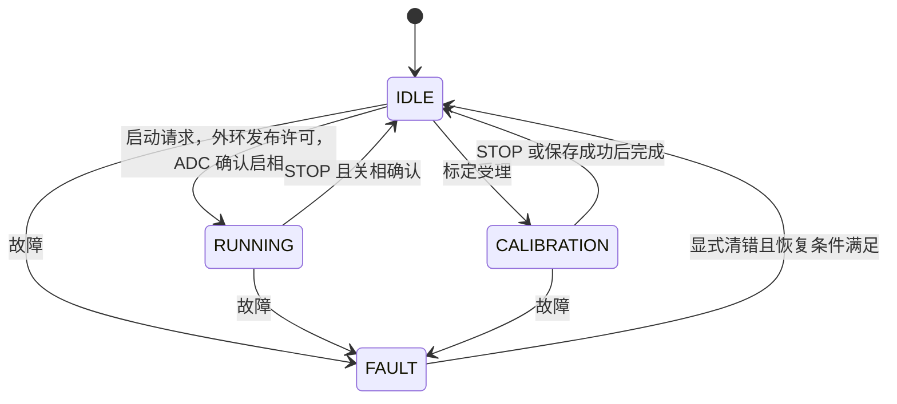

# APP 与 Loader 状态机设计

按 2026-11-10 的 `the-system-refactor` 工作树核对（分支提交 `a87bc5ce`）。两板每根轴各持有一个 `MotorStateMachine`。上电进入 IDLE。第五个枚举 SELF_TEST 保留线路映射，生产代码没有迁入该状态的事件。上电电流零偏在关相 IDLE 内采样。

## APP 电机状态与功率许可

APP1.6.2增加上位机位置会话策略：仅Type117显式不限位标志通过普通启动门禁后，
由本轴状态机发布`MotorControlState.host_position_unlimited`；外环快照只读此权限。
`host_feedback_ms`由来源正确的Type108在前台续期，监督拍按无符号毫秒差检测500ms失联并停机。
STOP、故障结束和初始化清除权限；普通RequestStart保持原行程策略。
位置目标、外环实测与OTG参考使用同一权限；不改轴记录、持久参数或其他动态保护。

| 主线 | 谁提出 | 何时改变主状态 |
| --- | --- | --- |
| 空闲 → 运行 | 前台受理启动，登记模式、起始目标和会话 | 外环发布启相意图，ADC 拍首复核本会话、采样、模式、STOP 和故障。只有 PWM 启相且读回确认后，才提交 `RUN` |
| 运行或标定 → 空闲 | 前台 STOP 或快拍任务请求停机 | 请求立即撤销许可。ADC 遇到待停请求先关相；监督拍或外环提交入口消费 STOP、清目标、撤销会话、确认关相，再提交 `STOP`。关相失败时进入故障 |
| 空闲 → 标定 | 前台受理指定标定类型 | 从关相空闲且输入有效的轴发起，受理时提交 `CALIBRATE`。需要通电的标定由 ADC 再复核并启相；机械零位保持关相 |
| 标定 → 空闲 | 快拍报告算法完成 | 先关相。需要安装 LUT 时由 ADC 在读角前复核会话；前台复核并保存，成功后由监督拍提交 `COMPLETE`。联合标定在同一会话转入电零位 |
| 任意状态 → 故障 | 保护逻辑锁存故障，或启相关相确认失败 | 快环看到故障立即抑制功率，慢拍处理故障并提交 `FAULT`。故障锁存和主状态写入发生在各自的执行上下文 |
| 故障 → 空闲 | 前台显式 CLEAR | 必须关相、输入有效、故障源满足恢复条件。若原子清故障字失败则恢复 `FAULT`；成功只回空闲，启动需重新请求 |

## 从 IDLE 判断请求能否受理

普通 START 要求无故障、无待处理启停或启动锁、已有数字关相确认、配置有效且已确认、采样有效、母线在允许范围、编码器在线。闭环模式还要求相应编码器标定标志齐全；位置模式额外核对当前角度的行程资格。受理后模式与 `start_pending` 可先更新，ADC 实际启相时才写入 RUNNING。

标定准入按类型判断。LUT 和电零位使用功率许可，电零位要求已线性化；机械零位保持关相，执行时检查输出轴就绪。带 Hall 的 LUT 可在一个 `epoch` 内继续联合电零位。`epoch` 用于拒绝旧会话的外环或标定结果。逐项判定见 [MotorStateMachine_RequestStart / RequestCalibration](../../firmware/app/motor_state_machine.c)，线路值见[启停协议](../protocols/README.md#control)。

### 各类请求的附加条件

所有运动和标定请求都经过前台状态机。基础采样检查包含快拍计数在上一个监督间隔有进展、当次电流零偏有效、三相电流与母线读数有限，以及板型要求的 MCU 温度新鲜且有效。功率准入同时检查滤波母线位于使能窗口，原始母线低于硬过压阈值。

| 请求 | 对配置、反馈和任务的附加要求 | 受理后的第一步 |
| --- | --- | --- |
| 117 电流、速度、位置、Vq | 配置有效且确认，编码器在线，具备完整的转子标定；位置模式额外检查当前位置在许可行程内 | 清理上一会话的参考和控制器。位置模式把当前位置作为初始参考，其余模式从零目标开始。 |
| 117 开环电压或开环电流 | 检查轴配置、母线与编码器在线；开环路径允许转子标定尚未齐全 | 登记模式和待启动标志；后续 116 须同时满足电角频率和电压或电流矢量限幅。 |
| 160 编码器 LUT | 轴空闲、关相、编码器在线、任务空闲、配置和功率条件满足；有轴预设时，标定电流预算须覆盖对齐电流及启动 d/q 电流幅值 | 进入 CALIBRATION，登记本代际的启相许可。 |
| 160 电零位 | 有功率标定的通用条件，另外要求已有线性化标志 | ADC 复核后对齐，完成后先关相。 |
| 160 机械零位 | 满足基础采样、轴配置、编码器及关相条件，快拍执行时输出轴反馈必须就绪 | 保持关相，生成机械零位并交给前台保存。 |

请求遇已有故障可返回 FAULT，已有待启动或交接锁可返回 BUSY，状态、模式或资格不符可返回 DENIED。116 还区分非法字段与超范围值；被拒时保留原目标。完整次序见[准入、目标检查和状态迁移](../../firmware/app/motor_state_machine.c)。

## 启动与 STOP 相遇时的事件顺序

以速度模式为例，初始 `state=IDLE`、`control_mode=NONE`、三相关闭。以下每行表示一次可能被其他上下文打断的事件，调用者不能把多行合并成一个“已启动”判断。

| 时刻 | 写入者 | 已发生的动作 | 此时能得出的结论 |
| --- | --- | --- | --- |
| 117 通过准入 | 前台 | 代际增加为 E，登记 SPEED，置 `start_pending` | 回复可为 ACCEPTED。尚未发出启相许可，主状态仍是 IDLE。 |
| 第一次有效外环提交 | 外环 | 复核 owner、E、模式和故障；速度环就绪后写 `phase_enable_epoch=E` | ADC 下一拍可以消费这次许可。 |
| ADC 本拍复核成功 | ADC | 取出并清空一次性许可，核对 E、输入、锁与外环就绪，操作 PWM 并读回 | 确认输出已启用后才转 RUNNING，清除 `start_pending`。启相复核或读回失败可锁存控制时序故障。 |
| STOP 恰好在许可发出后、ADC 消费前到达 | 前台 → ADC | 前台置 `stop_pending`、清许可和待启动意图、撤销控制模式。ADC 先处理 STOP 和故障 | 本次启动被撤销。外环或监督收尾后旧 E 失效，旧计算结果不能再启相。 |
| STOP 在已经 RUNNING 后到达 | 前台 → ADC / 慢拍 | 前台根据当时功率读回回复；ADC 遇 STOP 时关闭仍活动的输出，慢拍清控制器、结束会话并核对关相 | 0/0 表示数字输出已关，1/1 表示受理待关。若同时锁存故障，最终主状态进入 FAULT。 |

定位“看见模式、看不见出力”时，应在同一轴观察 `state`、`start_pending`、`phase_enable_epoch`、`stop_pending`、`fault_code` 和输出读回。三者的作用不同：模式选择控制算法，代际许可授权一次硬件操作，主状态记录已提交的结果。`epoch` 达到 UINT32_MAX 后若还需推进，代码锁存故障，避免计数回绕后误认旧工作。

## 标定阶段与故障恢复

| 交接标志 | 设置条件 | 谁消费，什么情况下拒绝 |
| --- | --- | --- |
| `MOTOR_CALIBRATION_NO_HANDOFF` | 标定正在执行，或联合标定开始下一阶段 | ADC 只在任务种类、功率状态、STOP、故障和启动锁均允许时执行一个快拍。 |
| `MOTOR_CALIBRATION_AWAITING_PUBLICATION` | 快拍任务已完成或 LUT 待发布，关相读回成功 | 前台准备候选。LUT 安装前由 ADC 检查原代际；最终保存前还核对原类型，防止同一 E 内的下一阶段误用上阶段候选。 |
| `MOTOR_CALIBRATION_AWAITING_COMPLETION` | 当前会话保存成功 | 监督拍消费 COMPLETE。若 STOP 或故障抢先发生，按停止或故障路径收尾。 |

带 Hall 的 LUT 有一段停稳等待。前台观察连续机械速度绝对值低于 1 rad/s 达 200 ms 后请求安装 LUT；在尚未满足停稳条件且等待达 6000 ms 时报告失败。ADC 安装成功后沿同一 E 转入联合电零位，待最终关相才保存整轴记录。Flash 写失败会报告存储故障。完整扫圈后记录 Hall 标定不合格原因、中途取消旧候选、存储失败是三条不同的退出路径。[标定发布实现](../../firmware/app/motor_calibration.c)

CLEAR 由前台执行。先核对实际关相、输入有效、标定会话空闲、配置合法及故障源恢复，再用原子比较交换清除已检查的故障字；期间若故障字已改变则保留 FAULT。不同故障有不同恢复条件：过流需要监督拍累计恢复时间，电压故障要求滤波母线回到使能窗口，编码器故障要求新鲜采样和编码器在线。关相读回失败导致的 `fault_locked` 阻止普通 CLEAR。[恢复判据](../../firmware/motor/protection/motor_fault.c)

## 从代码跟一条路径

- 从 [motor_state_machine.c](../../firmware/app/motor_state_machine.c) 的 `transition_motor_state` 开始读。它按 RUN、CALIBRATE、COMPLETE、STOP、FAULT、CLEAR 处理实际事件。初始化之后的主状态写入全部在这里。`MotorStateMachine_NextState` 给出五态之间允许的转换。
- 启动请求登记后，外环批准本次启相，ADC 在 `BeginFastTick` 处理 RUN。STOP、标定保存成功后的 COMPLETE、首次 FAULT 共用关相和会话收尾。CLEAR 在关相和故障源恢复后才回空闲，若同时发生新故障则仍锁存 FAULT。
- 每次 ADC 采样后，[MotorAxis_ControlFast](../../firmware/app/motor_axis.c) 先调用 `BeginFastTick` 检查故障和启相许可，再读取主状态。运行态执行 `MotorControl_Step`，可执行的标定态执行 `MotorCalibration_StepFast`。最后 `FinishFastTick` 接收本拍结果并检查新故障。
- 前台在 [motor_state_machine.c](../../firmware/app/motor_state_machine.c) 校验目标并直接写本轴，也从本轴读取 CAN 反馈。外环在 `MotorStateMachine_CommitOuterResult` 直接写有效结果。ADC 单独复核启相条件。
- 标定的停稳、LUT 安装和 Flash 保存见 [motor_calibration.c](../../firmware/app/motor_calibration.c)，线路状态和命令编号见[协议说明](../protocols/README.md)。除 Flash 事务外，这些交接不暂缓 ADC。

## Loader 下载与启动状态

APP 的 `epoch` 标记一次电机运行或标定会话。复位后由 Loader 创建下载会话，按来源节点、主机 nonce 和 Loader 分配的 session 核对写入权限。下载阶段保存在 RAM，激活、试运行尝试和确认三个标记保存在镜像的 Flash 描述符中。

| 当前阶段或条件 | 事件与守卫 | 动作与可观察结果 |
| --- | --- | --- |
| IDLE | 50 BEGIN 的清单与目标匹配，输出关闭且链路就绪 | 建立绑定，经过 READY 进入 ERASING；主循环按页擦除 APP 槽，完成后进入 RECEIVING。 |
| RECEIVING | 51 WRITE 的会话、偏移、长度和对齐有效 | 写入并回读，推进下一偏移。若重传已写区间，比较 Flash 内容；数据冲突返回错误。 |
| RECEIVING → VERIFYING | 52 FINISH，镜像已收齐 | 分段检查完整性和描述符。通过后进入 VERIFIED，镜像校验失败进入 ERROR。 |
| VERIFIED | 54 ACTIVATE，由匹配票据报告真实发送成功 | 重新核对镜像和提交条件，写激活标记并复位。事务进行中，55 ABORT、租约过期或链路丢失可撤销写权限。 |
| 复位后启动检查 | 救援窗口结束，允许启动且镜像有效 | 已确认镜像可跳转；首次试运行先写尝试标记；已尝试且未确认的镜像留在 Loader。 |
| LoaderApp 试运行 | 57 的版本、CRC、健康窗口及关相条件满足 | APP 写确认标记。通过同 UID 设备的 GET_INFO 回读角色和确认状态。 |

56 的 READY 表示原 APP 可以交接；54 的发送完成使 Loader 可以提交激活；57 成功才确认新 APP。重复 54 和截止点附近的已知实现行为见[Loader 交接时序及边界](loader/loader_product_v3.md)。状态迁移可用[双板电机用例](../../tests/unit/native/test_run_state.py)与[Loader 事务用例](../../tests/unit/native/test_loader_upgrade.py)分别验证。

### 复位后如何决定跳转

Loader 先确认复位原因、功率关闭及链路条件。看门狗复位、带有效 ENTER 邮箱的软件复位，或启动窗口内的有效驻留请求，均可使设备留在 Loader。常规启动等待 50 ms 后检查镜像完整性、向量和激活标记，再检查下表的两个持久标记。

| 尝试标记 | 确认标记 | 镜像已激活且通过检查时的决定 |
| --- | --- | --- |
| 擦除态 | 擦除态 | 写入并读回尝试标记，成功后跳转一次试运行。 |
| 有效 | 擦除态 | 上次试运行已消耗机会，留在 Loader，等待重新下载。 |
| 有效 | 有效 | 满足其他启动条件时可启动已确认 APP。 |
| 其他组合、半写或读取失败 | 任意 | 拒绝跳转。标记检查同时核对 magic 和反码。 |

57 由试运行 APP 处理。它要求通信就绪、监督有进展及连续 11 个健康检查间隔（每次至少 100 ms），当前关相且无已登记的 56 请求。BootHw 再核对版本、镜像 CRC、激活/尝试标记及试运行期限。5 s 内未确认时停止维护试运行看门狗；具体复位时刻取决于硬件看门狗。[启动判定](../../shared/image/image_transfer.c) · [健康检查与确认](../../firmware/app/app_loader.c)

### 设计变更时的验证轨迹

| 起点与注入事件 | 应检查的结果 |
| --- | --- |
| 117 已受理，启相前收到 STOP | 不产生该会话的后续使能；允许暂时看到模式与主状态处于不同阶段。 |
| 标定拟合已结束，在最终提交前撤销原会话 | 候选丢弃，旧会话不能写 Flash 或上报本次成功。 |
| 下载已 VERIFIED，一个其他票据报告发送成功 | 保持未激活；只有当前事务的物理完成事件才能进入标记写入路径。 |
| 首次启动已写尝试标记，确认前复位 | 不重复试运行。只有重新下载或满足已确认镜像的启动条件才能启动。 |

电机事件与抢占见[状态集成用例](../../tests/unit/native/motor_state_machine_integration_test.c)，掉电与标记组合见[Loader 内存用例](../../tests/unit/loader_upgrade_test.c)。
