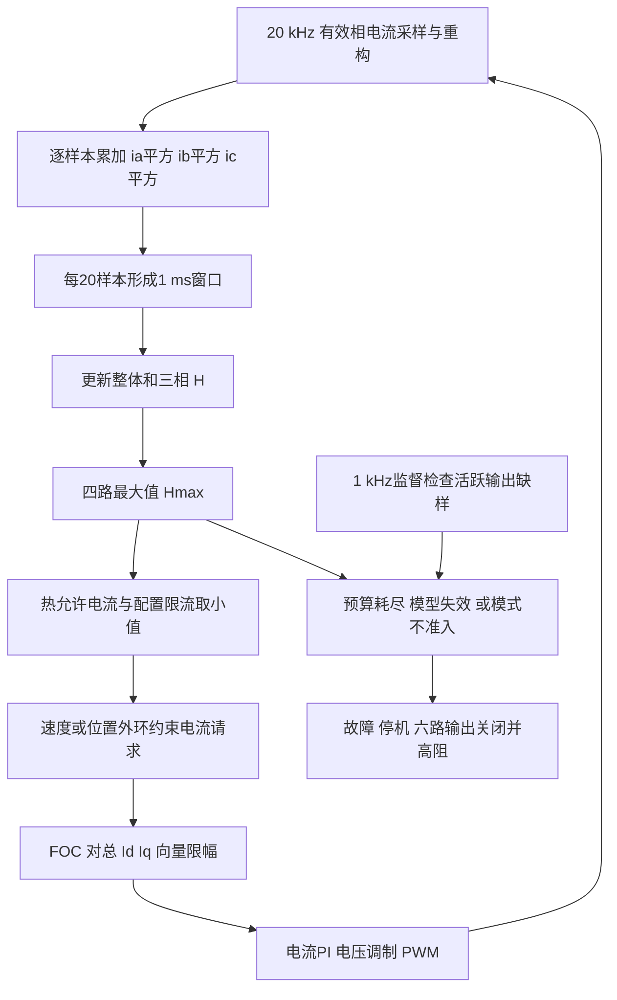

# 电机绕组热保护设计

文档版本：v1.0.0。整理日期：2026-10-17。适用：`codex/ovp-36v` 的 APP v0.6.0。
实现核对基准：`7e8808a5fc54358febf8363624213f16dad763c2`。

现有保护根据实测三相电流建立整体和逐相四个热负荷状态，先收紧可用电流，
再在预算耗尽或模型失效时停机。2026-10-16 实测已验证零速闭环叠加 Id 时的持续降额，
但默认参数尚未完成真实绕组温升与最坏安装条件标定，不能据此确定电机物理额定电流。

本设计说明现有软件及其边界。操作入口见[使用指南](../guides/motor_winding_thermal_protection_v1.md)，
帧与存储契约见[热参数协议](../protocols/motor_winding_thermal_configuration_v1.md)，
实测波形和恢复证据见[零速 Id 热测试报告](../reports/2026-10-16-zero-speed-id-thermal-test.md)。

## 1 保护对象与单位

`H` 是无量纲的归一化热负荷，1 表示参考热预算边界。`H=100%` 不表示 100 ℃，
也不是绕组温升百分比。算法没有输入绕组温度、环境温度、转子温度或实时热阻，
因此它是包含散热项的电流热预算模型，不是绝对温度观测器。

| 量 | 定义与单位 |
| --- | --- |
| `ia/ib/ic` | 校正并经现有扇区重构后的相电流，A；不是三路独立传感器原始值 |
| `Id/Iq` | 幅值不变 Clarke/Park 定义下的电流分量，A |
| `Ivec` | `sqrt(Id²+Iq²)`，A；不同于直流母线输入电流 |
| `Icont` | 连续向量电流参考，A |
| `Iphase` | 单相 RMS 连续电流参考，A，当前派生为 `Icont/sqrt(2)` |
| `H0/HA/HB/HC` | 整体及 A/B/C 相热负荷，无量纲比例 |
| `T_MCU` | MCU 内部温度，℃；与绕组热预算是两条独立保护链路 |

平衡旋转正弦电流的相 RMS 为向量幅值除以 `sqrt(2)`。零速保持时，某相电流可能
接近直流，不能沿用旋转时的 RMS 分摊来判断热点；逐相状态正是为覆盖这一差别。

## 2 实现分层与数据链路

| 层 | 实现入口 | 责任 |
| --- | --- | --- |
| 确定性模型 | [motor_thermal.c](../../firmware/motor/protection/motor_thermal.c) | 电流平方累计、四路积分、降额、锁存、配置校验，不访问硬件 |
| 应用组合 | [motor_thermal_control.c](../../firmware/app/motor_thermal_control.c) | 初始化、单槽配置发布、模式准入、缺样监督事件与诊断 |
| 快环与监督 | [foc_task.c](../../firmware/app/foc_task.c) | 提供真实采样、发布可用限流、执行模式切换与关相 |
| 电流执行 | [foc_algorithm.c](../../firmware/motor/foc/foc_algorithm.c) | 总 Id/Iq 向量限幅、电压限幅及电流 PI |
| 默认配置 | [motor_thermal_config.h](../../firmware/app/motor_thermal_config.h) | 默认参考电流、时间常数、门限和软件放行宏 |
| 参数与通信 | [foc_param.h](../../firmware/services/parameters/foc_param.h)、[协议](../protocols/motor_winding_thermal_configuration_v1.md) | MTH1 配置持久化与 CAN 读写 |



热状态、累计器和配置应用由 20 kHz 快上下文持有。1 kHz 监督任务只发布缺样事件并
要求关相，快环消费事件后锁定模型。通信只提交完整候选配置，不直接写热历史。
快环固定每 20 个有效样本更新热模型；常规速度环分频为 2 kHz，三个频率不可混用。

## 3 电流热模型

### 3.1 先平方再平均

每个窗口 `N=20`，累计 `Sa=sum(ia²)`，`Sb=sum(ib²)`，`Sc=sum(ic²)`。
归一化输入为：

```text
q0 = (2/3) * (Sa + Sb + Sc) / (N * Icont²)
qA = Sa / (N * Iphase²)
qB = Sb / (N * Iphase²)
qC = Sc / (N * Iphase²)
```

不能先对正负电流平均后再平方，否则交流电流会相互抵消、低估发热。
对理想平衡正弦及本工程变换，`q0=Ivec²/Icont²`。

### 3.2 一阶积分与冷却

每路状态独立更新，随后取四路最大值：

```text
tau = heating_tau，当 qj >= Hj；否则取 cooling_tau
x = dt / tau
alpha = x - x²/2 + x³/6       # 近似 1-exp(-dt/tau)
Hj_next = Hj + alpha * (qj - Hj)
Hmax = max(H0, HA, HB, HC)
```

`dt=1 ms`。系数只在初始化和停机配置准备时预计算，快环不逐拍调用指数函数。
升温和冷却的选择比较的是 `qj` 与当前 `Hj`，并非电机模式是否为 STOP。
关相但仍有有效采样时，模型继续根据真实残流更新并自然冷却。

缺样不会用假零电流补足窗口。关相维护暂停时不追补遗漏时间，不能把整段暂停
直接算作已经冷却；CPU 被调试器暂停时，模型和软件监督也都暂停。

### 3.3 默认时间常数的来源

整体模型冷态、恒定电流且无反馈降额时，有近似关系：

```text
H(t) = (I/Icont)² * (1-exp(-t/tau))
tau = -10 / ln(1-(3/8)²) = 65.98486785 s
```

这里使用的 8 A 和 10 s 是整体模型推算参考，不是当前允许运行电流或已完成的热安全测试。
该关系忽略逐相热点和运行降额，不能用它预测静止单相热点测试必在 10 s 停机。

## 4 配置与电流降额

| 参数 | 当前默认值 | 口径 |
| --- | ---: | --- |
| 连续向量参考 | 3.0 A | 待真实安装温升标定 |
| 相 RMS 参考 | 2.121320 A | `3/sqrt(2)`，派生值 |
| 热峰值边界 | 7.0 A | 仍受保存的 `current_limit` 限制 |
| 升温时间常数 | 65.984868 s | 模型参考值 |
| 冷却时间常数 | 120 s | `max(120 s, heating_tau)`，仍待物理验证 |
| 降额进入与退出 | 80% 与 70% | 带迟滞的状态切换 |
| 故障停机门限 | 100% | `Hmax` 达到后锁存 |
| 人工清故障资格 | 50% | 还须模型有效、配置放行且无待处理事件 |
| 软件参数放行 | 默认 1 | 仅表示软件允许准入，不证明已完成温升标定 |

非空有效 MTH1 保存配置优先于编译默认值。修改头文件并重新下载 APP，不保证覆盖已有
Flash 配置；应读回实际配置再判断本机使用值。本轮台架保存的运行限流为 6 A，
因此冷态实际边界为 `min(6,7)=6 A`。

`Hmax >= enter` 置降额状态，`Hmax <= exit` 解除。降额期间：

```text
若任一相 H >= 整体 H：Isustain = min(Icont, Iphase)
否则：                 Isustain = Icont
w = clamp((Hmax-enter)/(trip-enter), 0, 1)
Ithermal = Ipeak + w * (Isustain-Ipeak)
Iallowed = min(current_limit, Ithermal)
```

无效模型或已锁存热故障时，允许电流为 0。热降额不改保存的 `current_limit`、PI 增益或
Flash。参数未软件放行、待应用配置或缺样事件也会阻止功率准入。
进入降额状态时 `Ithermal` 仍可能高于运行限流，所以 `derating=true` 与实际
电流开始下降可以不同步；本轮分别发生在约 10.33 s 和 10.74 s。

降额是反馈过程：电流下降会使 `q` 下降，H 可以稳定在停机门限以下。
本轮 H 约 0.992795、相热点主导，代入上式得允许电流约 2.297 A，与实际约 2.295 A 一致。
未触发 100% 故障不能单独判断保护失效，也不能把此平衡电流当作已标定的物理额定值。

## 5 控制执行与模式差异

FOC 在电流 PI 前约束总向量；超出边界时对 Id 和 Iq 等比例缩放，不能分别夹紧至
同一上限而使总量达到上限的 `sqrt(2)` 倍。这里限制的是指令向量；瞬时测量电流仍可能
存在跟踪纹波和过冲，不等于实测电流数学上绝不超过配置值。

普通速度和位置运行路径会设置 `Id=0`。本轮零速加 Id 的方法只存在于冻结的临时台架
副本：保持原 2 kHz 速度 PI 输出 Iq，Id 使用剩余向量额度：

```text
Iq_actual = clamp(Iq_request, -Iallowed, Iallowed)
Id_actual = min(Id_test_request, sqrt(max(0, Iallowed²-Iq_actual²)))
```

这样在速度有偏差时优先保留纠速能力。本轮 200 ms 主机心跳超时关相也是专用台架
逻辑，不是生产固件现有的通用 Id 接口或热采样看门狗；测试后已恢复原 APP。

| 模式类别 | 热态行为 |
| --- | --- |
| 电流 1、速度 2、位置 3 | 允许受限电流继续运行，预算耗尽或模型失效则停机 |
| 无感速度 16 | 闭环受热限制；未完成启动时另有可用电流不足的退出条件 |
| 带电标定及其他受控功率模式 | 进入热降额后不继续标定，执行拒绝或锁存退出 |
| 电压开环或 Vq 等路径 | 不能靠 Iq 参考实现恒流；实际电流越过边界时退出，热降额也退出 |
| STOP、设零、默认参数、保存、清故障、零偏标定 | 可执行维护，不借此清除热历史 |

mode 18 虽在热模块的分类中保留编号，当前 APP 已裁剪其运行入口，不能据此认为可用。

外环有条件积分、限幅和 `PI_Controller_TrackOutput` 等抗饱和处理；位置控制也会将饱和
总电流减去前馈后回算积分。普通速度环的部分跟踪用于夹紧积分状态，最终 Id/Iq 矢量
缩放没有通用接口把实际施加转矩回传给全部外环。因此不能笼统保证任意前馈、Id 注入
和瞬态组合下都完全不积累未施加电流。电流 PI 对实际调制电压的回算是另一层抗饱和。

## 6 故障与热历史

| 条件或操作 | 状态与输出 |
| --- | --- |
| `Hmax >= trip` | 热锁存、允许电流 0；快环请求 mode 0 并关相 |
| 非有限电流、窗口异常、数值失效或活跃缺样 | 模型失效并锁存禁止出力；不能只清错误码恢复 |
| 进入不允许热态运行的标定模式 | 执行热准入拒绝，运行中的降额退出可锁存 |
| STOP、换模式、重复初始化 | 保留 H 和已有热锁存 |
| mode 10 清热故障 | 满足冷却门限及有效性资格后才解除锁存，结束在 mode 0，不自动恢复旧运动目标 |
| mode 10 清其他故障 | 不清热历史，也不绕过独立热锁存 |
| MCU 复位或掉电 | RAM 热历史丢失，新进程从 H=0 开始；绕组实际温度不会随之下降 |

故障 16 表示绕组热预算、模型或相关准入保护动作，不仅表示 H 已达到 100%。
参数未软件放行使用现有参数错误 12；已有其他故障通常保留首个原因，非法电流参考
执行路径可直接报告 16。MCU 温度达到 100 ℃使用独立故障 10，不能与 H 门限混为一谈。

活跃输出时，热更新的毫秒时间差超过 2 ms 会使模型失效；1 kHz 监督也检查发布的
更新时间，发现缺样则发事件并关相。这是调度与采样完整性监督，不保证检测所有 ADC
饱和、增益错误或重构误差。停机验证需检查六路主互补输出及引脚高阻，不能仅看 MOE。

## 7 CAN 配置与 Flash

七组配置分别为连续电流、峰值电流、升温常数、降额进入、退出、停机及恢复。
SET 使用 `0x80/82/84/86/88/8A/8C`，对应 GET 为下一奇数命令，`0x8E` 查询扩展版本 2。
标准 ID 为 `(node_id << 8) | command`，数据为 4 字节大端 float32。
门限在线上传百分数 80、70、100、50，模型与 Flash 内保存比例 0.8、0.7、1、0.5。

仅 mode 0、三相关闭、模型有效且配置单槽空闲时接受 SET，下一关相快拍应用完整配置。
成功按配对 GET 回复接受值，失败回复 `-1.0`；GET 可查询已接受但尚待应用的值。
写后逐项读回，再用 mode 9 保存。门限必须保持
`0 <= clear < exit < enter < trip <= 1`；修改单项也会校验全组关系。

降低连续参考时，各 H 至少按 `(旧参考/新参考)²` 放大；提高参考不减少已有 H。
修改配置不清锁存，mode 8 不覆盖独立热配置。热采样周期、缺样门限和热历史没有本扩展
的可写入口。完整收发示例和黄金向量以[通信契约](../protocols/motor_winding_thermal_configuration_v1.md)为准。

Flash 保持 schema 10，在原 2344 字节前缀之后追加 40 字节 MTH1/v1：魔数、版本、
七个小端 float32、覆盖前 36 字节的 CRC32/IEEE，总参数结构长 2384 字节。
只保存配置，不保存运行 H。电零位、机械零位、方向及 LUT 偏移保持。
旧尾全 0 或 FF 使用默认值；非空坏记录禁止参数准入。旧固件再次保存可能擦除扩展，
历史独立候选的偏移 2292 也不能直接当作本版偏移 2344。

现有 48 字节周期状态不增加实时 H，温度字段仍为 MCU 温度。
需要查看 H 时使用匹配 AXF 的调试诊断，不可把另一镜像的 RAM 地址直接复用。

## 8 观测与复测

| 观察项 | 用途 |
| --- | --- |
| `MotorControl.ModeNow/ErrorNow` | 识别运行、退出和故障，不仅检查电流是否变小 |
| `MotorControl.current_limit` | 保存的运行限流，降额时应保持原配置 |
| `MotorControl.thermal_current_limit_a` | 实际发布的可用边界，应随降额变化 |
| `MotorControl.idRef/iqRef` 与 `FOC.Id/Iq` | 区分请求、执行约束和实际跟踪 |
| `FOC.Ia/Ib/Ic` | 逐相热点与电流采样检查 |
| `thermal_diagnostics.model.heat[0..3]` | 整体与三相 H，诊断只读 |
| `max_heat/available_a/derating/fault_latched/valid` | 降额、失效与锁存是否符合门限 |
| 编码器角度和速度、`FOC.Vbus_filt/temp` | 分辨转动与测速噪声，并记录供电和 MCU 温度 |

运行中 SWD 分字段读取不是原子快照，`max_heat` 与四路 H 可能来自不同更新拍。
离线统计用四路 H 的最大值交叉核验，异常快照应重读；主机约 40 Hz 快照不能给出
20 kHz 全部瞬时峰值或精确保护响应时间。严禁写诊断状态来清热预算。

本轮零速加 Id 的完整步骤、心跳约束、备份、冷却和镜像恢复见[测试报告](../reports/2026-10-16-zero-speed-id-thermal-test.md)。
该方法能减少无负载轮电机持续旋转，仍会有纠速 Iq 和角度漂移；它不是位置保持试验。

## 9 物理热标定与验证范围

现有两项主要电机标定量为连续向量参考和升温时间常数；相 RMS 和冷却常数按当前规则
派生。派生规则并不免除在最坏安装、环境和散热条件下验证其保守性的责任。

真实热标定应先依据电机供应商与机构要求确定绕组、磁体、驱动板的允许温度，布置
绕组温度测点并记录环境温度；再通过受控电流稳态及升降温记录确认连续能力和时间常数。
需要覆盖旋转均匀发热和不同电角位置的零速单相热点，并核对驱动板自身温升。
记录实测 `I²`、真实温度、环境与安装状态，而不是用 H 曲线反向证明 H 参数正确。

| 验证层次 | 当前依据与范围 |
| --- | --- |
| 模型与保护离线检查 | 解析曲线、热点、迟滞、锁存、配置重标定、向量限流与异常输入，见原生测试 |
| 低门限实机 | [2026-10-15 记录](../reports/2026-10-15-winding-thermal-running-mode.md)验证过热停机及冷却人工清除；使用临时较低门限 |
| 默认门限实机 | [2026-10-16 记录](../reports/2026-10-16-zero-speed-id-thermal-test.md)验证零速加 Id 的持续降额与台架心跳关相，未触发 100% 锁存 |
| 真实热能力 | 尚未完成绕组温度、长期连续电流、最坏冷却和安装边界标定 |
| 发布与耐久 | 本轮不是发布验证，也未覆盖所有模式、全部 ADC 故障、掉电热历史或长期寿命 |

离线热模型测试入口为 `python tools/run.py test_motor_thermal --cc <C99编译器>`，
其实现位于 [test_motor_thermal.py](../../tests/unit/native/test_motor_thermal.py)，不会连接硬件。
本次文档整理未重新通电或修改任何控制策略。
