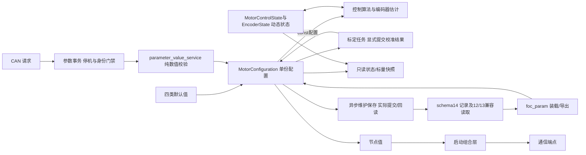

# 参数所有权与四类配置 v1

更新：2026-10-20。适用当前核心工程。本页描述配置与运行状态分离后的实际RAM和文件归属。
四类配置不再嵌入运行状态；[schema14](../protocols/parameter_schema14_storage_v1.md)删除退役齿槽占位，
只读兼容有效schema12/13；schema10通过显式离线工具迁移，不在启动时自动写回。
基础输入、派生量、标定结果与运行状态的分类及宏计算边界见
[参数来源与计算时机](parameter_sources_v1.md)。

## 从哪里修改配置

| 类别 | 默认值入口 | 活动对象与归属 |
| --- | --- | --- |
| 硬件 | `platform/api/board_profile_defaults.h`；采样派生与保护策略仍在对应能力头 | 编译期只读，平台实现使用；不能通过 CAN 改采样尺度或保护阈值 |
| 电机 | `motor/motor_profile_defaults.h`，含热模型基础输入 | `s_motor_configuration.model`：极对数、R/L/磁链、电流环整定、标定电流及绕组热配置 |
| 应用 | `services/parameters/application_profile_defaults.h`，含外环/前馈及既有关节配置修订 | `s_motor_configuration.application`：运行包络、速度/位置外环、轴范围及默认关闭的速度前馈 |
| 设备个体 | `services/parameters/device_profile_defaults.h` | `s_motor_configuration.device`：节点与三相采样零偏；其 `encoder` 成员单份持有LUT、方向、电零位、机械零位和标定标志；生产身份由独立身份页提供 |

以上路径相对 `firmware/`。硬件配置为编译期常量，其余三类活动配置组成独立的
`MotorConfiguration`，没有复制成每类各一份完整运行对象或Flash记录。

板卡与电机选择分别使用 `FOC_ACTIVE_HW_PROFILE`、`FOC_ACTIVE_MOTOR_PROFILE`；
当前各只有一份已实现 profile，未知 ID 编译报错。采样电阻另由
`CURRENT_SENSE_SHUNT_MILLIOHM` 选择：公共头文件默认与主工程显式配置均为 6 mΩ，
仅在硬件确为 2 mΩ 时使用显式编译选项覆盖。
增加新型号必须提供实际数值，不用枚举占位假装已支持。

默认零偏由板级 ADC 中点提供，真实零偏属于每台设备的标定结果。
UID由平台读回，产品/硬件修订取shared目标清单；SN和motor_type来自独立64 B生产身份记录，
普通参数写不开放这两个字段。motor_type尚不自动选择编译期电机profile，批次字段未定义。

## 状态和读写边界

`app/runtime/motor_axis.c` 分别持有以下单份对象；配置、运行态和编码器动态状态不再互相包含：

| 对象 | 类型与内容 | 写入边界 |
| --- | --- | --- |
| `s_motor_configuration` | `MotorConfiguration`；model/application/device、配置确认状态和来源 | 参数装载/默认值、通过门禁的参数事务及标定结果提交 |
| `s_motor_state` | `MotorControlState`；模式、故障、目标、参考、动态限幅等运行态 | 生命周期、执行及控制路径 |
| `s_rotor_encoder` | `EncoderState`；采样有效性、读帧状态、PLL和位置/速度估计 | 编码器采样与估计路径；不再持有LUT、方向或零位 |

按 Watch 观测要求保留非静态符号；公共头不提供这些对象的可写 `extern` 接口。
算法通过显式的只读配置参数和独立运行态参数工作；跨模块通过请求、值快照或明确的对象参数交互，
不把全局可见地址作为公共写接口，也不创建第二份完整参数或 LUT。
`app/runtime/motor_parameter_transaction.c` 独占 `s_config_revision`、请求缓存及保存票据，Axis 保留转发与调度。
事务模块不保存运行对象指针，不接管主状态机的准入或真实关相。
模式、故障、速度/位置/电流目标、参考值和测量仍是运行状态，不能当作持久配置。
确认状态和来源随配置对象管理；活动 revision 随参数事务管理，不能用 Flash schema 代替。

- 参数写入先核对停机、资源归还、source/sequence/完整内容和 expected_revision。
- 单标量成功只增加一次 revision；失败无副作用；读回值不含内部指针。
- 保存使用已有临时工作区，122 受理不代表 Flash 成功；提交并回读后才返回 OK。
- Flash 擦写首个失败立即结束，不继续后续页或双字；忙等待次数耗尽后，本次启动内拒绝后续写入，
  需要复位后重新建立存储资格。该软件边界不保证单 bank 取指停顿时的墙钟期限，不能代替硬件故障处理。
- 控制与估计只读配置、更新各自运行态；标定通过显式可写配置对象提交结果，通信仅消费服务与值快照，不持有参数指针。
- `Param_Upload` 只编码配置，`Param_Download` 只装载配置；不接收运行对象，也不保存PI积分、目标或采样历史。
- `MotorAxis_NodeId()` 给组合层复制地址；已删除通信拥有的参数节点桥和 Setter。
  通信端点在初始化时冻结地址，本批未新增在线改地址能力。运行期DEFAULTS保留现用node，
  不把控制默认值恢复当作生产改址；空白/损坏记录启动时仍使用既有默认地址1。

## 兼容与尚未完成

schema14记录为2288字节，保留整条CRC与16KiB参数/身份区域；旧schema12/13仍按原始长度校验后装载。
齿槽/摩擦旧字段只保留存储占位，装载不用于控制，导出清零；
参数ID 0x47～0x4B退役且不复用，其余目录ID/缩放/权限保持。
`node_id`与`speed_limit_rad_s`是独立持久字段；当前装载不再从角色覆盖节点，
也不从节点选择应用包络。应用编译上限为既有20 rad/s，默认仍0.5 rev/s和6 A，
有效AXS只进一步收窄。原混合记录仍单份保存，没有创建四份存储。
这是明确行为变化，例如无AXS的旧node3/字段10的有效上限从π变为10，role=roll/node7不再覆盖为3。
完整兼容边界、黄金向量与部署例子见[地址与应用包络分离v2](../protocols/parameter_node_application_v2.md)。

下一批若要独立保存硬件/电机profile ID、第二个产品硬上限或批次，
必须另行定义版本化存储/协议和制造写入权限。当前不新增这些ABI，也不自动迁移旧校准。

本次分离不改schema14/12/13的字段、长度、CRC或兼容装载规则，仅改变RAM对象及接口。
内部 RAM 偏移已变化，必须重新生成并使用该候选匹配的新AXF；历史AXF和固定地址脚本不能解释新对象。
实际下载镜像也必须与所用AXF匹配。本页不构成构建或实机验证通过的证据。
上电会重新采集关相电流零偏，不将存储零偏当作本次启动资格。
实施与证据见[参数所有权记录](../plans/completed/2026-09-29-parameter-ownership-v1.md)。

Watch观测符号不作为跨模块数据接口。架构边界检查拒绝其他生产模块自行声明或引用
Axis和参数事务的观测对象；参数事务的可写配置入口只允许Axis调用，通信与业务适配
统一使用Axis的参数请求与值快照。主状态机上下文不提供可写extern。
这些约束不改变Watch对象名，也不增加新的可写对象访问器；不能通过Watch任意改配置
来代替正常参数写入与状态准入。
