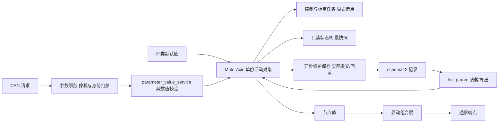

# 参数所有权与四类配置 v1

更新：2026-10-17。适用当前核心工程。本页描述实际RAM和文件归属。
配置分组保持单份；本次移植在[schema13](../protocols/parameter_schema13_delivery_v1.md)
尾追加热保护/前馈配置，兼容只读装载有效schema12，不恢复旧交付schema10的运行时迁移。
基础输入、派生量、标定结果与运行状态的分类及宏计算边界见
[参数来源与计算时机](parameter_sources_v1.md)。

## 从哪里修改配置

| 类别 | 默认值入口 | 活动对象与归属 |
| --- | --- | --- |
| 硬件 | `platform/api/board_profile_defaults.h`、`current_sense_profile.h`、各平台能力 profile | 编译期只读，平台实现使用；不能通过 CAN 改采样尺度或保护阈值 |
| 电机 | `motor/motor_profile_defaults.h`、`motor/protection/motor_thermal_config.c` | `MotorControlState.model`：极对数、R/L/磁链、电流环整定、标定电流及绕组热配置 |
| 应用 | `services/parameters/application_profile_defaults.h`、`motor/foc/speed_feedforward.c` | `MotorControlState.application`：运行包络、速度/位置外环、轴范围及默认关闭的速度前馈 |
| 设备个体 | `services/parameters/device_profile_defaults.h` | `MotorControlState.device`：节点与三相采样零偏；编码器校准和LUT在EncoderState，生产身份由独立身份页提供 |

板卡与电机选择分别使用 `FOC_ACTIVE_HW_PROFILE`、`FOC_ACTIVE_MOTOR_PROFILE`；
当前各只有一份已实现 profile，未知 ID 编译报错。采样电阻另由
`CURRENT_SENSE_SHUNT_MILLIOHM` 选择：公共头文件默认与主工程显式配置均为 6 mΩ，
仅在硬件确为 2 mΩ 时使用显式编译选项覆盖。
增加新型号必须提供实际数值，不用枚举占位假装已支持。

默认零偏由板级 ADC 中点提供，真实零偏属于每台设备的标定结果。
UID由平台读回，产品/硬件修订取shared目标清单；SN和motor_type来自独立64 B生产身份记录，
普通参数写不开放这两个字段。motor_type尚不自动选择编译期电机profile，批次字段未定义。

## 状态和读写边界

`app/runtime/motor_axis.c` 持有唯一 MotorControlState、EncoderState 和各控制对象。
按 Watch 观测要求保留非静态符号；跨模块仍通过快照、请求与显式对象参数交互，
不把全局可见地址作为公共写接口，也不创建第二份完整参数或 LUT。
`motor_parameter_transaction.c` 独占请求缓存、活动修订及保存票据，Axis 保留转发与调度。
事务模块不保存运行对象指针，不接管主状态机的准入或真实关相。
模式、故障、速度/位置/电流目标、参考值和测量仍是运行状态，不能当作持久配置。
确认状态、来源和活动 revision 是所有者元数据，不能用 Flash schema 代替。

- 参数写入先核对停机、资源归还、source/sequence/完整内容和 expected_revision。
- 单标量成功只增加一次 revision；失败无副作用；读回值不含内部指针。
- 保存使用已有临时工作区，122 受理不代表 Flash 成功；提交并回读后才返回 OK。
- 控制与标定按既有上下文借用对象，通信仅消费服务与值快照，不持有参数指针。
- `MotorAxis_NodeId()` 给组合层复制地址；已删除通信拥有的参数节点桥和 Setter。
  通信端点在初始化时冻结地址，本批未新增在线改地址能力。运行期DEFAULTS保留现用node，
  不把控制默认值恢复当作生产改址；空白/损坏记录启动时仍使用既有默认地址1。

## 兼容与尚未完成

schema12的4304字节、CRC和16KiB参数/身份区域保持。
齿槽/摩擦旧字段只保留存储占位，装载不用于控制，导出清零；
参数ID 0x47～0x4B退役且不复用，其余目录ID/缩放/权限保持。
`node_id`与`speed_limit_rad_s`是独立持久字段；当前装载不再从角色覆盖节点，
也不从节点选择应用包络。应用编译上限为既有20 rad/s，默认仍0.5 rev/s和6 A，
有效AXS只进一步收窄。原混合记录仍单份保存，没有创建四份存储。
这是明确行为变化，例如无AXS的旧node3/字段10的有效上限从π变为10，role=roll/node7不再覆盖为3。
完整兼容边界、黄金向量与部署例子见[地址与应用包络分离v2](../protocols/parameter_node_application_v2.md)。

下一批若要独立保存硬件/电机profile ID、第二个产品硬上限或批次，
必须另行定义版本化存储/协议和制造写入权限。当前不新增这些ABI，也不自动迁移旧校准。

内部 RAM 偏移已变化，调试和采样脚本必须使用该候选对应的 ELF。
调试必须使用实际下载候选匹配的HEX/AXF，不能用本页结构解读历史固件。上电会重新采集关相电流零偏，不将存储零偏当作本次启动资格。
实施与证据见[参数所有权记录](../plans/completed/2026-09-29-parameter-ownership-v1.md)。
