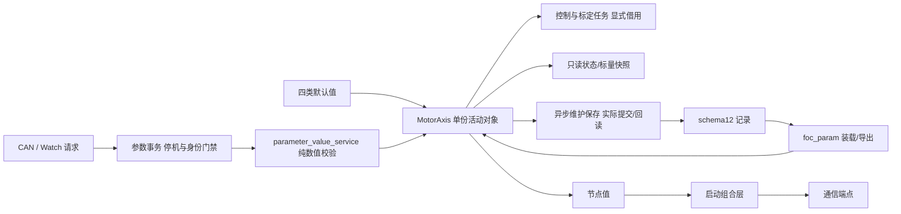

# 参数所有权与四类配置 v1

本页描述实际 RAM 和文件归属。配置分组不是新增 Flash 格式，
存储仍使用 [schema12](../protocols/parameter_schema12_loading_policy_v1.md)。

## 从哪里修改配置

| 类别 | 默认值入口 | 活动对象与归属 |
| --- | --- | --- |
| 硬件 | `platform/api/board_profile_defaults.h`、`current_sense_profile.h`、各平台能力 profile | 编译期只读，平台实现使用；不能通过 CAN 改采样尺度或保护阈值 |
| 电机 | `motor/motor_profile_defaults.h` | `MotorControlState.model`：极对数、R/L/磁链、电流环整定与标定电流 |
| 应用 | `services/parameters/application_profile_defaults.h` | `MotorControlState.application`：运行包络、速度/位置外环、轨迹和轴范围 |
| 设备个体 | `services/parameters/device_profile_defaults.h` | `MotorControlState.device`：节点、三相采样零偏与摩擦模型；编码器校准和 LUT 在 EncoderState，齿槽表由齿槽模块单份持有 |

板卡与电机选择分别使用 `FOC_ACTIVE_HW_PROFILE`、`FOC_ACTIVE_MOTOR_PROFILE`；
当前各只有一份已实现 profile，未知 ID 编译报错。采样电阻另由
`CURRENT_SENSE_SHUNT_MILLIOHM` 选择，主工程配置仍为 6 mΩ。
增加新型号必须提供实际数值，不用枚举占位假装已支持。

默认零偏由板级 ADC 中点提供，真实零偏属于每台设备的标定结果。
UID 由平台读回，产品/硬件修订取 shared 目标清单；没有新增序列号或批次字段。

## 状态和读写边界

`app/runtime/motor_axis.c` 持有唯一 MotorControlState、EncoderState 和各控制对象。
按 Watch 观测要求保留非静态符号；跨模块仍通过快照、请求与显式对象参数交互，
不把全局可见地址作为公共写接口，也不创建第二份完整参数或 LUT。
`motor_parameter_transaction.c` 独占请求缓存、活动修订及保存票据，Axis 保留转发与调度。
事务模块不保存运行对象指针，不接管主状态机的准入或真实关相。
模式、故障、速度/位置/电流目标、参考值和测量仍是运行状态，不能当作持久配置。
确认状态、来源和活动 revision 是所有者元数据，不能用 Flash schema 代替。

- 参数写入先核对停机、资源归还、source/sequence/完整内容和 expected_revision。
- 单标量成功只增加一次 revision；失败无副作用；读回值不含内部指针。
- 保存使用已有临时工作区，122 受理不代表 Flash 成功；提交并回读后才返回 OK。
- 控制与标定按既有上下文借用对象，通信仅消费服务与值快照，不持有参数指针。
- `MotorAxis_NodeId()` 给组合层复制地址；已删除通信拥有的参数节点桥和 Setter。
  通信端点在初始化时冻结地址，本批未新增在线改地址能力。

## 兼容与尚未完成

schema12 的 4304 字节、CRC、参数目录 ID/缩放/权限和 16 KiB 分区保持。
旧记录以节点表达轮子场景，`foc_param.c` 只在装载时把它解析为
`application.speed_ceiling_rad_s`；参数值服务随后不再据通信地址选择应用上限。
轴记录到节点的旧兼容映射仍在该边界保留。因此**持久层的应用角色和设备地址尚未完全独立**。

下一批若要独立保存应用角色、硬件/电机 profile ID、生产序列号/批次，
必须另行定义版本化存储/协议和制造写入权限。当前不新增这些 ABI，也不自动迁移旧校准。

内部 RAM 偏移已变化，调试和采样脚本必须使用该候选对应的 ELF。
本轮实机测试继续使用独立冻结的旧 HEX/AXF，不能用本页新结构解读旧固件。
实施与证据见[参数所有权记录](../plans/completed/2026-09-29-parameter-ownership-v1.md)。
