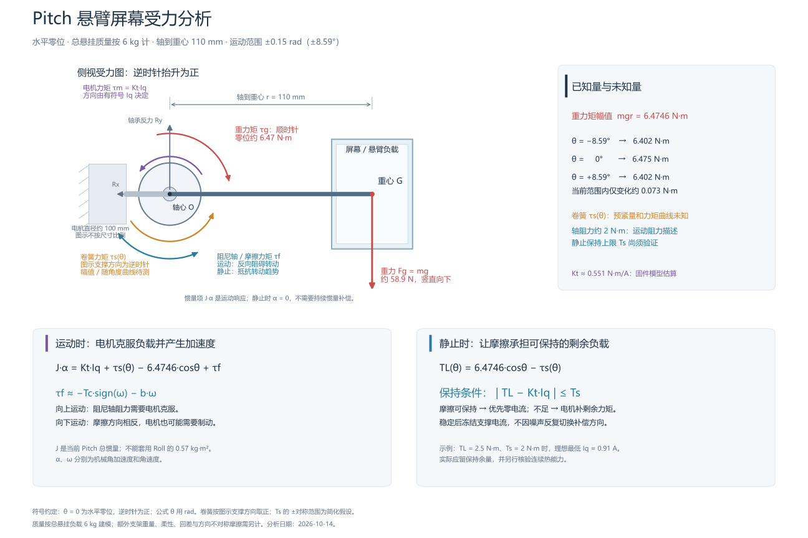

# Pitch 悬臂屏幕受力分析

版本 v1，2026-10-14。对象为水平零位的Pitch悬臂屏幕，旋转轴上装有卷簧和阻尼轴，当前运动范围为±0.15 rad（±8.594367°）。目标是在允许的位置误差内，利用卷簧和静摩擦承担负载，只让电机输出必要的支撑力矩。



## 已知结构和坐标

按侧视方向定义逆时针抬升为正，机械零位时轴心O到屏幕重心G的连线水平。本文的正向约定用于力矩分析，不替代编码器方向或电机相序标定。

| 量 | 数值或状态 |
|---|---|
| 悬挂质量 m | 约6 kg，计算暂按总悬挂负载处理；额外支架质量须另计 |
| 轴到重心 r | 约110 mm，即0.110 m |
| 电机直径 | 约100 mm；不直接决定重力力臂 |
| 位置范围 | −8.594367°～+8.594367°，即−0.15～+0.15 rad |
| 轴运动阻力 | 用户估计约2 N·m；不等于已测静止保持上限 |
| 卷簧力矩 | 零位预紧量、角度曲线及回差均未测 |
| 电机转矩常数 Kt | 固件磁链模型估算0.55132875 N·m/A，轴端实际值待核验 |
| Pitch轴端总惯量 J | 未测，不能复制Roll的0.57 kg·m² |

图为力学示意，不按机械尺寸比例绘制。屏幕与悬臂暂按刚体处理，支承反力Rx/Ry由轴承和机架承担；理想静止、仅有重力和纯力矩时Ry≈mg≈58.9 N。轴心处反力对轴心力矩为零，但轴承仍承受载荷。

## 重力和卷簧

重力始终竖直向下，大小为mg≈58.9 N。相对水平零位转动θ时，重力力矩为顺时针，按本文符号为：

```text
τg(θ) = −m g r cosθ = −6.4746 cosθ  N·m
```

三角函数输入用rad；显示位置和运动参数可继续用度及°/s。端点重力矩幅值为6.401897 N·m，零位为6.4746 N·m，全范围相对零位仅减少约0.072703 N·m。因此该小范围内重力几乎恒定，角度相关的负载变化应重点检查卷簧曲线、摩擦差异与结构弹性。

卷簧提供的有符号力矩记为τs(θ)。图示逆时针支撑为正；实际方向和幅值以装配测量为准，过度预紧也可能使净负载转向。不能仅根据“卷簧”名称假定线性力矩；若实测支持线性模型，才用预紧力矩和扭转刚度描述。

需要电机和摩擦共同抵消的净负载为：

```text
TL(θ) = 6.4746 cosθ − τs(θ)
```

TL可以为正、零或负，决定所需支撑方向，而不是由上一次运动方向决定。

## 运动时的力矩平衡

运动方程为：

```text
J α = Kt Iq + τs(θ) − 6.4746 cosθ + τf
```

摩擦滑动模型可暂写为τf≈−Tc sign(ω)−bω，Tc为库仑摩擦幅值，b为粘性阻尼系数；实际低速还可能有脱黏、回差和方向不对称。向上运动时电机需克服向下的摩擦，向下运动时摩擦方向相反。电流正负不能单独用来判定运动方向，下行时也可能需要正向电机力矩制动。[旋转摩擦模型](https://www.mathworks.com/help/sdl/ref/loadedcontactrotationalfriction.html)

惯量项Jα是运动响应，不是另一项独立外力。停止且α=0时，不需要持续惯量前馈。仅屏幕平行轴项mr²≈0.0726 kg·m²；总惯量还包括屏幕绕重心惯量、电机转子和支架，不能据此直接填成总J。

运动可使用负载模型前馈、轨迹加速度前馈和反馈纠偏，模型不准确的部分由有界反馈修正。[模型前馈与反馈控制](https://modernrobotics.northwestern.edu/nu-gm-book-resource/11-4-motion-control-with-torque-or-force-inputs-part-3-of-3/)

## 静止时的保持条件

静止时ω=0且α=0，力矩满足：

```text
Kt Iq + τs(θ) − 6.4746 cosθ + τf = 0
```

静摩擦会在保持能力范围内抵抗转动趋势，幅值不是固定2 N·m，也不能用带噪声的零速符号指定方向。若暂按双向对称的最大静摩擦Ts建模，则存在静止平衡的条件为：

```text
|TL − Kt Iq| ≤ Ts
可保持电流区间：[(TL − Ts)/Kt, (TL + Ts)/Kt]
理想最小电流：Iq,min = sign(TL) × max(|TL| − Ts, 0) / Kt
```

这是理想静止可行区间，不是自动保证长期稳定。实际应根据温度、磨损和扰动对可用静摩擦留余量；方向不对称时用两侧分别测得的门限。[静摩擦锁定与解锁条件](https://www.mathworks.com/help/sdl/ref/loadedcontactrotationalfriction.html)

以Ts=2 N·m、Kt=0.55132875 N·m/A为**示例假设**：

| 净负载力矩幅值 | 理想最低保持电流幅值 |
|---|---:|
| 1.5 N·m | 0 A |
| 2.5 N·m | 0.907 A |
| 3.0 N·m | 1.814 A |
| 6.4746 N·m，无卷簧支撑的水平零位 | 8.116 A，超过当前7 A运行上限 |

零位若卷簧只支撑4 N·m，净负载为2.4746 N·m，理想保持电流约0.861 A；但向上低速运动还须克服约2 N·m摩擦，无加速时就需约8.116 A。这说明“小电流能够保持”和“7 A内能够推动运动”是两个不同的可行条件。

若希望零位的正向保持电流不超过1 A，静摩擦确为2 N·m，则卷簧至少需支撑约3.923 N·m；再预留0.4 N·m保持余量，则至少约4.323 N·m。过强卷簧导致反向净负载时同样需要检查另一侧保持条件。

纯粘性阻尼的力矩随速度减小，零速时不能承担静态负载；必须确认当前阻尼轴确有摩擦保持能力。[库仑与粘性摩擦的区别](https://www.mathworks.com/help/sdl/ug/clutches-clutch-like-elements-and-coulomb-friction.html)

## 位置保持控制的对应要求

Pitch适合采用“优先零电流，必要时保留小支撑电流”。运动末段平滑撤除运动摩擦与惯量补偿，过渡到角度对应的支撑值；位置稳定后冻结该值，不因持续的小位置残差继续积分，也不因测速噪声反复切换摩擦方向。

当前mode3被动停靠会清Ui和前馈，并把Iq降至零。只有净负载能由静摩擦保持时，这一策略才适合Pitch；净负载超过保持能力时会回退。不能把需要支撑的静态负载一律当作不应存在的积分电流。以上为控制设计方向，本文不更改固件或Flash参数。

可先在−8°、−4°、0°、+4°、+8°辨识有符号保持电流区间，分别从两个方向接近，选择靠近零且留余量的值。低速双向电流平均只有在摩擦对称、加速度可忽略等条件下才可估计净负载，不能未经验证称为纯摩擦辨识。允许电流内测不到的边界只记录范围，不自动提高电流。

保持电流的长期上限由连续热能力决定；7 A运动限流不是连续保持定额。当前绕组I²t热保护已回退，保留MCU过温保护；现有自动实机试验约束仍为最多7 A、每次连续通电不超过10 s，长期温升验证另设场景。
