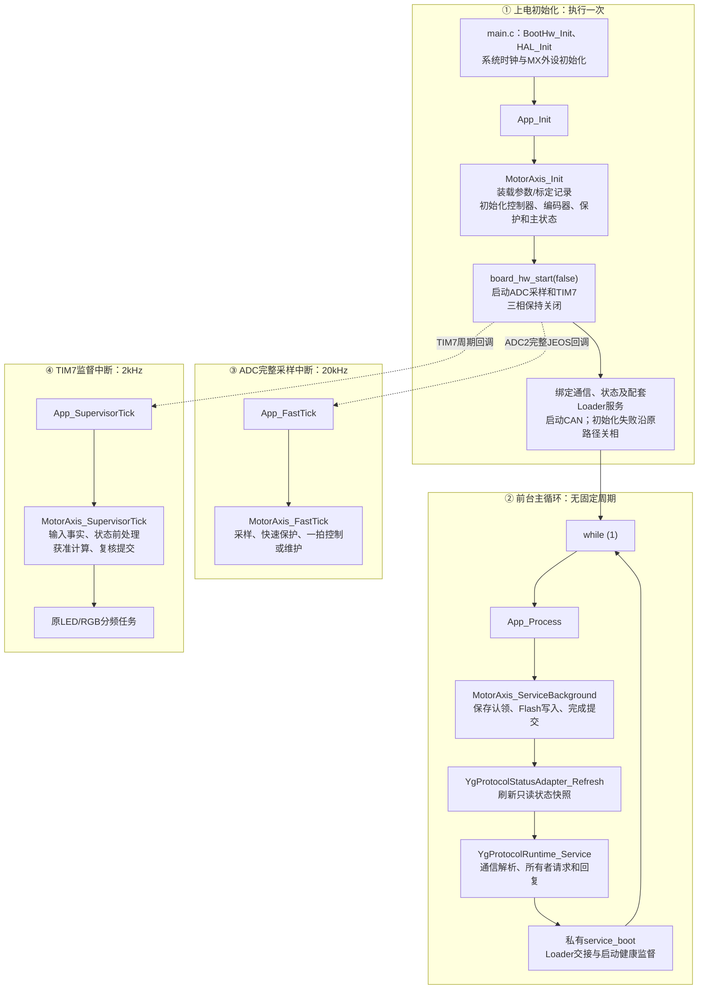
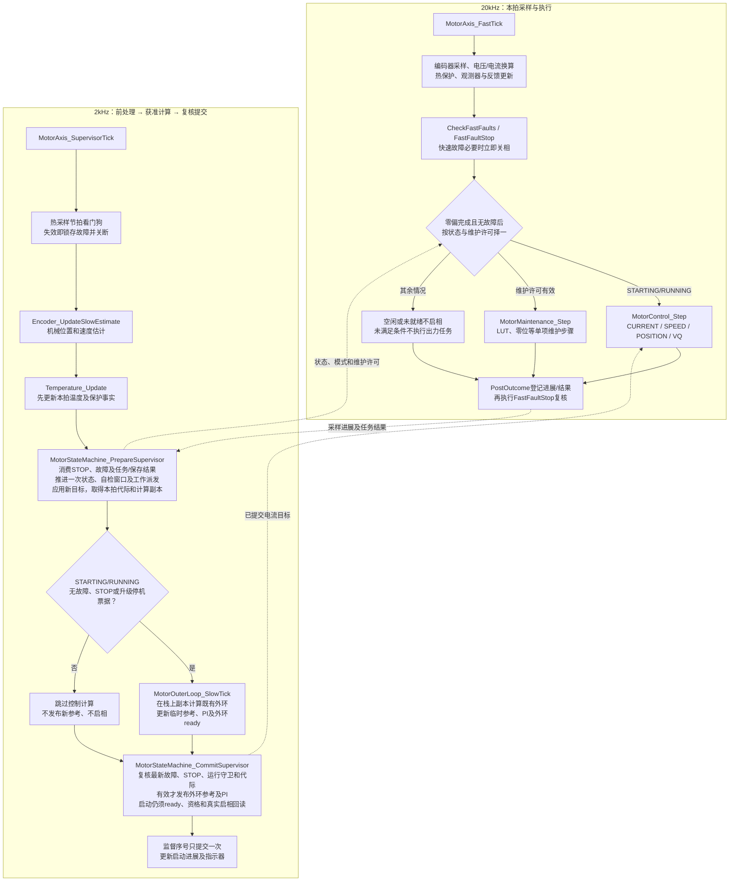

# 电机驱动软件架构

更新：2026-10-21。当前重构主线以核心控制、单项标定、参数、保护及升级恢复为范围。

## 产品与层级

```text
host_app：独立主机工具，通过通信访问设备，不链接进固件
APP：composition组装
       ├─ runtime单轴调度 + 主状态机
       ├─ interfaces命令/停机/快照 + parameters配置/记录 + communication业务
       ├─ motor控制、反馈、标定、保护
       └─ platform能力接口 → STM32G4 BSP/ports/CubeMX
Loader：独立启动/升级产品
shared：APP/Loader共用的纯codec、CRC、镜像、启动邮箱和目标契约
```

APP决定什么时候执行，motor计算结果，platform完成I/O，communication转换字节与请求。
主状态机独占启停许可，标定任务只管内部阶段；它们不互相复制状态机。
MotorAxis分别拥有单份MotorConfiguration和MotorControlState，前者保存配置，后者只保存运行状态。
EncoderCalibration在设备配置中保存唯一LUT/零位，EncoderState仅含反馈运行状态；两者不互藏指针。
控制器拥有积分/滤波，参数事务拥有修订与保存身份。算法显式接收const配置与可写运行对象。
runtime只保留对象所有权、调度、命令校验及维护/参数协调；控制执行、外环、零偏累计与热保护
位于motor，硬件寄存器和外设事务位于platform。没有为搬迁增加另一份状态或通用调度框架。
部分对象是Watch可见全局；模块间仍通过请求、快照及显式对象交互，未宣称所有状态都是私有变量。

## 从main到四个APP入口：当前调用流程

本节统一维护执行流程，依据当前`codex/system-refactor`及四入口实现、2kHz三段监督实现。
方框中的函数名对应源码，中文步骤概括内部工作；虚线表示中断触发或跨上下文信息交互。
20kHz和2kHz分别对应50µs和500µs节拍，不是已测执行耗时。



App_Init先初始化电机对象，再启动采样中断，随后完成通信绑定；中断可能在绑定通信时已经运行。
初始化控制器不等于完成上电自检；主状态从INIT开始，采样和资格满足后进入IDLE等待明确请求。
配套Loader服务只在对应产品构建中有效，独立APP没有Loader确认/升级交接能力。

## 快环、外环和主状态机：当前执行次序



实际出力经motor控制算法和platform PWM能力执行。维护任务只推进内部步骤；
主状态机拥有功率及资源许可，前台保存仍经同一状态所有者认领并提交完成。
生命周期周期推进主要在2kHz；前台请求接口也会准入/登记，部分维护请求同步迁移，
不能理解为所有生命周期写入都只发生在监督入口。

## 三段监督的边界与启动ready

1. **前处理**：先刷新温度，再消费本拍STOP、任务结果、保存/取消完成和恢复事实，
   推进自检及生命周期。运行中的同模式新目标在计算前应用，正常调度下可在本拍参与外环，
   不再固定多等一个500µs监督周期；这不是通信到机械响应或STOP关断最坏时延的测量。
2. **获准计算**：仅STARTING/RUNNING且未故障、停机、升级交接才计算。
   `MotorSupervisorStep`在监督栈上携带本拍代际、运行值和速度PI副本，不新增全局运行镜像。
   外环公式和求值顺序保持，计算区开中断；快环继续读取上一次已提交的外环参考。
   CURRENT/VQ仍沿既有外环入口的非外环分支，不要求速度/位置ready，也不覆盖其活动目标。
3. **复核提交**：读取计算期间可能发生的故障和STOP，再检查运行守卫、状态代际与监督序号。
   仅本拍有效SPEED/POSITION结果且ready有效才在短临界区发布外环参考与PI，
   不回写整份运行状态，避免覆盖快环更新的故障、热事实等字段。失效结果丢弃并请求外环复位。
4. **启动检查保留**：STARTING先生成零目标或当前位置的准备结果；
   SPEED/POSITION必须取得本拍外环ready，CURRENT/VQ使用各自原就绪判据。
   原启相入口仍先校验配置，再在短临界区重新核对STOP、故障、采样、许可和代际；
   实际数字输出状态确认已开启后才进入RUNNING，ready本身不等于已经启相。
5. **只推进一次**：Prepare消费任务邮箱、自检稳定窗口及保存衔接；Commit不再次执行这些步骤。
   Commit只复核当前保护事实和持续守卫，监督序号在提交时增一次，重复/过期票据无效。
   这不是两次完整Tick，也不是第二套状态机。

20kHz快速故障通道独立存在，必要时立即关相；提交复核不能替代快速保护。
STOP受理会撤销模式及许可，但受理成功不等于真实输出已关闭；关相仍走原平台及回读路径。
ADC优先级0、TIM7优先级3，外环允许快环抢占；不能通过扩大关中断范围代替提交边界。
四个App入口、状态与线上编码、控制公式、保护阈值和Keil Watch入口保持不变。

源码依据：[监督调度](../../firmware/app/runtime/motor_axis.c)、
[外环与ready](../../firmware/motor/foc/motor_control.c)、
[同一状态所有者的前处理和提交](../../firmware/app/motor_state_machine/motor_state_machine.c)。
实施与证据见[2kHz三段监督计划](../plans/active/2026-10-21-supervisor-staged-v1.md)。
本图表示当前源码调用关系；本批没有新的实机、中断耗时或MCU占用率结论。

## 上电、运行和维护

配套Loader校验并跳APP；独立APP直接从芯片入口启动。
外设初始化后装载配置与LUT，在关相下采集电流零偏并完成INIT自检，进入IDLE等待。
明确START选择一种模式，RUNNING只更新同模式目标；STOP关相后回IDLE。
单项LUT/零位由任务内部推进，成功关相后自动派生独立SAVE；Flash只在前台执行。
故障先关相，再收敛FAULT；恢复与CLEAR成功后仅回待机，不重新启动。
控制与有功率标定均在监督拍持续核对采样资格，采样中断停止也不能保持标定输出。

没有自动全套标定、轨迹管理、齿槽补偿、摩擦/电阻辨识、RTT、运行租约或heap。
绕组热保护与可选SPEED速度整形/惯量前馈已经接入：热历史归motor/protection，
速度前馈归motor/foc；位置串级不因速度前馈恢复轨迹或摩擦功能。
host_app同时保留Rust GUI候选与Qt核心工具，程序能力和验收分别按各自源码确认。
硬件、电机、应用和设备配置按来源与职责分组，持久布局为schema14，兼容读取schema12/13。
设备node只取独立地址字段；应用速度包络由应用配置及AXS数值决定，不再由节点派生。
删除旧地址映射会改变部分记录的实际通信地址和隐含速度钳制，详见本批兼容契约。

本批行为与兼容边界见[核心契约收口](../plans/completed/2026-10-16-core-contract-closeout-v1.md)。
多型号profile仍须提供真实配置数据；本批不虚构新型号，也不恢复组合标定。

## 深入阅读

- [从四个APP入口读主流程](../../firmware/app/README.md)：App_Init、App_Process、App_FastTick和App_SupervisorTick。
- [模块输入、输出与全局符号归属](module_core_responsibilities.md)
- [八状态及启停/故障流程](motor_state_machine_v1.md)
- [控制执行和直接位置串级](motor_execution_core_v3.md)
- [单项维护、编码器标定和真实保存](motor_maintenance_core_v3.md)
- [四类参数与兼容限制](parameter_ownership_v1.md)
- [通信分层](communication_layering.md)、[Loader设计](loader/loader_product_v3.md)、[故障保护](fault_protection.md)
- [实际目录归属](code_structure.md)、[当前候选及未测项](../plans/active/2026-10-21-current-candidate-acceptance-v1.md)

本页描述源码职责，不代表当前候选已通过实机验收。
