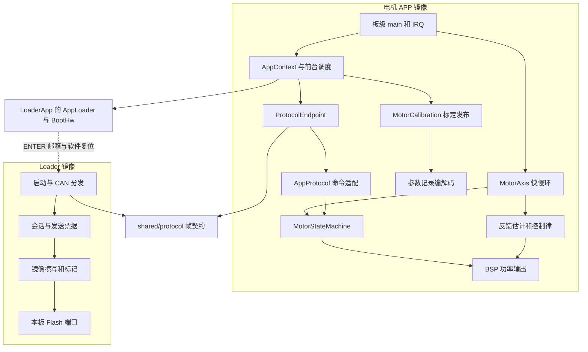

# APP 与 Loader 固件架构设计

本页按 2026-11-10 的 `the-system-refactor` 工作树核对，分支提交为 `a87bc5ce`。STM32G431 和 AT32F456 共用单轴电机 APP 与升级核心，各自链接板级入口和硬件实现。六个镜像的工程、启动地址及工作区见[仓库首页](../../README.md#选择板卡与固件工程)。长期依赖边界见[架构约定](../../ARCHITECTURE.md)。

## 两个镜像如何协作

```text
独立 APP    复位 → 板级 main → 初始化轴和通信 → ADC / 监督 / 前台
配套系统    复位 → Loader → 检查启动条件与镜像 → 跳入 LoaderApp → 同一套电机控制
                       ↑                                           │
                       └──── 软件复位与一次性 RAM 邮箱 ← 停机交接 ───┘
```

CAN 帧与 CRC、镜像描述符、启动标记、RAM 邮箱和目标分区由 shared 定义。APP 与 Loader 分别持有 CAN 端点、计时和运行状态。Loader 从参数区只读选取节点，普通 CAN 升级的可写域是 APP 槽；APP 在停机标定发布时写轴记录。两端的工程入口和端口见[代码结构](code_structure.md)。

## 模块依赖与文件边界



箭头表示运行时调用或使用的契约。两端的 CAN 业务处理分别编入各自镜像；跨复位保留的实体是邮箱和 Flash 内容。APP 内部的运行指针只在本次启动、本机实例的生命周期内有效。

| 边界 | 调用方向 | 设计约束 |
| --- | --- | --- |
| 板级入口与应用 | `projects/*/application/main.c → firmware/app` | 两板入口将物理中断路由给本机 `g_app`。板型影响中断派发和 BSP 实现，同一套轴状态机管理功率。 |
| 通信与业务 | `ProtocolEndpoint → AppProtocol → MotorStateMachine` | 通信层负责帧、队列和回复；适配层换算线路编号与单位；状态机决定请求能否执行。 |
| 控制与硬件 | `MotorAxis → firmware/motor`，采样及输出经 BSP 公共接口 | 轴实例持有活动状态。控制算法在本拍计算，启相关相及会话撤销由状态机负责。 |
| 下载与存储 | `loader/runtime → loader/core → shared/image → loader/ports` | runtime 分发命令，core 管理租约与票据，镜像层校验和提交标记，端口限制实际写域。 |

若修改控制准入、线路编码或 Flash 布局，可按[文件与测试导航](code_structure.md)找到对应入口。标定写入及重启恢复的完整路径见[参数管理设计](parameter_ownership_v1.md)。

## APP 启动与调度

板级 main 持有静态 `AppContext g_app`。两板依次执行 `Bsp_Init → App_Init → Bsp_Start → App_Start`。硬件先准备关相输出，APP 装载参数、初始化轴并绑定业务，随后开放采样和通信。无效轴记录的处理见[参数存储契约](../../firmware/parameters/README.md#storage)。

| 执行上下文 | 入口 | 本次工作与交接 |
| --- | --- | --- |
| ADC 快中断，20 kHz | `MotorAxis_SampleFast → MotorAxis_ControlFast` | 采样和估计反馈，复核启相许可，互斥执行控制或标定，提交结果及故障关相。上电电流零偏在关相 IDLE 累计 2048 拍。 |
| 监督中断，2 kHz | `MotorAxis_SupervisorTick` | 更新启用的温度测量，检查快拍进展，处理停止、故障和标定完成。G431 在同一上下文执行外环。 |
| AT32 外环，4 kHz | ADC 每五个有效快拍派发 PendSV → `MotorAxis_OuterTick` | 从轴实例读取本拍输入，计算位置或速度控制。提交时复核会话、模式、STOP 和故障，直接更新轴的电流参考与速度 PI。ADC 可以在多字段写入期间抢占。 |
| CAN 接收中断 | `Protocol_RxInterrupt` | 将帧搬入本端点队列。普通业务请求由前台解码和执行。 |
| 前台主循环 | `App_Process` | 依次推进位置建表、标定候选发布、通信；LoaderApp 还处理停机交接与试运行健康检查。 |

从两板 main 可追到每个执行上下文。[G431 入口](../../projects/stm32g4/application/main.c) · [AT32 入口](../../projects/at32f456/application/main.c) · [轴调度](../../firmware/app/motor_axis.c) · [前台调度](../../firmware/app/app.c)

## 状态与数据所有权

### 启动失败时哪些服务仍然可用

1. 板级 main 首先检查 `Bsp_Init`；若返回错误，立即关闭 PWM 并停在失败循环。`Bsp_Start` 失败时走同一路径。此时不会进入正常前台循环。
2. `App_Init` 按轴初始化、业务回调绑定、协议端点初始化、设备信息装配的顺序执行。LoaderApp 还在通信就绪时绑定交接服务。节点非法或身份信息装配失败会清除 `communication_ready` 并关闭功率输出；生产身份记录无法解码时可以继续公布“身份无效”。
3. `App_Start` 只为就绪端点启动通信。两板 main 仍按正常调用顺序运行；`Protocol_Process` 在端点未启动时立即返回。诊断时先区分“板级启动已经中止”“轴采样正在运行但 CAN 未启动”和“命令到达、业务拒绝”三种现象。[初始化与信息绑定](../../firmware/app/app.c) · [端点启动条件](../../firmware/communication/yg_protocol.c)

### 一拍控制如何到达 PWM

| 顺序 | 执行者 | 输入、输出与失败行为 |
| --- | --- | --- |
| 采样 | ADC → `MotorAxis_SampleFast` | 先启动编码器传输，再更新母线、电流限值与零偏。偏置完成后读三相电流并做 Clarke 变换；按模式更新观测器。最后在需要时安装 LUT，再完成编码器更新。 |
| 本拍准入 | `MotorAxis_ControlFast → MotorStateMachine_BeginFastTick` | 本拍采样完成后检查故障、STOP 和一次性启相许可。启相还须重新核对当前会话及输入。 |
| 执行 | `MotorControl_Step` 或 `MotorCalibration_StepFast` | 在 RUNNING 中由模式选择角度来源及控制律，再进入 `Foc_Step`。标定只有在当前阶段允许时执行。空闲分支预装中性占空比，功率使能由状态机单独管理。 |
| 收尾 | `MotorStateMachine_FinishFastTick` | 增加快拍计数，按代际消费本拍结果。标定完成后要读回关相，才登记前台发布；新故障会触发关相。 |

速度模式可沿一条具体数据链定位问题：116 的线路整数经适配层换算为 rad/s 并写入轴目标，外环读取速度反馈、计算电流参考，ADC 使用本拍电角度和电流执行 FOC，最后提交三相占空比。若命令已回 OK 却看不到力矩，应依次检查运行模式、外环参考、快环实测电流和输出使能。位置模式还需检查前台位置建表及外环轨迹采样。[轴调度](../../firmware/app/motor_axis.c) · [模式控制](../../firmware/motor/control/motor_control.c) · [FOC 输出](../../firmware/motor/control/foc_output.c)

### 抢占与跨上下文交接

| 数据交接 | 一致性方法 | 调整代码时要保留的行为 |
| --- | --- | --- |
| 外环计算 → ADC | 外环在栈上计算，提交时核对 owner、epoch、模式、停止和故障。控制临界区允许 ADC 抢占。 | ADC 可以看到多字段更新的新旧组合。撤销会话后，旧结果不能重新发布启相许可。 |
| ADC → 外环 Hall 数据 | ADC 向外环当前读槽的另一槽写入电机角计数与 sin/cos 原码，经过屏障发布槽号；外环选定读槽后复制样本。 | 配对采样用于 Hall 标定。若改为分别读取三个最新值，通道可能来自不同快拍。 |
| 前台 → CAN 状态查询 | 组装反馈前后读取快拍、外环、监督三个计数，遇到抢占重读一次。 | 108 读取不到一致快照时回 BUSY；116 关联的 124 仍保留目标处理结果，测量有效位按实际可用性填写。 |
| 前台建表或保存 → 控制环 | 位置建表只在取走和发布工作时进入控制临界区。标定保存先在可抢占区准备记录，再在关相且会话有效的提交窗口写 Flash。 | 前台耗时计算期间 ADC 可以继续运行；擦写与回读有独立的停机边界。 |

AT32 每 250 µs 派发一次外环；若上一次 PendSV 尚未完成，ADC 调用 `MotorAxis_OuterOverrun` 报告时序故障并关闭输出。G431 外环随 500 µs 监督拍执行。这些值是调度周期，实际中断耗时与截止裕量需要用匹配镜像在板上测量。[AT32 派发点](../../projects/at32f456/application/main.c) · [一致性与提交](../../firmware/app/motor_state_machine.c)

### 对象与读写方

| 对象 | 所有者与职责 | 消费者 |
| --- | --- | --- |
| 轴活动配置、测量与控制器 | `MotorAxis` 持有配置、FOC、编码器、PI、外环和记录暂存区；motor 模块计算控制律、反馈与标定 | 状态机用于准入，控制环用于计算，参数层转换持久记录 |
| 主状态与功率许可 | `MotorStateMachine` 写入主状态、会话代际和启停意图，在事件所属上下文操作功率 | 协议请求动作或读取快照，轴调度读取本拍资格 |
| 线路命令和回包 | `ProtocolEndpoint` 持有队列及业务绑定，`AppProtocol` 转换线路值并记录本端点已接受的目标 | 前台分发，BSP 提交物理帧 |
| 停机交接和试运行 | LoaderApp 中的 `AppLoader` 持有 56 事务和健康计数；板级 BootHw 读写邮箱、镜像标记 | CAN 发送完成回调、前台健康检查 |
| Loader 下载会话 | `LoaderUpgrade` 持有 nonce/session、租约、进度和激活票据；镜像层按阶段访问 Flash 端口 | Loader 主循环处理 CAN、轮询擦写与校验、决定驻留或启动 |

## 沿一个请求读代码

- **电机启动**：前台解码 117，AppProtocol 绑定到本轴的启动请求；外环发布许可，ADC 复核并实际启相后才进入 RUNNING。协议回复、主状态和功率读回的区别见[状态转移表](motor_state_machine_v1.md)。
- **角度标定**：160 请求进入 CALIBRATION。ADC 执行任务并关相，前台按原会话发布与保存，监督拍收尾。LUT 的 ADC 安装及 Hall 联合标定分支见[标定交接](motor_maintenance_core_v3.md)。
- **固件更新**：配套 APP 处理 56 并复位交接，Loader 持有 50–55 下载会话，新 APP 在试运行中处理 57。三个持久标记和跨镜像顺序见[Loader 设计](loader/loader_product_v3.md)，字节字段和应答见[通信协议](../protocols/README.md)。

## Loader 主循环与端口边界

Loader 在复位入口取得复位原因与一次性邮箱，从参数区选择节点，初始化 CAN 和镜像 I/O，随后进入轮询。每轮先检查输出与链路，再消费发送完成事件，推进一轮镜像擦除或校验，接收并分发报文，清理过期分片，最后判断能否启动 APP 并维护看门狗。发送完成事件带票据，只有匹配的激活事务有权使用该事件。Flash 的可写地址范围由 MCU 端口独立检查。[Loader 主循环](../../loader/runtime/main.c) · [事务核心](../../loader/core/upgrade.c)

G431 的 Loader 端口用 RX 中断和环形队列接收，跟踪三个发送槽；AT32 的 Loader 轮询接收，跟踪单个 PTB 发送槽。二者都向核心报告票据和实际发送结果。移植新端口时须能区分入队、在途、完成、失败，否则同一份核心代码会在不同板上产生不同的激活行为。[G431 CAN](../../loader/ports/stm32g4/can_port.c) · [AT32 CAN](../../loader/ports/at32f456/can_port.c)

## 架构变更的验收条件

| 变更触点 | 需复现的场景与预期结果 | 验证入口 |
| --- | --- | --- |
| 启动或绑定顺序 | 双板各自的独立与配套 APP 均可初始化；失败分支关相，独立 APP 不注册升级服务 | [编排用例](../../tests/unit/native/test_app_orchestration.py) |
| 轴对象或外环交接 | 两个模拟实例分别绑定 PWM 和记录槽；状态、输出及标定写入只归各自实例；过时代际无法恢复旧输出 | [实例隔离](../../tests/unit/native/test_app_instances.py)、[状态机用例](../../tests/unit/native/test_run_state.py) |
| Loader 端口或链接输入 | 错误票据、链路故障、越界写入被拒绝；镜像、参数区和身份页边界与对应工程一致 | [G431 运行时模型](../../tests/unit/native/test_loader_runtime.py)、[AT32 端口模型](../../tests/unit/native/test_at32_loader.py) |
