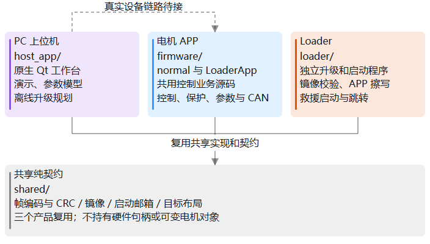
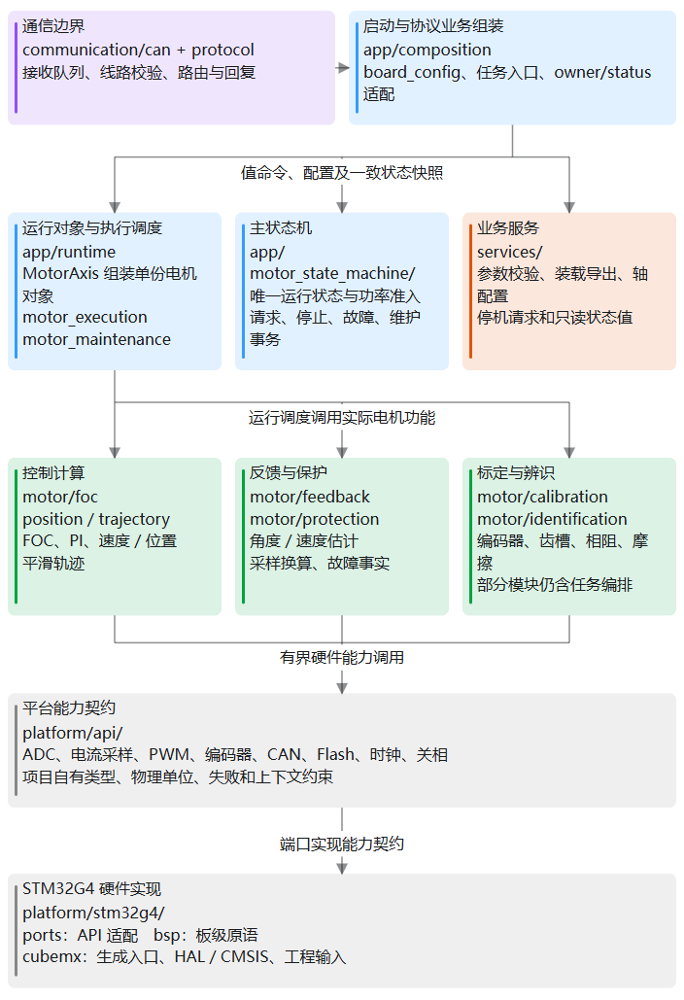

# 电机驱动软件架构说明

更新日期：2026-10-08。范围：`codex/architecture-closeout` 收口工作树；
由 system-refactor 的实际核心集成输入与独立状态机评审快照组成。

整个软件由三个独立程序组成：APP 控制电机，Loader 负责升级和启动 APP，
PC 上位机负责操作和观察设备。三者共用通信与镜像格式，但分别构建、分别运行。

APP 内部最重要的分工是：通信解释请求，主状态机决定是否允许执行，运行调度按周期调用
电机功能，平台完成硬件操作。电机功能把执行结果交回状态机，不自行接管整个运行流程。

## 1 整个工程由哪些部分组成

| 部分 | 负责什么 | 当前实现边界 |
| --- | --- | --- |
| `firmware/` APP | 电流、速度、位置控制，反馈、保护、标定、参数和 CAN 业务 | 普通 APP 与配套 LoaderApp 共用业务源码，链接地址和启动接入不同 |
| `loader/` Loader | 检查 APP 镜像，接收升级数据，写 APP 槽，复位或跳转 | 独立程序；CAN 升级写 APP 槽，不通过这条线路升级 Loader 自身 |
| `host_app/` PC 上位机 | 操作界面、波形、参数编辑、任务展示和升级规划 | Qt 工作台目前使用演示会话；真实 CAN/SWD 执行尚未接入 GUI |
| `shared/` 共享代码 | 帧编解码、CRC、镜像格式、启动邮箱和目标地址布局 | 被多个产品实际复用；不存放电机运行对象或硬件句柄 |
| `tests/`、`tools/` | 离线测试、构建、分析和明确场景下的台架工具 | 默认验证不烧录、不操作电机 |
| `docs/`、`outputs/` | 设计与维护说明；构建和验证产物 | 文档进入 Git，生成产物放在被忽略的 `outputs/` |

LoaderApp 是“按 Loader 的 APP 槽地址构建的 APP”，不是把 Loader 链接进 APP。
APP 进入升级流程时先停止并关闭输出，再通过启动邮箱和复位交接；Loader 校验镜像后启动 APP。
具体格式和条件分别由 [Loader 设计](loader/loader_product_v3.md) 和
[升级线路契约](../protocols/yg_protocol_upgrade_wire_v3.md) 定义。

PC 的独立 Python 升级客户端已经有显式打开 CAN SDK 的入口。这与 Qt 界面接入真实设备
是两件事，不能用界面的演示成功表示设备已执行。操作边界见 [PC 产品说明](../../host_app/README.md)。

## 2 APP 内部怎样分工

图中的箭头表示主要协作方向，不是完整的头文件依赖图。通信、状态机和采样模块也会调用
自己需要的平台接口；它们不必经过图中的每一层。实际目录与依赖规则分别见
[目录职责](code_structure.md) 和 [根架构约束](../../ARCHITECTURE.md)。

### 启动组装负责把系统接起来

`app/composition/` 负责启动顺序、任务入口和协议到业务接口的绑定。
例如 `board_config.c` 初始化电机对象、设置通信端点并处理启动交接；
`foc_task.c` 和 `bsp_task.c` 把中断入口接到运行调度。

这里可以选择具体板卡实现，但不应写位置控制公式，也不应再解析一遍通信载荷。

### 运行调度负责按时调用功能

`app/runtime/` 管理一台电机的运行对象以及调用顺序。主要有三个角色：

- `motor_axis` 装配电机、FOC、编码器和控制器对象，推进快慢周期，提供一致的状态快照。
- `motor_execution` 执行普通控制，并协调速度和位置外环。
- `motor_maintenance` 检查维护任务的功能前提，执行已获准的标定或辨识，取消当前功能。

调度回答“这一拍调用哪个功能、传哪些对象”。它不建立第二套运行状态机。
参数请求缓存、活动修订号和保存票据已经归 `motor_parameter_transaction`；
`motor_axis` 保留对象装配、调度和明确转发，事务模块显式借用对象，不保存对象指针。

### 主状态机负责运行许可与收尾

`app/motor_state_machine/` 是主运行状态和功率动作的唯一所有者。
它决定是否接受启动、停止、清错和维护请求，并协调任务取消、输出关闭和资源归还。

算法返回“还在执行、完成、需要前台整理或失败”；状态机决定随后进入哪个状态。
维护模块可以判断自身功能的参数是否满足，最终进入维护和启相的许可仍由主状态机掌握。

当前主状态为 INIT、IDLE、STARTING、RUNNING、MAINTENANCE、STOPPING、FAULT、FATAL
八种。INIT 合并原 BOOT/SELF_TEST；INIT/IDLE STOP 保持原状态，停止完成及健康 CLEAR
直接回 IDLE，FATAL 仅整个程序复位后重建初始化。STARTING 与真实输出/资源确认保留。
完整关系见 [主状态机说明](motor_state_machine_v1.md)。

### 电机模块负责具体控制与估计

`motor/` 负责电机功能：FOC 电流环、速度和位置控制、平滑轨迹、角度与速度反馈、
故障判定、编码器和齿槽标定、相电阻与摩擦辨识等。

计算核心应接收明确的输入和自有状态，输出控制量、估计值或计算结果。
例如 PI 根据目标、反馈和积分状态计算输出；角度校正根据原始角度与校正表计算校正角度。
公式本身不需要知道命令来自 PC，也不应负责切换主状态或写 Flash。

目前并非所有电机模块都已经成为纯计算：`angle_feedback` 仍协调编码器采样，
`foc_sensing` 仍调用采样能力，部分标定文件仍包含任务流程。
这些调用通过平台接口隔离 STM32，但“硬件接口已隔离”不等于“计算与调度已完全拆开”。

### 业务服务和通信各负责一个边界

`services/` 提供参数装载与导出、数值校验、轴配置解析、控制与维护请求、只读状态值等能力。
服务目录不是另一套电机执行流程；参数事务目前仍由 APP 运行所有者协调。

`communication/` 处理 CAN 接入、接收队列、线路校验、业务解析与回复。
它把线路编号和整数编码转换成内部请求，再调用明确的业务入口。
它可以拒绝损坏的帧，但不代替电机所有者决定是否启相。
跨产品通用的帧和分片计算放在 `shared/protocol/`，APP 专有业务处理留在 APP 通信目录。

### 平台负责真正操作硬件

`platform/api/` 描述 APP 需要的能力，例如采样、PWM、编码器、CAN、Flash、时间和关相。
接口要说清单位、失败结果和允许的调用上下文，不向电机模块暴露 HAL 句柄或寄存器。

`platform/stm32g4/ports/` 实现这些接口；`bsp/` 处理板卡和芯片细节；
`cubemx/` 保留生成入口、HAL/CMSIS 和工程输入。
更换 MCU 或板卡时，硬件差异主要在这些位置处理。

## 3 一条控制命令如何到达电机

以速度控制为例，启动和目标更新是两种请求。当前普通速度启动的线路入口属于台架候选，
其产品支持状态以 [通信协议总览](../protocols/yg_protocol_system_overview_v0_1.md) 为准。
以下说明内部职责，不表示任意收到的速度目标都能自动启动。

1. CAN 接收中断把帧放入有界队列，前台通信服务取出并校验。
2. 协议解析把载荷变成内部请求，组装适配把请求交给实际业务所有者。
3. 对启动请求，主状态机检查故障、参数、标定、模式和资源占用；满足条件才准备控制并启相。
4. 进入相应模式后，合法目标更新交给控制对象；控制目标的数值范围与运行许可分别检查。
5. 慢周期根据速度目标和实际速度计算电流参考，快周期根据电流参考计算输出。
6. 状态读取接口复制测量、模式、故障和请求进展，通信将快照编码后回复。

因此，“帧收到”“请求受理”“电机已运行”是不同的结果。收到 ACK 不应被 PC 解释成所有动作已经完成。

STOP 则撤销待启动和旧目标、关闭输出，并等待取消和资源归还。
故障由快速路径及时关闭输出，慢周期再对齐状态并完成清理；故障恢复不会自动重新运行。
零速度和位置保持仍可处于 RUNNING，不能等同于 STOP。

## 4 系统如何按周期运行

当前 APP 用固定中断和前台主循环安排任务，并未通过可动态注册的任务框架调度电机。
频率决定工作放在哪个上下文；目录归属决定谁拥有这项工作。

| 执行位置 | 周期与入口 | 主要工作 |
| --- | --- | --- |
| 快速中断 | 20 kHz，`MotorAxis_FastTick()` | 发起及完成角度采样，电压和电流换算，快速故障处理，执行获准的控制或维护功能，发布结果 |
| 监督中断 | 2 kHz，`MotorAxis_SupervisorTick()` | 更新编码器慢估计，执行外环，推进主状态机，更新温度；板级入口另处理指示器 |
| 前台主循环 | 持续调用，不承诺固定周期 | CAN 业务服务、状态快照刷新、参数保存、候选表整理和启动交接 |
| CAN 接收中断 | 帧到达时 | 有界接收与入队；不在其中运行电机业务或擦写 Flash |

快速路径必须有界，不能等待 Flash 或通信完成。当前 RTT 快速采样也采用有界、非阻塞入口。
前台较慢的工作通过任务身份和结果返回，与中断协作；“任务取消了”不表示它占用的对象已经归还。

例如一次需要保存结果的标定：快周期采集并返回结果，前台整理或写入，状态机确认结果和资源
后完成收尾。三处各做自身工作，不把存储塞进控制周期。

## 5 参数和运行数据怎样管理

### 配置按含义分组

| 配置类别 | 内容举例 | 默认值入口 |
| --- | --- | --- |
| 硬件配置 | 采样比例、板级能力、硬件相关限制 | `platform/api/` 的板卡和采样 profile；实际驱动在平台实现中 |
| 电机模型 | 极对数、电阻、电感、磁链、标定电流 | `motor/motor_profile_defaults.h` |
| 应用配置 | 速度和位置外环、轨迹、轴范围、运行包络 | `services/parameters/application_profile_defaults.h` |
| 设备个体配置 | 节点地址、电流零偏、编码器校正、齿槽与摩擦数据 | 设备默认值及相应标定模块 |

这些是职责分组，不是四份重复的参数文件。活动参数主要落在唯一电机对象的
`model`、`application`、`device` 子对象中；编码器校正和齿槽表仍由对应对象或模块持有。
当前存储保持 schema12，通过装载和导出边界映射到运行对象。
Flash 记录不能直接当作控制状态使用。

更换板卡首先调整平台实现和硬件 profile，再验证采样尺度、PWM、角度接口和关相能力。
更换电机则调整电机模型和应用包络，并重新确认对应个体标定。
当前 profile 选择只支持已有的具体实现，没有一个已经完成的任意型号自动选择系统。

转速目标、测量电流、故障、积分状态、当前任务和请求进展都是易失运行数据。
它们不因一次保存参数而成为需要下次上电恢复的控制命令。

### 修改活动值与保存到 Flash 分开

参数读取返回值和活动修订号。写入先检查停机、权限、类型、范围、请求身份与预期修订号；
成功后修改活动值并推进修订号，相同请求重试不能重复修改。

SAVE 创建一个保存任务。受理仅表示任务已建立，前台实际写入并回读验证后才能报告持久成功。
活动修订号表示 RAM 的配置版本；已保存修订号表示 Flash 已确认的版本；schema 表示记录格式。
这三个编号不能混用。实际边界见 [参数所有权](parameter_ownership_v1.md)。

### 大块临时数据只保留一份

参数记录、齿槽候选表和编码器标定采样互斥借用同一份 6 KiB 固定维护工作区。
APP 管理借用和归还，功能接收有类型的对象；任务实际归还前不能把空间给下一项任务。
这避免常驻多份大数组，也没有引入堆分配器。

## 6 全局变量怎样避免互相牵扯

当前代码仍有全局观测符号。重点是可变数据只有一个所属模块，其他模块通过受控接口使用，
不能因为调试器能看到变量，就直接修改它。

| 数据 | 所属模块 | 其他模块怎样使用 |
| --- | --- | --- |
| 电机、FOC、编码器、速度 PI、观测器和启动对象 | `motor_axis` 装配，相关功能按指定上下文更新各自字段 | 调度显式传对象；通信读取复制出来的快照 |
| 主状态、待处理请求、任务代际、故障和取消协调 | `motor_state_machine` | 请求接口、状态查询和结果发布接口 |
| 活动修订号、最近参数请求和保存票据 | `motor_parameter_transaction` | Axis 明确转发读写/保存请求；事务模块独占状态，主状态机仍决定准入 |
| 位置控制积分、轨迹与补偿工作状态 | 对应控制或功能模块 | 显式输入输出，不通过通信或平台全局变量取得控制意图 |
| CAN 队列和链路状态 | 通信模块 | 收发与业务服务接口 |
| 外设句柄、板卡细节 | 平台实现 | 平台能力接口 |

`s_motor_state`、`s_foc_state`、`s_rotor_encoder`、`s_context` 等当前具有全局符号可见性，
用于 Watch 只读观测；保留 `s_` 名称是已记录的调试例外。
其定义与更新路径仍由所属模块管理，这不构成跨模块直接写入的公共接口。
命名规则和例外见 [APP 命名与对象组织](app_naming_v1.md) 与
[观测对象记录](../plans/active/2026-09-29-watch-global-objects-v1.md)。

同一个结构体的不同字段也必须明确写入者。例如慢周期发布外环电流参考，快周期消费参考并
更新电流测量。读取一组关联值时使用快照入口和必要的短临界区，避免拼出不同周期的数据。

## 7 从哪些文件开始读代码

先读一条真实执行路径，再深入所需算法，不必从所有头文件开始。

| 阅读目的 | 建议入口 |
| --- | --- |
| 上电时如何组装 | [board_config.c](../../firmware/app/composition/board_config.c) 的 `Board_Init()`，接着看 `MotorAxis_Init()` |
| 每拍实际执行什么 | [motor_axis.c](../../firmware/app/runtime/motor_axis.c) 的 `MotorAxis_FastTick()` 和 `MotorAxis_SupervisorTick()` |
| 是否允许启动或维护 | [motor_state_machine.c](../../firmware/app/motor_state_machine/motor_state_machine.c)，配合主状态机说明 |
| 电流、速度和位置如何协作 | [motor_execution.c](../../firmware/app/runtime/motor_execution.c)，再进入 FOC 与位置模块 |
| 标定如何调度与取消 | [motor_maintenance.c](../../firmware/app/runtime/motor_maintenance.c)，再看对应功能任务 |
| CAN 如何调用实际业务 | [owner_adapter.c](../../firmware/app/composition/yg_protocol_owner_adapter.c)，配合通信分层说明 |
| 参数怎样校验和存储 | Axis 参数入口 → [motor_parameter_transaction.c](../../firmware/app/runtime/motor_parameter_transaction.c) → 参数服务与平台 `param_store` |
| 前台循环做什么 | [main.c](../../firmware/platform/stm32g4/cubemx/Core/Src/main.c) 的 USER CODE 主循环 |

完整文件夹树由 [代码框架与目录职责](code_structure.md) 维护；本页讲协作关系，不再复制一份
需要同步修改的完整目录清单。

## 8 当前还没收口的架构问题

硬件接口、单轴组装和唯一主状态机已经建立。后续重点是减少一个模块同时承担的不同职责，
保持现有电机功能、计算顺序、保护和协议语义。

| 事项 | 当前集成树 | 后续方向 |
| --- | --- | --- |
| 位置串级 | 同一文件内 core/friction 状态与窄输入已经分开，组合层协调轨迹/HOLD | 保留当前运算顺序；动态时序与栈尚待实机测量 |
| 编码器标定 | encoder_calibration_core 独立计算，task 保留采样时序及应用结果 | 新组合工程尚待统一实机验证 |
| 齿槽标定 | 复用已有计算核心，task 与 foc_cogging_runtime 分开 | 保留候选发布和实际保存边界 |
| 参数事务 | motor_parameter_transaction 独占请求缓存、修订和保存票据 | 持久层应用角色/设备地址兼容映射尚未独立 |
| 主状态机 | 八状态真实执行边界、六类业务视图、运行/标定子流程 | 新计划最后独立SAVE真实回读后完成；新协议/GUI入口及来源安全前提仍在接线 |
| PC 真实设备接入 | GUI 演示与独立真实客户端分开 | 将真实传输接入服务边界，不让 GUI 持有厂家 DLL 或硬件句柄 |

截至本页更新，四项核心拆分已经选择性合入集成工作树，并登记普通 APP 与 LoaderApp
所需的新源文件；保留现场修改与逐文件选项。各模块详设和删除依据统一见
[模块核心职责](module_core_responsibilities.md)。集成基线原含未提交现场输入，
本发布候选已独立冻结；组合离线证据按对应报告登记，不把独立测试或工程登记称作整机 PASS。
本发布候选另接入已冻结评审的八状态及 v1.2 出口；源码、产物和未测项按候选包清单确定。
本收口树已进一步接入编码器 v4、齿槽 v3、Axis v3 和整机流程 v7；原 v1.1.0 包不变。
新流程的模式切换、计划保存及租约已有业务实现，新协议和设备端口仍未全部连接。
启动身份、拒绝来源不污染、新线路完整幂等与组合容量按
[收口计划](../plans/active/2026-10-08-architecture-closeout-v2.md)核对，不能称已正式发布。
范围、验收和回退由 [模块核心解耦计划](../plans/active/2026-10-08-module-core-decoupling-v2.md)
管理；状态机事项由 [状态流程简化计划](../plans/active/2026-10-08-motor-state-flow-simplification-v1.md)
管理。

输出轴角度仍是预留需求，可能来自 ADC 线性 Hall 或 SPI 磁编码器。
当前不把它描述成已经实现的双编码器功能，也不提前增加空接口。

## 9 架构文档怎样维护

架构文档保存在仓库并随代码进入 Git。每种信息保留一个主入口，避免同一规则散落在多个
报告里，又被不同会话当作当前实现。

| 要查什么 | 主入口 | 维护内容 |
| --- | --- | --- |
| 整体如何协作 | 本页 | 产品职责、实际执行路径、数据所有权和未完成边界 |
| 允许哪些依赖 | [ARCHITECTURE.md](../../ARCHITECTURE.md) | 稳定架构规则和硬件边界 |
| 文件应放在哪里 | [code_structure.md](code_structure.md) | 当前目录与模块归属 |
| 某个功能的具体设计 | `docs/architecture/` | 状态机、参数、反馈、保护等当前详设 |
| 外部接口是什么 | `docs/protocols/` | 版本化协议、参数格式、黄金向量和兼容说明 |
| 本轮准备怎样修改 | `docs/plans/` | 目标、保持的行为、任务、验收、回退和决策 |
| 已经验证过什么 | `docs/reports/` 和 `outputs/` | 有日期和明确输入的报告、原始日志与工件 |

修改模块职责、执行顺序或数据所有权时，同时更新本页、相关详设和目录说明。
涉及外部格式时同步协议文档与向量。图源图片放在 `docs/assets/` 并与正文一起维护；
聊天中的图片只是展示，仓库里的资源才是长期引用。

详设应说明“当前实现”还是“尚未实施”；完成的计划归入 completed，历史报告保留日期和范围。
旧版设计、旧容量数字和旧测试结果不能被标为当前结论。
统一索引是 [docs/README.md](../README.md)，本页为其中的架构阅读入口。

默认文档检查可以发现坏链接，但不能自动判断一句描述是否与代码一致。
当前交付能否发布仍需对应输入的验证与实机证据，不能由架构图或历史报告代替。
