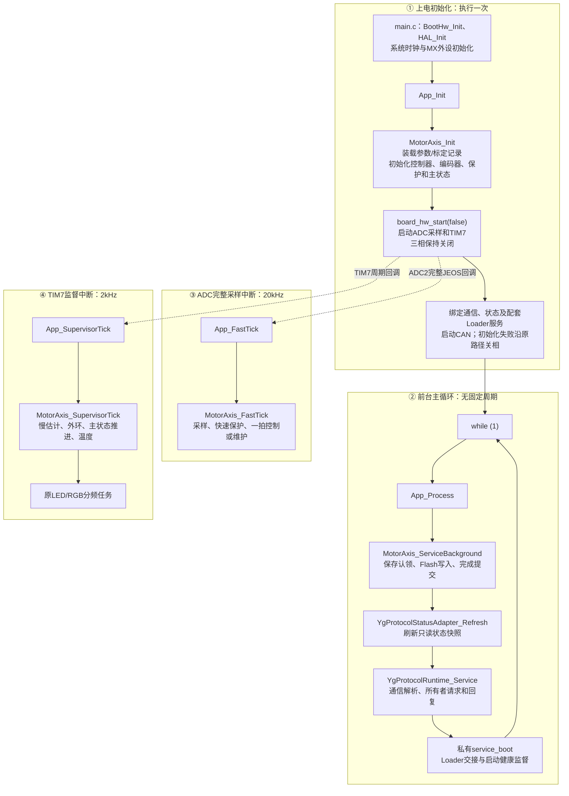
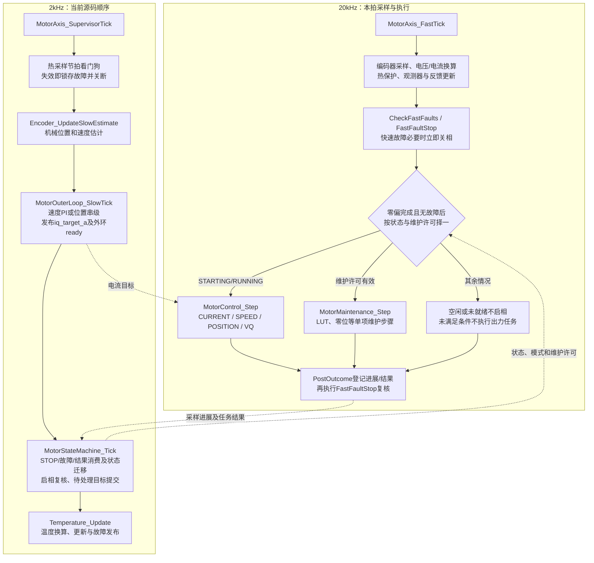
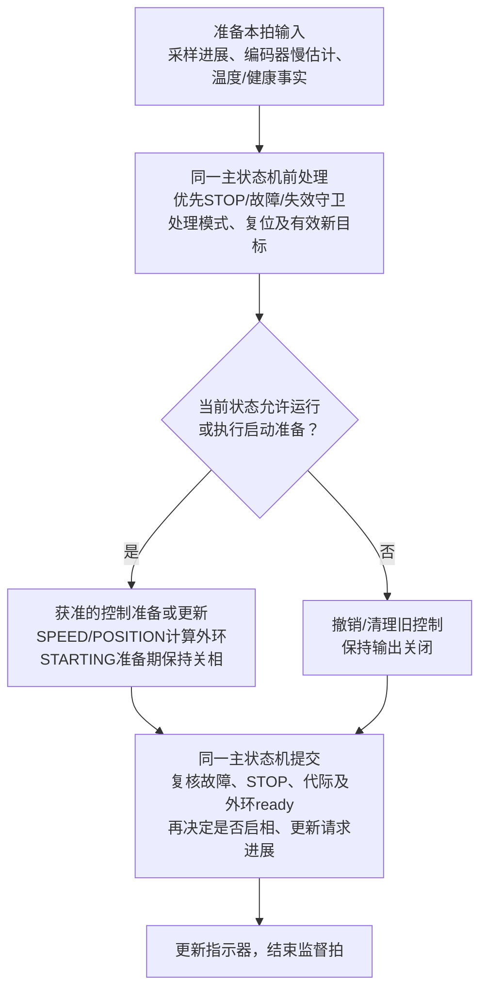

# 电机驱动软件架构

更新：2026-10-21。当前重构主线以核心控制、单项标定、参数、保护及升级恢复为范围。

## 产品与层级

```text
host_app：独立主机工具，通过通信访问设备，不链接进固件
APP：composition组装
       ├─ runtime单轴调度 + 主状态机
       ├─ interfaces命令/停机/快照 + parameters配置/记录 + communication业务
       ├─ motor控制、反馈、标定、保护
       └─ platform能力接口 → STM32G4 BSP/ports/CubeMX
Loader：独立启动/升级产品
shared：APP/Loader共用的纯codec、CRC、镜像、启动邮箱和目标契约
```

APP决定什么时候执行，motor计算结果，platform完成I/O，communication转换字节与请求。
主状态机独占启停许可，标定任务只管内部阶段；它们不互相复制状态机。
MotorAxis分别拥有单份MotorConfiguration和MotorControlState，前者保存配置，后者只保存运行状态。
EncoderCalibration在设备配置中保存唯一LUT/零位，EncoderState仅含反馈运行状态；两者不互藏指针。
控制器拥有积分/滤波，参数事务拥有修订与保存身份。算法显式接收const配置与可写运行对象。
runtime只保留对象所有权、调度、命令校验及维护/参数协调；控制执行、外环、零偏累计与热保护
位于motor，硬件寄存器和外设事务位于platform。没有为搬迁增加另一份状态或通用调度框架。
部分对象是Watch可见全局；模块间仍通过请求、快照及显式对象交互，未宣称所有状态都是私有变量。

## 从main到四个APP入口：当前调用流程

本节统一维护执行流程，依据当前`codex/system-refactor`及四入口实现提交`9ac9c392`。
方框中的函数名对应源码，中文步骤概括内部工作；虚线表示中断触发或跨上下文信息交互。
20kHz和2kHz分别对应50µs和500µs节拍，不是已测执行耗时。



App_Init先初始化电机对象，再启动采样中断，随后完成通信绑定；中断可能在绑定通信时已经运行。
初始化控制器不等于完成上电自检；主状态从INIT开始，采样和资格满足后进入IDLE等待明确请求。
配套Loader服务只在对应产品构建中有效，独立APP没有Loader确认/升级交接能力。

## 快环、外环和主状态机：当前执行次序



实际出力经motor控制算法和platform PWM能力执行。维护任务只推进内部步骤；
主状态机拥有功率及资源许可，前台保存仍经同一状态所有者认领并提交完成。
主状态机周期推进主要在2kHz；前台请求接口也会准入/登记，部分维护请求同步迁移，
不能理解为所有生命周期写入都只发生在MotorStateMachine_Tick中。

## 为什么当前先计算外环，再推进主状态机

当前顺序有明确依赖，但仍有收紧空间：

1. 启动请求先清旧参考、请求外环复位并选择模式；速度/位置初始目标为零或当前位置。
   外环慢拍消费复位、核对输入并生成初始电流目标，随后报告ready。
   状态机的startup_confirmed依赖MotorOuterLoop_IsReady；启相前还会在原临界区
   重新核对STOP、故障、采样、参数、许可和代际。先外环能在本拍提供准备结果。
2. 当前并非把全部故障检查放在控制后。监督入口首先执行采样节拍看门狗；
   外环遇已有故障不执行正常控制计算；20kHz独立检查故障并在出力任务前关断。
   远程STOP受理入口还同步撤销启动/维护许可并把control_mode置NONE，
   因此不能笼统推断“每次STOP都会再算一拍旧速度控制”。完整关相及停止确认仍按真实路径判断。
   STOP登记本身不调用平台关相，control_mode为NONE也不是输出已关闭的证据；
   后续状态处理执行关相并核对真实输出事实。
3. 新SPEED/POSITION目标由状态机尾部apply_pending_control提交，当前外环已经算完；
   目标要到下一外环拍才参与运算，正常调度下多等一个500µs监督周期。
   这不是通信到机械响应或STOP关断的最坏时延结论。
4. 持续运行守卫、任务结果及部分生命周期事件晚于本拍外环处理；
   外环没有独立核对全部主状态准入事实，不能称其已经满足“所有状态和故障前置”。
   温度也在状态机之后刷新，本次新温度不会被同拍较早的状态判断使用。
5. ADC中断优先级为0，TIM7为3；在允许抢占的NVIC配置下，快环可在监督中执行，
   iq_target_a也由外环直接发布。函数先后次序不等于整拍控制输出的原子提交。
   收紧边界时还需核对中断配置、代际及发布/撤销时机，不能用扩大关中断区解决。

源码依据：[监督调度](../../firmware/app/runtime/motor_axis.c)、
[外环与ready](../../firmware/motor/foc/motor_control.c)、
[状态、STOP、启动及目标提交](../../firmware/app/motor_state_machine/motor_state_machine.c)。

## 建议的监督组织：尚未改代码

方向是先处理当前状态与保护，再运行获准控制；启动准备及启相提交继续分开。
不宜只交换MotorOuterLoop_SlowTick和MotorStateMachine_Tick两行，
也不能把完整Tick调用两遍，那会重复推进计数、消费事件或改变维护/保存衔接。



“前处理/提交”是同一主状态所有者的概念阶段，不是已经新增的公开API或第二套状态机。
实施时应保证每拍只消费一次事件、推进一次计数；故障/STOP后不得再发布有效出力参考，
SPEED/POSITION无当前外环ready不得启相；在新目标计算与快环可见性之间保留明确的发布及撤销规则。
CURRENT/VQ不需要速度/位置外环，仍按各自就绪条件提交，不能因跳过外环而撤销有效运行。
控制公式、保护阈值、四个App入口和Keil Watch契约保持不变。
本次仅更新流程图与源码评审说明，没有重排运行代码，也没有新的实机或时序验证结论。

## 上电、运行和维护

配套Loader校验并跳APP；独立APP直接从芯片入口启动。
外设初始化后装载配置与LUT，在关相下采集电流零偏并完成INIT自检，进入IDLE等待。
明确START选择一种模式，RUNNING只更新同模式目标；STOP关相后回IDLE。
单项LUT/零位由任务内部推进，成功关相后自动派生独立SAVE；Flash只在前台执行。
故障先关相，再收敛FAULT；恢复与CLEAR成功后仅回待机，不重新启动。
控制与有功率标定均在监督拍持续核对采样资格，采样中断停止也不能保持标定输出。

没有自动全套标定、轨迹管理、齿槽补偿、摩擦/电阻辨识、RTT、运行租约或heap。
绕组热保护与可选SPEED速度整形/惯量前馈已经接入：热历史归motor/protection，
速度前馈归motor/foc；位置串级不因速度前馈恢复轨迹或摩擦功能。
host_app同时保留Rust GUI候选与Qt核心工具，程序能力和验收分别按各自源码确认。
硬件、电机、应用和设备配置按来源与职责分组，持久布局为schema14，兼容读取schema12/13。
设备node只取独立地址字段；应用速度包络由应用配置及AXS数值决定，不再由节点派生。
删除旧地址映射会改变部分记录的实际通信地址和隐含速度钳制，详见本批兼容契约。

本批行为与兼容边界见[核心契约收口](../plans/completed/2026-10-16-core-contract-closeout-v1.md)。
多型号profile仍须提供真实配置数据；本批不虚构新型号，也不恢复组合标定。

## 深入阅读

- [从四个APP入口读主流程](../../firmware/app/README.md)：App_Init、App_Process、App_FastTick和App_SupervisorTick。
- [模块输入、输出与全局符号归属](module_core_responsibilities.md)
- [八状态及启停/故障流程](motor_state_machine_v1.md)
- [控制执行和直接位置串级](motor_execution_core_v3.md)
- [单项维护、编码器标定和真实保存](motor_maintenance_core_v3.md)
- [四类参数与兼容限制](parameter_ownership_v1.md)
- [通信分层](communication_layering.md)、[Loader设计](loader/loader_product_v3.md)、[故障保护](fault_protection.md)
- [实际目录归属](code_structure.md)、[当前候选及未测项](../plans/active/2026-10-21-current-candidate-acceptance-v1.md)

本页描述源码职责，不代表当前候选已通过实机验收。
