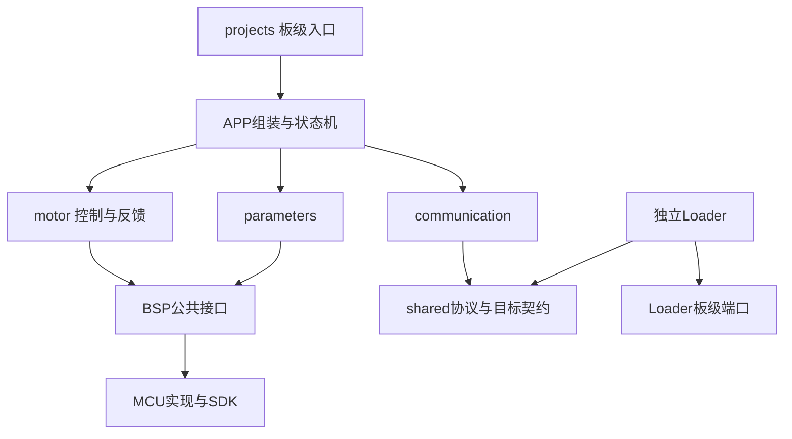

# APP 与 Loader 软件架构

适用STM32G431与AT32F456。两板共用单轴APP和升级核心，分别链接板级入口、SDK与BSP实现。
工程及镜像选择见[仓库入口](../../README.md)，稳定边界见[ARCHITECTURE](../../ARCHITECTURE.md)。

## 产品及依赖

| 产品/目录 | 所有者与职责 |
| --- | --- |
| `firmware/app` | AppContext组装、状态机、MotorAxis、标定发布和Loader交接 |
| `firmware/motor` | 控制律、传感器反馈、观测器、标定和保护算法 |
| `firmware/communication` | 帧、队列、校验、编解码与绑定的业务回调 |
| `firmware/parameters`、`config` | 默认值、校验、记录转换、板型及电机输入 |
| `firmware/platform/bsp` | 统一公共接口及各MCU真实硬件操作 |
| `loader` | 独立启动、下载、校验、激活和端口；不链接到APP |
| `shared` | 跨产品协议、CRC、邮箱、镜像与目标布局，不存放产品运行状态 |
| `host_app`、`tools/bench` | 独立主机产品，不代替固件功率准入 |

## 启动与调度

普通APP从自身向量启动；LoaderApp先由Loader验证镜像并交接。
各板main静态持有一个AppContext，顺序为 `Bsp_Init → App_Init → Bsp_Start → App_Start`，
前台持续调用App_Process。中断开放前完成对象和回调绑定。
ADC快拍执行采样、控制或标定；独立监督处理状态和慢任务；AT32可由有效快拍分频请求PendSV外环。
前台负责通信、位置段表构建、关相后的参数保存及升级交接。
频率与板级触发由配置定义，详细时序见[采样](sampling_chain_v1.md)。

## 对象、状态与并发

MotorAxis持有活动配置、FOC、转子/Hall/输出反馈、标定工作区和外环状态。
MotorStateMachine拥有主状态、运行代际、目标写入、功率许可及停止收尾。
ProtocolEndpoint拥有接收/发送队列和协议事务，不直接写算法积分。
AppLoader拥有停机交接票据、截止时间和镜像确认条件。

状态机受理启动不等于硬件已经启相；ADC在实际输出前复核代际、输入、故障和STOP。
前台与监督的短临界区允许ADC抢占；多字段更新不自动成为快环原子快照。
完整载荷先写、发布标志后写，必要处使用内存屏障和代际拒绝。
反馈快照在有限重试仍不一致时返回忙或无效，不通过长时间禁止ADC来获得一致性。
具体迁移与取消契约见[状态机](motor_state_machine_v1.md)。

## 参数、标定与共享内存

启动加载有效记录，否则按规定回退并保留参数故障；编译默认值不自动覆盖有效Flash记录。
标定先产生候选，关相后由前台登记发布，ADC在读角前安装LUT，再由前台保存并回读。
旧会话、STOP和故障会使候选失效。参数格式和兼容读取见[参数设计](parameter_ownership_v1.md)。
标定采样、检测队列和记录编码串行复用MotorCalibration的维护区，不能同时读写重叠视图。
检测结果和事务身份独立保存；消费者须遵循占用状态，不缓存已被下一阶段覆盖的视图。
AT32 APP的代码/数据/栈预算由链接输入约束；邮箱地址与大小服从shared目标及Loader ABI。
资源上限与运行栈水位是不同约束，源码布局不证明最坏嵌套栈已经测得。

## 硬件与控制边界

BSP不拥有电机运行状态，控制算法不直接访问寄存器。板级main只接线公共硬件事件。
共用控制、协议和参数实现不得散布板型分支；板间差异在配置、BSP与目标布局收敛。
控制链见[算法设计](motor_execution_core_v3.md)，硬件语义见[BSP](bsp_design_rules.md)，
采样窗口及PWM装载见[时序设计](at32f456_pwm_adc_driver.md)。

## 升级和主机

独立Loader只写APP槽；LoaderApp完成停机、同一回复物理发送确认后交接。
启动尝试、确认标记、继承看门狗与失败驻留见[Loader设计](loader/loader_product_v3.md)。
主机按UID、目标契约和设备能力建立会话，旧回复或本地包版本不能替代板端事实。
主机产品分别见[Qt生产工具](qt_production_design_v1.md)和[Rust工作台](yg_mc_host_design_v1.md)。

## 设计验证与能力边界

当前包含双板APP/Loader、单轴位置OTG、Hall初始定位与输出遥测。
普通位置串级和限位仍使用电机编码器坐标，不声明独立输出轴闭环。
UART业务、镜像签名、A/B回滚和多轴同步不属于现行实现承诺。
ADC窗口、最坏中断/栈预算、闭环带载稳定性和实际掉电恢复必须按匹配设备与镜像验证；
离线算法、接口与布局检查不能替代这些硬件性质。
接口及协议变更同步调用者、兼容约束和对应回归，通用入口见[tests](../../tests/README.md)。
