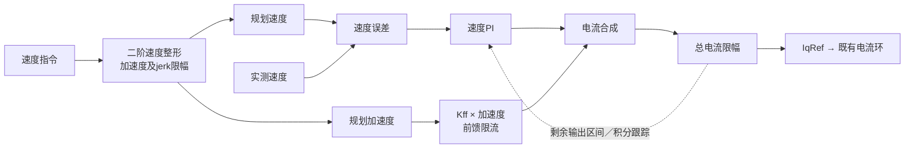

# 轮电机速度前馈实现设计

文档v2，2026-10-12；功能从`codex/wheel-speed-feedforward`合入`codex/ovp-36v`，APP v0.4.0候选。
本页说明实际代码；报文、Flash字段表及空载／整车操作见[使用调试指南](../guides/wheel_speed_feedforward_v1.md)。
默认关闭，尚未下载或实机验收；目标分支现有调试修改和mode3摩擦斜率控制保留。

## 1. 目标与范围

20～30kg整车的惯量明显大于架空轮子的负载。方案将可预见的加减速电流交给
惯量前馈，让速度PI纠正剩余误差，同时限制速度目标的加速度与jerk。
前馈改善指令跟随，不等于提高扰动抑制带宽；最佳系数及机械振动需要整车实测。

| 条件 | 执行路径 |
| --- | --- |
| 有感mode 2且`speed_ff_config.enabled=1` | 独立速度整形＋惯量前馈＋速度PI |
| 开关关闭 | 原速度PI及`speedAcc/speedDec`斜坡 |
| 开启但系数为0 | 只做速度整形，便于分离规划和前馈的效果 |
| mode 3、mode 16、标定／辨识 | 不使用本功能 |
| 停机、故障、模式切换 | 清除规划状态，保留既有停机／故障处理 |

没有自动调整PI、滤波、总电流或速度上限；没有新增摩擦补偿、零速增益切换、自动惯量辨识。

## 2. 数据流



指令输入为`MotorControl.speedRef`；规划速度写入`speedShadow`，也是PI的参考。
`speed_ff_state`保存规划速度、规划加速度和前馈电流，供下一拍计算与只读观测。

## 3. 速度目标整形

2kHz周期`Δt=0.0005 s`。设目标为`ωcmd`，规划速度为`ωp`，规划加速度为`αp`：

```text
λ = min(100, jmax / (2 × amax))        单位 1/s
j* = λ² × (ωcmd − ωp) − 2 × λ × αp
j = clip(j*, −jmax, +jmax)
αp_next = clip(αp + j × Δt, −amax, +amax)
ωp_next = ωp + αp_next × Δt
```

这是带硬限幅的二阶临界阻尼目标整形，**不是固定时长的分段S曲线**。
首次初始化采用实测速度；之后沿用规划状态，不对实测速度或CAN阶跃求导。
中途改目标不会重置规划速度、加速度。足够接近目标且剩余加速度可在一拍内
消除时，规划器将速度贴合目标并清零加速度。

默认`amax=20 rad/s²`、`jmax=200 rad/s³`，因此`λ=5 1/s`。它是规划时间尺度，
不是实际闭环带宽或电机共振频率。jerk同时影响平滑程度和跟随速度；只增大
加速度上限而不改变jerk会降低`λ`，未触及限幅的小目标变化可能反而更慢。

## 4. 前馈与积分抗饱和

```text
Iff_limit = min(配置前馈限流, 0.5 × 总限流)
Iff = clip(Kff × αp, −Iff_limit, +Iff_limit)
IqRef = clip(IPI + Iff, −总限流, +总限流)
```

`Kff`单位为A/(rad/s²)，可解释为`J/Kt`的初始估计。加减速使用同一系数，
电流符号由规划加速度决定。默认0.028约为25kg两轮直驱平动模型理论值的50%；
未计入轮子／转子转动惯量、滚动阻力和转向惯量，不能当作已辨识的最佳值。

速度PI保留原归一化增益。设总限流为`IL`，将前馈占用换算成PI剩余输出区间：

```text
Umin = (−IL − Iff) / IL
Umax = (+IL − Iff) / IL
```

`PI_Controller_Run`在该区间内进行积分准入，再通过`PI_Controller_TrackOutput`
跟踪合成后的限幅结果。这样总电流限幅与积分处理都包含前馈，不是在饱和PI上
继续叠加额外电流。快环提交时再次按最新总限流裁剪`IqRef`。

默认前馈峰值约**0.56 A＝0.028×20**，不是固定注入2 A。前馈2 A配置仅为上限；
若总限流降为2 A，规划前馈上限最多1 A。前馈观测值属于该次外环快照，
不是独立测得的相电流；电压圆、过流、故障保护保持原样。

## 5. 状态所有权与失败行为

- CAN配置经`MotorControl_SetSpeedFeedforward`应用；仅mode 0、上个模式已停机、
  无故障／待切档且功率输出已关闭时接受。接受后清规划状态，不启动车辆、不自动保存。
- 20kHz快环发布输入快照，2kHz延后外环计算。工作线程不直接写运行中的全局
  `MotorControl`或`PI_Speed`；结果经epoch校验后由快环提交。
- 模式切换、停机和故障清规划状态，过期结果不会恢复旧运动输出。
- 非法计算输入不提交规划新状态；现有外环有效性检查进入`MotorParam_Error`并清零电流指令。

正常降速发送mode 2速度目标0；mode 0和故障关相立即执行，不等待平滑规划。
两者不能互相替代。STOP／关相不能确认时须按仓库要求现场干预，不自动恢复测试。

## 6. Flash与兼容

保持schema10及既有PI、LUT、电零位、机械零位、轴配置的偏移。
SFF1/v1为32字节，放在相对偏移2312，CRC覆盖前28字节；总参数长2344字节，仍占两页。
FSL1/v1占用2292～2311，使用目标分支既有加载、保存及mode3斜率控制行为。

旧SFF位置全零／全0xFF时使用默认关闭，不因缺SFF本身额外保存；有效记录恢复其
保存值，包括明确保存的开启状态。非空损坏记录拒绝准入，不自动改写成默认值。
旧版本保存可能擦除其不认识的尾记录，再升级缺SFF时仍默认关闭。

合并后使用目标分支真实的FSL加载/保存及mode3斜率控制，不再使用独立分支
的透传缓存。FSL1偏移2292和SFF1偏移2312保持，未知格式不能仅凭schema10互刷。

## 7. 代码入口与验证边界

| 入口 | 职责 |
| --- | --- |
| [speed_feedforward.c/.h](../../firmware/motor/speed_feedforward.c) | 纯计算、默认值、合法性检查、调用方状态 |
| [foc_run.c](../../firmware/app/foc_run.c) | mode 2接入、PI剩余区间、快慢上下文提交 |
| [foc_task.c](../../firmware/app/foc_task.c) | 停机配置准入 |
| [interface_can.c](../../firmware/communication/can/interface_can.c) | 新参数读写、ACK/NAK与只读观测 |
| [foc_param.c/.h](../../firmware/services/parameters/foc_param.c) | SFF加载／保存／CRC，FSL数据保留 |
| [can_parameter_protocol.py](../../tools/bench/can_parameter_protocol.py) | 主机配对参数写入、查询、核对 |

两个Keil工程均须纳入`speed_feedforward.c`。若出现四个`SpeedFeedforward_*`链接
缺符号，确认打开当前工作目录中的工程、源文件已纳入编译，重新载入后Rebuild。

独立分支合入前已通过：55项Python单元、36项集成、19组原生检查；普通/HIL构建均0错误、0警告。
覆盖旧路径逐拍对照、限加速度／jerk／电流、抗积分、模式／故障隔离、真实CAN
配置准入、CRC坏记录及FSL透传。普通Code/RO/RW/ZI为87868/5056/428/27404字节，
HIL为89620/5064/640/27448字节；参数和标定并存的堆最小余量1672字节。

尚未验证真实整车跟随、噪声、最佳系数／PI、带载带宽、同步采集和长期稳定性。
候选未下载、未正式发布；历史工作树没有现代release profile工具，不宣称该profile通过。

合入前证据索引：`outputs/wheel_speed_feedforward_20261012/summary.json`；
接口黄金向量：[SFF1及CAN向量](../../tests/vectors/speed_feedforward_v1.json)；
工作记录：[实现计划](../plans/2026-10-12-wheel-speed-feedforward-v1.md)。
合并后重新验证并生成独立证据，不能用上述资源与哈希代表合并后的镜像。
合并检查索引：`outputs/speed_feedforward_merge_20261012/summary.json`。
