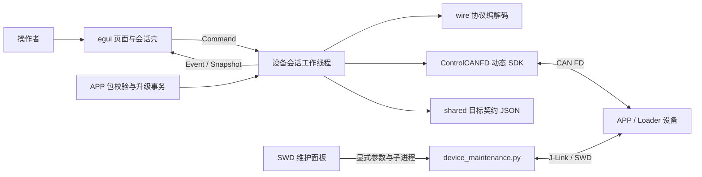
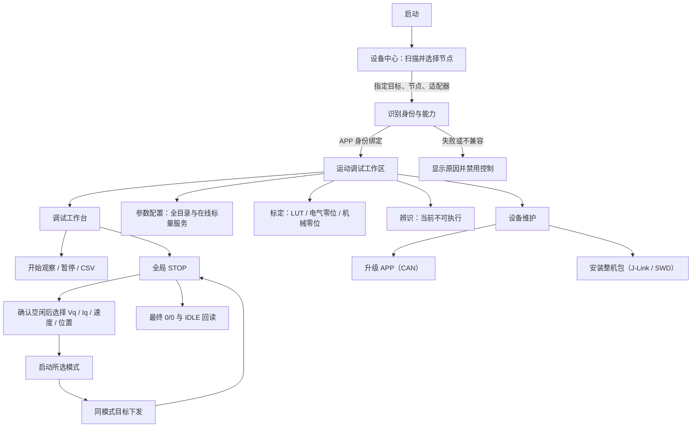

# YG_MC_HOST Rust 上位机软件设计说明

版本：2.3（上位机 v3.1.1 原生工作台候选）　日期：2026-11-11\
源码：[`host_app/rust/`](../../host_app/rust/)\
需求：[功能需求清单](../guides/yg_mc_host_requirements_v1.md)\
旧版方案：[Python/PySide6 设计档案](../../host_app/docs/README.md)

## 1. 设计目标

本设计面向当前 Rust/egui 工作台。重点是把设备通信、状态所有权、页面表现、升级和维护流程分开；所有设备数据必须来自真实回读，无法执行的业务必须明确标出。CAN 与 J-Link/SWD 是不同的独占作业，不能让两个工具路径同时占用设备。

## 2. 系统边界

GUI 负责收集用户意图、显示状态和发送受限命令。曲线处理线程独立于 CAN 和 UI：通过独立事件分发通道直接接收 CAN 快照，在 60 Hz 周期内计算时间窗、轴范围和保留极值的抽稀结果，以不可变快照交给 UI。UI 只读取快照并绘制窗口；不在绘制回调内遍历完整历史记录计算曲线。它不在绘制回调中操作 CAN SDK；设备线程独占 CAN 设备句柄并串行处理控制、查询和升级。SWD 维护通过独立 Python 维护脚本运行，执行期间 GUI 禁止新建 CAN 会话。

## 3. 模块职责

| 模块 | 文件 | 职责和边界 |
|---|---|---|
| 入口 | `src/main.rs` | 载入内置目标或显式选择的目标；支持正常 GUI、APP 包离线检查、原生离线预览。 |
| 目标契约 | `src/target.rs` | 从 `shared/targets/*.json` 读取产品、分区、schema、ABI 和 Loader 版本；目标未知或分区非法时停止，不回退默认目标。 |
| CAN 适配 | `src/can.rs` | 在用户扫描或连接后加载 ControlCANFD DLL；按索引打开通道并配置 CAN FD 速率，关闭句柄。 |
| 自动发现 | `src/discovery.rs` | 扫描可打开的 USBCANFD-200U 索引 0–15、通道 0、节点 1–254；仅通过 GET_INFO 识别目标与 UID；连接后重新核对 UID。 |
| 帧协议 | `src/wire.rs` | 编码、解码命令帧并验证节点、命令、序号和负载。 |
| 控制模式 | `src/control.rs` | 四模式线路值、单位、目标编码与主机调试范围；不访问设备。 |
| 型号配置 | `src/motor_configuration.rs`, `src/ui/motor_configuration.rs` | 型号CAN配置事务、型号/轴角色选择、热参数输入及保存/生效状态；固件按预设构造实际参数。 |
| 设备会话 | `src/device.rs` | 唯一 CAN 工作线程；持有会话 UID、控制序号、状态快照、能力与安全门禁；发出 UI 事件。 |
| 标量参数 | `src/parameters.rs`, `src/device_parameters.rs`, `src/ui/parameters.rs` | 协议目录和编解码、设备线程事务、绑定本次连接的回读缓存及独立草稿。展示元数据位于 `resources/parameter_presentation.json`，不存放示例设备值。 |
| 任务与清错 | `src/device_jobs.rs`, `src/calibration.rs` | Type107清错与160/161/162标定票据，校验真实终态和保存事实；未知结果停机，不重放启动。 |
| 故障与标定页面 | `src/ui/faults.rs`, `src/ui/calibration.rs` | 常驻故障码/红灯/清除按钮与三项标定的阶段、取消和保存结果。 |
| 故障日志 | `src/diagnostics.rs` | JSONL 会话事件、最近64帧故障证据、日志轮转和导出；正常收发不逐帧写盘。 |
| 趋势记录 | `src/capture.rs` | 仅采集当前 UID 的新鲜反馈；限制缓存、标记数据缺口/分段并导出 CSV。 |
| APP 包与升级 | `src/package.rs`, `src/upgrade.rs` | 校验完整 APP 包与目标契约，执行升级事务、进度报告、回读和失败收敛。 |
| SWD 维护 | `src/maintenance.rs` | 收集目标、探针、UID、构建包目录与确认；独立启动 `loader/tools/device_maintenance.py`；显示运行状态和结果详情。 |
| UI 外壳 | `src/ui.rs`, `src/ui/instrument.rs` | 全局连接标识、STOP、主题、工作区导航、状态事件、关闭/断开协调。 |
| 电机控制面板 | `src/ui/control_panel.rs` | 右侧模式下拉框、状态、使能/失能、STOP 和目标；运动命令不带人工勾选字段。 |
| 页面与图表 | `src/ui/pages.rs`, `src/ui/scope.rs` | 展示连接、总览、控制、参数、标定、辨识、记录和维护页面；图表仅绘制采集层提供的数据。 |

## 4. 页面与主要流程

v3.1.1 默认打开中控设备中心，由添加设备卡片进入 CAN 发现和选择。按适配器选节点后显式连接，设备型号及版本使用身份回读，
历史身份与输出状态各自标记。设备中心、运动调试、全参数、标定与辨识、固件维护、数据诊断均有导航入口。
运动页三幅曲线上下共用秒时间轴和游标，右侧集中模式下拉、使能、失能、STOP 和目标；
控制区以浅色分组显示当前设备的电流及外环参数，入口定位相应参数组。全参数目录分为电机、控制、阈值，控制参数按电流环、
速度环、位置环排列。活动值、Flash 值、待写值独立成列。全宽搜索与分类下拉位于可连续滚动的表格上方。全局栏分中控、日志和当前设备，设备列表可收起。
顶部视图菜单提供配色和应用缩放。显式 `--studio-preview` 可浏览示例节点、观察样本和五种状态；
预览无设备命令通道。自动截图仍使用 `--preview-dir`。型号配置、标定、维护与诊断沿用原事务。

## 5. 设备会话和状态数据

### 5.1 消息边界

页面通过 `Command` 请求 `Observe`、`Start {mode}`、`SetTarget {mode, value}`、`Stop`、`ClearFault`、`StartCalibration`、`CancelCalibration`、`Parameters`、`Upgrade` 或 `Disconnect`。工作线程将设备结果作为 `Snapshot`、`Parameters`、`Status`、`Progress`、`UpgradeDone`、`HardStop` 或 `Disconnected` 事件送回 UI。UI 不自行合成“设备已启动/升级成功”状态，状态只能由实际回复与后续反馈更新。

### 5.2 身份和反馈

- 设备身份最多 5 秒有效；状态反馈最多 500 毫秒有效。
- 控制目标必须和已绑定 UID、产品、硬件版本、schema、参数 ABI、APP 角色匹配。
- 四种能力必须由新鲜 GET_CAPS 功能位（8/10/11/12）及对应模式位声明；UI 不根据版本号猜测能力。线路模式为 Iq=1、速度=2、位置=3、Vq=6。
- 每个测量字段使用 `Option` 表示有效/缺失。反馈有效位与哨兵值不一致时整帧拒绝。
- 实测单位统一为 rad、rad/s、A、V、°C。设备原始缩放只在解析边界换算。

### 5.3 采集模型

观察由用户显式开始，样本基于主机单调时钟到达时间记录。缓存最多 15000 个样本；UID 改变、暂停或超过 100 ms 的接收间隔会形成数据边界。缺失值保持缺失，位置参考只在位置模式解释，速度参考在速度和位置模式解释，Iq 参考遵循有效位；Vq 只有实际回传，不生成参考曲线。CSV 前六信号列保持兼容并追加 vq_v、vq_reference_v（后者为空）。观察期间 CAN108 轮询默认 60 Hz（约 16.67 ms），界面分别显示最近 2 秒的实际接收频率与曲线新数据更新频率。暂停后恢复 200 ms 回读。接收频率、曲线新数据更新频率、显示器实际呈现频率和设备控制频率具有不同含义。导出位于 `%LOCALAPPDATA%/YG/YG_MC_HOST/captures`，包含数据 CSV 和曲线新数据更新时间戳 CSV。

## 6. 运动安全门禁

启用按钮仅是第一道门禁。工作线程在发送命令前重新检查身份、反馈、状态、故障和限制，避免 UI 状态变化与设备命令之间出现绕过。

| 操作 | 必要条件 |
|---|---|
| 启动模式 | UID/目标兼容；所选能力有效；反馈新鲜、无故障、母线读数合限；本会话 STOP 0/0 与 IDLE 5/0 已确认，速度近零且没有运动风险；不要求人工台架勾选。位置模式还须有有效实测位置。Vq/Iq/速度从零启动，位置由固件捕获并保持当前位置。 |
| 下发目标 | 上述身份有效；状态为 6、运行模式与请求一致；反馈新鲜，实测速率、电流与母线合限，所选模式测量有效；Vq ±6 V、Iq ±6 A、速度 0…31.416 rad/s；绝对位置目标保留有限值及线路整数范围，本次上位机位置会话解除行程限制。目标不隐式启动、不切换模式。 |
| 运行中自动保护 | 关键测量缺失/过期、位置模式位置缺失、Vq 模式电压缺失、故障、越限或实际速度超限时请求 STOP；STOP 失败进入硬停，不自动恢复。 |
| APP 升级 | 兼容的本次 UID、正确目标和配套 Loader；先 STOP 并确认最终 0/0 和 IDLE；完整包校验成功；用户确认设备与台架。 |

软件包络为母线电压 ≤33 V、母线电流绝对值 ≤3 A、运行 Iq 绝对值 ≤6 A；具体固件可能使用更低限制。Iq 不是相电流测量。CAN STOP 回读只证明通信协议的停机状态，物理输出仍需现场仪器或独立关断检查。

控制序号在发送功率相关命令前持久化，按 UID 保存。序号 0 表示恢复本机保存值；其他主机发过命令时，必须使用已知真实历史起点。未知时禁止猜测或复位序号。只读查询和控制共用会话序号计数；STOP 在序号保存失败时仍会尝试发送。

## 7. 升级和维护事务

### 7.1 APP CAN

1. 读取并绑定设备身份和目标契约。
2. 用户选择完整 APP 包；本地检查镜像、清单、版本和目标兼容性。
3. 检查配套 Loader、STOP/IDLE 回读、台架确认和 CAN 独占条件。
4. 进入升级事务并显示进度；运动命令在事务期间禁用。
5. 查询设备结果，核对版本/校验结果和 UID；失败时保持停机并提示下一步。

### 7.2 J-Link / SWD 整机维护

1. 选择目标匹配的构建包目录。维护页枚举 USB J-Link，单支自动选中，多支由用户选择。首次备份或安装时按探针序列号打开 SWD，自动双读 MCU UID，写入前核验。成功后工作台显示并绑定 UID；更换板型、探针或主动重新扫描时清除绑定。
2. 断开 CAN，确认设备停机并独占 SWD。
3. 通过维护脚本执行备份、整机安装、参数/LUT 查看、保护区比较或受支持的迁移准备。
4. 在 UI 显示执行状态；将完整子进程输出收进结果详情，失败摘要保持可见。
5. 维护任务运行时，连接页拒绝建立 CAN 会话；任务未验证前不能报告安装成功。

## 8. UI 信息层级

- **全局**：产品名、版本、当前设备/连接状态、主题、醒目的 STOP。
- **开始**：连接 → 运行调试 → 固件升级的工作入口、当前设备摘要、已有功能与待接入清单。
- **设备连接**：扫描、设备列表、选择与连接/断开；手动连接和 SDK 设置收纳在高级区域。
- **调试工作台**：右侧完整高度面板集中模式下拉框、使能状态、绿色使能、中性灰失能、红色 STOP、目标与实测及下发；使能和目标无台架勾选门槛，设备状态门禁继续复核。左侧保留观察工具栏、一张主曲线与两张辅助曲线；实时电气读数集中底栏；全局 STOP 保留。
- **设备维护**：区分“升级 APP（CAN）”与“安装整机包（J-Link / SWD）”；SWD 页面明确要求选择配套构建包目录。
- **未接入功能**：按钮禁用并说明缺失的主机服务或设备契约；不渲染伪造可写值。
- **详情**：协议/目标细节、完整维护命令输出和长日志在折叠区查看。

## 9. 错误、退出和恢复

- Type1/2/108/190/161 只读请求至多发送两次，共用总时限500 ms，每次等待不超过250 ms；运动反馈与身份请求进一步受最后有效反馈500 ms有效期约束。其他普通命令不自动重发。
- Type108 的 BUSY（6）是暂时没有一致快照，不是格式错误；最多进行三次快照读取，间隔2 ms且共用上述截止时间。BUSY 不更新测量、状态或新鲜度。
- 周期反馈暂忙或查询超时可在有限窗口继续读：运行时500 ms，停机时2 s。持续不可用、格式非法、SDK错误或UID变化仍失败收敛。身份后台刷新超时仅在旧身份仍新鲜且运行反馈未过期时延后；完整身份/配置解析成功才提交快照。
- 发送前门禁/输入拒绝与明确设备拒绝只显示操作失败，保留连接；START/目标结果未知时不重发，若可能正在运动则请求 STOP。STOP 最终状态未知仍关闭会话并要求现场核查，不自动使能或重放目标。
- STOP 最终回复或 IDLE 回读失败属于硬失败，要求人工物理检查，不自动重试运动。
- UID 变化立即撤销会话确认并暂停当前记录，不能继续用旧设备的同意状态。
- 断开连接后，历史曲线和记录可查看/导出，但不能作为当前实时测量或控制门禁。
- SWD 维护子任务意外退出且没有结果时，显示结果未知的失败状态并解除等待；设备状态须重新检查。
- 升级中不关闭程序、不切换设备、不启动运动；维护子进程独占期间不能建立 CAN。
- 日志和离线预览是辅助证据，不代替设备固件回读、输出关断验证或正式台架报告。

普通GUI启动后，将版本、UTC Unix毫秒时间、进程内单调时间、设备、命令、结果、
超时/丢弃帧原因及故障写到 `%LOCALAPPDATA%/YG/YG_MC_HOST/logs/*.jsonl`。
设备线程只在内存保留最近64帧，异常时随事件保存；SDK错误包含原始标志及数据。
每个日志分片上限约8 MiB，轮转后保留旧片；数据与日志页显示当前路径和写入错误，
可合并导出本次进程全部分片。日志写入失败不阻止 STOP；离线预览不访问日志或设备。
日志线程使用256项有界队列，设备侧只做非阻塞提交；磁盘/导出拥塞时显示事件丢失数，
不能为了日志完整性阻塞控制。正常退出和导出时等待已提交日志，设备线程不等待写盘。
自动化验证以离线故障注入为主；人工会话日志观察到使能受理、目标范围拒绝后连接保留和STOP最终0/0。
目标执行成功、物理关相、四模式及长时稳定性另行验收，不把被拒的目标记为运行通过。

### 启动过渡、故障栏与标定

START受理后保留最多500ms的待启动状态，允许IDLE且模式匹配、母线合限时暂缺运行Iq。
进入RUNNING后必须匹配所请求模式；超时或模式不符仍STOP。待启动窗口保留本次Type118续租。
位置目标还要求本次显式不限位位置使能，重新连接不能沿用旧权限。
STOP最终0/0接受无故障IDLE或模式0的故障停机，后者保留故障码和连接供显式清除。
所有页面底栏显示真实码与新鲜度，历史故障标为历史，不将离线零码当作正常。
标定按bit15开放三种任务，Type161每200ms查询当前票据，Type162请求取消；匹配票据与种类后才更新阶段。
终态回读STOP及身份；保存由固件确认effects，取消后的已保存结果仍显示已保存。
设备没有百分比/量化质量字段时明确标注；阶段detail来自设备，无虚构进度或评分。

## 10. 维护约束与后续接口

### 上位机不限位位置会话（v2.8.1 / APP1.6.2）

主机取消单次±10°步长，但保留有限值、线路整数范围和有效反馈校验。
GET_CAPS bit18声明会话能力；Type117仍为4字节，位置模式使用`03 01 00 00`请求不限位，
旧`03 00 00 00`维持原有限位语义；其他模式及未知标志不得借用此权限。
只在来源正确的请求通过所有普通启动门禁后开启，位置使能、目标、外环和轨迹参考共用此策略。
权限属于本次运行代际，不改写持久轴记录；STOP/故障/重启清除，普通控制不继承。
来源2的合法Type108刷新位置会话反馈时间；普通运动另须新目标或Type118在500ms内续租，监督拍检测失联后停机清除。旧固件不宣告能力时明确禁止无界位置使能。
电流、电压、温度、速度、标定和故障保护不受位置权限影响；仅连接/扫描不改变设备策略。

### 标量参数服务（v3.0.0）

协议唯一来源为[参数服务 v1](../protocols/README.md#参数服务-v1)，不改变固件ABI。
48项标量从共享目录读取类型、缩放、权限与静态范围；134项展示元数据只补充中文名称和分类。
Type120/123分别读取活动值与实际Flash值，每批最多4项，批次读取总时限500ms，单项不超过200ms；
批次前另做新鲜状态检查。UI在批次间提交后续读取，STOP/断开会取消尚未提交的批次。
Type121携expected_revision，单项修改成功后再用120回读实际量化值；其他旧修订行保留为历史值，须重新读取。
Type122显式保存，只有设备回复保存版本等于活动版本、flags=1才确认持久化。
权限、范围、版本冲突为业务拒绝，保留连接；帧损坏、通信失败遵循现有失败收敛。
缓存与本次连接UID绑定，重新连接清空；设备值、编辑草稿与Flash值分别保存，不跨重启复用修订号。
编译常量和没有可用接口的扩展显示未知/未接入，不在生产路径使用界面稿示例。

### CAN 指定型号配置（v2.7.0）

设备连接页配置适配器仲裁/数据段速率，扫描与连接共享设置；修改后清除旧扫描结果。
板端速率仍由当前固件配置，主机不声称已修改板端速率。

型号配置使用独立于生产身份 motor_type 的 CAN 服务；Type190 读取活动/已保存参数，
Type191 依据当前修订准备明确选择的型号、轴角色/节点、速度限制与已核实热参数，
Type192 携完整UID与准备票据提交保存，Type193携完整UID与保存修订显式重启。GET_CAPS bit17 门控此功能。
型号/节点配对来自固件产品预设；新参数由 Param_CreateAxis 构造，不在 GUI 复制电气参数。
保存先确认 IDLE 和实际关相，拒绝故障、未停稳、旧修订、型号错配和非法热参数；
写入前锁定本次上电的运行/标定，清除旧编码器/Hall/输出轴标定，并校验完整参数回读。
保存和当前活动配置分开显示；显式重启后按原 UID、新节点验证新修订及标定无效状态。
失败不回报生效，不自动恢复输出；失去回复不能推断写入未发生。

新增目标必须先扩展共享目标契约和对应的固件兼容验收，不应把产品判断散落到 UI 页面。新增在线参数、标定或辨识操作时，应先定义独立业务服务、协议版本/向量和确认流程，再向页面暴露命令。多设备、总线录制回放、离线报告和批量化功能暂不作为当前界面的隐式承诺。

### v3.0.1 续租高水位准入

设备线程在身份回读时检查已有本机续租记录，把不可用原因放入Snapshot，UI禁止使能并提供诊断详情。
每次START之前持久预留新的256计数区间，丢弃上次运行未发送的预留部分；缺失、损坏、零值或本进程已知回退均拒绝。
运行期间用尽当前区间后再预留，续租失败仍STOP并核对结果，不重试START或把计数改为猜测值。
日志记录实际控制/续租文件路径、首个计数、预留上限、上一次预留，以及Type118拒绝的counter/result/detail。
此策略不修改固件租约或线路ABI；没有可信历史的新设备/新主机初始化仍需独立流程，不能假定设备已复位。
