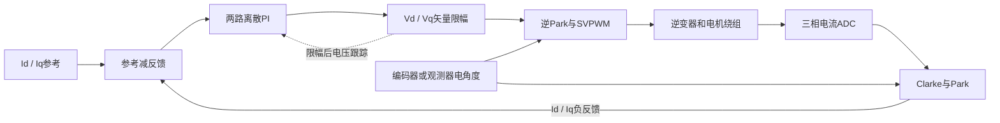

# 电流环整定过程与实测结论

核对日期：2026-11-02。适用硬件：AT32F456＋YQ-5708，减速比8:1。电流采用A，速度采用电机侧机械rad/s，角度采用rad。

本轮把“名义1.2kHz整定”改为“以闭环−3dB达到1.2kHz为目标的离散整定”。在Id=0.5A±0.1A、Iq=0条件下，D轴实测闭环带宽从约2.963kHz降到1.194kHz。最终PI为Kp=0.60995855、Ki=3226.22067，控制频率仍为20kHz。

上述实机数据使用1Ts输出角度预测。当前源码随后改为1.5Ts，已完成离线回归和编译，尚无该补偿版本的实机频响。0.75A持续Id测试触发速度截止；低电流短脉冲中0.3A通过，0.1/0.2A未全部达标。因此，1.194kHz只对应已测偏置和幅值，不能代表全工况稳定性。

## 1 整定目标与带宽口径

| 名称 | 定义 | 用途 |
| --- | --- | --- |
| 控制频率 | PI每秒更新次数，本机20kHz，Ts=50μs | 决定离散化、时序与采样上限 |
| 名义整定频率 | 连续模型中使用的`Kp=L×2πf、Ki=R×2πf`里的f | 生成初始增益，不等于真实闭环带宽 |
| 闭环−3dB带宽 | 参考电流到反馈电流的幅频响应，相对低频增益降到1/√2处的频率 | 本轮主要验收口径 |
| 开环交越频率 | 开环传递函数幅值等于1的频率 | 分析稳定裕度 |
| 阶跃等效带宽 | 一阶近似下`ln(9)/(2πt10–90)` | 辅助比较同工况阶跃，不能替代扫频 |

本轮验收目标为闭环−3dB频率1200Hz±10%，即1080～1320Hz，同时检查增益隆起、重复性、噪声和保护状态。

采样20kHz既不是带宽20kHz，也不能推出实际带宽为某个固定比例。阶跃从零电流进入工作点时还可能受非线性影响，不能与带偏置的小信号扫频直接互换。

## 2 当前控制结构



PI直接使用`current_dq_a`。另外计算的`current_dq_filtered_a`低通值用于观测，不串在PI反馈中。90Hz PLL属于编码器速度估计器，也不是电流反馈低通；速度会用于输出角度预测。

电流控制分支直接由两路PI产生Vd/Vq，没有显式加入ωL交叉耦合或反电动势电压前馈。低速单轴整定将这些影响视为扰动，不能由此推断高速dq已完全解耦。PMSM的dq模型及转矩关系见[Imperix FOC说明](https://imperix.com/doc/implementation/field-oriented-control-of-pmsm)。

PI积分在本拍更新：

\[
e[k]=i^*[k]-i[k],\qquad
x_I[k]=x_I[k-1]+K_iT_se[k]
\]

\[
u[k]=K_pe[k]+x_I[k],\qquad
C(z)=K_p+\frac{K_iT_s}{1-z^{-1}}
\]

这是后向矩形积分形式。代码另有条件积分、输出限幅及限幅后电压跟踪；下面的线性模型适用于这些非线性限幅未主导输出的情况。[离散PI形式参考](https://imperix.com/doc/implementation/pi-controller)

## 3 基线与问题发现

整定经历如下阶段，均保留对应原始报告：

| 阶段 | d/q Kp | d/q Ki | 关键结果 |
| --- | ---: | ---: | --- |
| 原名义1kHz | 0.895354 | 3455.752 | 关相噪声7.67～9.31mA RMS；当时尚未测闭环频响 |
| 名义提高到1.2kHz | 1.07442474 | 4146.90283 | 修复Vd/Vq反馈；Id阶跃改善，但后续小信号扫频达到约2.963kHz |
| 计入离散延迟重整定 | 0.60995855 | 3226.22067 | Id=0.5A±0.1A闭环实测1193.9Hz |
| 低电流短脉冲复测 | 同上 | 同上 | 0.3A三次通过，0.1/0.2A未全达标 |
| 输出角度预测改为1.5Ts | 同上 | 同上 | 离线验证通过，实机频响待复测 |

原连续公式把对象近似为RL，并用PI零点抵消电气极点。真实控制还包含离散积分、采样保持、输出更新时序和非理想电压作用。只改变名义频率，不能保证闭环−3dB等比例改变。

本轮还发现Vd/Vq字段先前未更新。修复后，它们表示从限幅后的调制量与母线电压还原的命令电压估计，复用于台架采样和108/124反馈；不包含独立测得的死区、管压降或绕组电压误差。

## 4 等效对象与延迟辨识

在0.5A偏置、±0.1A扰动条件下，用已知PI和闭环频响辨识等效对象：

| 参数 | 辨识或设计值 | 解释 |
| --- | ---: | --- |
| 等效R | 0.71897129Ω | 电流控制通路的拟合参数 |
| 等效L | 153.20277μH | 同上 |
| 额外等效延迟 | 约48.8μs | 在RL零阶保持模型之外拟合 |
| 设计额外延迟 | 50μs | 按一拍取值 |
| 保持环节低频等效延迟 | 约25μs | Ts/2 |
| 总等效延迟 | 辨识约73.8μs，设计约75μs | 不是独立测得的CPU运算时间 |

R、L和额外延迟由同一组闭环数据共同拟合，不能当成三项独立物理测量。实际ADC触发、转换完成、CPU计算、PWM写入和生效的分段时间仍需定时测量。

当前用于观测器的活动物理参数仍为R=0.55Ω、Ld=Lq=142.5μH，本次没有用拟合R/L覆盖它们。延迟分类与采样保持的说明见[Imperix PN142](https://imperix.com/doc/help/discrete-control-delay)。

令：

\[
a=e^{-RT_s/L}=0.79085
\]

RL经零阶保持离散化为：

\[
G_{\rm RL}(z)=\frac{(1-a)/R}{1-az^{-1}}z^{-1}
\]

再加入额外一拍延迟：

\[
G(z)=\frac{0.29090174z^{-2}}{1-0.79085z^{-1}}
\]

这里零阶保持已经包含在离散对象中，后续不能再串接一份25μs延迟重复计算。

## 5 PI参数的计算

保持已有PI实现，先令PI零点抵消等效RL极点：

\[
\frac{K_p}{K_p+K_iT_s}=a
\]

抵消后开环为：

\[
L_o(z)=C(z)G(z)=\frac{Az^{-2}}{1-z^{-1}}
\]

按闭环`T(z)=L_o(z)/(1+L_o(z))`在目标频率处的幅值为1/√2求A。设`ω_b=2π×1200`，额外延迟`T_d=T_s`：

\[
\phi=\omega_b(T_d+T_s/2)
\]

\[
A=2\sin(\omega_bT_s/2)
\left(\sqrt{1+\sin^2\phi}-\sin\phi\right)=0.22436366
\]

\[
K_p=\frac{ARa}{1-a}=0.60995855,\qquad
K_i=\frac{AR}{T_s}=3226.22067
\]

Kp单位为V/A，Ki单位为V/(A·s)。实际每拍积分系数是`KiTs=0.16131103`，不能再将该值作为Ki交给会乘Ts的PI。

最终线性闭环为：

\[
T(z)=\frac{0.22436366z^{-2}}
{1-z^{-1}+0.22436366z^{-2}}
\]

它是二阶离散闭环，不是直接指定时间常数的一阶惯性环节。模型预测闭环−3dB约1200Hz、开环交越约716Hz、相位裕度约70.7°；相位裕度属于模型分析，没有做独立开环注入测量。

以下计算可独立复核增益：

```python
from math import exp, pi, sin, sqrt

ts = 50e-6
resistance = 0.7189712900756896
inductance = 153.20276942709597e-6
omega_b = 2 * pi * 1200

a = exp(-resistance * ts / inductance)
phi = omega_b * (ts + ts / 2)
gain = 2 * sin(omega_b * ts / 2) * (sqrt(1 + sin(phi) ** 2) - sin(phi))
kp = gain * resistance * a / (1 - a)
ki = gain * resistance / ts
print(kp, ki)  # 约0.60995855、3226.22067
```

## 6 源码落点与参数装载

| 文件 | 作用 |
| --- | --- |
| [application_config.h](../../firmware/config/application_config.h) | AT32/YQ组合选择固定重整定增益 |
| [parameter_record.c](../../firmware/parameters/parameter_record.c) | 默认和Flash配置装载使用同一PI策略 |
| [pi_controller.c](../../firmware/motor/control/pi_controller.c) | 条件积分、限幅及输出跟踪 |
| [foc.c](../../firmware/motor/control/foc.c) | 电流变换、两路PI、矢量限幅、输出角度预测 |
| [foc_output.c](../../firmware/motor/control/foc_output.c) | 复用控制计算并提交PWM |
| [motor_bench.c](../../firmware/app/runtime/motor_bench.c) | 有界激励、捕获、保护和冻结读取 |
| [unified_motor_test.py](../../tools/bench/unified_motor_test.py) | 复用既有台架接口和结果计算 |

AT32F456＋YQ-5708装载配置时，旧Flash记录里的四个电流PI值不会覆盖这组固定增益。模型、编码器标定和外环参数按原路径装载，Flash结构及CRC不变；导出配置反映实际PI。

该组合只修改目标频率常量，不会自动重算固定增益。更换电机、采样时序或目标带宽时，需要重新计算和验证。其他板卡/电机保留`Kp=L×2π×1200、Ki=R×2π×1200`的原派生策略，本轮没有证明它们实测达到1.2kHz。

## 7 扫频验证步骤

硬件条件为电机本体固定、输出轴自由、没有锁轴加载装置，也没有示波器或电流探头。台架相电流截止3A、速度截止5rad/s、累计行程1rad、通信租约500ms。5rad/s是本轮保守门限，不是电机能力上限。

1. 备份并核对镜像、实际PI、完整参数区、LUT、电零位和极对数；确认数字关相及故障0。
2. 确认转子停稳，设置Id=0.5A偏置、±0.1A正弦扰动，Iq=0。
3. 每个频点独立运行，等待至少5个正弦周期且不小于50ms，再捕获128点；频点各重复2次。
4. 低频使用抽取以覆盖完整周期，高频使用20kHz直接记录。检查板端tick、参考幅值、偏置、无效计数和停止原因。
5. 停机后读取冻结数据，对参考与实测分别拟合常数项、正弦项和余弦项，得到幅值及相位。
6. 以最低三个频点的平均幅值比作为低频基准，在包围−3.0103dB的两点间按对数频率插值。
7. 每次结束后核对关相；任何保护停止保留原始记录，不将失败点纳入正常带宽统计。

本轮27个频点为：

```text
19.53125, 39.0625, 78.125, 156.25, 234.375, 312.5,
390.625, 468.75, 546.875, 625, 703.125, 781.25,
859.375, 937.5, 1015.625, 1093.75, 1171.875, 1250,
1328.125, 1406.25, 1562.5, 1875, 2187.5, 2500,
3125, 3750, 3906.25 Hz
```

每窗128点。直接采样的名义窗长是6.4ms，首末样本时间跨度为6.35ms；抽取窗相应乘以抽取系数，不能误认为所有频点的记录频率都是20kHz。

所有上升时间和频率拟合使用板端tick，不按CAN收发间隔计算；CAN只负责下发工况和停机后读回记录。

54组记录全部有效。闭环−3dB交点为1193.9Hz，位于1171.875～1250Hz之间，目标误差−0.51%；两次重复分别为1164.3Hz和1208.3Hz。重复范围不等于统计置信区间。

相对低频最大增益为+0.056dB，没有明显增益隆起。快窗最高速度0.350rad/s，电压矢量估计峰值0.761V。


[54组扫频明细与正弦波形](../../outputs/delay-aware-current-loop-20261102/frequency_report.html)

## 8 噪声 稳态和阶跃复测

重整定后，关相三相采样噪声7.03～9.53mA RMS。零电流时Id/Iq纹波分别约7.17/9.41mA RMS。Id=0.3A的三次5秒运行通过，Id纹波6.04～7.81mA、Iq纹波8.98～10.30mA RMS。

Id=0.75A首轮在正式采集前触发速度截止，设备`reason=2`、`fault=0`，高速采集0点。其余0.75A稳态和原长阶跃取消。最后一个主机趋势点速度为2.83rad/s，早于保护触发，不能代表真正的越限峰值。

随后改为10ms短脉冲，每档0.1/0.2/0.3A做3次dq阶跃，再各做1次同步机械角/速度采集。保持原3A、5rad/s、1rad和500ms租约，共12次脉冲正常结束，没有保护截止。

| Id阶跃 | 10%～90%上升ms | 稳定ms | 原始超调 | 结果 |
| --- | --- | --- | --- | --- |
| 0→0.1A | 1.15～1.80 | 1.20～1.50 | 10.99%～22.80% | 三次未过上升/超调指标 |
| 0→0.2A | 0.90～1.00 | 2.45～3.25；另一次窗口不足 | 15.71%～19.63% | 两次未过，一次未覆盖连续1ms稳定带 |
| 0→0.3A | 0.75～0.90 | 0.95～1.05 | 5.39%～8.14% | 三次通过 |

原建议为上升≤1ms、稳定≤3ms、超调≤10%。稳定带沿用`max(2%阶跃幅值, 0.03A)`，持续至少1ms。表格保留50μs采样网格的判定，线性插值仅作补充，不用平滑数据修改结论。

0.1A末段纹波8.30～11.91mA RMS，已占目标的8%～12%，单点超调容易受测量纹波影响；较慢的过阈值上升仍按实际结果记录。带0.5A偏置的小信号1.194kHz结果不能替代这些从零开始的阶跃结果。


同步角度/速度采集确认存在微小位移，反馈方向一致。位置为2kHz更新，速度来自20kHz计算的90Hz PLL，短暂加速时速度积分滞后。0.1/0.2/0.3A记录的角变化约0.288/0.767/1.150mrad；位移较小，只能用于内部一致性检查，不能证明绝对角度精度或速度比例。


上述噪声与纹波来自板载ADC，不是独立电流探头测得的PWM周期内绕组纹波。

## 9 1.5Ts输出角度补偿

原电压逆Park使用`θ+ωeTs`。当前源码按用户要求改为：

\[
\theta_{\rm PWM}=\theta_e+\omega_e(1.5T_s)
\]

20kHz时预测75μs后的电角度。电流Park仍用本拍θ，开环角度状态每拍仍推进`ωeTs`；测量角与输出角没有一起提前。

编码器、无感及开环控制复用同一输出入口。该改动补偿转子旋转造成的坐标角度滞后，不改变ADC转换时间、CPU执行时间或PWM更新等待，也不是电流闭环相位超前校正器。

`754e7829`提交了该补偿；`d6c728bc`归并了其余现有重构与试验代码。1.5Ts版已通过61,440次FOC对照、84组解析PWM矢量检查及双板编译。该完整源码提交的PR、release检查及9个Keil目标构建通过。前述扫频与阶跃仍属于1Ts实机版本，1.5Ts版需要重新进行实机确认。

## 10 后续整定顺序

1. 保留当前PI、20kHz和4次过采样，用DWT及定时器计数记录ADC完成、PWM写入与生效位置，分开确认计算耗时和等待更新的时间。
2. 在原低电流工况验证1.5Ts输出角度预测，复测偏置扫频和短脉冲，不套用旧版本结果。
3. 核对0.75A时的原始角度变化、速度估计和电零位，解释加速原因后再决定是否恢复该工况。
4. 如调整ADC触发、PWM更新或采样频率，重建离散模型并重算PI，再做同条件频响、噪声和阶跃对照。
5. 非零Iq持续测试及更大电流的完整验收需要解决输出轴固定/加载条件；不能靠放宽速度截止代替。

1.5Ts角度预测与总等效延迟约75μs数值接近，不代表它们是同一项。前者是输出坐标角的预测时间，后者是电流通路的频域等效延迟；不能将两者相减后声称实际控制延迟已消失。

## 11 原始记录与入口

| 记录 | 内容 |
| --- | --- |
| [原1kHz稳定性](../reports/2026-11/current_loop_stability_20261102.md) | 原PI、噪声及稳态 |
| [阶跃等效带宽](../reports/2026-11/current_bandwidth_20261102.md) | 一阶折算方法及适用边界 |
| [Vd/Vq修复及名义1.2kHz](../reports/2026-11/current_loop_1200hz_20261102.md) | 电压语义、旧增益及阶跃 |
| [旧PI扫频](../reports/2026-11/d_axis_sweep_20261102.md) | 约2.963kHz的频响与高偏置截止 |
| [含延迟重整定](../reports/2026-11/current_loop_delay_20261102.md) | 新增益、1193.9Hz及0.75A截止 |
| [短脉冲测试](../reports/2026-11/current_short_pulses_20261102.md) | 12次脉冲、逐次性能与角度速度数据 |
| [1.5Ts实现和检查](../plans/completed/2026-11-02-foc-phase-advance-1p5ts-v1.md) | 代码范围与离线验证 |

用于1193.9Hz及短脉冲验证的台架HEX SHA-256为
`a98b2b6b66386d7fe8539b669ed35aa6058afe74a53710dcf1ae4f5f48f6caac`。原始CAN帧、逐点CSV、模型输入和下载核对保存在`outputs/delay-aware-current-loop-20261102/`与`outputs/current-short-pulses-20261102/`。本机`outputs`为忽略的证据目录，复制文档时需同时带上引用的图片和数据。

AT32入口为[projects/at32f456/application/main.c](../../projects/at32f456/application/main.c)，STM32入口为[projects/stm32g4/application/main.c](../../projects/stm32g4/application/main.c)。两者经`BspApp_OnFastSample → App_FastTick → MotorAxis_FastTick`进入采样控制链。
