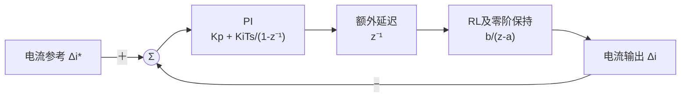

# 电流环整定原理与测试结果

2026-11-02，AT32F456＋YQ-5708（8:1），控制频率20kHz。

## 1 整定原理

电机电流近似由RL环节决定，PI根据电流误差调节电压。采样保持和控制延迟会改变闭环幅相，因此按连续公式算出的“1.2kHz”不等于实测带宽。本轮以**参考电流到反馈电流的闭环−3dB频率为1.2kHz**进行整定。

低速、小信号、未限幅时，D轴等效为：

其中`a=exp(−RTs/L)`，`b=(1−a)/R`。扫频辨识得到等效R≈0.719Ω、L≈153.2μH，Ts=50μs，对应a=0.79085、b=0.29090174；这些拟合值没有覆盖观测器使用的物理参数。

额外延迟按一拍50μs设计，加上保持环节约25μs，总等效约75μs。该值是频域模型，不是独立测得的CPU运算时间；RL离散块已含保持效应，不再重复添加25μs。

先令PI零点抵消模型的RL极点：

\[
\frac{K_p}{K_p+K_iT_s}=a
\]

此时开环为`L_o(z)=Az^{-2}/(1-z^{-1})`。按1.2kHz处闭环`|L_o/(1+L_o)|=1/√2`求得A=0.22436366，再得到：

\[
K_p=\frac{ARa}{1-a}=0.60995855,\qquad
K_i=\frac{AR}{T_s}=3226.22067
\]

Kp单位为V/A，Ki单位为V/(A·s)，实际每拍积分系数`KiTs=0.16131103`。d/q采用相同增益，闭环模型为：

\[
T(z)=\frac{0.22436366z^{-2}}
{1-z^{-1}+0.22436366z^{-2}}
\]

模型预测闭环−3dB约1.2kHz、开环交越约716Hz、相位裕度约70.7°。后两项为模型结果，没有独立开环注入实测。

**角度补偿是另一项设置：**当前源码的输出角为`θout=θe+ωe×1.5Ts`，电流测量仍用本拍θe。它补偿旋转坐标的角度滞后，不会消除实际采样和PWM延迟；下述实机结果来自此前的1Ts补偿版本，1.5Ts版尚待实测。

## 2 测试结果

扫频条件为Id=0.5A±0.1A、Iq=0，27个频点各测2次，使用板端时间戳计算幅相。保护保持相电流3A、速度5rad/s、行程1rad和500ms通信租约；输出轴自由。

| 项目 | 结果 |
| --- | --- |
| 原名义1.2kHz参数 | Kp=1.07442474、Ki=4146.90283；闭环实测约2.963kHz |
| 含延迟重整定参数 | Kp=0.60995855、Ki=3226.22067；闭环实测**1.194kHz** |
| 扫频重复性 | 两次分别1.164、1.208kHz；平均曲线交点相对目标偏差−0.51% |
| 关相采样噪声 | 三相7.03～9.53mA RMS |
| 零电流和Id=0.3A稳态 | 已测窗口通过；0.3A三次5秒运行通过 |
| Id=0.75A稳态 | 正式采集前触发5rad/s速度截止，采样0点；剩余测试取消 |

随后完成12次10ms短脉冲：每档3次电流阶跃及1次角度/速度复核，均未触发保护。电流阶跃结果如下：

| Id阶跃 | 上升时间 | 稳定时间 | 原始超调 | 结果 |
| --- | --- | --- | --- | --- |
| 0→0.1A | 1.15～1.80ms | 1.20～1.50ms | 10.99%～22.80% | 三次未通过 |
| 0→0.2A | 0.90～1.00ms | 2.45～3.25ms；另一次窗口不足 | 15.71%～19.63% | 两次未通过，一次稳定窗口不足 |
| 0→0.3A | 0.75～0.90ms | 0.95～1.05ms | 5.39%～8.14% | 三次通过 |

判据为上升≤1ms、稳定≤3ms、超调≤10%；稳定带±30mA，持续至少1ms。每次捕获128点，含1.6ms预触发和4.75ms阶跃后数据，下降沿不在该窗口内。

0.1A末段纹波约8～12mA RMS，已占目标的8%～12%，会影响单点超调判定；较慢的上升时间仍按实测保留。带偏置的小信号带宽达标，不代表从零开始的各档阶跃都达标。

本轮确认的是**指定工况下D轴带宽达到1.2kHz目标**。0.75A速度截止、非零Iq持续运行和1.5Ts补偿版本仍待验证；板载采样结果不代表外部探头测得的PWM电流纹波。

详细数据：[扫频与稳态报告](../reports/2026-11/current_loop_delay_20261102.md)、[短脉冲报告](../reports/2026-11/current_short_pulses_20261102.md)。图片和原始数据保存在本机`outputs`目录。
