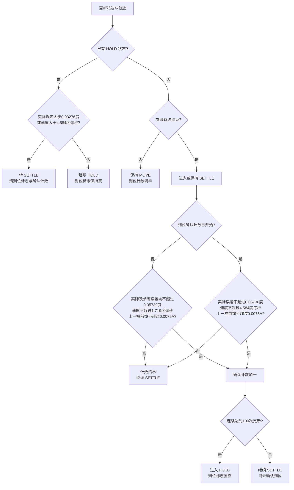
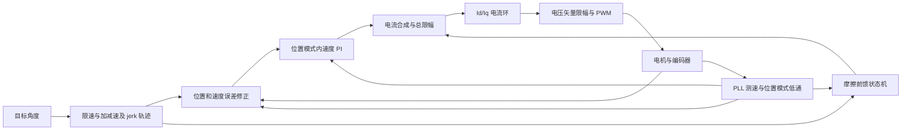
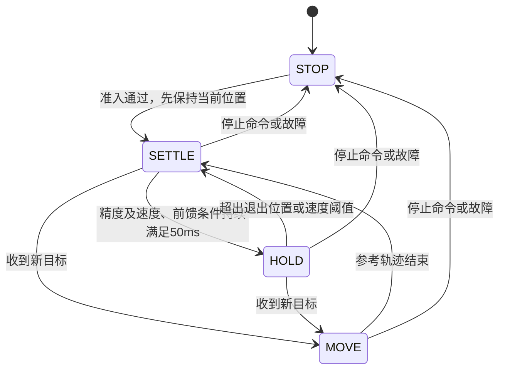

> **v0.2.2积分纠偏候选覆盖下文旧版策略**：停靠后误差>1°持续50 ms触发位置内速度PI积分纠偏，电流受运行限流及2 A/s斜坡约束；回到≤0.5°清Ui并撤流，中间保持原状态。摩擦/惯量前馈关闭。本版已下载Pitch并完成静态核验，尚未运动验收；详见[计划](../plans/2026-10-10-passive-recovery-integral-v2.md)。

# mode 3 位置串级、摩擦补偿与运行判定

> 当前源码采用[阻尼环被动停靠v1](mode3_passive_hold_v1.md)：精确到位±0.08°、
> v7停靠窗口±0.5°，窗口内零保持/纠偏；超过±0.5°才允许纠偏，限1 A且不恢复Ui/摩擦前馈。
> 首次停止总Iq按2 A/s释放，受阻纠偏退出等待真实外部位移。下文原始立即唤醒属于旧流程。
> 下文旧窗口/保持流程为历史审读，不代表当前源码；下载及实测须核对对应版本报告。

> 03数据暴露近区模型前馈往复恢复；最新候选增加SETTLE近区前馈退出锁存，
> 尚未烧录或实机验证。见[03排查报告](../reports/2026-10-10-roll-position-noise03.md)。

> 最终捕获逻辑增加独立位置资格滤波，并在连续资格50 ms后撤除前馈；未捕获的
> SETTLE不因PLL静止判据波动撤掉补偿。下文属于较早审读，最终契约及实机边界
> 见[本轮排查报告](../reports/2026-10-10-roll-position-capture.md)。

版本：v1.1，2026-10-10。范围：`codex/ovp-36v` 当前工作树，基准提交
`bb38d388ed7bf0235dc898f71c134719d46e61a4`，包含未提交的位置捕获修复。
本文为代码审读，不连接台架、不修改控制代码；不保证每块板已下载这份工作树镜像。
旧版实机指南中的 0.18° 捕获、40 Hz 滤波和 1.2 倍启动增强是历史配置，
不能用于解释当前默认逻辑。

后续版本注意：本篇详细流程对应审读时的源码快照。随后工作树新增SETTLE近区模型前馈退出锁存及到位资格位置滤波；0.18°/0.26°用于前馈退出/恢复，不等于默认0.0573°捕获精度。新增策略及板上版本边界见[前馈往复截图审读](../reports/2026-10-10-friction-feedforward-chatter-review.md)和[近区锁存计划](../plans/2026-10-10-settle-friction-quiet-v1.md)。

## 0. 按执行顺序理解判定

先区分三个互相独立的结果：`ModeNow`决定是否处于出力模式，`phase`决定
运动/收敛/保持策略，`target_reached`只表示是否已确认到位。
SETTLE和HOLD都仍是mode3，不会自动变成mode0。

新目标的判断是目标浮点值与上次不相等，而不是变化超过精度窗口。
因此即使目标只改变很小量，也会清除到位确认计数并进入MOVE。

### 每个快拍与外环周期先做什么

| 顺序 | 判断 | 成立后动作 | 不成立后动作 |
| --- | --- | --- | --- |
| 1，20 kHz快拍 | STOP或故障，或参数/传感器/实际位置/目标非法？ | 放弃外环旧结果，最终mode0、清运行状态并关相 | 允许继续mode3 |
| 2，20 kHz快拍 | 上一份外环已完成且模式代次一致？ | 接收新的参考、Iq和到位结果 | 保持上一份有效输出；到下一提交期限仍未完成则报控制超时 |
| 3，每500 μs | 可以提交新的外环输入？ | 复制本拍目标、反馈及参数，调度PendSV | 若旧任务仍占槽则报控制超时，不追加队列 |
| 4，外环开始 | 是首次初始化或目标改变？ | 初始化/转MOVE；新目标清到位计数及摩擦恢复资格，保留有用Ui | 延续当前轨迹和状态 |
| 5 | 更新滤波与轨迹，轨迹数据非法？ | 返回失败，快拍接收后停机 | 若仍准备规划，本次保留已有支撑输出；否则进入下面的状态与电流判定 |
| 6 | 状态、摩擦、积分与总电流计算通过？ | 交付新Iq；快拍接收后用于20 kHz电流环 | 返回失败并停机 |

### 到位分支：判断先于本拍摩擦更新

记 `e_actual=目标−实际位置`，`e_ref=目标−轨迹参考位置`。
默认精度 `delta=0.05730°`；`v`为基础5 Hz滤波后的速度。



到位判定使用上一拍的摩擦前馈，因为本拍的新前馈在下面才计算。
实际/参考进入窗口可以先触发前馈卸载，但必须待前馈小、轨迹结束及确认完成，
才把到位标志置真。轨迹结束、进入窗口、确认到位是三个不同事件。

### 电流分支：不能把前馈为零或Ki为零理解为总电流为零

按以下顺序执行，不是几套控制器各自独立争用Iq：

```text
① 用位置/速度误差计算速度命令，再限幅。
② 尚未捕获，且旧Ui同时反对位置和速度纠偏？
   是：按限速卸载相反Ui。否：保留Ui。
③ 更新摩擦前馈（按下表的优先级）。
④ 静摩擦资格满50ms、前馈不再增长且有电流余量？
   是：在原Ui内按0.30A/s加电流。否：不做额外积累。
⑤ 本拍有静摩擦积累，或同向前馈正在增长，或HOLD，
   或已进入位置窗口且速度≤1.719°/s？
   是：普通速度Ki本拍置0，保留Ui。否：正常速度PI积分。
⑥ 计算速度PI的P+Ui，再加摩擦前馈（加速度前馈目前为0）。
⑦ 总电流是否超限？
   是：限幅并回写PI抗饱和，继续闭环。
   否：直接输出。
   非有限数值：计算失败并停机。
```

普通电流命令饱和本身不切换到STOP；实际过流保护是另一项判定。
“前馈退出”只去掉`I_friction`，“Ki暂停”只暂停普通积分增量；
P项和已有Ui仍可以产生电流。

### 摩擦分支的优先级

| 优先级 | 首先满足的条件 | 本次动作 |
| --- | --- | --- |
| 1 | 前馈开关关闭 | 前馈立即0，清摩擦状态；速度PI及残余静摩擦Ui逻辑仍独立运行 |
| 2 | HOLD，或实际/参考已进入捕获窗口 | 将前馈目标设0，按斜率卸载；取消脱黏/恢复状态 |
| 3 | 已处于着陆状态 | 保留原运动方向；在窄捕获区内衰减；若窗口外静止满50ms则转恢复 |
| 4 | MOVE | 从轨迹速度、参考剩余距离、实际误差依次选择方向，施加模型前馈 |
| 5 | SETTLE且恢复已激活 | 继续原恢复方向补偿；捕获或越过目标时转卸载/着陆 |
| 6 | SETTLE、误差仍在窗口外且近似静止 | 等待50ms，然后沿实际误差方向恢复；等待期间不凭速度噪声翻转补偿 |
| 7 | 其余情况 | 前馈目标0，卸载已有前馈 |

选出目标前馈后，还要经过着陆缩放、换向先经过0、电流变化率及总限流。
因此判断“前馈开着”不等于本拍就直接输出完整约3 A。

### 用具体输入判断输出状态

以下均假定没有故障、没有新目标、轨迹已结束、参考等于目标、速度0，
未注明时前馈已为0。表中的状态均仍处于mode3。

| 当前条件 | 代码如何判定 |
| --- | --- |
| 未HOLD，误差0.24° | 未捕获、不到位；维持SETTLE，静止资格满足后恢复前馈/Ui纠偏 |
| 未HOLD，误差0.07° | 超过0.05730°，不能开始HOLD确认；仍允许静摩擦恢复 |
| 未HOLD，误差0.04°，前馈仍2 A | 已进入精度窗，先卸载前馈；不能立即置到位 |
| 未HOLD，误差0.04°，前馈≤0.0075 A | 开始确认，连续100次满足才置到位 |
| 已HOLD，误差0.07° | 尚未超过0.08276°退出阈值，保持HOLD；保留支撑Ui，不启用摩擦恢复 |
| 已HOLD，误差0.09° | 退出HOLD，清到位标志，转SETTLE重新纠偏 |
| 已HOLD，误差0.02°、速度5°/s | 即使位置很近，也因速度超过4.584°/s退出HOLD |

## 1. 控制链与输入输出



算法内部位置、速度、加速度分别使用 rad、rad/s、rad/s²，电流使用 A。
本文展示阈值时附换算后的 °、°/s。

1. 目标 `posRef` 是最终位置；`posShadow` 是经过规划的运动参考位置。
   位置反馈来自 LUT 线性化并相对机械零位连续展开的编码器位置。
2. 轨迹产生 `q_ref / w_ref / a_ref`。从静止到静止使用平滑分段轨迹；
   运动中修改目标会保留当前参考位置、速度、加速度，转入在线限 jerk 规划。
   规划准备分拍执行，准备时保留原参考及支撑电流。
3. 位置级联输出速度命令：

   ```text
   e_q = q_ref - q_actual
   e_v = w_ref - w_filtered
   w_cmd = w_ref + cascade_pos_Kp * e_q + cascade_pos_Kd * e_v
   w_cmd 限幅到 ±min(speed_limit, 1.5 * 有效位置巡航速度)
   ```

   `cascade_pos_Kp` 单位为 1/s，`cascade_pos_Kd` 无量纲。
   Kd 对轨迹速度与实际速度的差做修正，不是直接输出阻尼电流的参数。
   `pos_kp/pos_kd/pos_ki` 属于另一种位置阻抗控制，不能代替 mode 3 的级联增益。
4. 位置模式内速度环使用 `position_speed_Kp / position_speed_Ki`，与纯速度
   模式的 `speed_Kp / speed_Ki` 分开。为保持既有归一化参数含义，执行时：

   ```text
   Kp_current = position_speed_Kp * current_limit
   Ki_current = position_speed_Ki * current_limit
   I_feedback = PI(w_cmd - w_filtered)
   Iq_ref = clamp(I_feedback + I_friction + Ka * a_ref, -current_limit, current_limit)
   Id_ref = 0
   ```

   0.5/1.0 与 8 A 限流对应电流域 Kp=4 A/(rad/s)、Ki=8 A/rad。
   修改限流也改变有效速度增益。当前 `Ka=0`，没有启用惯量加速度前馈。
5. 总限流包含反馈与前馈，摩擦前馈没有额外电流额度。最终可施加的反馈电流
   回写速度 PI 抗积分饱和；电流环还会对总 d/q 电压矢量限幅，并回写各电流 PI。

## 2. 执行周期与测速

| 环节 | 当前行为 |
| --- | --- |
| 编码器采样、FOC 电流环、快速故障检查 | 20 kHz，50 μs/拍 |
| 位置轨迹、位置修正、内速度 PI、摩擦逻辑 | 2 kHz，500 μs/次 |
| 外环调度 | 快中断提交单份输入，PendSV 计算，下一个快拍接收已完成结果 |
| 外环未完成 | 到下一次 500 μs 提交仍未完成，触发 `ControlOverrun_Error`，不积压队列 |
| 温度监督 | 1 kHz；当前读取 MCU 内部温度 |

mode 3 使用 `Encoder_GetMecVelContinuous()`，默认来源是 20 kHz PLL，
不使用速度接口的硬零速截断。WINDOW4 是编译时可选的替代估计器，不是默认位置反馈。

位置控制再加一阶低通，默认基准 10 Hz；已保存的半截止标志使其变为 5 Hz。
滤波在 2 kHz 更新，系数 `alpha = 2πfcTs/(1+2πfcTs)`。
5 Hz 对应约 31.8 ms 时间常数。MOVE、SETTLE、HOLD 使用同一基础滤波。
额外 HOLD 滤波默认 0，即不追加第二级滤波，而不是取消已有 5 Hz 基础滤波。
到位、堵转和摩擦判定读取该基础滤波速度，不能将滤波零速当成独立的机械静止证明。

## 3. 速度和轨迹限制

- 有效轨迹巡航速度取 `pos_maxspeed` 与轴记录最高速度的较小者。
- `speed_limit` 还约束位置反馈修正。Roll 90°/s 巡航允许最高 135°/s 修正命令；
  Pitch 45°/s 对应 67.5°/s，Yaw 28.65°/s 对应约 42.97°/s。
  这些是命令上限，不是对实测瞬时速度的硬截断。
- 有效减速度为 `min(posDec, 30°/s²)`；例如 Flash 中 45°/s² 实际按 30°/s² 使用。
- jerk 上限为 `max(有效加速度, 有效减速度)/0.20 s`。
- 轨迹跟随误差软治理默认关闭（限值为 0）；不存在一个默认启用的跟随误差故障阈值。

## 4. 摩擦补偿模型与状态

### 是否开启

`load_profile_flags` 仅允许 0、1、3：0=无阻尼/无前馈，1=有阻尼但无前馈，
3=有阻尼且前馈开启。前馈开关由 flags 决定，`friction_model_valid` 只决定取哪套模型。

- 已开启且模型有效：使用 Flash/RAM 中的正反向库仑电流与粘性系数。
- 已开启但模型无效：回退到软件默认正/反向 3.6/3.5 A，粘性项为 0。
  因此没有辨识模型并不会自动禁止前馈。
- 未开启：前馈立即为 0，并清除对应摩擦状态。

模型幅值使用轨迹速度：`Ic_direction + B_direction * abs(w_ref)`。
当前三个关节的粘性系数为 0，主要是不同方向的固定库仑电流。
Roll/Pitch 最近按参数表配置，不等于在各自当前电机上重新完成摩擦辨识。

### 运动、着陆和恢复

| 场景 | 方向和前馈处理 |
| --- | --- |
| MOVE | 优先按轨迹速度方向；速度很小时按参考到目标方向，再按实际目标误差方向。不是按噪声速度符号反复翻转。 |
| 静止但存在运动请求 | 滤波速度≤1.146°/s，持续约50 ms后允许脱黏恢复；当前增强比例1.0，不额外放大模型电流。 |
| 运动启动 | 前馈以30 A/s建立，2 kHz下每次最多增加0.015 A；不是直接跳到约3 A。 |
| 着陆 | `剩余距离≤捕获距离+v_toward²/(2*有效减速度)` 或越过目标/控制要求制动时进入着陆状态，并锁存方向。 |
| 实际前馈衰减 | 不是在整个制动距离内归零；仍保留到捕获窗口附近，在捕获距离与其一半之间线性降到0，再经过电流变化率限制。 |
| 已捕获或 HOLD | 目标前馈为0，按卸载斜率退到0；保留速度 PI 已学习的负载电流。 |
| 着陆后停在精度窗口外 | 停止条件持续50 ms后沿目标误差方向恢复前馈，恢复建立速率15 A/s；不必等内部轨迹结束。 |
| 换向 | 原方向前馈先通过0，再施加反方向前馈；不直接从正约3 A跳到负约3 A。 |

默认建立/快速卸载为30 A/s，普通卸载和恢复建立为15 A/s。
位移脱黏确认距离为0.003 rad≈0.172°，运动速度阈值为0.05 rad/s≈2.865°/s。
默认捕获距离0.0573°，着陆缩放归零距离约0.02865°。

### 残余静摩擦纠偏

前馈不足、实际仍停在目标之外时，会在原速度 PI 的同一个 `Ui` 中按0.30 A/s
增加支撑电流；没有额外的无限累加位置积分器。资格条件：

1. 实际目标误差和参考误差均超出精度窗口，且两者同向。
2. 不在捕获/HOLD 状态，滤波速度≤1.146°/s。
3. 小位移状态持续约50 ms，期间相对观察起点位移未达到0.172°。
4. 摩擦前馈没有正在继续增强，P项及前馈计入后的总限流还有余量。

本拍静摩擦积分生效时，普通速度 Ki 暂停，避免两路重复积累。
普通 Ki 还会在同向前馈建立、HOLD、或已捕获且速度低于进入阈值时暂停。
这些分支保留已有 Ui，不清除负载支撑；总饱和的抗饱和回写仍可改变 Ui。
目标换向或超调时，仅当旧 Ui 同时反对位置和速度纠偏，才按既有限速卸载；
单纯减速不会清掉已学习的负载支撑。

## 5. 到位状态判定



| 条件 | 当前默认有效值与行为 |
| --- | --- |
| 实际定位精度 | `pos_error_window=0.001 rad`，即±0.05730°；实际位置及内部参考均需满足 |
| 开始 HOLD 确认的速度 | ≤0.03 rad/s≈1.719°/s |
| 确认过程中速度 | 可放宽至0.08 rad/s≈4.584°/s，位置仍必须连续满足±0.05730° |
| 额外确认条件 | 轨迹已结束、前馈接近0（≤15 A/s×0.5 ms=0.0075 A） |
| 确认时间 | 50 ms，2 kHz下100次更新；条件不满足则重新计数 |
| 确认 HOLD 后退出位置 | `0.26°/0.18°×0.05730°≈0.08276°` |
| HOLD 退出速度 | >4.584°/s；返回SETTLE、清除到位标志，恢复纠偏 |
| 新目标 | 转MOVE，清除到位/捕获/脱黏等资格，重新规划；不无条件清零有用负载积分 |

`isReachTargetPos` 只在确认 HOLD 后置真，不是轨迹到终点就置真。
HOLD 保持 mode 3、电流环及位置/速度比例反馈运行，冻结普通积分并撤除运动摩擦前馈。
到位不等于 Iq=0，也不等于关闭三相输出。

`pos_error_window` 当前由启动代码设置，是 RAM 控制变量，不是独立 Flash 参数字段。
以上阈值描述当前捕获修复，旧镜像可能仍采用0.18°/0.26°宽窗口。

## 6. 从停止到运行、故障与关相

正常模式切换走 `ModeSwitch_Handle()`：需mode0、无故障、母线允许使能、
轴记录有效、编码器在线、角度LUT及电零位有效。进入位置模式还要求实际位置位于
配置范围内部，并将 `posRef/posShadow` 设成当前位置，避免恢复旧目标或突然回零。
正常启动不会自动跑mode13/15预定位，也不会施加5 A标定电流。

当前准入仅强制标定标志bit0、bit1，不单独强制机械零位bit2。
因此准入通过不等于已验证机构机械零点；位置范围始终相对已配置的机械零位。
直接用J-Link写`ModeNow`绕过正常模式切换，不等同于执行完整准入。
快环仍检查参数、编码器和范围，但不能将这种写法称为正常准入已通过。

第一次模式快拍在三相关闭状态下提交外环初始化，等待首份有效结果；
准备完成后后续快拍才启相。外环返回的结果绑定模式/代次，STOP或模式切换会作废旧结果。

运行判定包括：

- 实际位置必须严格在限位内；目标可等于限位端点。越界会置参数故障并停机，
  不把超界目标悄悄裁剪到边界，也不保证机械没有过冲。
- 参数/目标/位置/速度非有限值、无效轴或负载记录、外环规划/计算失败会停机。
- 编码器连续100帧失败判离线；外环超过500 μs完成期限触发控制超时故障。
- 6 mΩ配置的普通相电流过流阈值是18 A，连续5快拍确认；既检查原始三相，
  也检查重构后电流。8 A是Iq命令总限幅，不是固件实际相电流8 A立即停机阈值。
  台架脚本单独设置的8 A采样停止阈值属于另一层。
- 本分支使能滤波母线窗口25.6～33.8 V；运行欠压24 V/100 ms、过压36 V/2 ms、
  原始电压36.2 V连续3快拍。这里仅记录实验分支代码值，不作为板卡额定电压。
- MCU温度≥100℃置过温故障；不代表独立测得电机绕组温度。
- CAN心跳配置非零且进入闭环运行时启用，默认500 ms；还依赖已启用CAN接收路径。
  有效控制帧刷新心跳。CAN断连错误在有效帧恢复时可清除，但已停止的模式不自动恢复运动。

停止命令或故障最终进入mode0，清除参考、电流指令、控制器运行状态并关相；
mode0每个快拍核验关相，避免异步写模式导致遗漏停止。
设机械零位与保存Flash不需要功率输出，也会确保关相。
普通STOP是退出出力闭环，不等同于轨迹减速到目标或主动机械制动。

## 7. 定位噪声的代码入口

HOLD并未删除速度反馈，因此静止PLL噪声仍经过基础低通，再进入位置Kd和内速度Kp。
未饱和的小信号状态、参考速度为0、位置近似固定时：

```text
delta_Iq ≈ -current_limit * position_speed_Kp * (1 + cascade_pos_Kd) * delta_w
```

8 A、0.5、Kd=2时，系数为−12 A/(rad/s)；滤波后若仍有0.02 rad/s
（1.146°/s）速度变化，会产生约0.24 A反馈电流变化。
这是当前控制公式的局部推算，不是本轮实测噪声幅值。
摩擦前馈到位后已退出，但支撑Ui与比例反馈仍在，不能仅凭前馈为0判断总电流应为0。

## 8. 源码入口

- `firmware/app/foc_run.c`：配置装配、限幅、PLL连续速度输入、2 kHz异步外环。
- `firmware/motor/position/position_cascade.c`：轨迹、MOVE/SETTLE/HOLD、摩擦、Ui与总电流抗饱和。
- `firmware/motor/position/position_cascade_config.h`：编译期滤波、斜率、速度和时间阈值。
- `firmware/motor/protection/foc_errhandle.c`：正常模式准入及控制状态清理。
- `firmware/app/foc_task.c`：启动初始化、20 kHz故障/模式分发、启相与停止。
- `firmware/motor/foc/foc_pid.c`、`foc_algorithm.c`、`foc_sensing.c`：PI、电压矢量限幅及采样保护。
- `firmware/services/parameters/motor_axis_profile.h`：范围判定契约。

代码审读的来源哈希保存于 `outputs/mode3_logic_review_20261010/manifest.json`。
