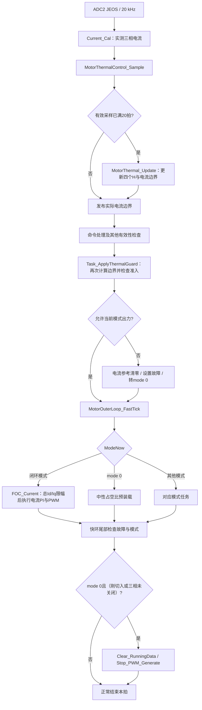

# 电机绕组热保护设计

文档修订：v5；更新：2026-10-15。适用`codex/ovp-36v`，软件v0.6.0。

通过实测三相电流估算绕组热负荷，先降额限流，再过载停机。整体绕组和三相热点分别计算，覆盖转动、位置保持与标定。热量H表示热预算比例，不是测得的绕组温度。当前实现已通过离线验证，已重新合入开发分支，尚未完成实机热标定。

## 1 配置参数

| 参数 | 当前值 | 含义 |
| --- | ---: | --- |
| 连续向量电流 Icont | 3 A | 按Id/Iq向量幅值解释 |
| 单相连续电流 Iphase | 2.121 A RMS | Icont / √2，用于逐相热点 |
| 峰值电流 Ipeak | 7 A | 热保护模型的峰值上限 |
| 升温 / 冷却时间常数 | 65.985 / 120 s | 冷却自动取max(120 s, 升温常数) |
| 热更新周期 dt | 1 ms | 20 kHz采样，每20拍更新 |
| 参数放行 | 1 | 默认启用；显式设为0时拒绝出力 |
| 上电 / MCU复位初值 | H = 0 | 四个状态均从0开始，不额外等待 |

电机标定量精简为**连续电流、升温时间常数**。单相电流自动由连续电流÷√2派生，冷却常数采用上述保守规则；峰值电流是运行限制，四个热动作门限是策略参数，通常不需标定。

编译默认入口：[motor_thermal_config.h](../../firmware/app/motor_thermal_config.h)。三项主参数和四个热门限可通过CAN配置、mode 9保存，详见[热参数通信协议](../protocols/motor_winding_thermal_configuration_v1.md)。3 A口径、升温常数和实际热边界仍需验证；8 A / 10 s只用于推算模型参考，不作为安全持续时间。

## 2 热量计算

### 2.1 输入与四个状态

输入是`Current_Cal()`换算、重构后的实测`FOC.Ia / Ib / Ic`，单位A；不是电流指令，也不使用MCU温度代替绕组温度。20 kHz快环每50 μs采集一次，满20拍形成一个1 ms计算窗口。

| 量 | 含义 |
| --- | --- |
| Qmotor、Qa、Qb、Qc | 当前窗口的归一化电流平方负荷，无单位；在输入恒定时也是对应H的趋近值 |
| Hmotor / `heat[0]` | 整体绕组累计热负荷；0表示软件冷态，1表示模型过载阈值 |
| Ha、Hb、Hc / `heat[1..3]` | A、B、C相各自的累计热负荷，记录固定电角度下的局部积热 |
| Hmax / `max_heat` | 四个H中的最大值，用于降额、停机和恢复判断 |

每个窗口按以下顺序执行：

1. `MotorThermal_Accumulate()`检查电流有效性，分别累加`Ia² / Ib² / Ic²`。先平方再平均，正反向电流不会互相抵消。
2. 收满20拍后，`MotorThermal_Update()`由平方和算出四个Q。
3. 对每个H单独选择升温或冷却系数，更新H，再取Hmax。
4. 清除本窗口平方和及样本计数；保留四个H，计算下一窗口的电流边界。

```text
N = 20
Sa = sum(Ia[k]²), k = 1 ... N           # Sb、Sc同理，单位A²
Qmotor = (2/3) × (Sa + Sb + Sc) / (N × Icont²)
Qa = Sa / (N × Iphase²)                 # Qb、Qc同理

对四个状态分别执行：
tau = 配置升温常数，当 Q >= H           # 默认65.98486785 s
tau = max(120 s, 配置升温常数)，Q < H   # 保守冷却
alpha = 1 - exp(-0.001 / tau)
Hnext = H + alpha × (Q - H)

Hmax = max(Hmotor, Ha, Hb, Hc)
```

两个alpha在初始化或通信配置准备时按`x=dt/tau`、`alpha=x×(1−x/2+x²/6)`预先计算（x≤0.01，另含单精度舍入误差），快环只做乘加。四个状态可在同一个窗口中分别升温或冷却，内部H允许超过1，触发故障不会清零。

### 2.2 为什么低电流不一定立即冷却

模型对应`dH/dt = (Q - H) / tau`：电流平方带来热输入，已有热负荷产生散热。它不是只累加`max(I² - 3², 0)`的纯积分器。

以整体状态为例，恒定2 A电流向量对应`Qmotor = (2/3)² = 0.444`。若Hmotor为0.8，它会下降；若Hmotor为0.2，它仍会上升，并趋近0.444。零电流时Q=0，在采样有效且持续更新的前提下，`H(t) = H(0) × exp(-t / tau_cool)`，默认tau_cool为120 s。3 A恒定向量对应整体Q=1，当前模型会在H达到0.8时先降额。

逐相计算用于补足整体计算的盲区。例如静止时三相为`[7, -3.5, -3.5] A`，整体Q为5.444，A相Q为10.889，B/C相各为2.722；A相热点会比整体状态更快积热。因此3 A向量连续电流的假设不能直接等同于固定电角度下每相均可长期安全运行。

升温常数由“整体模型从H=0、恒定8 A输入，10 s到H=1”反推：`tau = -10 / ln(1 - (3/8)²)`。这只是参数来源；实际会提前降额，也可能由逐相热点先触发，不能将10 s当作当前实现保证的安全运行时间。

## 3 保护动作

下表为默认门限，通信可配置，所有热判断均使用当前配置。H=1始终表示参考热预算，停机门限可配置在1及以下。

| 条件 | 动作 |
| --- | --- |
| Hmax达到80% | 进入降额，降低实际允许电流 |
| 无热锁存且Hmax降到70%及以下 | 退出降额，避免阈值附近反复切换 |
| Hmax达到100% | 电流参考归零、关相停机、锁存热故障 |
| 热故障后Hmax降到50%及以下 | 模型和反馈有效时允许人工清故障；结束在mode 0，需新启动命令 |
| 无效电流、计算异常或活跃输出下ADC更新间隔超过2 ms | 禁止继续出力；无效数据不能当作零电流冷却 |

降额区间采用线性电流边界：

```text
w = clamp((Hmax - Henter) / (Htrip - Henter), 0, 1)
Ithermal = Ipeak × (1 - w) + Isustain × w
Iallowed = min(保存的运行电流上限, Ithermal)
```

整体热量主导时Isustain为配置连续电流；任一相H大于或等于整体H时，采用其÷√2的保守向量边界。按默认参数，Hmax为0.9时前者允许5 A，后者约4.561 A；若保存的运行上限为3 A，实际仍只有3 A。达到配置Htrip便锁存停机，不继续按Isustain运行。

`derating`在Henter进入、Hexit退出，中间保留原状态；下降至Henter以下时限流公式已回到峰值，但带电标定仍要等退出降额后才放行。`MotorControl.thermal_limit_active`表示实际边界低于配置上限，不等同于模型的`derating`标志。模型无效、热锁存、参数未放行、等待配置应用或采样时钟异常时，实际边界为0。

执行层按总Id/Iq向量限幅：`sqrt(idRef² + iqRef²) <= Iallowed`，包含PI与摩擦/惯量前馈。两轴按同一比例缩小，例如`Id=6 A、Iq=8 A、上限5 A`时得到`Id=3 A、Iq=4 A`。外环积分按限幅后的可用反馈电流回算，配置电流上限和PI增益保持不变。

热保护故障码为**16（0x10）**，CAN故障字段为`00 10`；MCU过温仍为10。快环准入和缺样监督在已有故障时保留其故障码；最终电流执行发现非法参考时会直接写入16。热锁存独立于对外故障码，清除其他故障不会解除热锁存。放行配置为0时，拒绝出力使用参数错误12。

## 4 模式与启动

| 模式 | 热保护处理 |
| --- | --- |
| 电流、速度、位置及无感速度闭环 | 动态限流；热故障停机 |
| mode 13 / 15、其他带电标定、电压开环、Vq和制动 | 进入降额即中止并锁存退出，避免受限激励产生错误标定；电压控制还检查实测电流越界 |
| STOP、设零、保存、查询及电流零偏标定 | 保留热历史；无效零偏不能用于冷却或放行负载运行 |

首次上电或MCU复位从H=0开始。同一次运行中重复初始化、STOP、切模式、恢复默认参数和清故障均不清热量。热状态只在RAM中，MCU复位会重新获得冷态预算，实际绕组温度不会随之归零；运行中热故障仍须冷却并人工清除。

CAN写入仅在mode 0且三相关断时接受；下一关相快拍应用，mode 9保存已接受配置。修改不清热量或故障：持续电流降低时，对应H按旧/新持续电流比的平方放大；增大时不降低已有H。降低停机门限重新检查锁存，提高门限不自动清锁存。mode 8保留独立热配置，需恢复热默认值时逐项通信写入。

## 5 代码执行流

### 5.1 启动与状态所有权

```text
Board_Init()
  → flash_read_param()：读取电机参数、运行电流上限和已有标定
    → Param_Download() / motor_thermal_record_load()：检查MTH1尾记录
    → MotorThermalControl_LoadParameters()：加载七个配置值，派生单相及冷却参数
  → MotorControl_Init()
    → MotorThermalControl_Init(now_ms)：装入已加载热配置或编译默认值
      → MotorThermal_Init(..., initial_heat = 0)
        → 校验配置，计算两个alpha，四个H置0，计算初始电流边界
```

默认参数有效时，初始`valid=true、derating=false、fault_latched=false`，模型`available_a=7 A`；实际电流还受电机配置上限约束。热参数放行不替代电机配置、零偏及标定准入。运行中的四个H与采样累计器由20 kHz快环更新；2 kHz外环只消费电流边界，TIM7监督只发布采样异常事件。重复调用`MotorThermalControl_Init()`直接返回，避免同一次运行中重置热历史。

### 5.2 ADC快环：采样、保护、执行、关相

ADC2注入序列完成JEOS触发`HAL_ADCEx_InjectedConvCpltCallback()`，进入`FOC20kHzIRQHandler()`。下图只展开热保护相关顺序，编码器及其他控制处理仍在原位置执行。



`MotorThermalControl_Sample()`先在输出关闭时应用已接受配置，再检查监督事件，累计电流，满20拍才更新H。`Current_Cal()`失败时传入NaN，使模型失效，不沿用旧电流或伪造零电流。NaN/Inf、绝对值超过100 A、窗口计数或计算异常均触发模型失效并锁存；100 A是非法输入检查门限，运行电流仍按Iallowed限制。

每拍发布`thermal_current_limit_a`和`thermal_limit_active`。命令可能在随后改变配置，所以`Task_ApplyThermalGuard()`会重新发布边界，再调用`MotorThermalControl_Guard()`。新模式请求还会在`ModeSwitch_Handle()`中提前经过`MotorThermalControl_CanRunMode()`；快环检查覆盖运行中状态变化及直接调试写入，不能只依赖命令入口。

运行中的带电标定/开环/制动进入降额时，`MotorThermalControl_Guard()`会锁存并退出；新请求在降额状态下直接拒绝。电压控制无法通过电流参考限幅，因此另检查实测`(2/3) × (Ia² + Ib² + Ic²) > Iallowed²`，越界或非有限值直接转停机。

快环保护函数先清电流参考并置mode 0；**真正关相发生在同一次快环尾部**：`Clear_RunningData()`清运行控制状态，`Stop_PWM_Generate()`关闭三相主/互补输出并将引脚置高阻。mode 0的中性占空比写入不替代关相；关相后保留热状态，采样有效时继续计算冷却。

### 5.3 2 kHz外环与最终电流边界

```text
MotorOuterLoop_FastTick()：每10个快拍提交速度/位置及电流边界快照
  → motor_hw_outer_schedule() → PendSV_Handler()
  → MotorOuterLoop_Service()：计算速度PI或位置级联，输出候选Iq
  → 后续快拍MotorOuterLoop_FastTick()：校验模式/任务代次/故障，提交有效结果
  → FOC_Current() → MotorThermal_LimitVector() → 电流PI → PWM
```

速度环按可用电流与配置上限的比值收紧PI输出范围，并通过`PI_Controller_TrackOutput()`回算。位置环由`PositionCascade_OutputLimit()`取得边界，限制摩擦/惯量前馈与总Iq，并按“实际总Iq减去实际前馈”回算反馈PI，避免积分要求超过可用电流。

外环快照计算期间热边界可能下降：提交结果时再次按当前边界限Iq，`FOC_Current()`在电流PI与PWM前最后对总Id/Iq限幅。这三处分别约束积分、异步结果和最终执行，不能只限制某一路前馈或某个外环输出。

### 5.4 TIM7监督：快环缺样也能关相

```text
TIM7 / 1 kHz → BSP1kHzIRQHandler() → FOC1kHzSupervisor()
  → MotorThermalControl_CheckWatchdog(now_ms, outputs_disabled)
  → 活跃输出下，距最近热更新超过2 ms或已有时钟异常
  → 发布pending_clock_fault，设置故障16、mode 0，立即Stop_PWM_Generate()
  → 下次快环采样消费事件，MotorThermal_Invalidate()锁存模型无效
```

满20拍更新时也检查同样的时间间隔。2 ms是异常判断门限，监督以1 kHz调度，不表示恰好2 ms完成物理停机。已关相时监督不因停止采样新增此故障，但不会凭空补算冷却。TIM7不更新H；它与“快环每20拍更新一次热模型”是两条不同路径。CPU被调试器暂停时软件监督也会暂停。

### 5.5 热故障恢复

```text
故障后停机 → 有效采样继续计算H → Hmax降到配置Hclear及以下（默认0.5）
  → 人工请求mode 10
  → ModeSwitch_Handle() / MotorThermalControl_CanClearFault()：入口核验
  → 快环Task_TryClearError() / MotorThermalControl_ClearFault()：再次核验
  → MotorThermal_ClearFault()：只解除锁存，不清H
  → 清故障并回到mode 0 → 等待新的启动命令
```

两次核验均要求初始化完成、参数已放行、模型有效、无采样时钟异常且Hmax≤配置Hclear。无效模型或时钟异常不能靠mode 10解除；普通清故障不重建采样链路。热状态仍保留，下一次运行从剩余热负荷继续计算。

实现入口：[热模型](../../firmware/motor/protection/motor_thermal.c)、[热保护组合层](../../firmware/app/motor_thermal_control.c)、[快环与监督](../../firmware/app/foc_task.c)、[外环调度](../../firmware/app/foc_run.c)、[位置级联](../../firmware/motor/position/position_cascade.c)、[最终电流执行](../../firmware/motor/foc/foc_algorithm.c)、[模式切换与关相](../../firmware/motor/protection/foc_errhandle.c)。

## 6 标定与验证

| 项目 | 何时需要 |
| --- | --- |
| ADC零偏、电流增益和三相重构验证 | 通电热测试前必需，先确认实测电流及3 A的口径 |
| 连续电流、升温时间常数 | 仅此两个电机标定量；采用适用厂家数据或独立温度证据，校验派生冷却规则及静止热点 |
| 编码器LUT与电零位，mode 13 / 15 | FOC闭环测试前有效；原标定经核对可沿用 |
| 机械零位与运动范围 | 带机构的位置测试前必需 |
| 摩擦模型 | 使用摩擦补偿时核对；不是热算法验证的前置项 |

离线逻辑验证不要求重做电机标定。实机先验证低电流测量，再采集同一安装条件下的升温、停机冷却和重复负载数据，确认逐相热点与适用环境。没有独立温度证据或可信厂家热数据时，只能确认算法按设定动作。STOP或关相无法确认时中止测试并要求现场处理。

独立候选保留Flash schema10及2292字节旧前缀，追加40字节MTH1，总长2332字节。CAN周期状态仍为48字节，温度仍是MCU温度。

离线热专项：`python tools/run.py test_motor_thermal --cc <C99编译器> --out outputs/motor_thermal_native`。重点覆盖零初值与默认放行、积热/冷却、逐相热点、降额及人工清故障、总限流和积分、无效采样及缺样停机。已有离线回归和普通构建结果见验证记录；实机温升、冷却及20 kHz最坏耗时待验证。

- [实现与配置说明](../guides/motor_winding_thermal_protection_v1.md)
- [最新通信配置验证](../reports/2026-10-14-winding-thermal-configuration-v1-validation.md)
- [启动修订验证记录](../reports/2026-10-12-winding-thermal-startup-v2-validation.md)
- [启动修订记录](2026-10-12-motor-winding-thermal-startup-v2.md)
- 资料参考：[maxon I²t保护](https://support.maxongroup.com/hc/en-us/articles/4412763373970-maxon-controllers-I2t-Limitation-Motor-winding-protection)、[Synapticon堵转保护](https://doc.synapticon.com/actilink_s/sw5.6/motion_control/advanced_control_options/stall_protection.htm)。动作阈值和电流参数采用本项目配置。
