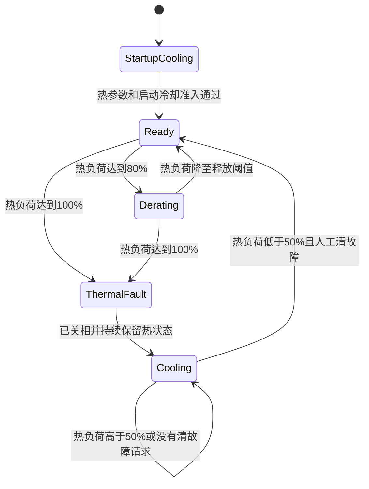

# 电机绕组热保护设计与标定要求

版本：v1；日期：2026-10-12；状态：设计评审稿，尚未实现或下载。

本设计针对持续大电流造成绕组过热的问题，采用实际三相电流驱动的 I²t 热模型，先降低允许电流，再在热预算耗尽时关相停机。模型同时保留整体绕组与逐相热负荷，覆盖运动、位置保持、堵转和标定。MCU 温度保护继续独立工作，不能用 MCU 温度推断绕组温度。

用户给出的连续电流参考约为 3 A，当前运行峰值目标为 7 A；8 A、10 s 仅作为离线计算参考，尚未确认是安全过载工况。第一版先完成软件与离线验证，热参数放行后再推进实机验证。本文中的动作阈值和公式是拟实现契约，不代表现有 v0.2.2 已具备绕组热保护。

## 1 目标和保护边界

- 相同电机本体使用同一套算法；阻尼环影响需要的电流和占空比，安装散热、环境温度和风冷变化会影响允许连续电流及冷却速度。
- 从实际电流估计热负荷，不仅统计电流指令、Iq 或母线输入功率。d 轴预定位电流、运动回馈及静止电流同样产生铜耗。
- 热量跨 STOP、换目标、换模式、标定重试和清故障保留。反复启停不能重新领取完整峰值时间。
- 保持现有瞬时过流、母线保护、机械软限位及 MCU 过温保护。软件热模型不替代快速过流保护。
- 首版不更改既有电机 Flash 参数布局，也不把热参数与电零位、机械零位、LUT 混存。

热状态是绕组热负荷估计，不是测得的温度 ℃。没有有效额定数据和热辨识结果时，不能承诺模型完全避免损伤；无参数放行的构建不进入正式通电验收。

## 2 当前固件与集成基线

设计基线是 v0.2.2，Git 提交 `af70e737`。实现和独立验证应使用该基线的隔离工作树，并记录后续真实源码差异；其他任务的未提交修改不能默认混入候选镜像。

| 现有入口 | 当前职责 | 热保护需要增加的行为 |
| --- | --- | --- |
| `firmware/motor/foc/foc_sensing.c` 的 `Current_Cal` | 实际三相电流换算、按扇区重构和瞬时过流判定 | 为热模型提供有效电流；保留原始相过流检查，不让重构掩盖采样异常 |
| `firmware/app/foc_task.c` 的 `FOC20kHzIRQHandler` | 快环、模式调度及功率输出管理 | 快上下文持有热状态；采样后累计，热故障在本拍功率写入和使能前生效 |
| `FOC1kHzSupervisor` | MCU 温度更新 | 不与快中断共同写热状态；绕组模型由快拍分频更新，避免两个状态所有者 |
| `firmware/app/foc_run.c` | 2 kHz 外环及参数快照 | 使用独立的实际可用电流边界，并处理外环积分的限幅回算 |
| `firmware/motor/foc/foc_algorithm.c` | 电流闭环、电压开环、Vq 控制和 PWM 计算 | 在共同执行边界约束 d/q 电流向量，电压模式另设退出规则 |
| `firmware/motor/protection/foc_errhandle.c` | 启停、清故障及关相 | 热锁存参与所有使能与清故障路径，不能直接清掉热量 |

现有 6 mΩ 档瞬时过流门限约为 18 A，MCU 过温门限为 100 ℃。持续 7～8 A 绕组发热可以发生在这两个门限均未触发时。

## 3 电流口径和待确认参数

现有 Clarke/Park 使用幅值不变变换，平衡三相时：

```text
Ivec² = Id² + Iq² = (2/3) × (Ia² + Ib² + Ic²)
```

本稿暂把用户给出的 3 A 作为 `I_cont_vec_a`，即与固件 Id/Iq 同口径的连续向量幅值。此解释需要先核对：如果用户的 3 A 是单相 RMS、单相直流或其他电流口径，必须先转换，不能直接套用下列逐相门限。

若 3 A 确认为平衡正弦的向量幅值，对应每相连续 RMS 电流为 `3/√2 ≈ 2.12 A`。堵转时一相的直流电流不能沿用“旋转时正弦峰值 3 A 可持续”的结论。

| 参数 | 本稿值或要求 | 性质和放行条件 |
| --- | --- | --- |
| `I_cont_vec_a` | 3 A 参考值 | 用户提供的近似值，需确认单位和安装条件下的连续热能力 |
| `I_cont_phase_rms_a` | 暂按 2.12 A | 仅在上述向量幅值解释成立时使用；需低速、堵转热验证 |
| `I_peak_config_a` | 7 A | 运行配置上限，不代表可以持续 7 A |
| `I_reference_a` / `t_reference_s` | 8 A / 10 s | 离线参考，不作为已验证安全台架边界 |
| `tau_heat_s` | 离线示例约 65.985 s | 按整体模型的 3 A、8 A/10 s 推算；正式值由安全热数据或适用厂家数据放行 |
| `tau_cool_s` | 待辨识 | 示例可暂用同一时间常数；实际冷却未验证前不能用该值快速释放峰值能力 |
| 降额开始 / 热故障 | 80% / 100% | 拟定软件动作阈值，离线可先固定验证 |
| 热故障复位资格 | ≤50% 且人工清故障 | 必须同时满足有效模型、有效反馈与已停机条件 |
| 启动热状态 / 最小冷却等待 | 待放行 | 整板掉电或丢失热历史时使用，禁止直接当成完全冷态 |

参数未放行不能通过“关闭热保护”进入候选正式测试。离线示例参数允许运行仿真，不允许将测试通过解释为这些参数已获得物理验证。

## 4 热量累计和冷却模型

### 4.1 采样和状态所有权

20 kHz 快拍在有效 ADC 电流换算后，先计算并累计 `Ia²`、`Ib²`、`Ic²`。每约 20 拍形成一个 1 ms 平均窗口，再更新热状态。必须先平方再平均，不能先平均带正负号的电流再平方，否则旋转时电流均值接近零会漏算发热。

单个快上下文拥有累计器、四个热状态、降额状态和故障锁存。通信与调试读取已发布快照，控制工作线程读取实际可用电流边界；不通过多个 ISR 或可写全局变量共同修改累计器。热计算不新增 ADC 通道，不阻塞，也不在 20 kHz 每拍计算对数或指数。

模型周期采用明确的样本数和时间口径。调度超时、缺样及无效反馈不能当成零电流参与冷却；累计器与状态保留，并禁止继续依赖失效模型出力。

### 4.2 四个热状态

整体状态 `Hmotor` 的归一化输入为：

```text
Qmotor = (2/3) × mean(Ia² + Ib² + Ic²) / I_cont_vec_a²
```

逐相状态 `Ha`、`Hb`、`Hc` 的输入分别为：

```text
Qa = mean(Ia²) / I_cont_phase_rms_a²
Qb = mean(Ib²) / I_cont_phase_rms_a²
Qc = mean(Ic²) / I_cont_phase_rms_a²
```

每个状态采用一阶热模型。固定周期时在初始化阶段预计算系数：

```text
alpha = 1 - exp(-dt / tau)
H_next = H + alpha × (Q - H)
Hmax = max(Hmotor, Ha, Hb, Hc)
```

`Q ≥ H` 时采用升温时间常数，`Q < H` 时采用已放行的冷却时间常数。第一版可使用同一时间常数做离线基准，分开辨识后再验证周期负载。

H 不因触发保护而归零，也不能仅为显示方便钳到 100% 丢失超限热量。显示可限幅，内部热状态仍保留；NaN/Inf 或运算溢出产生无效模型故障并停止出力。

### 4.3 8 A 和 6 A 的换算边界

忽略散热、从完全冷态开始时，`8²×10=640 A²s`，因此 6 A 对应约 17.78 s。

在本稿整体一阶模型中，假定 `I_cont_vec_a=3 A`，令冷态 8 A 在 10 s 达到 H=1，可推得 `tau≈65.985 s`：

| 恒定向量电流 | 纯 I²t 等热量时间 | 整体一阶模型到 H=1 的时间 |
| ---: | ---: | ---: |
| 8 A | 10.00 s | 10.00 s |
| 7 A | 13.06 s | 13.39 s |
| 6 A | 17.78 s | 18.98 s |
| 5 A | 25.60 s | 29.45 s |

此表为离线对照：不含降额、不含初始热量，也不含逐相热点。实际保护应更早介入，而不是坚持输出到表中时间。

例如，若堵转时一相持续为 8 A，且每相连续口径为 2.12 A，在同一示例时间常数下，该相约 4.81 s 即达到 H=1，早于整体状态的 10 s。该时间同样不是实机安全额定值，说明逐相模型与整体模型不能共享“总是允许 8 A 输出 10 s”的口头承诺。

若 10 s 已接近实际损伤，正式允许热预算必须低于该参考。已有热量会缩短下一次峰值时间；3 A 连续能力、过载参考和冷却时间不能只靠单个烧毁边界同时推得。

## 5 热保护动作

| 状态或条件 | 电流动作 | 停机和恢复动作 |
| --- | --- | --- |
| 启动热历史未知 | 禁止直接领取冷态峰值预算 | 进入启动冷却准入；初始状态和等待时间未放行时禁止正式通电测试 |
| 模型有效且 Hmax <0.8 | 实际允许电流不超过配置峰值 7 A | 所有正常保护继续生效 |
| 0.8≤Hmax<1.0 | 平滑降低实际可用电流，满足总向量及逐相连续边界 | 记录降额状态，不重置模型；电压及标定模式按下一节退出 |
| Hmax≥1.0 | 当前参考清零，禁止本拍新增出力 | 锁存绕组热过载，复用现有 STOP/关相路径；不自动恢复运动 |
| 热过载锁存、仍高于50% | 零出力，继续在有效电流窗口下计算冷却 | 拒绝清热故障和再次使能；STOP、查询和安全参数维护仍可使用 |
| 所有状态均≤50%，反馈和模型有效 | 仍保持停机 | 允许一次显式清故障；清除锁存后仍需新的启动命令，不自动回到旧目标 |
| 反馈无效、热配置无效、计算超时 | 不放宽电流；不得伪造冷却 | 退出功率模式并保留热历史，通过现有采样/参数/时序故障入口处理 |



降额状态的释放拟采用 70% 以避免 80% 附近反复切换。状态回到 Ready 只解除热降额，不意味着自动启动电机；其他故障、机械范围和标定准入仍要满足。

### 5.1 动态限流与积分

保存的配置峰值 `I_peak_config_a` 与实际执行边界 `I_available_a` 分开。热保护不能不断改写 `MotorControl.current_limit`，否则既有按该值换算到电流域的速度 PI 增益会随热降额变化，保存参数还可能写入临时值。

第一版降额基准按热状态从 80% 到 100% 线性降低：

```text
w = clamp((Hmax - 0.8) / 0.2, 0, 1)
I_available = min(I_peak_config, I_peak_config × (1-w) + I_sustain × w)
```

整体绕组主导时，`I_sustain` 按连续向量电流设置；逐相热点主导时，要满足各相连续电流边界。初版可使用更保守的最小连续相电流作为向量上限，后续只有在相序、电角度和限幅验证充分时才考虑角度相关的逐相限幅。

执行层对 d/q 向量进行等比例限幅，不能分别夹到同一上限后让组合幅值超过热允许值。总电流边界必须包含 PI、摩擦、惯量及其他前馈，不能让任一路绕过。

电流 PI 的电压抗饱和保持；外环 PI 的抗饱和必须依据最终允许/施加的电流回算。2 kHz 外环使用一致的边界快照，20 kHz 执行层作最后约束，处理边界在两个外环周期之间下降的情况。

热降额的电流上升必须受限，下降不能滞后到超过热预算。达到硬阈值时直接关相，不能用正常卸流斜坡延迟保护动作。

## 6 各模式的处理

| 工况 | 热累计 | 降额和超限动作 |
| --- | --- | --- |
| mode 1 电流、mode 2 速度、mode 3/18 位置、无感速度 | 所有实际电流，包括 Id、Iq 和合成前馈 | 动态向量限流与抗饱和；热故障关相停机 |
| mode 13 角度线性化、mode 15 电零位、摩擦及其他有电流辨识 | 与运行共用剩余热预算，不重新计时 | 触发降额时中止本次标定，避免限流改变激励后仍把结果判为有效；保留此前已有效的标定 |
| 电压开环、Vq 模式 | 逐相累计实际电流 | 单靠 Id/Iq 参考限幅不能约束开环电流；达到降额入口就退出，不继续追求电压指令 |
| 静态制动或三相短接 | 若可获得可靠的相电流，同样累计 | 热状态超限时退出制动功率输出；失去可靠采样时不能把电流当零 |
| STOP、设零、保存、查询 | 热历史保留；有效低电流采样允许冷却 | 不需要功率输出；这些动作不能清热预算 |
| 电流零偏标定 | 保留历史，不把未建立零偏的读数当热测量 | 在输出关闭且采样可信之前不允许负载运行；无效窗口不释放热准入 |

保存的 5 A 标定电流是标定激励配置，不是连续热允许值。若剩余热预算不足以完成标定，应先冷却，不提高阈值或暂时绕过保护。

模式切换和异步 RAM 写模式都受共同执行层检查。只有在所有校验完成后才能使能输出；热故障在本拍控制前生效，保证发生故障后不会先写一拍有效 PWM 再停机。

## 7 冷却 复位和故障语义

- STOP 只停止出力，热状态继续累计或冷却；换向、换目标、重做 mode 13/15 不创建新冷态预算。
- mode 10 清故障不得调用热状态 Reset。即使热故障可清，仍保留已估计热量。
- 软件复位不能通过重新初始化为 H=0 绕过保护。实现阶段在保留状态与保守启动冷却之间选定可验证方案；没有可靠保留记录时执行启动冷却准入。
- 整板掉电没有可靠温度或离线时间依据时，不能认定电机已经冷却。`Hboot` 和最低冷却等待必须按可接受的最坏热态放行；直接从 H=1 等待某个示例秒数不等于已经证明安全。
- 第一版不以 1 kHz 频率写 Flash 保存热量，避免磨损，也不占用已有电机参数区。
- 新增独立绕组热过载故障，既有故障编号保持。可追加编号16，正式实现须同步协议说明、兼容性和黄金向量；本稿不直接修改枚举。
- 首个已有故障可继续显示，但热故障内部锁存仍能阻止启动。MCU 故障10与绕组热过载不能相互覆盖或相互清除。

当前 Pitch 读到过 MCU 过温锁存且温度快照无效；这不证明绕组热状态，也不允许禁用 MCU 保护来放行新算法。保护代码的离线验证可以继续，通电验收需要单独处理现有准入条件。

## 8 需要哪些标定和辨识

这里把“标定”限定为通过测量确定传感器、坐标或物理模型参数。“把目标值写入 Flash”属于配置；“给固定曲线验证程序输出”属于验证，不能代替物理标定。

| 项目 | 属于什么 | 是否需要实测或可信数据 | 阻塞哪个阶段 |
| --- | --- | --- | --- |
| ADC 三相零偏 | 电流传感器标定 | 必需；可沿用有效启动零偏，但需确认零流噪声与偏移 | 任何通电热验证 |
| 电流增益、单位及三相重构可信性 | 电流测量标定/验证 | 必需；6 mΩ只是配置，需要低电流参考测量验证。10%增益误差约造成21%平方量误差 | 热模型参数放行与通电验证 |
| 3 A 连续允许电流 | 热能力验证 | 必需确认口径和目标安装下的长期能力；不能用驱动板额定电流替代 | 正式热参数与保护能力声明 |
| 短时热预算/升温时间常数 | 热参数辨识 | 必需，或采用适用厂家数据；8 A/10 s未获安全验证前仅用于离线示例 | 正式峰值输出验收 |
| 冷却时间常数和重启冷却条件 | 热参数辨识 | 必需，或采用可证明保守的边界；要覆盖重复动作与热态重启 | 自动释放降额、故障再准入与复位验证 |
| 单相堵转热边界 | 热能力验证 | 位置保持工况必需；温升或热模型必须考虑热点 | 位置保持/堵转保护验收 |
| 环境温度、安装导热、风冷 | 工况确认 | 必需；在最差适用条件中放行，可用厂家明确的降额范围 | 模型能否复用于当前机构 |
| 编码器 LUT，mode 13 | 角度传感器标定 | 真实 FOC 闭环需要有效值；已有标定经核对后可沿用，不为纯热仿真重做 | 实机闭环，不阻塞热算法离线测试 |
| 电零位，mode 15 | 电角坐标标定 | 同上；相线、转子或磁铁安装变化后重新核对 | 电流/速度/位置闭环通电测试 |
| 机械零位 | 机构坐标标定 | 上机位置测试前必需，热算法本身不需要 | 机构位置/行程测试；不阻塞离线热验证 |
| 摩擦前馈模型 | 负载模型辨识 | 不属于热模型必需项；用于真实补偿时应验证其适用性 | 精确摩擦补偿验收，不阻塞热保护验证 |
| 相电阻和铜温度系数 | 可选绕组温度估计标定 | 归一化模型第一版不必需；若通过电阻反算绕组温度则必需 | 绝对绕组温度估计，不阻塞当前算法 |
| 7 A峰值、80/100%动作和50%清故障阈值 | 保护配置 | 配置值需软件验证，不是独立物理标定；7 A仍需热和电气边界支持 | 配置及代码验收 |
| 位置/速度 PI 与运动范围 | 控制整定/机构配置 | 不需要为加入模型一律重整定；需要验证动态限流后的行为和真实行程 | 对应控制效果验收 |

目前 Pitch 的角度线性化、电零位标志为3，即前两项标志已置位；机械零位标志尚未置位，不能为了放行位置测试直接改成7。热计算不依赖这些编码器标志，但实机 FOC 激励必须遵守既有准入。

同一电机本体及相同驱动板可以复用经验证的参数起点；每板零偏、每电机 LUT/电零位及每机构机械零位独立保留。无阻尼环转动时的散热结论不能直接代表带阻尼环的静止保持条件。

## 9 物理参数辨识怎样推进

1. **先确认测量口径。** 在低电流、输出受控条件下，对照可信电流测量，确认3 A对应相RMS、相直流还是Id/Iq幅值；记录采样偏差和零流噪声。
2. **先建立低风险温升数据。** 从低电流逐级采集，不使用“持续8 A直到烧毁”作为标定方式。记录电流平方均值、初始热状态、环境与安装条件，并获取独立温度证据。
3. **确定独立温度证据。** 内部温度探头未接时，可评估临时外部热电偶及可靠的绕组电阻测温。外壳/红外读数存在绕组到外壳的延迟，不能单独证明绕组没有超过允许温度。
4. **拟合升温与冷却。** 在相同安装条件下获取升温段和停止后的冷却段，再用不同电流及重复工作周期交叉验证，不只拟合一条8 A/10 s曲线。
5. **留出裕量并放行适用范围。** 覆盖测量误差、安装差异、最高适用环境温度和堵转热点。放行后的参数记录来源、适用条件及验证证据。

如果当前无法取得任何独立温度或适用厂家热数据，只能验证“保护算法按设定动作”，不能验证“该设定保证绕组安全”。此时先完成离线实现，实际允许电流/时间维持保守边界，暂不把示例热参数作为正式保护标定。

## 10 验证用例与验收

### 10.1 无硬件离线验证

| 用例 | 验收重点 |
| --- | --- |
| 0/3/5/6/7/8 A恒定输入，冷态与热态 | 与定义的模型解析解一致；暖机剩余峰值时间更短；整体参考表仅用于不含降额的模型对照 |
| 正负正弦电流及单相DC堵转 | 先平方再平均不漏热；逐相热点能独立触发 |
| Id非零、Iq为零及d/q同时非零 | 电零位对齐等d轴工况被累计，总向量限幅有效 |
| 8 A脉冲、短暂停顿、重复启停 | 不重置热状态，不因多次START获得多份预算 |
| STOP、换目标、换模式、mode10、参数保存 | 正常控制状态可清，热状态不被清除 |
| 80%附近噪声、70%降额释放、100%停机、50%清故障 | 无边界频繁切换，冷却未满足时清故障无效，解除后不自动运动 |
| PI、摩擦和惯量前馈合成后热限流 | 实际电流不越执行边界，速度/位置积分不会积攒未施加电流 |
| 电压开环及标定模式 | 热降额入口退出；没有有效标定结果误保存 |
| NaN/Inf、缺样、调度超时、无效配置、热状态溢出 | 不伪装零电流或冷却，不放行输出 |
| 软件复位、丢失热历史、整板重新上电 | 不能立即重获冷态峰值预算，启动冷却策略有独立证据 |
| 已存在MCU或其他故障 | 绕组模型仍更新和锁存，不覆盖或清除既有保护 |

### 10.2 构建与时序

实际实现须检查所有控制调用者，执行纯模型C测试、控制/故障适配回归、CAN兼容向量及工程输入检查，再进行普通Keil构建。正式启用前实测20 kHz最坏耗时、2 kHz外环截止期及1 kHz热更新周期；仅编译成功不能证明截止期满足。

本旧工作树无新版统一verify/format/lint入口，使用该基线可用的检查，并在结果中明确范围；有新版流程的验证工作树应执行对应PR/release检查。所有默认离线命令不得访问J-Link、烧录或启动电机。

### 10.3 实机验证

热参数、电流口径和台架准入通过后，先用低电流、可观察的降额验证控制链路，再逐级检查热态重试与冷却恢复。过程中记录三相平方均值、四个H状态、实际可用电流、指令/反馈电流、模式、故障及独立温度证据。

不以接近烧毁的工况直接验收。STOP或关相无法确认即中止，按仓库规约要求现场干预；不自动重启试验。当前位置测试还要先完成Pitch机械零位、确认实际行程并处理现有故障准入。

## 11 实现阶段的存储和观测

第一版把放行后的模型配置放在专用配置及可只读观察的状态中，不新增电机参数ABI，也不改变CAN状态帧温度字段的MCU语义。拟增加调试符号：四个热负荷、最大热负荷、有效电流边界、降额/锁存状态、剩余准入资格和无效采样原因。

热过载故障通过已有故障字段反馈；新编号追加，旧接收端至少能显示未知故障。若后续需要远程查询热负荷或保存不同散热模型，另行定义版本化协议/尾记录、黄金向量和兼容性，不能挤占已有字段。

## 12 推进顺序和当前放行门

| 阶段 | 当前可推进工作 | 需要先具备的条件 |
| --- | --- | --- |
| A 设计评审 | 本稿动作、口径、故障及标定划分 | 确认设计方向，尤其3 A口径和启动热历史策略 |
| B 独立实现与离线验证 | 纯模型、所有模式适配、故障、抗饱和及构建 | 可用明确标记的示例参数；不要求先做机械零位或重新跑mode13/15 |
| C 测量和热参数放行 | 低电流测量验证、升温/冷却辨识、逐相热点验证 | 电气链路与实际电流可信，已有电角标定有效，独立温度或适用厂家数据 |
| D 候选下载与低电流验收 | 验证限流、停机、冷却后人工恢复 | 模型参数和启动冷却放行；电机停稳且唯一命令源，现有故障准入满足 |
| E 位置机构验收 | 带机构重复动作、热态、限流后的跟踪 | 完成真实机械零位，运动范围和负载明确；需要补偿效果验收时再确认摩擦模型 |

设计审读和离线验证不需要电机先到机械零位，也不需要把摩擦辨识作为前置门。正式热保护能力的关键门是电流测量可信、连续电流/热预算/冷却边界放行；位置机构测试另有机械零位和行程条件。

独立任务和工作树在设计确认后建立。本稿不创建验证结果，不修改、下载固件，也不执行硬件标定。

## 13 回退和资料依据

实现候选独立版本化，保留v0.2.2源码、该板Flash备份和实测证据。回退算法不能把历史电机参数或个体标定复制给当前板；存在已知热风险时，回退也不能恢复无时间限制的大电流试验。

工业I²t保护会使用实际电流、额定连续电流和绕组热时间常数估算绕组热负荷，并限制热态重复过载。[maxon绕组保护说明](https://support.maxongroup.com/hc/en-us/articles/4412763373970-maxon-controllers-I2t-Limitation-Motor-winding-protection)

低速与堵转时，逐相电流的热负担不同，需要逐相评价。[Synapticon堵转保护说明](https://doc.synapticon.com/actilink_s/sw5.6/motion_control/advanced_control_options/stall_protection.htm)

80/100/50/70%动作、当前模型公式及集成位置为本项目设计选择，不是上述厂商为本电机给出的安全额定值。

仓库相关入口：[同型号新电机流程](../guides/new_motor_commissioning_workflow.md)、[总体参数表](../guides/five_motor_parameter_table.md)、[MCU温度方案](2026-10-09-mcu-temperature-v2.md)、[当前Pitch参数更新](2026-10-12-pitch-target-parameters-v1.md)、[固件发布规范](../guides/firmware_release_standard.md)。
