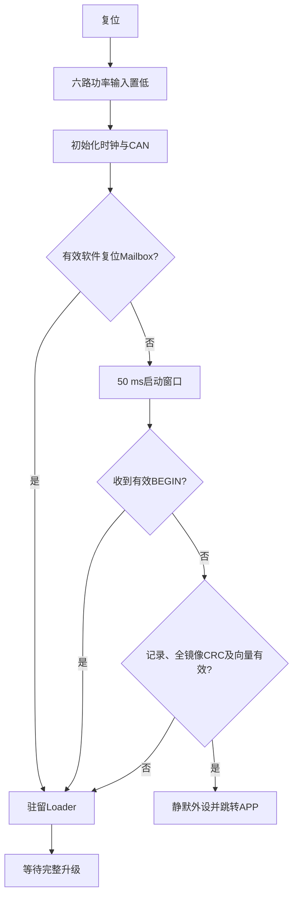

# Vector Mini ST CAN Loader 设计方案

适用：STM32G431、128 KiB Flash、32 KiB RAM，基于 `codex/ovp-36v`，开发分支 `codex/ovp36-can-loader`。APP v0.5.0、Loader v1.0.0、CAN协议v2。

本文描述当前方案。线上字段以[CAN Loader v2协议](../protocols/can_loader_v2.md)为准，逐字节输入见[黄金向量](2026-10-13-can-loader-minimal-v1-vectors.json)，构建和台架结果见[验证报告](../reports/2026-10-13-can-loader-bringup-and-endurance.md)。连续1000次验收尚未通过，尚未合并。

## 1. 目标与边界

使用独立常驻Loader、单APP镜像、CAN-FD停止等待传输。首次通过J-Link安装Loader，后续由USB-CAN或其他上位机逐台升级。

- 连续1000次完整升级的观察失败率严格低于0.1%，即必须零失败。
- 升级全过程保持电机停止，保留整个16 KiB参数区及个体标定。
- 设备校验镜像后才能启动，下载中断后驻留Loader，完整重新下载。
- 一套Loader用于五块相同驱动板，以节点和96位MCU UID绑定目标。

本方案不提供断点续传、A/B镜像、自动回滚、签名认证、UART或跨MCU适配。CRC验证内容一致性，不代表身份认证或APP所有功能正常。

## 2. 存储布局与参数保护

Flash页为2 KiB，下表末地址包含在区域内。

| 区域 | 首地址 | 末地址 | 容量 | 页号 |
| --- | --- | --- | ---: | --- |
| Loader | `0x08000000` | `0x08002FFF` | 12 KiB | 0～5 |
| APP有效记录 | `0x08003000` | `0x080037FF` | 2 KiB | 6 |
| 保留页 | `0x08003800` | `0x08003FFF` | 2 KiB | 7 |
| APP | `0x08004000` | `0x0801BFFF` | 96 KiB | 8～55 |
| 参数与标定 | `0x0801C000` | `0x0801FFFF` | 16 KiB | 56～63 |

RAM首32 B `0x20000000～0x2000001F`为Boot Mailbox，不参与RW复制或ZI清零。两份固件普通RAM均从 `0x20000020`开始，容量 `0x7FE0`；各自独立使用，RAM占用不相加。

参数保护有三层：

1. 主机只传APP相对偏移，升级包不含参数镜像；Loader端口只允许擦页6及8～55，禁止全片擦除。
2. `APP_LOADER_LAYOUT`构建启动仅在RAM解释旧参数，禁止自动迁移写入，并强制STOP。用户显式mode9保存是独立配置操作，不属于升级流程。
3. 每次升级核对全16 KiB参数CRC；初装及验收结束完整回读，与原始备份逐字节及SHA256核对。

保护整个16 KiB，不以当前2344 B参数结构长度作为保护边界。升级不重新标定、不设零、不根据电机类型覆盖CAN ID，也不恢复默认参数到Flash。

## 3. 启动与APP交接



50 ms从CAN初始化完成后计时；镜像CRC校验另计时间。无效帧和只读查询不会无限延长窗口。APP无效时持续驻留；APP失联时，可在现场复位前持续发送已预检的有效BEGIN，利用窗口恢复，必要时使用SWD。

APP的 `ENTER_BOOT`处理顺序：

1. CAN接收入口验证节点和 `BOOT`载荷，锁存交接请求。
2. 禁止新的运动、标定、设零、保存和身份变更，执行STOP。
3. 前台确认ModeNow、ModeLast均为0，且六路功率输出已关闭。
4. 回复成功，等待实际CAN发送完成，再写Mailbox并软件复位。

交接限时100 ms；失败保持停止和维护锁定，不自动恢复运动。Loader期间不运行FOC、PWM、对齐或电流零偏标定。升级版APP启动保持STOP，不恢复升级前运动。

跳转前再次验证：镜像长度8 B对齐且不超过96 KiB；MSP为8 B对齐，位于 `0x20000028～0x20008000`；Reset_Handler的Thumb位为1，入口位于实际镜像内。关闭CAN、SysTick和NVIC，清pending，设置VTOR；专用汇编尾跳设置MSP后进入APP，避免使用旧C栈。

## 4. 寻址与协议

仲裁段和数据段均1 Mbit/s，标准11位CAN-FD数据帧，BRS开启。APP请求和回复ID均为 `(node << 8) | command`；Loader请求为 `0x7D0 + node`，回复为 `0x7E0 + node`，硬件精确过滤本节点升级ID。

| 电机 | 节点 | APP进入Loader | Loader请求 | Loader回复 |
| --- | ---: | --- | --- | --- |
| 左轮 | 1 | `0x166` | `0x7D1` | `0x7E1` |
| 右轮 | 2 | `0x266` | `0x7D2` | `0x7E2` |
| Roll | 3 | `0x366` | `0x7D3` | `0x7E3` |
| Pitch | 4 | `0x466` | `0x7D4` | `0x7E4` |
| Yaw | 5 | `0x566` | `0x7D5` | `0x7E5` |

当前支持节点0～7。Loader从schema10参数前缀读取节点；不支持的身份退到node0单板恢复，不改写参数。Mailbox节点不一致时保持驻留，仍按Flash节点寻址。总线节点必须唯一；重复ID或多块node0板需物理隔离。BEGIN必须携带完整目标UID，设备再次核对。

APP维护接口：`0x01`查询模式、`0x63`查询UID、`0x66`进入Loader、`0x6F`查询APP版本、`0x7C`查询全参数区CRC。UID和CRC查询使用4 B nonce关联回复。

Loader帧：

```text
B1 02 OP 00 SEQ_BE16 PLEN_BE16 SESSION_BE32 PAYLOAD CRC32_BE [FF padding]
```

头12 B、CRC4 B、payload最大48 B。线上整数大端，UID保持原始12字节；CRC-32/ISO-HDLC覆盖头与payload，不含填充。帧补齐至最小合法DLC，尾部均为FF。所有字段、命令长度、版本、CRC和填充必须通过检查。

兼容标识：`layout_id=0x4F564C31`、`hardware_id=1`、`param_abi=0x4F563130`。主机同时核对这三个值、节点和UID；不能只根据版本号或schema名称判断兼容。完整命令字段、结果码和黄金向量集中维护在配套协议文档。

## 5. 升级流程与重试

```text
包预检 → APP身份/STOP/参数CRC → ENTER_BOOT → Loader INFO/UID
       → BEGIN → ERASE → PROGRAM逐块 → VERIFY → ACTIVATE
       → APP版本/UID/STOP/参数CRC及功率状态核验
```

| 状态 | 含义 | 允许的变更命令 |
| --- | --- | --- |
| IDLE=0 | 无会话 | BEGIN |
| PREPARED=1 | 清单有效，旧APP未破坏 | ERASE、ABORT |
| RECEIVING=2 | 记录无效，顺序写APP | PROGRAM、VERIFY、ABORT |
| VERIFIED=3 | 镜像及向量有效 | ACTIVATE、ABORT |
| ERROR=4 | 擦写或验证失败 | ABORT后新BEGIN |

BEGIN核对40 B镜像描述、UID及兼容标识，不擦Flash。ERASE先擦记录页，再擦APP全部48页。PROGRAM块长8～40 B，偏移和长度均8 B对齐，不跨2 KiB页；写入回读一致后才推进偏移并回复。分块公式为 `min(40, remaining, 2048-offset%2048)`。

VERIFY要求全部字节已接收，校验全镜像CRC及向量。ACTIVATE再次验证并提交有效记录；只有对应发送缓冲TXBTO已置位、TXBRP无挂起才跳转。取消发送或消息入队不代表发送成功。

主机一次只保持一个请求；回复必须匹配ID、op、seq、session，查询还需匹配nonce。缓存最近一次成功变更请求及回复；相同字节的重试不重复擦写，冲突返回错误，只读查询不覆盖缓存。旧PROGRAM仅在Flash内容完全相同时接受，不重新编程。

| 超时项目 | 当前配置 |
| --- | --- |
| APP停机交接 | 100 ms |
| 普通请求、ACTIVATE | 每次1 s，包含首发最多10次相同请求 |
| ERASE / VERIFY | 每次20 s / 10 s |
| 新APP版本应答 | 5 s |
| Loader会话无活动 | 30 s，清会话并保持恢复入口 |
| 旧CAN回复挂起 | 新请求到来时，挂起满100 ms则请求取消；本次未入队回复仍需重试 |

请求耗尽即停止本轮；不能自动重新擦写整圈以抹掉失败。ACTIVATE应答丢失先核对APP版本和UID，不能盲目重新下载。Flash操作期间不连续灌包，固定接收队列不能替代停止等待。

## 6. 有效记录与Mailbox

两种存储格式均显式按小端序列化，不依赖C结构填充。

**有效记录48 B，位于页6起点：**

| 偏移 | 字段 |
| ---: | --- |
| 0 | magic:u32=`0x3252444C` |
| 4 / 6 | version:u16=1 / length:u16=48 |
| 8 / 12 / 16 | layout_id / image_size / image_crc32，各u32 |
| 20 / 24 / 28 | app_version / hardware_id / param_abi，各u32 |
| 32 | reserved:u32=0 |
| 36 | record_crc32:u32，覆盖前36 B |
| 40 | commit:8 B，字节`BCOMMIT1` |

先写并回读前40 B，最后单独写commit并回读；不重复编程commit。每次启动同时校验记录和实际APP，记录损坏时驻留恢复。该页不做A/B副本。

**Mailbox32 B，位于RAM首地址：**magic:u32=`0x314C4D42`、version:u16=1、length:u16=32、command:u32=1、node:u32、token:u32、reserved:u32=0、crc32:u32、valid:u32=`0x54494D43`。CRC覆盖前24 B。

APP先清valid，写字段和CRC，内存屏障后最后写valid再复位。Loader仅在软件复位且无BOR标志时采信，读完立即清valid，消费一次。Mailbox不作为掉电后的持久请求。

## 7. 初装、升级包与异常恢复

初装先确认停机和维护独占，按探针serial读取UID并备份完整128 KiB Flash。只安装Loader区域，再用CAN下载重定位APP，验证后提交记录；全程不使用mass erase，不写参数区。

APP必须重新链接到 `0x08004000`，不能把旧 `0x08000000` BIN直接平移。包至少含 `app.bin`和 `manifest.json`：基址、兼容标识、版本、补齐后大小/CRC/SHA256、协议版本、源码提交和dirty状态、编译器及AXF哈希。预检在打开设备和擦写之前完成。

主机显式选择适配器serial、通道、节点和UID；J-Link另选探针serial。USB device_index只用于当前打开，不是持久身份；不能通道失败后试写其他板。

| 异常 | 处理 |
| --- | --- |
| BEGIN前失败或ERASE前中断 | 旧APP及有效记录保持 |
| ERASE、PROGRAM或记录提交中断 | 不启动半成品，完整重新下载 |
| 请求冲突、越界、错误UID | 拒绝，无对应Flash副作用 |
| PROGRAM应答丢失 | 重试相同请求，回放缓存回复 |
| VERIFY失败 | 不提交有效记录，ABORT后新完整事务 |
| 新APP无应答 | 记失败，复位窗口或SWD救援 |
| 参数区不一致 | 停止并保留诊断，不能自动重建参数 |
| STOP或输出关闭无法确认 | 台架硬失败，现场介入，不自动恢复试验 |

成功必须包含同一UID的新APP版本、STOP、通信恢复和参数CRC一致；ACTIVATE ACK本身不够。此结论不包含电机控制性能验收。

## 8. 实现与构建入口

| 入口 | 职责 |
| --- | --- |
| `shared/boot_contract.h/.c` | 布局、CRC、记录、Mailbox和向量校验 |
| `loader/firmware/loader_core.c/.h` | 会话、状态机、准入、幂等及超时 |
| `loader/firmware/loader_proto.c/.h` | 帧编解码与严格检查 |
| `loader/firmware/loader_port.c/.h` | G431 Flash范围、擦写回读、UID和参数CRC |
| `loader/firmware/loader_can.c`、`loader_link.h` | CAN硬件收发和固定队列 |
| `loader/firmware/loader_main.c` | 安全输出、初始化、启动窗口及跳转 |
| `firmware/services/boot_handoff/`、`firmware/app/boot_handoff_app.c` | APP维护锁定及前台交接 |
| `loader/tools/loader_updater.py` | 单目标升级CLI |
| `loader/tools/loader_cycle_test.py` | 显式硬件耐久测试 |
| `tests/loader/run_tests.py` | 离线真实C核心、假Flash、跨语言及发送保护测试 |

Loader只使用静态状态和固定缓冲，不链接FOC、PID、轨迹、标定或RTT。ISR取帧入队，核心协议、整镜像校验及Flash操作在前台。HAL、寄存器和板级引脚留在硬件端口或组成层。

独立Keil工程为 `loader/mdk/Vector_Mini_ST_Loader.uvprojx`及 `firmware/platform/stm32g4/cubemx/MDK-ARM/Vector_Mini_ST.uvprojx`。产物位于 `outputs/build/keil/`，测试、备份和真实设备身份均位于 `outputs/`。

## 9. 验收与合并

离线检查覆盖黄金向量、坏帧、UID/布局/session拒绝、范围及对齐、最大镜像、擦写失败、记录提交切点、精确重试、查询插入、APP交接失败、CAN挂起取消和计时回绕。

APP及Loader独立全量构建均须0错误、0警告，HEX只落各自分区，ROM/RAM和Mailbox符合链接契约；冻结包、源输入、AXF/map/HEX/BIN及日志的哈希必须可追溯。当前基准分支没有统一quick/PR/release profile，使用已有离线及Keil入口归档，不能把不可用命令算通过。

本轮实机验收为同一冻结APP、Loader、UID和通道的连续1000次升级，每次核对版本、UID、STOP、全参数CRC及J-Link功率相关位；结束完整回读参数，逐字节及SHA256匹配原始备份。1000次中1次失败即等于0.1%，不符合严格低于0.1%的要求。

任一失败停止批次，保存失败行和诊断；修复后另开批次从1开始，不能累计不同版本或删除失败。报文级精确重试单独计数。J-Link只核验六路功率相关位，SPI等无关引脚变化不算关相失败。`stop.request`在已完成一圈的安全边界停止。

真实断电、多节点隔离和其他上位机互操作在设备可用时另行验证；不能把单板或离线结果称为这些项目已实测。1000次观察零失败也不是长期真实失败概率认证。

本轮验收通过后才合并回 `codex/ovp-36v`，保留原分支未提交工作。回退时恢复匹配布局的原固件或Loader/APP/记录，参数区仍单独保护。具体执行记录保存在验证报告，不在本文重复修改过程。
