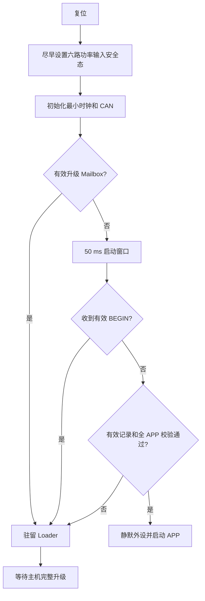

# Vector Mini ST CAN Loader 完整设计方案

文档版本：v1.1。日期：2026-10-13。基准分支：`codex/ovp-36v`，基准提交：`632b83d155a704b1237ab7fae52cbeca796368d6`。开发分支：`codex/ovp36-can-loader`。

配套：[候选协议黄金向量](2026-10-13-can-loader-minimal-v1-vectors.json)，包含合成镜像、完整帧、无效帧、48 B记录和32 B邮箱；用于后续C/Python实现独立核对，不代表固件协议已通过。

状态：已完成最小实现、离线回归及独立构建，首轮CAN完整升级已通过；连续1000次验收尚未通过，尚未合并。本文定义当前候选协议与验收边界。开发 worktree 从上述提交建立；原分支未提交的控制试验修改保留在原 worktree，不作为 Loader 修改自动提交。

## 1. 设计结论

采用独立常驻 Loader、单 APP 镜像、CAN-FD 停止等待传输。复位先执行 Loader；完整校验 APP 后启动，或驻留等待升级。升级前停机并确认六路功率输出关闭。先使启动记录失效，再擦写 APP；完整校验成功后，最后写入有效记录。

首次通过 J-Link 安装 Loader 和重定位 APP，后续通过 USB-CAN 逐台升级。Loader 永不擦写电机参数和标定区。升级中断后重新下载完整镜像；单镜像方案不能自动回滚到旧固件。

首版使用裸机主循环、静态缓冲、一个活动升级会话和一个变更请求缓存。复用已有 Loader 的 CRC、CAN 端口、镜像校验及主机传输代码，修正目标节点固定、长度检查和幂等处理；不把其他分支的电机控制或参数存储体系整体迁入。

## 2. 当前分支核对

| 项目 | 当前状态 | 接入后要求 |
| --- | --- | --- |
| MCU | Keil 目标 STM32G431CBUx，128 KiB Flash | 启动时检查实际 Flash 容量符合 target |
| APP 入口 | `0x08000000`，IROM 容量 `0x1C000` | 重新链接到 `0x08004000` |
| 参数区 | BSP 从页 56，即 `0x0801C000` 读写 | 整个后 16 KiB 保持保护 |
| 参数结构 | schema10，含 AXS1/DMP1/PVF1/PSP1/FSL1/SFF1 | Loader 不调用 Param_Download，不迁移、不重建参数 |
| 参数长度 | 当前源码契约 2344 B，跨两页 | 必须保护 16 KiB，不能只保护一页或旧 2272 B |
| CAN | 标准 11 位 ID，FDCAN，仲裁/数据段均 1 Mbit/s | Loader 沿用 1M/1M、FD+BRS |
| APP 寻址 | `(node_id << 8) | param_id` | 电机命令寻址保持；新增进入 Loader 及 UID 查询 |
| APP 过滤 | 仅接收当前节点的 256 个命令 ID | Loader 使用独立的精确升级 ID 过滤 |
| 进入 Loader | 尚未实现 | 通过前台停机交接服务实现 |

2026-10-13 对原 worktree 当前源码完成一次 APP 重建，0 错误、0 警告。map 的 Load Region 大小为 `0x16CC0=93376 B`，96 KiB 容量余 4928 B；map 的 Total ROM 为 92976 B。前者包含链接布局开销，是当前容量核对依据。重定位、新入口和协议加入后必须重新构建，不能直接套用该余量。

该产物包含原 worktree 未提交修改，与开发分支干净基准不完全相同。开发分支必须产生独立的源码哈希、map、HEX/BIN 和验证报告。当前编译结果仅证明原 APP 容量，不证明 Loader 或重定位 APP 已通过。

## 3. Flash 与 RAM 布局

### 3.1 Flash

下表末地址均包含在区域内；所有边界按 2 KiB 页对齐。

| 区域 | 首地址 | 末地址 | 大小 | 页号 |
| --- | --- | --- | ---: | --- |
| Loader 程序 | `0x08000000` | `0x08002FFF` | 12 KiB | 0～5 |
| APP 有效记录 | `0x08003000` | `0x080037FF` | 2 KiB | 6 |
| 保留页 | `0x08003800` | `0x08003FFF` | 2 KiB | 7 |
| APP 程序 | `0x08004000` | `0x0801BFFF` | 96 KiB | 8～55 |
| 参数与标定 | `0x0801C000` | `0x0801FFFF` | 16 KiB | 56～63 |

升级器只提交 APP 相对偏移，不接受任意绝对 Flash 地址。Loader 的 Flash 端口只允许擦页 6 和 8～55；禁止擦 Loader、保留页及参数区，禁止 mass erase。初装工具也必须显式限制写入范围。

12 KiB 是 Loader 的代码预算，前 16 KiB 中其余两页属于记录和保留空间。如果实现超过 12 KiB，先分析实际 map 并裁剪非必要代码；不可悄悄占用记录页或参数区。调整分区须形成新 layout_id，并重新核对 APP 容量。

### 3.2 RAM

| 区域 | 地址范围 | 用途 |
| --- | --- | --- |
| Boot Mailbox | `0x20000000～0x2000001F` | 32 B、NOINIT，APP/Loader 软复位交接 |
| 普通 RAM | `0x20000020～0x20007FFF` | 各固件自己的 RW、ZI、堆、栈 |

两份 scatter 文件都必须排除 Mailbox。Mailbox 不参与启动清零和 RW 拷贝；只允许软件复位交接，掉电后不依赖其内容。Loader 保留 APP 当前 3 KiB 栈预算作为初始配置，再用 map 和栈高水位验证；两份固件的 RAM 使用量不相加。

STM32G431 的 32 KiB RAM 包含普通 SRAM 与 CCM 别名，DMA 缓冲应留在 DMA 可达的 SRAM 区，不把 CCM 别名当作等价的 DMA 存储。参见 [ST 数据手册](https://www.st.com/resource/en/datasheet/stm32g431cb.pdf)和[参考手册 RM0440](https://www.st.com/resource/en/reference_manual/dm00355726.pdf)。

## 4. 模块与职责

```text
loader/
  firmware/
    loader_core.c/.h      升级状态、请求准入、幂等和超时
    loader_proto.c/.h     帧长度、字段、端序、CRC；无硬件访问
    loader_crc.c/.h       CRC-32/ISO-HDLC
    loader_main.c         初始化、主循环、启动窗口
    loader_flash.c/.h     APP/记录区擦写、回读、范围保护
    loader_can.c          FDCAN 收发、固定队列、bus-off 处理
    loader_jump.c/.h      向量校验、外设静默、APP 跳转
    loader_cfg.h          本 target 的板级常量
  mdk/                   独立 Keil 工程和 Loader scatter
  tools/                 升级 CLI、打包与离线协议检查
shared/
  flash_layout/          APP/Loader/主机共享分区常量
  protocol/              升级协议、操作码、结果码与黄金向量
  boot_mailbox.h         32 B 交接格式
firmware/services/boot_handoff/
                         APP 升级请求的前台交接
tests/loader/            编解码、假 Flash、掉电切点、主机重试
```

Loader 不链接 FOC、PID、轨迹、标定、RTT 或 APP 的参数业务模块。CAN ISR 只取出帧并入队；协议解析、整镜像 CRC、Flash 操作、提交记录都在前台执行。core/proto 使用项目自有类型，硬件文件独占 HAL、寄存器和板级引脚。

## 5. 正常启动和救援



50 ms 从 CAN 初始化完成后开始计时，不是 MCU 复位到 APP 运行的总时间；镜像 CRC 会增加启动时间。普通噪声帧、错误版本、CRC 错误或其他节点请求不能阻止 APP 启动。

只读 INFO/UID 查询不无限延长窗口。设备向量或记录无效时持续驻留；有效 BEGIN 在窗口内可保持驻留且不擦 Flash。正常 APP 主动请求进入 Loader 时也持续驻留。

APP CRC 正确但运行崩溃、不能发出进入命令时，维护工具先准备并重复发送本设备的有效 BEGIN，再由现场复位/重新上电，利用窗口进入 Loader。已安装单镜像无法自动回退；无法接入 CAN 时仍保留 SWD 救援。首版不通过 CRC 声称 APP 全部功能健康。

## 6. 五电机寻址

Loader 使用与 APP 一致的节点编号；一个通用 Loader 镜像适用于五块相同驱动板。

| 电机 | 节点 | APP 进入 ID | Loader 请求 ID | Loader 回复 ID |
| --- | ---: | --- | --- | --- |
| 左轮 | 1 | `0x166` | `0x7D1` | `0x7E1` |
| 右轮 | 2 | `0x266` | `0x7D2` | `0x7E2` |
| Roll | 3 | `0x366` | `0x7D3` | `0x7E3` |
| Pitch | 4 | `0x466` | `0x7D4` | `0x7E4` |
| Yaw | 5 | `0x566` | `0x7D5` | `0x7E5` |

升级ID编码可容纳0～15；本APP及Loader当前target只支持0～7，其中正常五电机使用1～5；0 为参数身份无效时的单板恢复节点，不能用于五电机在线批量升级。正常启动时 Loader 从固定参数前缀读取 node_id，并检查有限、整数、范围、schema/magic；不根据电机类型强制覆盖 ID。完整参数错误时进入恢复，不自动写默认节点。

有效 Mailbox 的 node 必须与有效 Flash 节点一致；不一致返回身份错误并驻留，不能悄悄选择另一电机。主机在 BEGIN 前读取 MCU 96 位 UID；BEGIN 指定完整 UID，由目标侧再次核对。

同一总线上节点必须唯一。重复 ID 或多块 node0 恢复板必须先隔离到单板；首版不做自动分配 ID或广播写入。USB-CAN 通道由 CLI 显式指定，不能通道0失败后自动向其他通道擦写。

## 7. CAN 升级协议

### 7.1 传输与兼容性

CAN-FD、标准 11 位 ID、数据帧、BRS，仲裁 1 Mbit/s、数据 1 Mbit/s。Loader 硬件过滤精确接收 `0x7D0+node`，拒绝扩展帧、远程帧、其他节点 ID、Classic CAN 和非法长度。

本方案候选协议为 **Loader CAN v2**：复用已有 v1 的 12 B 帧头和操作码，扩展身份/布局预检及严格幂等语义。v1/v2 版本字节不同，双方明确拒绝，不自动降级写入。它独立于当前电机协议 `0x67` 返回的版本数值。

### 7.2 公共帧

所有线上多字节整数均大端；UID 使用芯片 UID 地址按递增顺序读出的 12 B 原始字节，不交换字节序。回复首字段为 result；请求没有 result。

| 偏移 | 长度 | 字段 |
| ---: | ---: | --- |
| 0 | 1 | magic=`0xB1` |
| 1 | 1 | protocol_version=`0x02` |
| 2 | 1 | opcode |
| 3 | 1 | flags，首版必须0 |
| 4 | 2 | seq，事务内递增；重试保持相同 |
| 6 | 2 | payload_len，0～48 |
| 8 | 4 | session；只读查询为0，BEGIN使用主机新生成的非0值 |
| 12 | payload_len | payload |
| 12+payload_len | 4 | CRC32，覆盖帧头和 payload |
| 后续 | 可变 | `0xFF` 填充至合法 CAN-FD DLC |

CRC为CRC-32/ISO-HDLC：反射多项式 `0xEDB88320`、初值 `0xFFFFFFFF`、最终异或 `0xFFFFFFFF`，等价 `zlib.crc32`；`123456789` 的结果为 `0xCBF43926`。padding 不计 CRC。发送使用可容纳整帧的最小合法长度：16/20/24/32/48/64 B。

接收严格校验 magic/version/flags、实际 DLC、命令精确 payload 长度、CRC 及全部填充字节。无效帧不得修改会话、偏移、启动窗口或 Flash。字段合法而业务准入失败时才返回业务错误。

### 7.3 命令表

以下回复长度均已包含2 B result；失败回复为仅 result 2 B，不携带成功字段。

| op | 名称 | 请求 payload | 成功回复 payload |
| --- | --- | --- | --- |
| `0x01` | GET_INFO | nonce:u32，共4 B | result:u16、nonce:u32、loader_version:u32、app_base:u32、capacity:u32、layout_id:u32、hardware_id:u32、param_abi:u32、node:u8、reserved:3、parameter_crc32:u32，共38 B |
| `0x02` | GET_STATUS | nonce:u32，共4 B | result:u16、nonce:u32、state:u8、last_error:u8、reserved:u16、next_offset:u32、size:u32、image_crc:u32、active_session:u32，共26 B |
| `0x03` | GET_UID | nonce:u32，共4 B | result:u16、nonce:u32、uid:12 B，共18 B |
| `0x20` | BEGIN | 镜像描述40 B，见下表 | result:u16、app_base:u32，共6 B；帧头回显所接受session |
| `0x21` | ERASE | 空 | result:u16 |
| `0x22` | PROGRAM | offset:u32＋data:8～40 B，8 B倍数 | result:u16、next_offset:u32，共6 B |
| `0x23` | VERIFY | 空 | result:u16、computed_crc:u32，共6 B |
| `0x24` | ACTIVATE | 空 | result:u16 |
| `0x25` | ABORT | 空 | result:u16 |

GET_INFO/STATUS/UID 使用全新 nonce，回复回显，主机仅接受当前挂起查询的 nonce/op/seq/ID。它解决旧只读回复混入查询的问题；nonce 和 session 不构成密码认证。

BEGIN 帧头 session 为主机生成的非0维护事务号；失败不替换现有活动会话。主机一次仅维护一个目标，每次重连或设备复位后重新生成 nonce/session。32位随机标识仍有碰撞可能，首版适用于受控维护总线，不承诺抵御恶意重放或多主机并行操作。

| BEGIN payload 偏移 | 长度 | 含义 |
| ---: | ---: | --- |
| 0 | 4 | 补齐后 image_size |
| 4 | 4 | 补齐后整镜像 CRC32 |
| 8 | 4 | APP version，`0xMMmmppbb` |
| 12 | 2 | image_type=`1`，APP |
| 14 | 2 | reserved=`0` |
| 16 | 4 | layout_id，候选 `0x4F564C31`（OVL1） |
| 20 | 4 | hardware_id，候选 `1`，Vector Mini ST G431 target |
| 24 | 4 | param_abi，候选 `0x4F563130`（OV10） |
| 28 | 12 | 完整目标 UID |

上述兼容标识为本 target 候选登记值；不能套用其他 Loader 分支的标识。param_abi 表示schema10既有前缀及上述尾扩展兼容族，不能仅因另一分支也称schema10就认为兼容。升级包必须由本 target 构建工具生成。

### 7.4 结果码

| 数值 | 名称 | 含义 |
| ---: | --- | --- |
| 0 | OK | 当前命令实际完成；ACTIVATE为记录提交完成 |
| 1 | BAD_FRAME | 字段或命令长度错误 |
| 2 | BAD_CRC | 业务镜像 CRC错误；坏帧 CRC通常直接丢弃 |
| 3 | BAD_STATE | 当前状态不允许 |
| 4 | BAD_OFFSET | 偏移、对齐或跨页错误 |
| 5 | BAD_SIZE | 镜像/块长度超范围 |
| 6 | FLASH_ERROR | 擦写或回读失败 |
| 7 | VERIFY_FAIL | 整镜像或向量不通过 |
| 8 | BAD_OPCODE | 不支持命令 |
| 9 | BAD_SESSION | session为0或不属于活动事务 |
| 10 | BUSY | 已存在其他活动事务 |
| 11 | CONFLICT | 相同序号对应不同请求内容 |
| 12 | BAD_IDENTITY | UID不匹配 |
| 13 | BAD_COMPATIBILITY | 布局、硬件、参数族或类型不兼容 |

Flash内部细分错误写入诊断，不把HAL枚举直接当线上结果码。不得对错误回复执行成功字段解析。

## 8. 升级状态机

| 状态 | 含义 | 允许的变更命令 |
| --- | --- | --- |
| IDLE=0 | 未绑定会话，Flash不变 | BEGIN |
| PREPARED=1 | 清单通过，尚未破坏旧APP | ERASE、ABORT |
| RECEIVING=2 | 记录失效，按序写APP | PROGRAM、VERIFY、ABORT |
| VERIFIED=3 | 全镜像及向量校验通过 | ACTIVATE、ABORT |
| ERROR=4 | 本轮Flash/镜像失败 | ABORT，之后新BEGIN |

INFO/STATUS/UID任意状态可查询，不更新变更请求缓存。BEGIN不擦Flash；在活动会话中，另一BEGIN返回BUSY，相同session/seq/字节的精确重试返回原回复。新会话只能在IDLE创建。

ERASE先擦记录页并确认记录无效，再擦APP的48页。成功后next_offset=0。PROGRAM只接受 `offset==next_offset`；数据写入并回读一致后才推进偏移和ACK。VERIFY要求偏移等于image_size，校验CRC及向量，成功后进入VERIFIED。

ACTIVATE重新校验镜像，写记录、回读确认，发送成功回复；使用实际回复缓冲的TXBTO和TXBRP确认发送完成后才跳转；未启用TXBTIE时不能依赖TC中断标志。ABORT清RAM会话，既不恢复旧镜像也不构造有效记录。PREPARED中ABORT后旧镜像可在显式复位后正常启动；ERASE后ABORT仍留在恢复状态。

### 8.1 幂等与停止等待

主机发送一块，等待ACK，再发送下一块。缓存最近一次成功变更请求和完整回复，键为session/op/seq/完整请求字节。精确重试重放回复，不重复擦写；同键不同字节返回CONFLICT。只读查询不能覆盖该缓存。

已推进偏移后收到较早PROGRAM，只有对齐、范围合法且Flash字节完全相同时允许返回当前next_offset；不得重编程。主机正常只精确重试最后一块，对超前ACK或其他请求的ACK应先查询状态并终止本轮自动推进。

seq不回绕；最大96 KiB/40 B分块仍远小于65536条请求。旧session写请求、乱序请求、错误UID和越界请求无Flash副作用。

### 8.2 初始超时配置

| 项目 | 初值 |
| --- | --- |
| APP关相交接 | 100 ms；失败保持停机，不复位、不宣告成功 |
| 进入Loader等待 | 2 s |
| 普通查询/BEGIN/PROGRAM | 1 s，精确重试最多3次 |
| ERASE | 20 s；期间不发送其他数据 |
| VERIFY | 10 s |
| ACTIVATE | 1 s；回复丢失后先检查APP，不盲目重新擦写 |
| 会话无活动超时 | 30 s；清会话并驻留，无效APP绝不自动启动 |
| 新APP应答等待 | 5 s |

这些是实现初值，需按实测校准。Flash操作期间单Bank取指或中断可能暂停，不能依赖8帧接收队列吸收持续发包。FDCAN实际发送完成与入队分开：保存LatestTxFifoQRequest位掩码，确认TXBTO对应位已置位且TXBRP不再挂起。该判据不依赖TX完成中断使能；bus-off后保持功率安全，恢复链路或驻留，不把无ACK当作写入未执行。

## 9. Flash写入与有效记录

### 9.1 PROGRAM约束

同时满足：`8<=length<=40`、length和offset为8 B倍数、不跨2 KiB页、`length<=image_size`、`offset<=image_size-length`、结果地址在APP区、session和状态合法。加法前先做减法式边界检查，防止uint32溢出。

G431使用8 B doubleword编程。新块最多5次编程，每次检查HAL结果，整个块回读比较后ACK。重复块不再次写入，避免Flash/ECC重复编程。末块在主机打包阶段以0xFF补齐；BEGIN长度和CRC针对同一份补齐后字节，不能下载过程中再改变镜像。

### 9.2 48 B有效记录

记录位于页6开头。以下存储整数采用STM32小端，与CAN大端不同；统一按字节序列化，不依赖未检查的C结构填充。

| 偏移 | 长度 | 字段 |
| ---: | ---: | --- |
| 0 | 4 | magic=`0x3252444C`，小端字节LDR2 |
| 4 | 2 | record_version=1 |
| 6 | 2 | record_length=48 |
| 8 | 4 | layout_id |
| 12 | 4 | image_size |
| 16 | 4 | image_crc32 |
| 20 | 4 | app_version |
| 24 | 4 | hardware_id |
| 28 | 4 | param_abi |
| 32 | 4 | reserved=0 |
| 36 | 4 | record_crc32，覆盖前36 B |
| 40 | 8 | commit=`0x3154494D4D4F4342`，最后一次写入 |

ERASE已把记录页擦空；ACTIVATE先写并回读前40 B，再用单独8 B编程写commit并回读。记录写入中断则记录无效。ACTIVATE不另擦一次记录页，也不重复编程commit；失败后要求新完整事务。

每次启动必须检查记录的字段/commit/CRC、兼容标识、实际APP全量CRC和向量。只有记录看似完整不能放行。记录页没有A/B副本：记录损坏可进入CAN恢复，代价是重新下载，不恢复旧APP。

## 10. APP安全交接

### 10.1 新命令

本分支空闲参数号 `0x63` 定义为只读GET_UID：请求4 B nonce；回复CAN-FD 16 B为相同nonce＋UID12 B。`0x66`定义为ENTER_BOOT：请求4 B大端 `0x424F4F54`，即BOOT；其他值拒绝。

进入请求不得当作float32参数或mode9保存命令。成功回复为4 B大端结果0；其他结果为1忙、2未支持、3字段错误、4关相失败。另增加只读 `0x7C` 参数全区CRC：请求4 B nonce，回复8 B为nonce＋大端CRC32，覆盖 `0x0801C000～0x0801FFFF` 全16 KiB。GET_INFO尾部也返回同一范围CRC，便于纯CAN上位机在升级前后核对。CRC用于完整性检查，不提供认证；台架验收同时使用原始备份的SHA256与逐字节核对。

旧APP不支持时超时，主机停止，不能将超时解释为已经进入或自动触发标定。

### 10.2 时序

1. CAN接收边界验证节点、命令和载荷，提交一次交接请求，不在ISR复位。
2. APP锁存升级交接状态，禁止新运动、标定、设零、参数保存及身份变更请求。
3. 前台/控制所有者执行现有STOP，等待ModeNow和ModeLast均为Motor_Disable。
4. 用 `motor_hw_phase_outputs_disabled()` 检查三相通道和六路引脚状态；不能只看IqRef=0或MOE。
5. 关相通过后回复成功，等待实际发送完成；失败或超时保持安全停止并报告失败。
6. 写Mailbox、内存屏障、NVIC_SystemReset；Loader再次尽早设置板级安全输出。

STOP失败或输出关闭无法验证是台架硬失败，不能自动重试或继续运动。Loader只做板级安全态，不运行电流零偏、编码器对齐或电机PWM。

### 10.3 32 B Mailbox

小端字段：magic:u32、version:u16、length:u16、command:u32、node:u32、token:u32、reserved:u32、crc32:u32、valid:u32。magic候选`0x314C4D42`，version1，length32，command1，reserved0；CRC覆盖前24 B；valid候选`0x54494D43`最后写入。

写入前先清valid，字段/CRC完成并DSB后写valid再DSB。Loader在软件复位后校验并复制字段，然后立即清valid，消费一次；POR/BOR或未知字段不采信。token用于关联交接日志，不代表身份认证或持久化升级请求。

## 11. APP重定位与跳转

APP scatter：ROM首地址`0x08004000`、最大`0x18000`；RW首地址`0x20000020`、最大`0x7FE0`。保持向量表RESET节第一，Keil工程地址与scatter一致。不得仅把旧BIN后移16 KiB；必须重新链接。

SCB.VTOR需在APP中断启用前设为APP_BASE。CubeMX生成文件仅在USER CODE内调用初始化，或使用独立板级启动适配；禁止直接修改生成代码中固定VECT_TAB_OFFSET来维持方案。

跳转前检查：size至少8 B且8 B对齐；MSP 8 B对齐且位于允许RAM窗口（允许等于顶端）；Reset_Handler的Thumb位为1，去掉最低位后落在实际APP镜像内，不是仅落在整个Flash内。主机在ERASE前也执行同样预检，并核对manifest.link_base。

Loader静默CAN、SysTick和自己启用的外设，关闭并清除NVIC pending，清PendSV/SysTick pending，恢复约定的CONTROL/BASEPRI/FAULTMASK/PRIMASK和FPU上下文，设置VTOR、DSB/ISB。最后在专用短汇编尾跳中设置MSP并BX到Reset_Handler；换栈后不能再执行依赖旧C栈的函数尾声。必须验证APP中断正常工作，不能把__main在跑当成启动完成。

Loader从主循环线程态跳转，禁止ISR直接跳APP。APP启动仍保持既有停机默认，不恢复升级前运动指令。

## 12. 上位机与升级包

首版为Python CLI，复用现有USB-CAN适配器，不增加GUI。拟定入口：

```text
loader_updater.py --channel 0 --node 4 --uid <24位十六进制UID> --package <发布目录>
```

### 12.1 多探针与多适配器

J-Link用探针serial选择，USB-CAN用adapter serial加channel选择，电机用MCU UID加CAN ID选择；三者不能相互替代。USB device_index只用于本次枚举后打开句柄，插拔可能变化，不能持久当作设备身份。J-Link连接的电机通过UID读取确认，不能按探针列表第一项或Keil默认探针下载。

一个USB-CAN适配器可能有多个通道，一个CAN通道可能挂五台电机。主机应分别显示：探针serial→板UID；适配器serial/channel→发现的节点/UID集合。相同UID才能建立SWD与CAN对应关系。

拟定的显式选择参数为 `--adapter-serial <serial> --channel <n> --node <id> --uid <uid>`；首次安装额外使用 `--jlink-serial <serial>`。设备唯一时可自动解析唯一项；存在多个候选时必须提供选择，禁止静默使用index0、自动切换适配器或试写其他通道。

枚举阶段只获取设备信息，不初始化/启动CAN通道、不发送运动或升级命令、不halt/reset MCU。读取板UID与CAN节点属于独立只读识别步骤；扫描不同通道前检查资源占用和实际波特率。枚举失败要区分SDK不可用、设备打开失败/占用和USB未枚举，不能全部显示为“没有电机”。

发布目录至少包含`manifest.json`、重定位`app.bin`和SHA256文件。manifest包括target、MCU、hardware_id、layout_id、link_base、image_size、CRC32、SHA256、APP版本、参数兼容族、协议版本、源码commit/dirty状态和编译器。SHA256用于主机检查文件一致性；首版设备用CRC校验传输和存储，不提供签名认证。

包预检先于ENTER_BOOT：验证SHA、CRC、8 B补齐、96 KiB容量、向量、地址、版本及target兼容。主机读取并记录APP节点/UID/版本，确认总线节点唯一，选择单目标；进入Loader后重新核UID、协议和布局，再BEGIN。

分块公式：`n=min(40, image_size-offset, 2048-offset%2048)`，所有项来自已8 B对齐的镜像。每块ACK必须对应当前ID/op/seq/session，next_offset必须为expected。VERIFY回复CRC必须等于包CRC，ACTIVATE成功后查询原节点APP的 `0x6F`，版本应等于包版本，再读UID核对设备。

最终成功定义：设备报告写入/验证/记录提交成功，且观察到指定UID的新APP版本与CAN通信恢复。只收到ACTIVATE ACK或GET_MODE=0不够；这个结果也不包含位置环、速度环或电机标定的性能验收。

日志记录UTC时间、通道、节点、UID、会话、包哈希、命令结果、偏移、耗时及最后状态；产物进入outputs，不写入参数区。

## 13. 首次安装和参数保护

首次安装流程：现场确认停机/关相和独占维护；通过J-Link完整备份Flash及16 KiB参数区；记录UID、CAN ID、电机类型、LUT、电零位和机械零位。构建独立Loader与重定位APP，预检HEX的所有地址范围。

先安装Loader、再写重定位APP、最后写由同一APP包生成的有效记录。任何步骤中断后应能从已正确安装的Loader救援；不要先标记APP有效再写数据。下载范围不能覆盖参数区，也不能使用全片擦除。

回读比对Loader/APP/记录和参数全16 KiB，参数必须逐字节与备份一致。正常升级同样不允许额外调用mode9保存、重新标定、设零或电机类型映射。升级包不得混入另一电机的参数镜像。

APP升级构建的启动参数读取禁止自动迁移写入：`APP_LOADER_LAYOUT`下仅在RAM解释旧记录；旧schema或缺速度PI尾记录也不得启动擦写。原独立APP仍保留既有迁移行为。升级构建启动强制STOP，不能因参数无效时的默认Save模式保存到Flash。正常使用中用户显式mode9保存仍是独立配置操作，不属于升级流程。参数错误时保持停机诊断，不把恢复默认参数作为升级成功的一部分。

## 14. 异常恢复矩阵

| 故障点 | 允许行为 | 恢复方式 |
| --- | --- | --- |
| BEGIN前/预检失败 | 原APP和记录保持 | 修正包或身份再试 |
| BEGIN后、ERASE前掉电 | 旧记录/旧APP仍有效 | 正常启动旧APP或再进Loader |
| 记录擦除中掉电 | 仅记录可能损坏，APP未开始擦 | 记录有效且镜像通过可启动；否则CAN恢复 |
| APP擦除/PROGRAM中掉电 | 无有效记录，不启动半成品 | 从头BEGIN→ERASE→下载 |
| PROGRAM ACK丢失 | 精确重试，回读相同块，不重编程 | 继续当前session |
| 请求冲突/超范围 | 返回错误，无Flash变化 | 主机停止并诊断 |
| VERIFY失败 | 不写有效记录 | ABORT后新完整下载 |
| 记录写入中断 | commit/CRC不合法则驻留 | 完整重新下载 |
| ACTIVATE ACK丢失 | 不据此认定失败或重复擦除 | 先查询APP版本/UID，再决定救援 |
| 新APP通信失败 | 结果记失败，禁止自动运动 | 复位窗口救援，必要时SWD |
| 参数区异常 | Loader不改参数 | 保持诊断，单独恢复参数流程 |
| node非法 | node0单板恢复，禁止广播写 | 物理隔离单板并指定UID |
| STOP/关相未确认 | 本轮硬失败 | 现场介入；不自动继续 |

## 15. 验收和合并门槛

### 15.1 离线

- C/Python共同黄金向量：INFO/UID/BEGIN/PROGRAM/VERIFY/ACTIVATE，CRC、padding及端序。
- 拒绝错版本、flags、长度、padding、错误UID/布局、错误session和非法状态。
- 假Flash验证页号/字节边界、整数溢出、8 B和跨页约束；参数/Loader/保留页逐字节保持。
- 模拟每次记录与APP擦写的掉电切点，启动决策不能执行不完整镜像。
- ACK丢失、精确重试、查询插入、不相同重复BEGIN、重复ERASE、乱序PROGRAM、session超时。
- 最大96 KiB、最小合法镜像、尾部补齐；坏MSP、Thumb位、旧link_base及Reset越界。
- APP交接期间并发START/标定/保存被拒绝，STOP失败不能写Mailbox或复位。

### 15.2 构建和链接

Loader/APP独立全量构建，均0错误/0警告；Loader<=12 KiB、APP<=96 KiB。检查HEX仅落在各自允许区间，向量、scatter、VTOR和RAM Mailbox一致。检查新增链接依赖不引入电机算法到Loader，Mailbox不被ZI/RW覆盖。发布包与AXF/map/HEX/BIN使用同一源码快照。

### 15.3 实机

台架上下文包含板UID、节点、通道、实际位时序、功率安全状态及其他命令源暂停确认。先单板初装，再做正常升级、重复升级、ACK丢失与不同擦写阶段真实断电。回读整个参数区和个体标定；确认新APP正常启动、CAN中断工作、默认mode0及功率关断。

最后在五电机总线上逐台验证：选定一台升级时，其他四台身份、参数和运行状态不被升级请求修改。失败用独立summary记录，不能拿其他分支旧台架日志当本分支证据。

### 15.4 连续1000次指标

同一冻结镜像、同一目标UID、同一总线通道连续升级1000次。每次包括APP停机/进入Loader、全镜像擦写校验、记录提交、APP版本/UID/停机查询、全16 KiB参数CRC核对，以及指定J-Link对功率相关位的独立检查。结束时以J-Link完整回读参数区，与初始备份逐字节及SHA256核对。

观察失败率严格低于0.1%意味着1000次中必须零失败；1次失败等于0.1%，不满足目标。任一失败停止该批，不删失败行、不通过重试整圈抹掉记录。修复后另建新批次，从1重新完整运行；初装和调试失败另行归档，不能转成成功。

单条报文丢ACK后的精确重试是协议功能，计入retransmissions并保留日志；整圈最终失败仍计失败。STOP/功率关闭无法确认需要现场介入，不自动恢复。读状态仅检查CCER相通道位及六路引脚MODER位；无关SPI/其他GPIO位变化不能当成关相判据，两个原始快照应保留到错误日志。

台架脚本 `loader/tools/loader_cycle_test.py` 保存每圈CSV、原始镜像哈希、参数基线、通过/失败/重试和耗时。`stop.request`只在完成一圈的安全边界停止；不能结束前台Flash操作后自动恢复运动。1000次零失败只表示本批观察结果，不直接证明长期真实失败概率。

### 15.5 工程检查与合并

遵守用户AGENTS要求：文档阶段quick；代码/协议PR；链接与硬件release加实际台架。当前ovp分支旧tools/run.py没有这些profile；不得把Unknown command计为通过。使用已有离线/原生/Keil入口归档等效项目检查，并在summary明确统一profile是否可用。

只有选定验证范围通过、无未解决的阻断错误，才提交Loader改动并合并回codex/ovp-36v。原分支未提交试验修改不混入Loader提交；涉及同文件时保存精确补丁，在合并后恢复并逐项核对。未完成实机时不得宣称CAN升级实测通过。

## 16. 实施顺序与回退

1. 固化本文、协议/布局单一常量、黄金向量及首版主机包格式。
2. 在独立worktree迁入最小Loader模块，先跑假Flash与重试验证。
3. 改独立APP链接布局和安全交接；控制增益、参数ABI和标定数据不随Loader修改。
4. 全量构建、地址/容量检查、主机dry-run；完成离线阶段报告。
5. 按确认的台架执行首次安装、升级和中断恢复；全部证据通过后合并。

回退软件：撤销Loader集成提交；原分支用户试验修改另行保留。回退实机：停机并确认关相后，用匹配原layout的完整Loader/APP/记录或原独立APP备份恢复，参数区仍独立保护。不能将旧0x08000000 APP通过新Loader当作0x08004000镜像下载。

## 17. 参考与历史方案边界

- [已有通用Loader框架](../architecture/loader/d_loader_portable_framework_20260917.md)：本方案只取当前单target必需部分。
- [历史Flash/RAM设计](../architecture/loader/d_loader_architecture_memory_20260917.md)：存在多个历史布局，地址以本文为准，不自动兼容。
- [固件发布规范](../guides/firmware_release_standard.md)：APP/Loader分别命名发布，layout_id和协议版本写入清单。
- [参数总表](../guides/five_motor_parameter_table.md)：升级保存个体配置，不能用总表覆盖个体校准。

首版取舍：用完整重下载恢复单镜像中断；用固定五节点和完整UID确认目标；用CRC保证内容一致性；用实际APP版本/UID应答核对启动。A/B镜像、自动回滚、签名认证和跨产品通用升级框架均不作为本首版验收能力。

## 18. 当前实现入口

- APP候选版本v0.5.0；Loader候选版本v1.0.0，线上协议v2。未作为正式发布版本交付。
- `shared/boot_contract.h/.c`：布局、CRC、48 B记录和32 B邮箱。
- `loader/firmware/`：真实升级核心与G431硬件端口。
- `loader/tools/loader_updater.py`：单次升级；`loader_cycle_test.py`：显式硬件耐久测试。
- `tests/loader/run_tests.py`：真实C核心假Flash故障测试及Python/C客户端联测，不连接硬件。
- `tests/run.py --cc <compiler>`已接入Loader离线检查；Keil项目位于`loader/mdk/`及原APP项目目录。

所有台架序列号、真实UID、备份及测试日志仅进入outputs，不写入通用源码配置。
