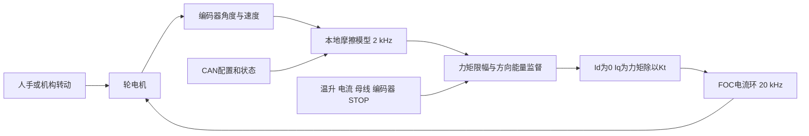

# 轮电机可调阻力旋钮方案 v1

日期：2026-10-17。代码基线：`codex/ovp-36v`，`7e8808a5`，APP v0.6.0。

## 使用目标与结论

将一台无阻尼环轮电机固定在底座上，由人手或外部机构转动转子，电机提供可配置的反向阻力矩。轮电机具备带编码器的 FOC 电流环，适合验证可调动摩擦、粘性阻尼和有限弹性行程的静摩擦手感。首版从 0.05～0.20 Nm 开始；参考会话中的 2 Nm、±20% 波动、90°/s 作为后续机构试验的评估工况，不直接作为手动试验边界。

2 Nm 从电磁转矩估算上可达，但需要约 3.63 A，按现有电阻参数计算的绕组铜耗约 42 W；连续能力取决于温升与逐相热点。现有轮电机的齿槽转矩、惯量和轴承阻力，也决定了它能否具有精细旋钮的手感。先验证这些条件，再决定是否扩大力矩或更换低齿槽电机。

实现阶段使用独立 worktree；本方案不改变轮电机既有运行模式、个体标定或整车速度前馈配置。

## 调研依据

| 资料 | 对本项目的意义 |
| --- | --- |
| [SmartKnob 官方项目](https://github.com/scottbez1/smartknob) | BLDC 电机、磁编码器和闭环转矩已经可实现触觉旋钮；项目明确指出齿槽会掩盖弱触觉与自由旋转手感 |
| [MathWorks 旋转摩擦模型](https://www.mathworks.com/help/simscape/ref/rotationalfriction.html) | 可将动摩擦、Stribeck 和粘性阻尼组合；平滑速度函数过零连续，但由公式可见其零速输出为零 |
| [MathWorks PMSM 转矩估算](https://www.mathworks.com/help/mcb/ref/pmsmtorqueestimator.html) | 使用磁链、极对数和 dq 电流估算电磁转矩；精确转矩测量仍需要物理传感器 |
| [MathWorks PMSM 铜耗模型](https://www.mathworks.com/help/simscape-electrical/ref/femparameterizedpmsm.html) | 绕组损耗是各相电流平方乘相电阻之和，低机械功率不等于低发热 |
| [Stanford ME327 触觉系统稳定性讲义](https://web.stanford.edu/class/me327/lectures/lecture10-prerecorded.pdf) | 采样、延时与量化会影响无源性；可用能量观测和耗散控制限制主动输出 |
| [ODrive 回馈能量管理资料](https://docs.odriverobotics.com/v/latest/hardware/regen-clamp-datasheet.html) | 反拖可能向直流母线回馈能量，需要匹配的吸收路径；本文不将该产品直接认定为本板兼容附件 |

以上资料证明原理与可用方法；本轮电机的转矩精度、最小平滑阻力和持续热能力由下面的标定及验收确定。

## 现有固件能复用什么

| 项目 | 当前代码行为 | 方案处理 |
| --- | --- | --- |
| 电流环 | mode 1 的 `Task_Current_Mode` 调用有感 FOC；快环 20 kHz | 复用电流控制与执行限幅，独立模型产生 `Id*=0`、`Iq*` |
| 速度或位置环 | mode 2/3 主动跟踪目标 | 阻力旋钮绕过这两个外环；零速速度 PI 会形成位置约束，不能代替自由旋转摩擦 |
| mode 20 | `Start_Damping_Brake` 进入三相低边短接 | 保持其语义；短接制动随转速变化，不能指定稳定的静态 Nm |
| 现有摩擦前馈 | 用于克服原机械阻力 | 与模拟阻力方向相反，不直接复用其输出策略 |
| 速度惯量前馈 | 仅作用于 mode 2 | 不参与旋钮模式，保留其配置 |
| 热保护 | 总体与逐相热模型、执行层电流约束、热故障锁存 | 全部保留，旋钮电流还受独立的小电流上限约束 |
| 编码器 | 默认 2 kHz、16 点、8 ms 滑窗，约 4 ms 群延时 | 模型取无死区连续速度；换向与失效另用及时的角度增量监督 |
| 标定 | LUT 与电零位决定有感换相质量 | 保留有效的个体标定；没有可靠换相标定不能靠增大电流弥补 |

对应入口：

- [电流模式](../../firmware/app/foc_run.c)、[快环与模式调度](../../firmware/app/foc_task.c)。
- [短接制动](../../firmware/motor/protection/foc_errhandle.c)、[模式定义](../../firmware/motor/data_type.h)。
- [编码器配置](../../firmware/platform/stm32g4/bsp/encoder.h)、[滑窗实现](../../firmware/platform/stm32g4/bsp/encoder.c)。
- [电气参数默认值](../../firmware/services/parameters/foc_param_profile.h)、[绕组热保护](../guides/motor_winding_thermal_protection_v1.md)。

当前默认测速不是 PLL。常规 `vel_mech` 带 8 个内部计数的零速门限，对应约 5.49°/s；`vel_mech_continuous` 和该分支的 `vel_mech_fast` 不加这个门限。不能把常规零速速度直接用于低速摩擦，否则接近零速时会突然撤力。TLE5012B 读取的是 15 位角度后左移一位，物理原始角度步进约 0.01099°，内部 65536 表示不代表获得了 16 位物理分辨率。

也不能直接搬用位置环的 5 Hz 速度低通：一阶 5 Hz 滤波低频延时约 31.8 ms，再叠加原滑窗，会明显增加换向滞后。应先记录静止噪声和手动换向，再选择估计窗口与过零宽度，不预先认定更低截止频率会有更好手感。

## 转矩和发热估算

代码参数以及 2026-10-13 左右轮归档 Flash 均为：极对数 `p=21`、相电阻 `Rs≈2.144 Ω`、磁链 `ψ≈0.0175025 Wb`、`Ld=Lq≈0.9 mH`。归档值不等于本次已读取连接板。以下把这些参数视为有效的电机模型输入，采用现有幅值不变 dq 口径；电阻参考温度尚未测定。

在 `Id=0` 下：

```text
Kt = 1.5 × p × ψ ≈ 0.55133 Nm/A
Iq = τ / Kt
P铜 = Rs × (Ia² + Ib² + Ic²) = 1.5 × Rs × Iq²
P机械 = |τ × ω|，其中 ω 用 rad/s
```

这里的 Iq 是 dq 电流幅值，不是相 RMS 电流，也不是电源直流输入电流。转矩为电磁估计，轴端手感还叠加原生摩擦、齿槽和加速惯量。

| 电磁阻力矩 Nm | Iq 幅值 A | 铜耗估算 W | 90°/s 机械吸收功率 W | 直径 100 mm 轮缘切向力 N |
| ---: | ---: | ---: | ---: | ---: |
| 0.05 | 0.091 | 0.03 | 0.079 | 1 |
| 0.10 | 0.181 | 0.11 | 0.157 | 2 |
| 0.20 | 0.363 | 0.42 | 0.314 | 4 |
| 0.50 | 0.907 | 2.65 | 0.785 | 10 |
| 1.00 | 1.814 | 10.58 | 1.571 | 20 |
| 1.60 | 2.902 | 27.09 | 2.513 | 32 |
| 2.00 | 3.628 | 42.32 | 3.142 | 40 |
| 2.40 | 4.353 | 60.94 | 3.770 | 48 |
| 3.00 | 5.441 | 95.22 | 4.712 | 60 |
| 4.00 | 7.255 | 169.28 | 6.283 | 80 |

因此参考会话中“2 Nm、90°/s 只有约 3 W，所以功率很小”的判断只覆盖轴端机械功率。该工况绕组仍可能产生约 42 W 铜耗，温升还会进一步增大电阻。4 Nm 所需的约 7.26 A 也已经超过当前热配置的 7 A 峰值，不能作为现有固件保证值。

当前热模型的 3 A 向量连续参考对应约 1.65 Nm，但它不是实测连续额定值。静止输出时相电流是固定分配，一相可能长期承担接近整个 Iq 幅值；相 RMS 参考约 2.12 A，最不利电角下相约束对应的向量转矩参考约 1.17 Nm。实际由总体和逐相模型共同决定可用电流，必须覆盖多个停驻电角及真实绕组温升。复位会丢失 RAM 热历史，不能用复位恢复所谓冷态试验预算。

## 控制方案



### 首版采用平滑动摩擦和粘性阻尼

定义电机对人的输出转矩为 τ，正速度对应正向转动：

```text
τ目标 = −Tc × tanh(ω / ωε) − b × ω
Iq目标 = 限幅(τ目标 / Kt)
```

Tc 是近似恒定的动摩擦阻力，b 决定越转越重的粘性手感，ωε 决定过零缓冲宽度。也可用分段线性饱和函数代替 tanh，减少计算；先选择一种并固定测试口径。连续时间且速度准确时有 `τ×ω≤0`，但这不构成采样系统的稳定性证明。

首轮先令 Tc 为零，仅测试粘性阻尼，方向和停机通过后，再将 Tc 从 0.05 Nm 增加到 0.10、0.20 Nm。该模型零速输出为零，低于过零宽度时阻力减小；不能将其宣称为理想静摩擦。

### 第二版增加静摩擦与脱黏

使用可移动锚点的微小弹性位移模拟预滑移，而非始终拉回某个绝对零位：

```text
静止阶段：τ弹性 = −ks × (θ − θ锚点)，幅值不超过静摩擦门限 Ts
滑动阶段：使用平滑动摩擦模型，锚点随滑移更新
重新停下：连续衔接当前转矩，进入新的局部静止锚点
```

令 `Ts≥Tc`，配合带回差的滑动/静止判定；必要时加入有限的 Stribeck 过渡，测试其负斜率是否引发粘滑。静摩擦建立需要可测的微小位移，仅凭编码器不能精确获知零位移下任意外部手力。弹性状态还会存储并释放 `0.5×ks×位移²` 的能量，因此需要包含储能的无源性约束；首版“总是反向”的判断不能原样替代该约束。

刚度和预滑移角度应由编码器噪声、延时与实际手感确定，不直接指定很高刚度追求绝对锁住。松手后不能出现明显回弹或持续自激。

### 零速与换向处理

1. 使用有时效、已展开的角度及连续速度；单圈跨零、坏帧和采样超时不能变成转矩尖峰。
2. 慢速度用于平滑阻力幅值，较新的角度增量用于换向监督。方向不可靠时降低或撤销力矩，不能长时间保持旧方向的制动力矩。
3. 配置增大和正常建立阻力采用斜率限制；反向助推、故障与 STOP 的撤力不等待正常上升斜率。换向先撤旧力，再建立新反向力。
4. 记录实际 Iq 与角度增量，估算对外功 `ΔE输出≈Kt×Iq×Δθ`。首版不允许持续净主动输出；需要容差与窗口来处理量化及测量误差。监督触发时退让到更低阻力或停机，不能通过提高增益掩盖问题。

2 kHz 是计划的本地模型更新率，并不代表 2 kHz 触觉带宽。原测速延时、电流跟随和人手/机构动力学仍决定可用阻抗；实施时必须量测快环最坏耗时与换向响应。

## 首轮参数与配置兼容

下面是低力矩原型的候选起点；显示统一使用度、度每秒，内部计算保持 rad 与 rad/s，在接口边界明确换算。

| 参数 | 首轮候选 | 说明 |
| --- | ---: | --- |
| 功能默认开关 | 关闭 | 上电 mode 0；保存配置不等于自动出力 |
| 动摩擦 Tc | 0.10 Nm | 先从 0 测粘性，再试 0.05、0.10、0.20 Nm |
| 粘性 b | 0.001 Nm/(°/s) | 内部等效约 0.05730 Nm/(rad/s) |
| 过零宽度 ωε | 10°/s | 按静止噪声和反向延时复核，低速阻力会下降 |
| 总转矩幅值上限 | 0.25 Nm | 动摩擦与粘性合计后限幅 |
| 旋钮独立电流上限 | 0.50 A | 同时受原运行上限和热可用上限约束 |
| 正常建立转矩斜率 | 1 Nm/s | 不延缓故障撤力 |
| 首轮转速覆盖 | 1～90°/s | 人工或机构反拖，不是电机主动速度目标 |
| 静摩擦、随机波动 | 关闭 | 基础稳定后再加入 |

在 90°/s、Tc=0.10 Nm 时，含上述粘性项的阻力约 0.19 Nm、Iq 约 0.345 A、铜耗约 0.38 W。这组参数用于验证工作链路，不能推导出精度承诺或直接外推到 2 Nm。

配置通过现有 CAN 服务管理，但摩擦实时计算在 MCU 本地完成；PC 以 10～50 Hz 量级修改参数和查看状态，不经 USB-CAN 逐拍生成力矩。接收端做范围和有限数校验，由快环单一所有者在明确时点应用完整配置；参数组和使能不能出现半更新。

Flash 使用有版本、长度和 CRC 的独立扩展配置，缺失时禁用。保留现有参数前缀与个体标定偏移，旧镜像降级及再次保存的扩展丢失行为需要兼容测试。新协议编号在实施时查占用并补文档、黄金向量和测试，不能复用速度前馈或热配置编号。普通 mode 1、mode 20 的旧语义保持；新增专用模式的编号也需先核对全部消费者，不在方案中预占。

复用 STOP、编码器故障、通信失联与热保护退出路径；首次联机原型保留心跳超时，不通过关闭保护实现离线手感。若要做脱机独立旋钮，再明确本地使能与硬件停止方式。模式切换、故障恢复后不自动恢复旧力矩。

实现范围限于一个确定性摩擦模型、小段调度接入和必要的配置扩展，不建设通用触觉框架；新的模型不直接访问 HAL、寄存器或板级引脚。

## 机械与电源条件

定子固定在刚性底座，反力矩和附件紧固按试验上限校核；转子外安装圆滑手轮并遮挡夹点。若仍使用直径 100 mm 轮体，2 Nm 需要约 40 N 切向力，已经属于明显的机构阻力，不能按轻量旋钮处理。断电仍保留齿槽、轴承摩擦和转子惯量；软件配置为 0 Nm 也不是零阻力、零惯量。

需要用力臂加测力计标定 `τ=F×半径`，或安装扭矩传感器。至少覆盖正反向与多个转子角度，区分电磁转矩、原生阻力和齿槽波动。没有力矩测量时，只能提供基于 Kt 的名义阻力设置，不能声称精确复现 2.00 Nm。若电机原生齿槽已大于想模拟的小阻力，优先调整硬件选型；主动齿槽补偿属于另一个会输出能量的功能，首版不加入。

反拖时的机械输入可能经逆变器回到母线，但不能把所有 `|τω|` 当成净回馈：近似有 `P直流输入≈P铜及其他损耗−|τω|`。2 Nm、90°/s 示例仍可能净耗电约 39 W，而较小阻力或较高反拖速度可能净回馈。电源、制动吸收或可充电源应覆盖后者。

现分支按 8S 配置欠压 24 V、过压 36 V；README 同时保留“原硬件超过 35 V 可能损坏”的约束。因此软件 36 V 过压不是板级回馈钳位保证。回馈吸收阈值及供电余量应按真实器件额定值重新确认；例如 ODrive 示例钳位器的最坏触发压差达 2.5 V，若输入 33 V，不能直接认为它足以保护本板。不要直接并一只无控制电阻或套用其他驱动器的附件规格。

降低母线也需同步检查当前 24 V 欠压和 ADC/调制配置，不能把其他 5 V 触觉旋钮方案的电压直接照搬到本板。高力矩连续试验需要绕组温度测量；板载 MCU 温度不能代替绕组热点温度。

## 开发与验收步骤

| 阶段 | 动作 | 通过条件 |
| --- | --- | --- |
| 1 原生手感与换相确认 | 高阻状态记录正反转阻力和齿槽；夹具固定后用小电流验证 Iq 符号、角度方向与实测力矩 | 无异常自转；有可靠 LUT/电零位和电流采样；确认可实现的最小阻力 |
| 2 离线与低力矩原型 | 独立 worktree 实现纯粘性、平滑动摩擦，覆盖跨零、坏帧、反向、限幅、STOP、热降额和参数兼容 | 有界输出；失效撤力；其他模式和旧 Flash 行为保持；通过 PR/release 及适用工程检查 |
| 3 轻阻力手感 | 0.05、0.10、0.20 Nm；±1、±5、±30、±90°/s；慢起步、急换向、松手停驻 | 无持续自激、方向性助推或角度尖峰驱动；记录最小平滑速度与力矩误差 |
| 4 静摩擦 | 增加局部锚点，测起动/滑动力矩、微小预位移和松手响应 | 静摩擦与动摩擦可区分，过渡连续，储能有界，无明显回弹或自激 |
| 5 扩大负载 | 机构反拖分级到 0.5、1.0、1.6、2.0、2.4 Nm，并覆盖多个停驻电角及热稳态 | 实测绕组温升、逐相限流及母线峰值符合已确认边界；只能据此声明对应连续能力 |
| 6 波动摩擦 | 在已通过的范围内增加例如 2 Nm±20%、低频正弦波动 | 峰值仍在电流和热边界内；波动不引起失稳；以实测转矩验证，避免逐拍白噪声 |

定量验收至少输出：正反向实际力矩—速度曲线、不同转角的力矩波动、起动力矩、松手后的位移/振荡、换向助推能量、Iq 跟踪、母线峰值和温升。转矩精度应在完成测力标定后约定，不能只以电流命令作为通过证据。

离线与台架数据放在 `outputs/`。台架执行另行建立明确场景和边界；STOP 或高阻关相无法核验时，必须现场断电，不自动恢复试验。

## 交付与回滚

首个交付物是默认关闭的低力矩动摩擦旋钮、CAN 参数说明、Flash 兼容向量、离线验证和轻阻力台架记录。静摩擦、2 Nm 连续输出及随机摩擦分别验收，避免同时引入多个不稳定来源。

回滚时停机、高阻、禁用旋钮功能并恢复原固件；保留回滚前 Flash 备份、个体 LUT/电零位及其他运行参数。旧固件是否忽略或重写新增扩展，以兼容测试结果为准。现有轮电机整车控制不在本次功能交付的变更范围内。
