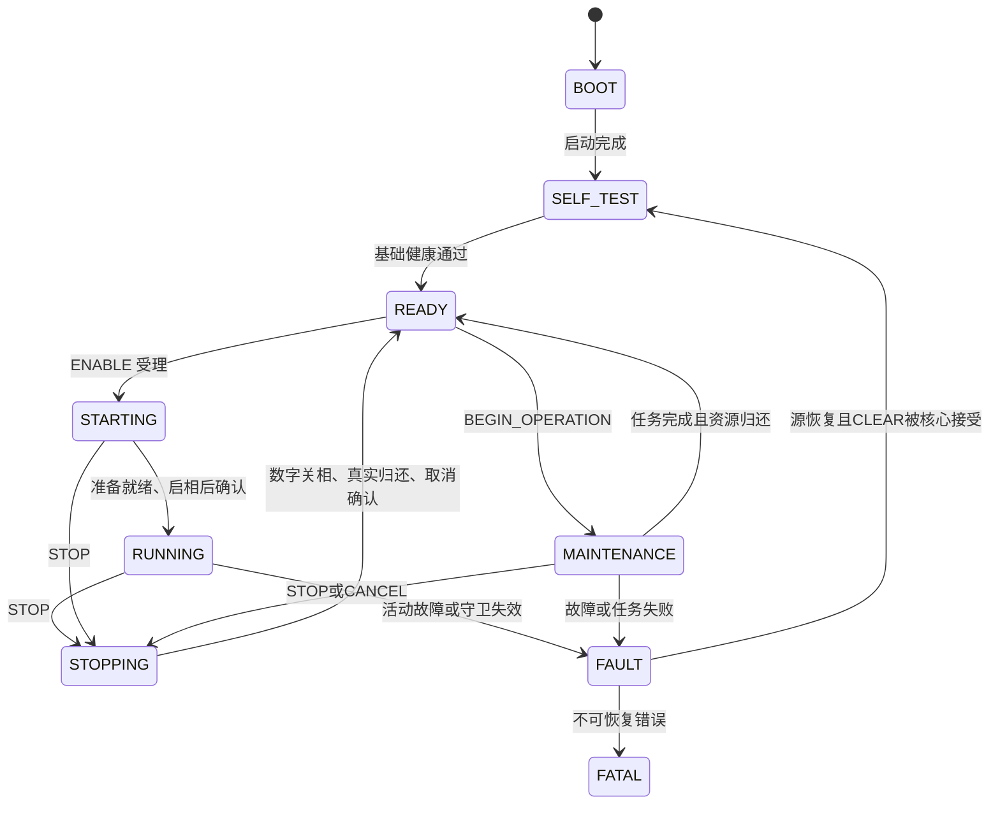

# 运行所有者功能分析与局部快照优化 v1

日期：2026-09-28。状态：功能分析与第一批优化已实施，离线特征通过；全库 PR FAIL，整包与实机验收待后续。
分支：`codex/capacity-fit`；提交基线：`abc3b45a` 加当前未提交修改。
整理期间代码与特征用例已随启动迁移提交 `95f1aa0a` 收录；本批编译源码哈希与提交后文件一致。

## 目标与基线

按用户要求认真分析 `firmware/app/foc_run_state.c` 的完整功能，再优化重复路径。
分析请求受理、生命周期事件、功率动作、维护身份、快环结果、后台借用及故障恢复。
同工作区正在进行启动链路简化，本批保留全部既有修改，不实施或回退布局方案。
源码与原测试快照保存在 `outputs/review/foc-run-state-20260928/`。

## 不变行为

- 保留公共 API、命令返回优先级、参数单位、参数/协议 ABI 和模式映射。
- 保留 20 kHz 故障关断、2 kHz 监督、前台借用及全部维护任务。
- 保留 STOP/FAULT 优先、原始 epoch、重复请求身份、取消后真实资源归还。
- CLEAR 仍先核对故障恢复，再提交核心；清错进入 SELF_TEST，不恢复旧目标。
- 保留目标受理与应用两次校验；启停功率、核心推进或 worker 状态变化后重新取证。
- 不缓存跨拍 guards，不新增可变全局，不触碰 Flash 驱动、布局或 CubeMX 文件。

## 实施边界

1. 为现有公共入口补充故障恢复与延后目标复核的特征用例，先对旧实现运行。
2. 检查 guards 依赖的生产读取函数，证明同一临界区内没有状态修改或读取副作用。
3. 清错路径仅在 FAULT 中读取一次局部 guards；故障源恢复函数只读这些依赖。
4. 使能/维护准入共享一次局部 guards 与停机配置判据；核心事件和功率动作之后仍重新读取。
5. 同条件编译、差分检查和 PR 验证；只保留有实际尺寸收益或明确执行开销收益的候选。
6. STOP/CANCEL 共用邮箱撤销：先保留同代故障，再撤销旧目标；调用方显式提供原始身份。

## 验收与证据

旧新实现均通过完整生产所有者的 native 特征用例，核对拒绝优先级、故障锁存、
清错不重启、参数限值变化后丢弃目标、STOP 撤销、取消/后台归还及原始维护身份。
执行 PR profile；既有或其他在途改动造成的失败与本批问题分开记录。
ARMCC5 对比保持编译参数一致，记录函数段、静态 RAM 与栈帧信息；整包差值需一致
链接输入成功才能报告，失败则保留原因，不把 object 或诊断链接当作发布成功的证据。
没有硬件授权；不烧录、不复位、不写设备参数、不运行电机。MCU 周期与实机栈待后续验收。

## 回退

本批补丁只涉及运行所有者、相关 native 特征用例和本文档；按本批补丁逆向恢复。
不使用 reset、clean 或整文件覆盖回退，不覆盖启动链路在途改动及原有用户修改。
功能分析与本批证据见下文。

## E 框架的设计逻辑

以 E3/E4 已落地的所有权和异步身份设计为基础，不重新实现生命周期核心。
来源见 [E3 计划](2026-09-28-internal-decoupling-e3.md)、
[集成裁决](2026-09-28-system-refactor-e-h-d.md) 和
[目录中的所有权说明](../../architecture/code_structure.md)。历史 E1 的占位条件已经由后续代码替代，
不能仅凭历史文档判断当前实现缺少维护释放或结果身份。

设计遵循“请求受理 → 当前证据 → 核心决策 → 动作执行 → 真实反馈”的闭环。
接口返回 ACCEPTED 只确认请求被登记，不等于已启相、已停机或已保存。
纯核心不接触硬件；适配器也不能把动作请求当作动作成功的证明。

| 层与所有者 | 输入/状态 | 输出与约束 |
| --- | --- | --- |
| `motor_state.c` 组合与调度 | 私有 MotorControl/FOC/PI/Encoder/Startup；快慢调度 | 显式传入终身对象；不导出内部可写指针 |
| `foc_run_state.c` 运行所有者 | 请求邮箱、生命周期、维护身份、真实 guards | 串行受理、提交模式和执行动作；拒绝迟到/陈旧结果 |
| `AppLifecycle` 纯核心 | 单事件、当前 guards、原始 epoch | 新状态、动作位和拒绝原因；FAULT/STOP 优先 |
| 模式 worker | 已准入任务与执行前 epoch | 返回周期结果；不能用消费时的当前身份重建旧结果 |
| 平台功率端口 | 启停请求 | 数字关相回读；不证明物理栅极电压 |
| 前台保存/成表 | `{epoch, kind}` 认领和独占工作资源 | 写入/发布前复核，归还后上报原身份；迟到结果不能恢复运动 |

常规启动由所有者执行功率动作。齿槽标定仍存在受 MAINTENANCE 准入约束的自管启相，
所以不能把此框架描述成“全仓只有一个函数能写 PWM”。所有者统一的是请求许可、
状态提交和结果收口；板级启动与升级最终关相还有独立的组合层职责。

图表示主要业务路径；FATAL 还可由 API 误用或 epoch 用尽从其他状态进入，只能复位退出。
标定完成后派生 SAVE 是新维护会话，不能把原标定 ticket 的终态改写为保存成功。

## 全文件功能分析

### 1. 状态与身份

`lifecycle.snapshot` 是核心状态；`MotorControl->ModeNow` 是兼容模式投影；
`ModeLast` 是上次已提交模式，用于停机清理和准备阶段判断。三者语义不同，不能合并。
STARTING 尚未完成时延迟更新 ModeLast，否则速度/位置的准备流程会被误判为已启动。

| 私有值 | 功能与失效规则 |
| --- | --- |
| `request_epoch` | 新请求创建时身份；核心推进后不再授权旧请求 |
| `operation_epoch` | 当前维护创建时身份；派生 SAVE 会获得新身份 |
| `outcome_epoch` | worker 执行前身份；接收和消费都拒绝陈旧结果 |
| `cancel_epoch` | 核心处理取消后的新身份，用于 CANCEL_DONE，不替代原任务 ticket |
| `background_claim` / `background_busy` | 唯一前台借用；STOP 后必须仍允许原借用归还 |
| `configuration_reading` | 开中断 CRC/补偿期间稳定配置借用，阻止 READY 启动和新维护 |
| `fast_sample_epoch` / `fast_samples_fresh` | 快环完成计数；每个监督拍只比较一次，不能把同拍多次 Step 当作多帧 |
| `boot_stop_ticket` | 升级停机独占；失败也不自动解锁运动，本批不修改 |

### 2. 请求和准入

`validate_control()` 只接受已 RUNNING 的同模式目标；检查所有目标字段有限、非本模式字段为零、
故障、关相、轴身份、编码器、母线与模式限值。`SubmitControl()` 复制值到单槽邮箱；
`apply_pending_control()` 在监督拍再次检查 epoch、STOP 和当前限值。两次检查解决的是不同时间点，
不能为了缩减代码删除执行前复核。

`RequestEnable()` 强制零目标或当前位置；基础 guards 依据当前模式建立，目标模式的专项校验仍由
`FocMode_Admit()` 完成。READY 表示基础自检通过，不意味着所有模式均可启动。
速度/位置进入 STARTING 后需外环 ready；Current/Vq 可同监督拍确认。公开入口仍拒绝无感请求。

`RequestMaintenance()` 映射八类维护，先清输出 ticket，再按 INVALID、FAULT、BUSY、DENIED/ACCEPTED
既有顺序受理。带来源请求保留同序号同任务重放、同序号换任务冲突和 16 位半范围陈旧判断。
查询优先保留最近终态/带来源原始终态；派生 SAVE 不覆盖标定身份。

停机配置许可要求 READY、无故障、关相、无目标/操作/借用、全部维护释放。
许可读取与实际应用必须在同一调用方临界区内；它不是以后可以写参数的凭证。

### 3. 证据与动作

`RunState_BuildGuards()` 在短临界区读取数字功率、worker 释放、感测与温度健康、
轴身份、反馈/标定、外环 ready 和请求 freshness。生产 getter 为只读状态/寄存器读取；
本板没有会自动修改此处 CCER 数字使能证据的 TIM1 BKIN 接线。

只在同一临界区且尚未改变依赖时共用局部快照。以下位置必须重新读取：

- `FocMode_Admit()` 或清理参考之后；模式/控制依赖已变。
- `AppLifecycle_Step()` 之后；epoch、维护和状态已变。
- 启相/关相、取消 worker 或归还后台之后；实际功率或资源已变。
- `request_epoch` 更新之后；旧快照的 request_fresh 不能授权新事件。

`RunState_ApplyActions()` 先取消维护、撤销请求，再按需要清控制和关相，最后处理启相。
`RunState_ConfirmStart()` 先核对 STARTING 的当前证据，执行启相后重新构造 START_DONE 的 guards。
删除第二次读取会让核心一直看到旧的“相已关”状态，这是必须保留的重复。

### 4. 监督拍顺序

`FocRunState_Tick()` 保持如下顺序：

1. 取结果、更新采样进展，处理挂起 STOP。
2. 应用 worker 的模式切换/停止/故障结果，捕获 CLEAR 请求。
3. 故障模式与指示；启动链、维护收尾、故障恢复计数、核心故障/CLEAR/轮询。
4. 故障或 FATAL 强制 Disable，然后复核并应用目标邮箱。
5. 处理停机/准备/启相/退出运行；没有本拍收尾事件才创建新维护会话。
6. 更新 ModeLast 和对外模式/故障影子。

采样 freshness 同拍共用，但完整 guards 不跨核心事件共用。目标应用前处理故障和 STOP，
维护完成后延后一拍再开新会话；这些顺序是行为约束，不是可以任意重排的代码布局。

### 5. 维护、保存和取消

ZERO/DEFAULTS/编码器/齿槽通过 worker 的 Save_Param 结果表达应用完成；相电阻/摩擦以 worker 停机表达完成。
原任务记 COMPLETED + UNCOMMITTED，随后 SAVE 创建新身份。后台保存只有验证后返回成功才记 COMMITTED；
失败进入故障，不伪装成业务成功。

齿槽自然完成可暂时处于 MAINTENANCE + Motor_Disable，以便后台成表；这不等于收到 STOP。
STOP/CANCEL 后进入 STOPPING 或 FAULT，等待编码器、齿槽、摩擦、相电阻和前台借用真实归还，
再以 cancel_epoch 确认取消。迟到保存只能归还资源，不能改当前模式或宣称旧操作已提交。

### 6. 故障恢复与快车道

20 kHz 路径检查反馈/轴身份，故障已锁存时立即撤销目标并请求关相；2 kHz 随后对齐核心状态。
`MotorFault_SourceRecovered()` 决定源恢复；所有者在同一临界区向核心提交 CLEAR，
只有被接受才清 ErrorNow。CLEAR 后 SELF_TEST，不恢复参考或自动启动。
过流恢复仍为 2000 个监督拍（1 s）；电压、温度、编码器等继续沿用原恢复矩阵。

STOP/CANCEL 撤销邮箱前必须保留同代 worker 的已入箱故障，否则核心推进 epoch 后可能丢弃该故障。
因此共享撤销辅助函数显式接收 worker_epoch：维护取消使用 operation_epoch，STOP 使用 WorkEpoch。

## 第一批优化与尺寸

保留 E 的核心、公共接口和 Tick 主流程，仅做两类局部收敛：

| 变化 | 最大重复扫描变化（仅准入/恢复判定） | 不变项 |
| --- | --- | --- |
| TryClearFault 共用局部 guards | 成功清除的恢复分支 3→1 | FAULT 前提、恢复矩阵、核心先提交后清锁存 |
| RequestEnable 共用配置与健康快照 | 2→1 | 模式专项准入和监督拍再次取证 |
| RequestMaintenance 共用释放/配置/健康快照 | 3→1 | 返回优先级、创建原始身份、准入后再次取证 |
| STOP/CANCEL 共用邮箱撤销 | 同一完整合同一处实现 | 同代故障先锁存，再撤销；不恢复旧目标 |

ARMCC5、Cortex-M4 单精度 FPU、原文件 O3 配置对比：Code **5860→5834 B（−26 B）**，
RO 32 B、RW 88 B、ZI 68 B 不变。函数段收益与对齐不同，不把逐函数差值直接当整包收益。
清错函数保存寄存器与局部栈的帧占用 **144→104 B（−40 B）**。

试验也记录了只改准入会增加 2 B；与清错及撤销共享一起采用，原因是减少同一临界区的重复扫描，
兼顾代码组织与执行开销，而不是把每个改动都描述成独立 Flash 收益。
共享撤销函数有 16 B 自身帧；STOP 路径的这段调用组合由 16→24 B，取消处增加一层 16 B 的临时调用帧。
这不是整条 ISR 栈水位结论；最坏调用链、MCU 周期和抖动仍需后续验证。

使用当前源文件编译 object 成功。尝试冻结其他对象作诊断链接时，启动迁移使现有对象同时引用
已移除的 BootHw_Confirm/GetInfo，链接失败。因此本批不报告整个 APP ROM/92 KiB 余量，
不通过补回旧启动函数或扩大分区制造成功。整包测量需等当前启动迁移收口并重建。

## 验证与后续边界

新增真实公共入口特征：电压/温度源恢复、NaN 拒绝、过流恰好 2000 拍、受理后限值变化的执行前复核、
STOP/CANCEL 保留同代已入箱故障。全部在保存的旧实现与当前实现运行通过，
连同既有请求优先级、原始维护身份、派生 SAVE、取消归还和关相失败，共输出 16 项 PASS。
没有把 getter 调用次数当作功能测试，也没有放宽检查门禁。

证据：`outputs/review/foc-run-state-20260928/` 中的源码基线、旧新 native 日志、
ARMCC 参数/object/反汇编、候选尺寸和 `function-sizes.json`。当前修改文件格式检查通过。
最终 PR 为 `codex-foc-analysis-final-20260928`，结论 FAIL：native 24 项与集成 17 个测试
全部通过，环境/工程布局/架构/卫生通过；format/lint/interfaces 失败日志与基线逐字一致，
本批 C 与测试文件无新增问题。Python 单元 39 个中 38 通过，1 个文档断链检查失败。
最终 docs 日志有 11 项，其中 10 项为既有输出断链，另 1 项来自在途 Loader 文档引用尚未存在的
`2026-09-28-loader-simplification-review-v1.md`，不属于本批文件。
摘要位于 `outputs/runs/codex-foc-analysis-final-20260928/summary.json`，记录当前 dirty 工作区，
没有硬件访问。旧新 native 日志完全一致，最终 ARMCC 编译源码与当前模块的 SHA256 一致。

后续应分开处理功能缺口与等价优化：

- 数字关相只证明六路使能位关闭；启动“非全部关闭”不证明六路均成功。完善证据属于功能增强，须单独设计。
- E 的维护角色禁止在当前启动裁剪中被改为固定 false；这是在途启动方案的行为变化，不计入本批优化。
- Tick 的 Save/Default 容错注释与当前无条件故障失能逻辑不一致，应按代码解释，不能依据旧注释恢复容错。
- 下一批优先审查事件构造/结果发布的重复完整合同；避免新增返回大结构副本或回调框架，防止栈与代码反增。
