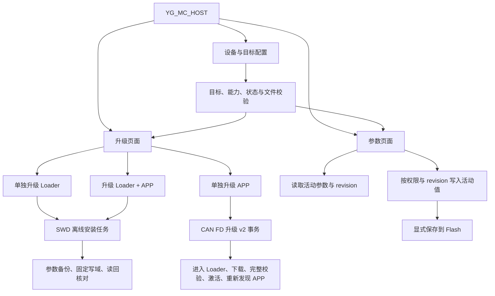
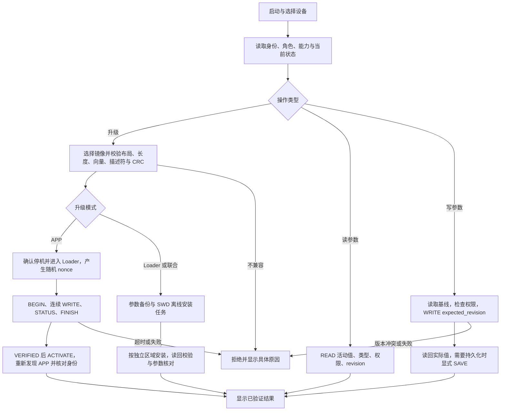

# YG_MC_HOST 升级与参数页面 v1

日期：2026-09-29。分支：codex/system-refactor；基点 ccd8d8a8。
范围：host_app 原生 Qt6/C++17 页面、离线服务与相关测试。保留现场目录整理及固件修改。
本轮先交付功能框图、程序流程图和可运行页面；设备传输执行作为明确的后续接线。
目录整理提交 83f5aae0 进入现场分支后继续交付；不混入同期固件参数所有者修改。
两张图描述最终设备业务流程，当前实现覆盖本地准备及明确标记的离线交互。

## 功能框图

## 程序流程图

## 当前实现边界与接口

当前 Loader 只允许 CAN 写 APP 槽，不能覆盖自己。Loader 单独升级与联合升级采用 SWD
离线安装任务，保持参数区和不在任务内的区域；不能借 APP 命令绕过 Loader 写域保护。
页面提供三种模式的文件选择、真实本地校验、任务导出和明确标记的演示流程。
物理执行入口暂不接线；导出任务不是烧录成功。

唯一地址、布局、schema 与 ABI 从 shared/targets/vector_mini_st_g431.json 消费，
不复制地址。APP 包采用 loader/tools/package_image.py 产生的 image.bin + manifest.bin；
主机复用 shared/image 的真实 CRC32/向量/描述符校验，拒绝旧 SHA/YI、错误目标和超限包。
Loader BIN 检查槽范围及向量；没有可信版本/布局元数据时不能声明设备兼容性或发布批准。
联合任务保留独立 Loader/APP 写域，不生成包含参数区的全片覆盖镜像。

参数页面按当前 120/121/122 标量契约准备：READ 活动值、WRITE expected_revision、
读回确认、显式异步 SAVE。活动写入与掉电保存分别呈现；ACCEPTED 不等于完成。
当前可交互读写来自单一所有者的离线参数模型，全部标记演示；不会填造设备数据。
真实参数权限以 READ access 为准，SN、未支持项和标定所有者字段不开放通用写入。

页面位于 host_app/gui；业务与校验位于 host_app/services；载荷适配位于 host_app/protocol。
GUI 不访问 DLL、Flash、探针或原始设备句柄；共享纯 C 核心独立链接，无 firmware 依赖。
界面展示目标配置，不把配置常量当已识别设备。所有日志、任务、截图和二进制归 outputs。

## 验证与回退

先检查当前真实调用者及契约，再运行直接相关的服务/GUI 离线检查和根 format/lint/PR profile。
验证覆盖错包、超限、保留参数写域、参数类型/权限/revision、高位 u32、受理与持久化分离。
GUI 检查三模式、路径失效、参数编辑、演示取消和截图；不连接硬件或执行供应商认证。
现场其他 WIP 如造成检查失败，按日志区分来源，不改其检查规则或用历史产物冒充通过。
回退仅撤回本批 host_app/专属文档文件，不 reset/clean 现场树。

## 页面阶段交付记录

原生三模式页面与参数页已完成本轮接线范围。APP 校验直接消费共享 C 校验器；
任务包含已冻结的镜像、目标快照及内容哈希。参数模型保持单一状态所有者；回复解释器
拒绝 WRITE 类型不符、伪造受理值与非法字段。保存等待期间 READ 不恢复写入按钮。
布局使用可滚动内容区，Windows 字体检查中按钮、路径、结果和参数文字均可辨认。

2026-09-29 当前证据：

- Qt 6.8.3 / MinGW 13.1 独立配置及构建通过；生成 YG_MC_HOST.exe。
- host_maintenance_offline：1/1 PASS，包含三模式共享校验、任务导出/重校验、CRC 损坏、
  参数黄金字节、高位 u32、权限/revision 拒绝、保存失败/完成及 GUI 操作门禁。
- 根 PR profile：doctor、format、lint、项目布局、测试、架构、接口、文档和卫生检查全 PASS；
  证据 outputs/runs/host-maintenance-v1-20260929/summary.json。现场树含其他所有者 WIP，
  此结果只证明本次离线检查通过，不是干净发布或固件放行。
- outputs/host_app/dist_v1 收集匹配 Qt 插件及编译器运行库；去掉开发工具链 PATH 后，
  打包程序保存 Windows 页面预览并以 0 退出。部署工具缺少可选翻译目录和 DXC 的警告
  不影响本轮 Widgets 页面启动；未据此声明其他 Qt 功能可用。
- Windows 实际字体截图位于 outputs/host_app/preview-windows；offscreen 仅用于自动测试。
  本轮未访问设备，未烧录、复位或操作电机。

完整入口、构建与功能边界见 [host_app 使用说明](../../../host_app/README.md)。
设备通信执行、实际参数权限读取、升级身份核对及 SWD 参数备份/读回仍待设备后端阶段。
