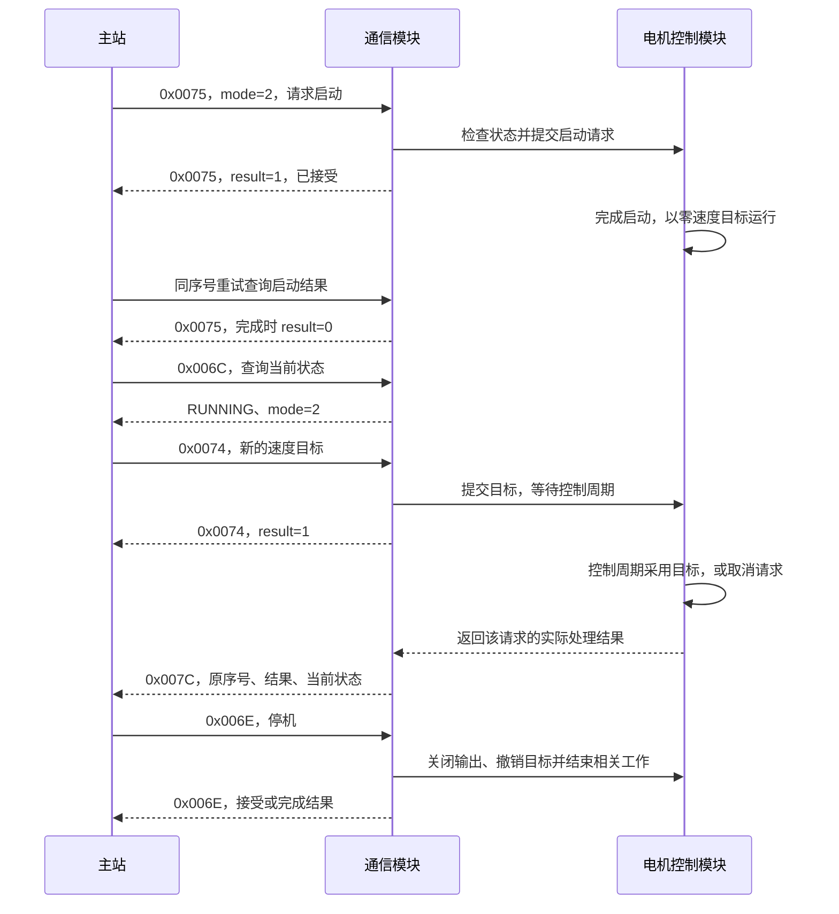
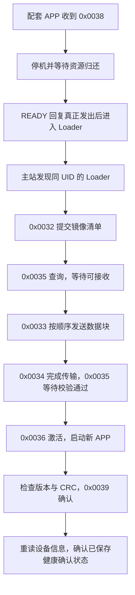
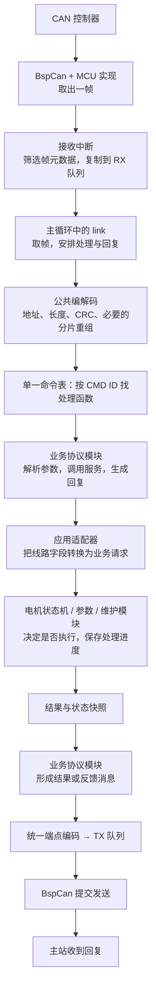

# yg_protocol 通信协议与软件设计

核对日期：2026-10-29。适用分支：`the-system-refactor`，包含当前工作树中的 CAN/BSP 重构与正式开环扩展。
本文描述当前源码的通信行为，供固件、主站和测试人员共同使用。文档日期不表示设备已烧录或完成验收。
所有 **CMD ID 均用十六进制**；长度以字节（B）计，除非特别说明，表中的请求和回复长度均只指业务数据 payload。

本文是通信设计的主阅读入口。逐字段测试向量和专题说明列在第 10 节；旧总览与旧提案在归档目录，不作为当前实现依据。

本轮软件简化按[通信框架简化设计与实施顺序](yg_protocol_simplification_design_v1.md)实施：
统一接收队列、单一命令注册表、统一回复与发送队列；实施与验证状态见设计文档第 9 节。

## 1. 这套协议解决什么问题

主站通过同一套消息完成设备识别、电机启停、目标更新、状态读取、参数读写、标定和固件升级。
通信模块把收到的字节转换为请求，由对应模块决定是否执行，再把结果发回主站。

当前实际使用 CAN FD，主站地址为 `0x02`。电机使用设备当前配置的 Node ID；
公司多轴编号为 `0x03～0x07`，示例统一使用 `0x03`。不能把测试文件里曾使用的 `0x01` 当作设备默认地址。

| 项目 | 当前情况 |
| --- | --- |
| 物理通信 | 29 位扩展 CAN FD 数据帧，开启 BRS；仲裁段 1 Mbit/s，数据段 5 Mbit/s |
| 应用格式 | 公司统一应用头、业务数据、应用 CRC；APP 和 Loader 共用编解码代码 |
| 对外公布的电机能力 | 速度、纯电压开环、电流闭环角度开环：启动、同模式目标更新、停机和反馈 |
| 已有候选入口 | 电流、位置、q 轴电压控制；源码有接线，能力页尚未公布 |
| 维护功能 | 编码器 LUT、电角零位、机械零位、保存、恢复默认值 |
| 硬件适配 | STM32G4 与 AT32F456 共用 BspCan 接口；具体构建可禁用 CAN |
| 升级 | 已有 G431 配套 Loader/APP 方案；不能据此推定 AT32 已具备同样的升级能力 |
| 尚未接入 | 五轴同步命令、每轴固定 1 kHz 反馈、RS485、以太网、MIT 控制、低侧制动 |

能力页当前返回 `features=0x00001D00`、`supported_modes=0x0604`，公布 mode 2 速度控制和 mode 9/10 开环控制。
开环请求布局见[扩展v0.3](yg_protocol_simplification_design_v1.md#正式开环控制扩展-v03-2026-10-29)。
主站应先查询身份和能力，再决定允许哪些操作。能力位表示固件声明支持，不等同于本次设备测试已经通过。

## 2. 一条 CAN FD 帧怎样组成

### 2.1 从物理帧到业务消息

```text
CAN FD 帧（由 CAN 控制器收发）
┌──────────────┬──────────────────────────────┬───────────────────┐
│ 29 位 CAN ID │ 数据区，最多 64 B             │ 硬件 CRC、ACK 等  │
└──────────────┴──────────────────────────────┴───────────────────┘
                       数据区内部
┌──────────────┬───────────────┬──────────────┬─────────────────┐
│ 公司应用头16B │ payload 0～46B│ 应用CRC16 2B │ 按DLC需要补零   │
└──────────────┴───────────────┴──────────────┴─────────────────┘
```

CAN ID 说明发送方、接收方和优先级；应用头中的 CMD ID 说明要执行哪条命令。
它们用途不同。硬件 CRC 由 CAN 控制器生成，应用 CRC 由协议代码计算，两者都保留。
29 位 CAN ID 不占数据区字节。

### 2.2 CAN ID 分配

| 位 | 字段 | 当前含义 |
| --- | --- | --- |
| 28～26 | priority，3 bit | 优先级，取值 0～7；数值较小优先 |
| 25 | R | 固定 0 |
| 24 | DP | 固定 0 |
| 23～16 | PF | 固定 `0xEF`，表示本项目使用的消息通道，不是 CMD ID |
| 15～8 | dst | 接收节点 |
| 7～0 | src | 发送节点 |

```c
can_id = (priority << 26) | (0xEFu << 16) | (dst << 8) | src;
```

这是 J1939 风格的 ID 分配，不代表实现了完整 J1939 服务。
主站 `0x02` 发给电机 `0x03`，优先级 2 时 ID 为 `0x08EF0302`。
应用头中的 src/dst 必须与 CAN ID 一致。广播地址 `0xFF` 已保留，但当前控制、参数、维护和升级请求按单播处理，不能用广播启动所有电机。

### 2.3 公司应用头

| 数据区偏移 | 字段 | 类型 | 含义 |
| ---: | --- | --- | --- |
| 0～1 | magic | u16 | 固定 `0xA55A`，线上字节为 `5A A5` |
| 2 | version | u8 | 当前 `0x01` |
| 3 | flags | u8 | 请求、回复、重试及分片标志 |
| 4 | src | u8 | 发送节点 |
| 5 | dst | u8 | 接收节点 |
| 6～7 | CMD ID / type | u16 | 命令编号；两种名称指同一个字段 |
| 8～9 | sequence | u16 | 单帧请求序号；分片时用作片序 |
| 10～13 | payload_len | u32 | 本帧业务数据长度，不包含头、CRC 和补零 |
| 14 | reserved | u8 | 当前请求必须为 0 |
| 15 | header_crc8 | u8 | 校验前 15 字节 |
| 16 起 | payload | bytes | 命令参数或结果 |
| 16 + payload_len | frame_crc16 | u16 | 校验完整应用头与 payload |

应用头和普通业务整数均为**小端序**。唯一需要单独处理的是升级镜像的 96 B 清单/描述符，它按其容器定义使用大端。
按字段编码，不直接发送 C 结构体内存；结构体的填充、枚举值和指针对端都不能使用。

| flags 位 | 含义 |
| --- | --- |
| 7～6 | `00` 单帧、`01` 首片、`10` 中片、`11` 尾片 |
| 5 | 请求业务回复 |
| 4 | 本帧是回复 |
| 2 | 重试 |
| 3、1～0 | 当前普通请求不用，保持 0 |

普通请求 `flags=0x20`，重试 `0x24`，回复 `0x10`。
回复交换 src/dst，并使用原请求的 CMD ID 和 sequence。控制反馈使用独立的 `0x007C`，
通过 payload 中的 `correlated_seq` 对应原控制请求。

### 2.4 CRC 和 DLC

| 校验 | 参数 | 覆盖范围 |
| --- | --- | --- |
| CRC8 | poly=`0x9B`，init=0，xorout=0，不反射 | 数据区偏移 0～14 |
| CRC16 | poly=`0xBAAD`，init=`0xFFFF`，xorout=0，不反射 | 16 B 应用头加 payload；结果小端写入 |

先填好应用头并计算 CRC8，再计算 CRC16。之后补零到能装下整条应用帧的最小 CAN FD 长度。
接收端也会检查这些补零字节，不接受多余的非零数据。

| payload 长度 | 应用帧总长 | CAN FD 数据区长度 | DLC 编码 |
| ---: | ---: | ---: | ---: |
| 0 | 18 | 20 | 11 |
| 4 | 22 | 24 | 12 |
| 12 | 30 | 32 | 13 |
| 20 | 38 | 48 | 14 |
| 32 | 50 | 64 | 15 |
| 45 | 63 | 64 | 15 |
| 46 | 64 | 64 | 15 |

DLC 是长度编码，不是字节数。补零不计入 payload_len，也不参加应用 CRC。

## 3. 当前命令清单与回复规则

### 3.1 完整 CMD ID 清单

共 24 个现行命令/反馈编号，分别由 APP 或 Loader 处理；并非每种固件都同时开放全部命令。

| CMD ID | 名称 | 负责什么 | 请求 → 回复 | 如何判断结果 |
| --- | --- | --- | --- | --- |
| `0x0001` | GET_INFO | 读取设备身份、角色、版本及镜像信息 | 12 B 页查询 → 32 B | 按页读取，无统一 result 前缀 |
| `0x0002` | GET_CAPS | 读取允许主站使用的功能 | 12 B 页查询 → 16 B | 当前只支持第 0 页，公布速度和两种开环控制 |
| `0x0003` | GET_DEVICE_STATUS | 保留 APP 启动身份查询接口 | 空 → 16 B | 当前 result=6，启动编号无效；它不是心跳 |
| `0x0032` | UPDATE_BEGIN | Loader 开始一次升级 | 104 B → 40 B | 接受后查询擦除和接收阶段 |
| `0x0033` | UPDATE_WRITE | Loader 写入一块镜像 | 18 + 数据长度 → 40 B | 检查 result 和 next_offset |
| `0x0034` | UPDATE_FINISH | Loader 校验整份镜像 | 12 B → 40 B | 查询直到 VERIFIED 或 ERROR |
| `0x0035` | UPDATE_STATUS | 发现 Loader 或查询升级进度 | 空或 12 B → 40 B | 查看 phase、next_offset、错误 |
| `0x0036` | UPDATE_ACTIVATE | 激活已校验镜像 | 12 B → 40 B | 回复发送完成后激活；还需确认新 APP |
| `0x0037` | UPDATE_ABORT | 放弃当前升级 | 12 B → 40 B | 检查回复阶段；不保证旧镜像仍可启动 |
| `0x0038` | ENTER_LOADER | 配套 APP 停机并进入 Loader | 8 B → 4 B | READY 后重新发现同 UID 的 Loader |
| `0x0039` | APP_CONFIRM | 确认新 APP 运行正常 | 8 B → 4 B | 成功后重读身份，确认已保存确认状态 |
| `0x0065` | SET_ENABLE | 关闭输出，保留制动编号 | 4 B → 4 B | enable=0 停机；enable=1 当前不支持 |
| `0x006B` | CLEAR_FAULT | 清除原因已经排除的故障 | 空 → 4 B | 满足恢复条件才成功；成功不启动电机 |
| `0x006C` | GET_MOTOR_STATE | 查询当前电机状态 | 空 → 45 B | result、valid_bits 和各测量值共同判断 |
| `0x006E` | MOTOR_STOP | 停机、关闭输出并撤销目标 | 空 → 4 B | 请求被接受与输出已关闭需区分；均不代表转子停稳 |
| `0x0074` | SET_CONTROL | 更新运行中电机的目标 | 旧模式20 B、开环32 B → 4 B，另发 45 B 反馈 | 回复说明接受/拒绝，反馈说明实际处理结果 |
| `0x0075` | START_CONTROL | 按指定方式开始控制 | 4 B → 4 B | 同序号重试查启动结果，再查询运行状态 |
| `0x0078` | READ_PARAM | 读取当前使用的参数 | 4 B → 成功 16 B，失败 4 B | 返回数值、类型、权限及活动版本号 |
| `0x0079` | WRITE_PARAM | 修改当前使用的参数 | 12 B → 完成 16 B，其余 4 B | 返回实际值和新版本；不会自动保存到 Flash |
| `0x007A` | SAVE_PARAM | 将参数保存到 Flash | 4 B → 接受/完成 8 B，失败可 4 B | 完成且 persisted_revision 对应后才算保存 |
| `0x007C` | MOTOR_FEEDBACK | 回报控制命令结果和电机状态 | 设备发送 45 B，主站不回复 | correlated_seq 对应原 `0x0074` |
| `0x00A0` | CALIBRATION_START | 开始一项标定或维护任务 | 4 B → 12 B | 取得 ticket 后查询进度 |
| `0x00A1` | CALIBRATION_STATUS | 查询指定任务 | 4 B → 12 B | 查询成功不等于任务成功，需检查 phase |
| `0x00A2` | CALIBRATION_CANCEL | 取消指定任务 | 4 B → 12 B | 收到请求后仍需等任务实际结束 |

`0x0032～0x0037` 由 Loader 处理；`0x0038/0x0039` 仅由配套 LoaderApp 开放。
其余 APP 命令以实际注册和能力为准。未知 CMD ID、错误地址、CRC 错误或无法识别的报文可能没有业务回复。

### 3.2 回复表示什么

普通动作的 4 B 回复为 `result:u16 + detail:u16`。其他命令可能在它之后附加值、版本或任务编号；
GET_INFO、GET_CAPS 是固定页面，没有这两个前缀字段。

| result | 含义 |
| ---: | --- |
| 0 | 这条命令规定的处理已完成；查询成功不代表被查询的任务已完成 |
| 1 | 请求已接受，还要等待控制周期或后台任务 |
| 2 | 不支持 |
| 3 | 长度错误 |
| 4 | 字段、序号或版本冲突；由 detail 进一步说明 |
| 5 | 当前状态不允许 |
| 6 | 忙或数据暂不可用 |
| 7 | 请求来源未获允许 |
| 8 | 内部处理失败 |
| 11 | 数值超范围 |
| 17 | 故障尚未解除 |

主站至少要区分三个时刻：**设备接受请求、设备完成处理、电机实际达到目标**。
CAN 硬件 ACK 只证明总线上有接收节点，不代表目标设备接受了这条业务命令。

新请求使用递增序号；同一请求重试保留序号和业务数据，设置 retry 标志并重新计算 CRC。
不能用同一个序号发送不同的目标值。当前控制历史保留 32 槽，不能把它当作无限重试缓存；
已超出窗口的旧请求会被拒绝。重试次数和等待时间由主站按业务设置，固件没有一个适用于所有命令的“统一 1 秒超时”。

## 4. 电机控制与状态反馈

### 4.1 启动和更新目标

START_CONTROL 的 payload 为 `mode:u8 + reserved[3]=0`。
它只选择控制方式，不携带运动目标。设备接受启动后使用下表的初始目标。

| mode | 控制方式 | 初始目标 | 当前能力 |
| ---: | --- | --- | --- |
| 1 | q 轴电流 | 0 mA | 候选 |
| 2 | 速度 | 0 mrad/s | 已公布 |
| 3 | 位置 | 启动时的当前位置 | 候选 |
| 6 | q 轴电压 | 0 mV | 候选 |
| 9 | 纯电压开环 | Vd/Vq和电角频率均为0 | 已公布 |
| 10 | 电流闭环、角度开环 | Id/Iq和电角频率均为0 | 已公布 |

mode 0、4、5 不作为普通启动模式。线路 mode 编号与内部枚举不同，适配器逐项转换。

旧模式SET_CONTROL保持20 B；mode9/10使用32 B，追加电角频率、Id和Vd，
完整布局及限值见[开环扩展v0.3](yg_protocol_simplification_design_v1.md#正式开环控制扩展-v03-2026-10-29)。
以下为旧模式20 B布局：

| 偏移 | 字段 | 类型 / 单位 |
| ---: | --- | --- |
| 0 | mode | u8，必须与当前运行的控制方式一致 |
| 1 | flags | u8，固定 0 |
| 2～3 | reserved | u16，固定 0 |
| 4～7 | position_mrad | i32，0.001 rad |
| 8～11 | speed_mrad_s | i32，0.001 rad/s |
| 12～15 | iq_mA | i32，mA |
| 16～19 | v_q_mV | i32，mV |

只填写当前模式对应的目标，其他三个目标字段为 0。
例如速度模式填写 speed_mrad_s，不能同时把位置、电流或电压字段用作前馈参数。

只发 SET_CONTROL 不会启动电机，也不会改变控制方式。
从速度控制改为位置控制，需要先 STOP，确认停止处理完成并回到 IDLE，再以位置方式 START。
CLEAR_FAULT 仅清除满足恢复条件的故障，也不会恢复上一次目标。

### 4.2 速度控制的消息流程



图中 result=1 是典型异步路径；状态、字段或范围不符合要求时会直接拒绝。
第一次接受的控制目标，等实际控制周期给出结果后发送一次延迟反馈：
已采用为 0，STOP 撤销为 5，故障为 17，应用前复核越限为 11。
等待该结果期间，新目标返回 BUSY；STOP/CLEAR 仍可处理。
重试会返回已有处理记录，不再次执行目标；反馈所带测量值是当前快照，不是历史采样的重放。

### 4.3 45 B 电机状态

GET_MOTOR_STATE 和 MOTOR_FEEDBACK 共用下列 payload。
前者 correlated_seq 固定为 0；后者填写对应 SET_CONTROL 的请求序号。
45 B payload 加头和 CRC 为 63 B，补零为一帧 64 B CAN FD。

| 偏移 | 字段 | 类型 / 单位 |
| ---: | --- | --- |
| 0 | result | u16，查询或关联控制的结果 |
| 2 | correlated_seq | u16，对应控制请求 |
| 4 | fault_code | u32，协议故障位图 |
| 8 / 12 | reference_position / actual_position | 各 i32，mrad |
| 16 / 20 | reference_speed / actual_speed | 各 i32，mrad/s |
| 24 | valid_bits | u16，测量字段有效标志 |
| 26 | bus_voltage | i16，0.01 V |
| 28 | bus_current | i16，mA |
| 30 / 32 | reference_iq / actual_iq | 各 i16，mA |
| 34 / 36 | mcu_temperature / motor_temperature | 各 i16，0.01 °C |
| 38 / 40 | v_q / v_d | 各 i16，mV |
| 42 | node_id | u8 |
| 43 | motor_state | u8 |
| 44 | control_mode | u8 |

valid_bits 的 bit 0～11 依次对应：参考位置、实际位置、参考速度、实际速度、母线电压、母线电流、
参考 Iq、实际 Iq、MCU 温度、电机温度、Vq、Vd；高四位为 0。
无测量来源、不可用或缩放越界时，对应位清零，数值写入该整数类型的最小值。
**不能把无效温度当成 0 °C，也不能用 MCU 温度充当电机温度。**

当前电机温度、Vq、Vd 没有真实测量来源，保持无效。母线电流依板卡能力使用实测或已有估算，
不能仅凭相同字段名称认定两板都有电流传感器。Iq 是转矩电流，单位为 A 的缩放值，不是 N·m 转矩。

fault_code 由适配器转换，不能直接当成固件内部故障枚举。当前映射如下：

| 位 | 报告内容 |
| ---: | --- |
| 0 / 1 / 2 | 过流 / 过压 / 欠压 |
| 4 | MCU 温度过高 |
| 5 / 6 | 编码器故障 / CAN 连接故障 |
| 9 | 参数、极对数或编码器标定资格异常 |
| 12 | 温度传感器故障或其他未单列故障 |
| 14 | 电流零偏故障；保留历史齿槽标定故障的转换 |
| 15 | 保留历史电阻、电感或摩擦故障的转换 |

映射保留旧故障类型，不表示相关维护命令仍可执行；当前快照由内部单一故障码映射，不能据此承诺同时报告全部故障源。

线路状态值：INIT=3、IDLE=5、STARTING=2、RUNNING=6、STOPPING=7、FAULT=8、FATAL=9。
维护任务会投影为 4 或 5，因此看到状态 5 不能单独证明维护完成，还要查询任务 ticket。
详细映射见[状态与恢复](yg_protocol_motor_state_v1_2.md)。

当前全量反馈的速度为 **i32**、Iq 为 **i16**。早期讨论的“位置 i32 + 速度 i16 + 电流 i16”
紧凑反馈属于已归档的多轴方案，不能用于解码当前 45 B 状态。

### 4.4 可直接拆解的速度示例

示例地址：主站 `0x02`、电机 `0x03`。它说明字节编码，不跳过设备身份、启动条件和运行状态检查。

**请求启动速度控制**：CMD `0x0075`，seq=`0x1001`，mode=2。
CAN ID=`0x08EF0302`，IDE=1、FDF=1、BRS=1，DLC=12（24 B）。

```text
5A A5 01 20 02 03 75 00 01 10 04 00 00 00 00 D6
02 00 00 00 A0 DC 00 00
```

**更新速度为约 30 rpm**：换算为 π rad/s，按 0.001 rad/s 取整为 3142，即 `0x00000C46`。
CMD `0x0074`，seq=`0x1002`；CAN ID 同上，DLC=14（48 B）。

```text
5A A5 01 20 02 03 74 00 02 10 14 00 00 00 00 68
02 00 00 00 00 00 00 00 46 0C 00 00 00 00 00 00
00 00 00 00 81 2F 00 00 00 00 00 00 00 00 00 00
```

前 16 B 是头；第 16 字节是 mode=2；偏移 24～27 是速度值；
偏移 36～37 为 CRC16 `0x2F81`，之后十字节均为补零。

**已接受回复**：CMD 和 seq 与请求相同，result=1、detail=0。
CAN ID=`0x0CEF0203`（设备以优先级 3 回复），DLC=12（24 B）。

```text
5A A5 01 10 03 02 74 00 02 10 04 00 00 00 00 2E
01 00 00 00 0A 95 00 00
```

后续 `0x007C` 的 correlated_seq 应为 `0x1002`。实际位置、速度、电流来自设备，不能预填为目标值来表示成功。

## 5. 参数、设备发现与维护

### 5.1 先认设备，再发控制

GET_INFO / GET_CAPS 的请求都是 12 B：
`session_id:u32, request_id:u32, page:u16, reserved=0:u16`。
保留页查询格式不表示建立电机运行会话；不要据此增加租约或续租步骤。

GET_INFO 支持第 0～2 页，每页回复 32 B：
第 0 页是 UID、产品、硬件及 APP/Loader 版本；
第 1 页是 SN、电机类型、节点、APP/Loader 角色、镜像 CRC 和确认状态；
第 2 页是 MCU、布局、参数 ABI 与存储容量。
GET_CAPS 仅支持第 0 页，回复 16 B，含功能位、模式位、帧长与能力边界。

当前 GET_DEVICE_STATUS 返回 result=6、epoch_valid=0、boot_epoch=0。
读取 APP/Loader 角色和镜像确认状态应使用 GET_INFO 第 1 页。
不能把 0 当成有效启动次数，也不能用它作为升级事务的身份。

### 5.2 读参数、改参数、保存是三步

| 命令 | 请求布局 |
| --- | --- |
| `0x0078` READ_PARAM | `id:u8, reserved[3]=0`，4 B |
| `0x0079` WRITE_PARAM | `id:u8, value_type:u8, value_len=4:u8, reserved=0:u8, expected_revision:u32, value[4]`，12 B |
| `0x007A` SAVE_PARAM | `expected_revision:u32`，4 B |

参数 ID 为 **u8**，不是 CMD ID。value_type=1 表示 i32，2 表示 u32。
先 READ 取得当前值和 revision，再 WRITE 携带该 revision；需要掉电保存时再发 SAVE。
revision 是活动参数版本，和 Flash 存储格式的 schema 版本不是一回事。

READ 成功和 WRITE 完成的 16 B 回复：
`result:u16, detail:u16, id:u8, value_type:u8, value_len:u8, access:u8, revision:u32, value[4]`。
WRITE 完成时 access 字节为 0；READ 的 access bit0 表示可读、bit1 当前可写、bit2 标定写入。
SAVE 的 8 B 回复为 `result:u16, detail:u16, persisted_revision:u32`；
只有 Flash 实际写入并读回核对后才报告完成。

常用参数：`0x01` 速度上限、`0x02` 电流上限、`0x03` 节点号（只读）、
`0x15～0x17` 位置控制设置、`0x40～0x46` 标定数据、
`0x4D～0x51` 配置确认和启动条件诊断、`0x60～0x66` 热保护、
`0x68～0x6C` 速度前馈。
完整参数、倍率和权限使用[参数目录](yg_protocol_parameter_catalog_v0_1.md)，不再维护第二份独立编号表。

参数错误 detail：1 不支持的 ID、2 只读、3 revision 冲突、4 保存失败、5 状态不允许、
6 字段错误、7 旧序号、8 同序号不同内容。它必须与 result 一起解释。

### 5.3 一次只启动一项维护

START 请求为 `kind:u16, reserved=0:u16`；
STATUS/CANCEL 请求为非零 `ticket:u32`，均为 4 B。

| kind | 工作 |
| ---: | --- |
| 1 | 编码器 LUT 标定 |
| 2 | 电角零位标定 |
| 6 | 机械零位 |
| 7 | 保存维护结果 |
| 8 | 恢复默认值 |

kind 3、4、5 已退役，分别是齿槽、相电阻和摩擦任务；不支持且不复用编号。
每项任务检查自己的启动条件，不会自动替用户补做其他标定。

12 B 回复为 `result:u16, detail:u16, ticket:u32, kind:u16, phase:u8, effects:u8`。
phase：0 无任务、1 执行中、2 完成、3 已请求取消、4 已取消、5 失败。
effects：0 未知、1 结果尚未确认保存、2 已确认提交。

主站保存 START 返回的 ticket，之后只查询或取消这项任务。
查询 result=0 只表示查到了任务；phase=5 仍是任务失败。
标定完成不等于结果已保存，取消请求被接受也不等于设备已归还工作区。

## 6. 固件升级流程

APP 处理“进入 Loader”和“确认新 APP”；Loader 处理擦除、写入、整包检查和激活。
升级复用公司应用帧。96 B 镜像清单作为 payload 中的原始容器传输，其大端格式单独保留。



| CMD ID | 请求 payload |
| --- | --- |
| `0x0032` | `nonce:u64 + manifest[96]`，104 B |
| `0x0033` | `nonce:u64 + session:u32 + offset:u32 + length:u16 + data` |
| `0x0034/0x0036/0x0037` | `nonce:u64 + session:u32`，12 B |
| `0x0035` | 空请求用于发现；12 B nonce/session 用于查询当前升级 |
| `0x0038` | 主站生成的非零 nonce，8 B |
| `0x0039` | `application_version:u32 + image_crc32:u32`，8 B |

nonce 是主站为本次升级生成的随机事务号，不是设备启动次数。
session 是 Loader 分配的升级编号，不是电机运行会话。
WRITE 数据块为 8～128 B，offset 和 length 均按 8 B 对齐，主站每次只保持一个完整逻辑请求在途。
BEGIN 和较大的 WRITE 需要分片；每块必须实际写入并核对，才能推进 next_offset。

`0x0032～0x0037` 统一回复 40 B：
`result:u16, detail:u16, nonce:u64, session:u32, phase:u8, flags:u8,
max_block_bytes:u16, next_offset:u32, image_bytes:u32, image_token:u32, image_version:u32, image_role:u32`。
phase=0～7 依次为 IDLE、READY、ERASING、RECEIVING、VERIFYING、VERIFIED、COMMITTED、ERROR。
收到“已接受”或“激活回复”都不能直接宣布新固件启动成功。

当前 G431 方案是单槽 CRC32 升级，没有旧 APP 自动回滚、跨复位续传或签名认证。
普通独立 APP 不提供配套 LoaderApp 的升级交接能力；AT32 CAN 接入也不等于升级产品已移植。
布局、镜像和掉电后的行为以[升级协议 v3](yg_protocol_upgrade_wire_v3.md)及实际目标配置为准。

## 7. 软件怎样组织，怎样与硬件解耦

### 7.1 数据从哪里进入，在哪里执行



通信代码不计算电机控制算法，也不直接打开 PWM。
电机状态机负责启停和故障处理；参数模块负责版本及保存；维护模块负责任务进度和工作区。
长操作不会在 CAN 接收中断里等待完成。

处理函数默认立即回复；扩展命令可用内部 `reply_ready=false` 推迟回复，完成后仍走统一发送入口。
TX 队列满时保留已生成的回复，只重试入队，不重新执行命令。现有电机命令的回复与反馈规则不变。
CAN FD 使用完整帧和硬件发送槽，不增加逐字节解包或 DMA 状态机。

### 7.2 文件与接口关系

| 文件/目录 | 职责 | 交给下一层的内容 |
| --- | --- | --- |
| `shared/protocol/` | CAN ID、公司头、CRC、分片和升级字段的纯编解码，APP/Loader 共用 | 消息字段或字节，不访问外设 |
| `communication/can/yg_protocol_canfd.c` | 固定容量帧队列、CAN FD 元数据、DLC、补零、地址一致性、收发转换 | 完整帧和消息 |
| `communication/can/yg_protocol_endpoint.c` | 命令注册、解包、重组、命令执行和响应编码 | 完整请求及待发送帧 |
| `communication/can/yg_protocol_link.c` | 启动与中断入口、前台调度、唯一命令表、升级回复的实际发送跟踪 | 调用端点和业务模块接口 |
| `communication/commands/yg_protocol_motor.c` | 电机命令处理、32 条控制重试记录、请求完成关联和待发反馈 | 调用电机服务，生成结果或反馈消息 |
| `communication/commands/yg_protocol_readonly.c` | 身份、能力、维护页和设备状态查询 | 查询回复内容 |
| `communication/commands/yg_protocol_parameter/job/boot.c` | 各自解析命令、检查请求、调用绑定服务、构造回复；boot 保存待确认的升级票据 | 普通 C 值请求及结果 |
| `app/composition/yg_protocol_owner_adapter.c` | 线路模式/参数/维护种类转换，调用业务模块 | 状态机请求、参数事务、维护请求 |
| `app/composition/yg_protocol_status_adapter.c` | 采集业务状态并映射故障、模式和有效标志 | 供通信编码的快照 |
| `app/composition/app_startup.c` | 初始化、绑定服务；前台先刷新状态再处理通信 | 显式装配关系 |
| `platform/bsp/include/bsp_can.h` | 对上统一 CAN 接口与 BspCanFrame | 不暴露 HAL、寄存器和厂商句柄 |
| `platform/bsp/bsp_can.c` | 共用发送跟踪编号、超时、完成消费和恢复协调 | 调用 BSP 内部 MCU 接口 |
| `platform/bsp/mcu/*/can_backend.c` | STM32G4 或 AT32F456 的控制器、FIFO、IRQ、完成位和恢复 | 硬件操作结果 |

各业务模块只接收消息和服务接口，不访问 CAN 控制器或 RX/TX 队列。
`link` 在初始化时分别准备业务上下文，并把“CMD ID、处理函数、上下文”登记到同一张表中。
新增命令通常只需修改所属业务模块和这张表，编解码、队列和 BSP 不需要跟着改。

控制请求的重试记录和待发反馈属于电机协议模块；电机实际运行状态仍由电机状态机拥有。
普通回复由 `endpoint` 保留到成功入队；主动反馈通过发送回调进入同一个端点。
升级模块保存票据，`link` 记录对应的发送队列位置，等硬件报告发送结果后再通知升级模块。

当前协议主体为 **30 个 C/头文件**：CAN 流程 6 个、业务命令 13 个、共用协议 11 个；另有 4 个应用适配文件。
`shared/protocol/yg_protocol_common.h` 集中消息类型、字节读写、请求检查和公共结果写入。
`commands/yg_protocol_service.h` 保留 APP 业务结果和主站权限配置，公共协议不依赖它。
原业务 `protocol/` 目录已改名为 `commands/`，三个旧公共头已删除。
命令注册函数位于 endpoint；Runtime 和接收中断函数位于 link，旧的独立文件已删除。

表中路径均相对 `firmware/`，只有 `shared/protocol/` 位于仓库根目录。
截至本次核对，软件发送跟踪状态已由共用 `bsp_can.c` 持有，不再分别放在两板实现中。

关键接口可以按“谁拥有数据”来理解：

| 接口 | 调用方得到什么 / 需要保证什么 |
| --- | --- |
| `BspCan_Receive(frame)` | 成功得到完整帧副本；失败不修改输出缓冲 |
| `BspCan_TrySendFrame(frame)` | 非阻塞提交；false 时通信层保留待发帧，true 只代表提交 |
| `BspCan_TrySendTrackedFrame / TakeTxCompletion` | 用完整 64 位编号跟踪具体帧的硬件发送结果；用于必须先回复再复位的流程 |
| `yg_protocol_commands_register` | 初始化时登记静态命令表；重复 CMD ID 拒绝注册 |
| `yg_protocol_endpoint_send` | 编码并复制到统一 TX 队列；队列满则调用方保留结果，稍后重试 |
| `YgProtocolLink_Bind*Service` | 应用启动时绑定处理函数和上下文，不由通信层寻找电机全局对象 |
| `yg_protocol_*_call` | 输入业务值，输出结果；后续异步工作由业务模块保存必要数据 |
| `YgProtocolStatusAdapter_Refresh` | 刷新通信使用的状态副本；线路缩放和小端编码留给协议模块 |

### 7.3 解耦已经做到哪一步

**更换 MCU 的 CAN 控制器**：保留公司应用帧、命令和业务模块，替换 BSP 内部 MCU 实现和板级资源配置。
STM32G4 和 AT32F456 已走这条边界；HAL/SDK 依赖留在 MCU 实现中。

**新增一个电机业务命令**：增加请求/回复编解码、注册 CMD ID，并绑定业务处理函数；
通常不需要改 CAN 驱动。业务处理函数也不应读取 FDCAN 寄存器。

**将来新增 RS485 或以太网**：帧字段和业务处理可复用，但当前 endpoint、link 和物理帧队列仍与 CAN 承载有关。
还需要实现收发边界、字节流组帧或网络包边界、寻址和队列调度；不能只替换一个发送函数就宣称完成移植。

当前目标是保持这些边界清楚。代码没有一个已经实现所有链路的通用传输框架。

## 8. 调度、重试和异常处理

APP RX/TX 队列各 8 帧，每次前台服务最多处理 8 个输入、尝试发送 8 个输出。
发送失败时不移除队首；目标提交前为命令回复和反馈预留空间。
CRC、路由和业务处理在短暂复制帧所需的临界区之外执行，允许电机中断抢占。

控制历史保留 32 槽，等待实际控制结果期间只允许一条目标请求在处理。
这不是固定 1 kHz 的通信调度器，也没有实现五轴共同执行时刻。
当前 `0x007C` 是按控制请求返回的反馈，不是独立周期上报。

分片只用于允许分片的管理/升级消息：

- 首片和中片 payload 必须为 46 B，尾片为 1～46 B。
- 首片 sequence=0，后续片依次递增；每片都有自己的应用头与 CRC。
- 源、目的、CMD ID、版本和非分片标志必须一致。
- 首片开始后绝对截止时间为 2000 ms，同时受配置的片间超时约束；当前 APP 端点片间超时为 200 ms。
- 完整重复的上一片被忽略，不重新累计，不刷新超时。
- 实时控制禁止分片；分片序号不能代替升级 nonce/session/offset。

通用重组缓冲上限为 1767 B，但当前 APP 发送队列不承诺一次容纳这么长的全部分片。
当前 APP 业务输出都是单帧，Loader 的升级接收按其独立实现处理。

CRC 错误、地址错误、未知命令和队列溢出都可能造成主站收不到回复。
主站应区分请求超时与业务拒绝，不能因为超时就认为上一条目标没有执行。
总线故障恢复由 runtime 每秒检查一次；恢复通信不会自动重新启动电机。
跟踪发送超过 100 ms、被取消或总线故障时报告失败，不把软件入队当作物理发送完成。

## 9. 与最初设计的对应，以及仍需完成的工作

| 原始要求 | 当前实现 |
| --- | --- |
| 遵循公司统一应用帧 | 已保留 16 B 头、CMD ID、序号、小端和双应用 CRC；具体 flags 解释按当前代码，外部公司表仍需同步 |
| CAN FD，29 位扩展 ID，1M/5M | 当前两板接口和线路格式采用该配置 |
| 控制与硬件分开 | 已通过通信服务、应用适配器、BspCan 和 MCU 实现分开 |
| 每条控制请求得到处理结果 | 已实现命令回复及关联状态反馈；坏帧或拥塞仍需主站超时处理 |
| 获取标定参数、执行指定标定 | 标量参数读取和五项维护已实现；没有 LUT 分页导出或整套自动标定 |
| 位置、速度、电流与设备状态反馈 | 45 B 全量反馈已实现；转矩没有直接按 N·m 输出，缺少的传感器值保持无效 |
| 至少五轴，每轴 1 kHz 控制和反馈 | 未实现同步调度和对应现行命令，也未完成总线容量/抖动验收 |
| 多链路升级 | 业务字段可复用，实际升级链路目前为配套 CAN FD Loader；其他承载未实现 |

已退役的 `0x0076` 运行会话、`0x00A6` 组合任务及维护 kind 3～5 不得重新当作现行功能。
五轴候选 `0x00C1/0x007D` 在归档中，不能发给当前固件并期望执行。
后续若扩展模式、紧凑反馈或多轴控制，应同时确定字段、错误回复、时序和测试向量，再接入代码。

本文完成的是协议与软件设计整理。实际板卡能力、固件镜像版本和通信频率需要对应的构建与设备测试记录，
不能根据文件存在、版本号或另一块板的测试结果直接确认。

## 10. 详细定义与源码入口

| 主题 | 现行说明 |
| --- | --- |
| 身份页面与注册能力 | [设备发现](yg_protocol_device_discovery_v1.md)、[SPEED 能力](yg_protocol_core_speed_caps_v2.md) |
| 控制与完整反馈 | [单轴命令](yg_protocol_motor_wire_v1.md)、[启动](yg_protocol_ordinary_start_wire_v0_2.md)、[状态与恢复](yg_protocol_motor_state_v1_2.md) |
| 参数 | [读写和保存](yg_protocol_parameter_wire_v1.md)、[全部参数 ID](yg_protocol_parameter_catalog_v0_1.md) |
| 地址与存储兼容 | [节点装载](parameter_node_application_v2.md)、[schema14](parameter_schema14_storage_v1.md)、[schema12](parameter_schema12_loading_policy_v1.md)、[schema13](parameter_schema13_delivery_v1.md) |
| 标定与维护 | [单项维护](yg_protocol_calibration_wire_v1_2.md) |
| 升级 | [升级、交接与镜像 v3](yg_protocol_upgrade_wire_v3.md) |
| 传输 | [CAN FD 承载](yg_protocol_canfd_adapter_v0_1.md)、[分片重组](yg_protocol_fragment_v0_2.md) |
| 软件实现 | [通信分层](../architecture/communication_layering.md)、[当前共用 BSP](../architecture/platform_interface_implementations_v1.md) |
| 特殊编码 | [数值编码](numeric_encoding_v1.md)、[兼容设备状态](yg_protocol_device_status_wire_v1.md) |
| 检查与历史 | [链路冒烟测试](yg_protocol_link_smoke_test_v0_1.md)、[报告索引](../reports/README.md)、[协议归档](../archive/protocols/README.md) |

可直接对照的源码：
[公司帧编解码](../../shared/protocol/yg_protocol_frame_codec.c)、
[CAN ID](../../shared/protocol/yg_protocol_can_id.c)、
[CRC](../../shared/protocol/yg_protocol_crc.c)、
[命令注册与链路处理](../../firmware/communication/can/yg_protocol_link.c)、
[应用适配器](../../firmware/app/composition/yg_protocol_owner_adapter.c)、
[BspCan 接口](../../firmware/platform/bsp/include/bsp_can.h)。

字节回归使用普通启动、参数、维护、能力页的现行 JSON 向量及对应单元测试。
升级布局另以 [layout6 夹具](../../tests/fixtures/loader_image_layout6.json) 为准；
保留的旧向量只供兼容/拒绝测试，不代表旧功能仍开放。
