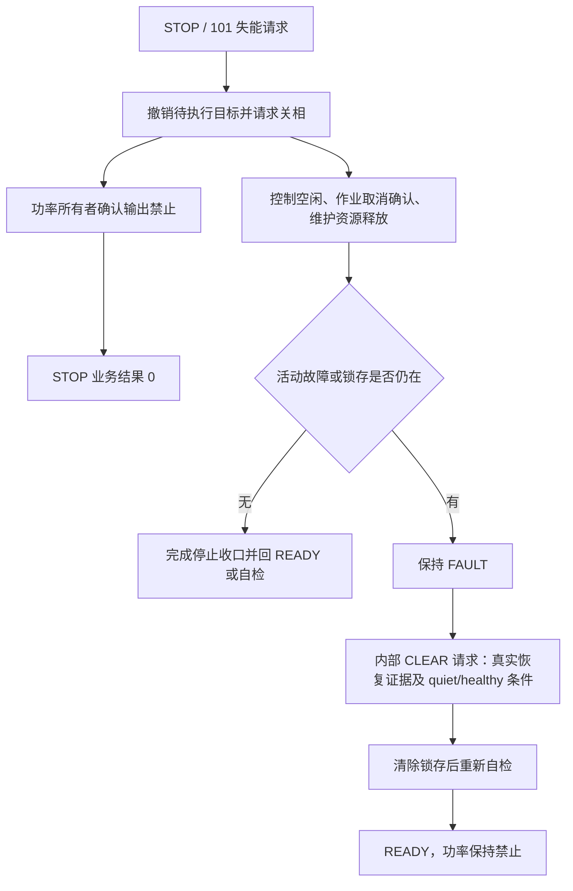

# yg_protocol 核心接入与受控启动契约 v1

日期：2026-09-28。H1 文档包。核对基线：`9226df154c1f6bc8eef9ecdd2be920d5a7d0c847`。
后续H3已新增107及120/121/122通信路由/服务绑定，当前行为以
[参数及清故障接入v1](yg_protocol_parameter_wire_v1.md)为补充；以下表格保留H1阶段边界，
不能据此否定新增路由，也不能把新增通信入口视为已完成APP所有者接线。
本文件保持 [wire v1](yg_protocol_motor_wire_v1.md) 与参数 schema11，
不新增 CMD、payload、模式编号或参数 ABI。E1 的真实 guards 接线仍待独立审查，
本文不把其计划能力写成已实现能力。H1 交付时 F/D 暂停；后续 F1 已获准最小离线接入，
D 仍暂停。H2 内部精简及验证见[通信职责收口](../plans/active/2026-09-28-communication-core-h2.md)。

## 1. 当前可以接入什么

当前能进行查询、停止/失能、控制请求校验和逐请求反馈；尚不能仅凭 CAN 从失能状态
启动电机。101 使能及从制动态进入控制模式的接线缺失，116 不隐式启动或跨模式切换。

| Type | 当前请求 | 回复与已实现行为 | 尚未具备的能力 |
| ---: | --- | --- | --- |
| 1 GET_INFO | 12B：session_id:u32、request_id:u32、page:u16、reserved=0:u16，page=0 | 同 Type/seq，32B 信息页 | UID 为零、版本/boot_id 等是固定占位；不能据此识别实际镜像或复位代际 |
| 2 GET_CAPS | 同上，page=0 | 同 Type/seq，16B 能力页；supported_modes=0 | 不声明可远程启动的控制模式；不能按模式枚举推断支持能力 |
| 101 SET_ENABLE | 4B：enable:u8、3B 零 | enable=0 走停机所有者；结果 0/1 或明确错误；enable=1 返回 2 | 三相低侧制动及远程使能未开放 |
| 108 GET_MOTOR_STATE | 空 payload | 同 Type/seq，45B 全量状态；非空请求结果 3；无新鲜快照结果 6 | 无具体控制命令的实际完成序号 |
| 110 MOTOR_STOP | 空 payload | 同 Type/seq，4B result:u16、detail:u16；结果 0 仅在输出禁止获所有者确认时使用 | 不代表故障已清、维护作业已释放、转子已静止或可以立即重启 |
| 116 SET_CONTROL | 20B，模式与目标一起发送 | 同 Type/seq 的 4B 回复，另发一条关联 124；模式 1/2/3/6 可更新已 RUNNING 的相同模式目标 | 失能启动、跨模式启动、MIT、制动模式及 APPLIED 终态通知 |
| 124 MOTOR_FEEDBACK | 设备主动发送，无主机请求 | 45B 状态；每条有效接入的 116 均关联一条，拒绝也报告当前状态 | 当前不是自主定时状态流，也不是已应用或到位确认 |
| 107 CLEAR_FAULT | 仍是后续候选，字段未冻结 | 基线未登记描述符、未绑定 CAN 路由，不保证业务回复 | 不得当成已可用命令发送，不能把超时当作清除成功 |

历史候选表中“101+116 即可启动”“124 回显实际应用序号”等描述属于目标方案，
不能覆盖本基线的支持边界。旧 111 失能、旧会话前缀及旧状态 payload 已退役。

1/2 的 session_id/request_id 是现有只读页字段，保留编码即可；它们不是控制授权会话、
生命周期 epoch 或必须先建立的 ARM/会话命令。

## 2. 模式、状态和故障的三个层次

内部枚举只能经明确映射成为线上值，不能通过强制转换或复制枚举整数接入主机。

| 线上 116 mode | 含义与有效目标 | 服务 MotorControlMode | 旧 ModeNow_TypeDef | 生命周期 AppControlMode |
| ---: | --- | --- | --- | --- |
| 0 | 失能；使用 101 enable=0，不发 116 mode=0 | 无 | Motor_Disable=0 | APP_CONTROL_NONE |
| 1 | Iq，iq_mA:i32 | MOTOR_CONTROL_CURRENT=0 | Current_Mode=1 | APP_CONTROL_CURRENT |
| 2 | 速度，speed_mrad_s:i32 | MOTOR_CONTROL_SPEED=1 | Speed_Mode=2 | APP_CONTROL_SPEED |
| 3 | 绝对位置，position_mrad:i32 | MOTOR_CONTROL_POSITION=2 | Position_Mode=3 | APP_CONTROL_POSITION |
| 4 | MIT 候选，位置/速度/Iq；当前不支持 | 无 | Position_Impedance_Mode=18 只在现有状态投影中对应 4 | APP_CONTROL_IMPEDANCE |
| 5 | 三相上管关、下管全开制动；当前不支持 | 无 | 无等价实现；旧编号 5 是编码器标定 | 无等价制动态 |
| 6 | q 轴电压，v_q_mV:i32 | MOTOR_CONTROL_VQ=3 | Vq_Mode=14；旧编号 6 是齿槽补偿标定 | APP_CONTROL_VQ |

116 的其余目标必须为零；flags:u8 与 reserved:u16 必须为零。协议层把
mrad、mrad/s、mA、mV 乘 0.001 转成 rad、rad/s、A、V，服务及算法只消费 SI 值。
旧 Voltage_OpenLoop=12 不是线上 mode=6 的别名；sensorless 路径不由当前 116 开放。
线上反馈 mode=7/8 是项目标定状态投影，不能由 116 请求。

| 内部生命周期 | 当前线上 motor_state 投影 | 主机应如何解释 |
| --- | ---: | --- |
| APP_BOOT | 0 | 启动中 |
| APP_SELF_TEST | 3 | 自检中 |
| APP_READY | 5 | 空闲；不等于 101/116 启动能力已开放 |
| APP_STARTING | 2 | 启动等待；不等于已运行 |
| APP_RUNNING | 6 | 运行状态；不能证明某条目标已应用 |
| APP_MAINTENANCE | mode=7/8 时为 4，其余为 5 | 维护投影会与 idle 重合，不能证明维护资源已释放 |
| APP_STOPPING | 7 | 停止收口中 |
| APP_FAULT | 8 | 故障；ErrorNow 非零时状态适配器也优先投影为 8 |
| APP_FATAL | 9 | 本基线映射为线上 9；不能因历史名称 fault_over 而视作可清除或可启动 |

APP_* 状态枚举序号不是线上状态编号。ErrorNow_TypeDef 是旧单故障枚举，
124/108 的 fault_code 是适配后的位图，例如旧 Over_Current=7 映射到 bit0。
主机按线路位图解码，不能把内部枚举值当位图。具体状态与测量格式以
[108/124 全量反馈契约](yg_protocol_motor_feedback_v0_2.md)及状态适配器为准。

## 3. 101 使能的约定及启动前置依赖

101 enable=1 的目标动作已经约定为：PWM/驱动使能、三相上管关闭、下管全开。
这是低侧制动，有制动力矩和环流，不能解释为电气高阻、全桥关闭或普通控制 PWM 启动。
101 不携带位置、电流或速度目标，不能被改成“使能即运行非零目标”。

当前 adapter 对 enable=1 直接返回 UNSUPPORTED；Board_Init 只启动采样时钟、
保持三相输出关闭。既有 Start_PWM_Generate 路径不构成已验证的 mode 5 实现。
在下列依赖收口之前，保持结果 2 和 supported_modes=0：

| 依赖 | 所有者与必要证据 | 基线缺口 |
| --- | --- | --- |
| 生命周期健康与资源静默 | 电机运行所有者；故障源、采样、自检、控制/操作空闲、维护释放、请求时效各有真实来源 | 多项 guards 仍为常量真，phases_disabled 取软件 power_on；E1 尚未验收 |
| 制动准入 | 静止/低速稳定判断、编码器有效性、三相电流有效性、允许电流与持续时间 | 产品阈值和稳定时长未冻结，不能仅用 Iq 或单次速度零判断安全 |
| 制动硬件动作 | platform 功率能力；六路门极波形、极性、互锁/死区、进入与退出确认 | 未完成 mode 5 波形及退出/温升验证；软件开关位不等于实测门极波形 |
| 制动到目标模式 | 生命周期与模式执行所有者；先关闭/准备再按模式授权启动，并在启相时复核紧急禁止与代际 | 116 只受理已运行的相同模式，没有这条启动转换 |
| 零动作的初始参考 | 各模式所有者；位置参考取真实当前位置、速度/Iq/Vq 取明确的安全初值 | 尚无线上启动接线；不能以“位置=0”代替“保持当前位置” |
| 具体目标应用确认 | 控制周期产生真实完成证据，由状态接口单向发布 | 当前没有 last_applied_seq 或对应终态报告；H1 不增加 ABI 字段 |

100 ms 仅是此前讨论的初次制动试验窗口建议，不是已批准的产品持续时间配置。
温度、电压等沿用现有保护配置；本文件不增加阈值、调度任务或硬件寄存器访问。

后续启动接线必须先明确制动态的内部表示及退出，再串联模式准备、受控启相与真实启动完成；
不能强行把 APP_CONTROL_NONE 当作已有 ENABLE 事件的合法运行模式。
通用健康条件与模式/标定依赖需分开，避免“编码器未标定”同时封死编码器标定入口。

当前 116 的已有目标准入保持不变：无故障、功率已开、APP_RUNNING、目标模式相同、
轴配置有效、有感路径、编码器在线且完整标定、母线在已有使能窗口内、目标有限且未用字段为零。
电流/速度按现有上限，位置按轴范围，Vq 按 FOC 调制上限；邮箱占用拒绝 BUSY。
受理后控制周期复核，STOP、故障或条件失效可以丢弃目标，不能自行恢复。

## 4. 回复、ACCEPTED、应用和到位

| 观察 | 可以证明 | 不能证明 |
| --- | --- | --- |
| USB-CAN 发送返回成功 / CAN 链路 ACK | 主机接口或链路层完成发送阶段 | 目标节点业务成功、使能或目标执行 |
| 同 Type、同 seq 的业务回复 | 设备处理了该请求并给出业务结果 | 单凭存在回复无法判断结果成功 |
| 116 result=1 ACCEPTED | 首次请求已复制到所有者邮箱；重试可能是缓存的历史受理结果 | 当前仍在邮箱、已应用、已运动或到位 |
| 对应 124 的 correlated_seq | 此次处理/重试与这条反馈关联 | 该序号是控制周期实际完成序号 |
| 108/124 显示参考或运行态 | 某一时刻的状态快照 | 因果上属于某条目标；快照可能先于应用且参考可能相同 |
| 实际应用 | 应由控制周期在复核后提交，并发布真实完成证据 | 当前线上没有这条可核验的逐命令证据 |
| 位置到位 | 主机用有效实测位置/速度、允差及稳定时间判断观测结果 | 接收成功或参考值变化不等于机械到位；当前也不能完成逐命令归因 |

STOP/101 失能的 result=0 只证明所有者当时确认功率输出禁止；它不等于所有维护资源静默。
result=1 是停止已受理，主机必须继续用新查询/停止请求取得关闭确认，不能立即发启动。
当前停止回复仅 4B，不包含旧 token/session 前缀；detail 不是可轮询的作业 ID。

内部 router 回复关联字段原名 applied_sequence，H2 更名为 response_sequence，
仍直接取 request.sequence，用于回复关联，
也不能当作真实电机应用证据。124 的 result 与本次 116 业务结果一致，反馈可以在 2 kHz
所有者消费目标之前生成；其独立帧头 seq 是反馈流序号，不是控制完成序号。

## 5. STOP 与 CLEAR



STOP 结果 0 的功率确认与生命周期收口是不同检查；本基线不把完整资源释放通过 STOP 回复
暴露给主机。STOP 不清故障，CLEAR 不启动、不恢复旧参考或待执行目标。
LINK_RECOVERED 同样不清锁存；未确认取消的维护作业不能因旧完成事件而获得释放。

内部 APP_EVENT_CLEAR 需 FAULT、真实资源 quiet、采样健康、故障源已解除、无活动故障、
无未确认取消，并校验请求时效/epoch；成功后进入自检，不直接 RUNNING。APP_FATAL 不由
CLEAR 恢复。旧 Clear_Error=10 是内部模式/操作员入口，不是 CMD 10 或 107 的现有 CAN API。
其恢复矩阵对部分参数/标定类故障仍有过渡性放行，不能据此对外承诺完整恢复策略；
G1/E1 需审查真实故障恢复和维护释放条件。

107 CLEAR_FAULT 当前只有候选功能描述，没有冻结掩码/回复格式和线上路由。本轮 F 只能
显示故障与“远程清除未支持”，不能通过直接写 ModeNow、兼容命令或调试器绕过所有者。

## 6. F 后续最小接入流程

以下是 F 的接入契约；F1 当前只实现离线编解码、模拟传输和演示，不授权硬件发帧。
基础流程只使用现有指令：

1. 使用明确板卡配置确定目标 Node ID。主站为 2；规划电机 3～7，但此前实板保存的是 1。
   不自动重写节点。按需发送 1/2 信息与能力查询，不能把占位 UID/版本当镜像真实性证明。
2. 发送 110 STOP 或 101 enable=0，等待同 Type/seq 的回复；受理结果 1 继续确认，
   只有 0 才标记当时输出禁止。失败/超时按台架停止规则处理，不自动恢复试验。
3. 发送空 108，解析 45B 状态和有效位。展示实际 mode/state/fault，缺失测量按哨兵显示无效。
   supported_modes=0 时禁用远程启动；不能因 state=idle 或 fault=0 绕过能力限制。
4. 当前没有可用的“101 enable=1 → 116”启动流程。只有在外部已获授权、真实所有者已经
   RUNNING 且模式相同时，116 才可提交该模式目标；这不是 F 获得启动能力的替代入口。
5. 每条 116 分别收集同 Type/seq ACK 和 124。反馈用 `(源节点, correlated_seq)` 关联，
   ACK 用 `(源节点, Type, seq)` 关联；不要用 124 帧头 seq 配对，也不要向 124 回复 ACK。
6. STOP/FAULT 时取消主机未决控制，停止补发旧目标。故障解除或未来 CLEAR 成功仍需新请求、
   新序号和完整启动检查，不自动续跑。退出使用 110/101 失能取得输出禁止确认。

建议主机呈现“已回复 / 已受理 / 拒绝 / 超时 / 当前状态”，当前不显示“命令已应用”。
若展示位置到位，只作为有效测量的观测判断，并注明没有逐命令 APPLIED 证据。

### 编解码与错误处理最小映射

- CAN ID：`(priority<<26) | (0xEF<<16) | (dst<<8) | src`。主机请求优先级 2，
  设备回传优先级 3；PF 是寻址，Type 在统一帧头中。均为扩展帧、BRS。
- 公司帧：16B 头、payload、2B CRC16；小端，DLC 零填充不进 CRC。
  CRC8/CRC16 算法与黄金向量复用 wire v1，不以宿主结构体内存直接发送。
- 请求 flags=0x20，同序号同内容的传输重试 flags=0x24；业务 ACK flags=0x10；
  主动 124 flags=0，不能统一按 ACK 标志拒绝它。
- 108/124 采用相同 45B 体；108 correlated_seq=0，124 correlated_seq 对应 116。
  测量先检查有效位再使用，INT16_MIN/INT32_MIN 不参与控制或到位计算。
- 结果 0/1/2/3/4/5/6/7/8/11/17 分别为已执行、受理、不支持、长度、字段、状态、忙、
  未授权源、内部失败、范围、故障；这些不是旧 ErrorNow 枚举。
- 帧 CRC、版本、保留位、地址或控制请求 flags 不合法时，不承诺业务回复。
  合法单播 116 请求的长度/字段/权限拒绝仍带 ACK+124；未知 CMD 不等于会返回 result=2。
- 主站递增 seq。相同内容同序号重试只返回缓存结果；改变内容用同序号会被拒绝。
  result=6/5 等业务拒绝即本次请求结束，条件改变后用新 seq，不能靠同序号变为成功。
- 主机 1 s 超时、最多 5 次重试是请求策略，不是固件通信看门狗或到位超时。
  去重历史只有 256 条，约覆盖 200 Hz 的 1 s；1 kHz 下约 256 ms。
  超出历史的旧序号可能拒绝为 4，不能承诺 1 kHz 控制丢包后 1 s 仍可重放。
  周期目标应发送当前新目标，不能补发已过时周期；STOP 单独确认。

## 7. 实现边界与交付判据

```text
F 主机编码/收包与关联（本轮暂停）
  → platform CAN FD → communication endpoint/link（校验、路由、去重、ACK+124）
  → motor adapter（线上模式/SI 转换）
  → services 值命令 / STOP 端口
  → app 运行所有者（生命周期、唯一目标邮箱、真实条件）
  → platform 功率能力与 motor 算法
状态源 → app 状态适配 → protocol 编码 → 108/124 → F
```

协议层不触碰寄存器、HAL、ModeNow 或保护状态；F 不越过线上接口直接写控制对象。
E1 完成真实 guards 只构成启动接线的前置条件，不自动开放 101、107 或新模式。
下一包需分别验收：低侧制动准入与动作、制动到目标模式转换、启动完成证据、
故障清除线上契约，以及主机能力门禁和回复关联。没有证据的能力继续明确不支持。

本文件仅静态核对共同基线与已记录证据，未运行新的硬件试验。既有
[单板通信实测](../reports/2026-09/yg_protocol_canfd_bench_20260928.md)
只覆盖三相线断开、失能态请求/反馈，不能代替上述启动与闭环验收。

代码核对入口：

- [路由、能力和去重](../../firmware/communication/can/yg_protocol_link.c)
- [电机业务适配](../../firmware/communication/protocol/yg_protocol_motor_adapter.c)
- [运行所有者及目标复核](../../firmware/app/foc_run_state.c)
- [STOP 的输出禁止确认](../../firmware/services/lifecycle/motor_stop_service.c)
- [生命周期纯核心](../../firmware/services/lifecycle/app_lifecycle.c)
- [线路状态投影](../../firmware/app/yg_protocol_status_adapter.c)
- [参数 schema 定义](../../firmware/services/parameters/foc_param.h)

ROOT 后续可在最邻近文档索引登记本文件；H1 仅拥有本文件写权限，不修改索引或 E/G 的文件。
