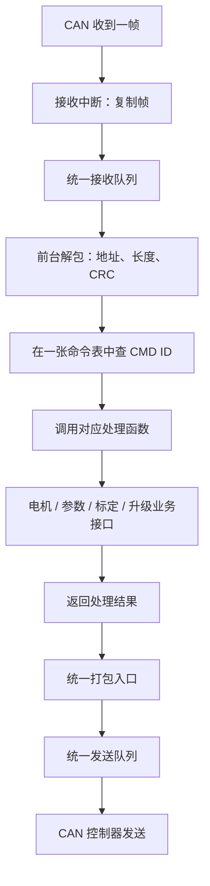
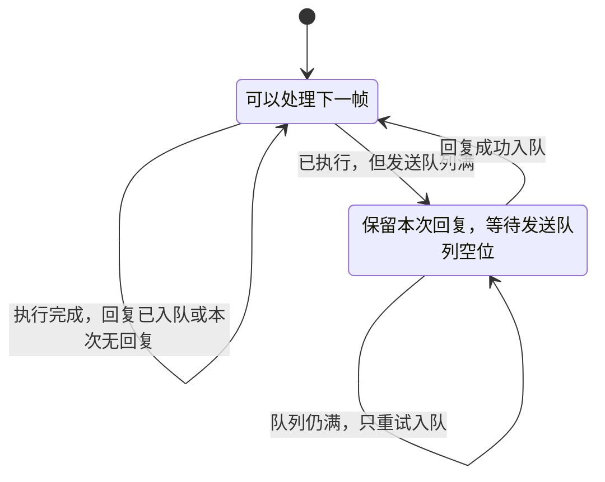

# 通信框架简化设计与实施顺序

日期：2026-10-26。范围：APP 的 CAN FD 通信软件。状态：软件简化、离线验证与四个 APP 目标构建完成，未烧录。

本文先确定重构方法，再指导代码实现。线路上的 CMD ID、参数、单位、回复格式见
[通信协议总览](README.md)；本次简化软件组织，不重新设计线路协议。

## 1. 最终保留什么

整个通信过程只保留一条主线：

**接收队列 → 解包校验 → 查命令表、执行函数 → 打包 → 发送队列。**

| 环节 | 负责的工作 | 在哪里运行 |
| --- | --- | --- |
| 接收 | 从 CAN 控制器取出完整帧，复制到统一 RX 队列 | 接收中断 |
| 解包 | 检查地址、长度、CRC；需要时重组长消息 | 前台主循环 |
| 命令处理 | 按 CMD ID 找到函数，解析参数，调用业务接口 | 前台主循环 |
| 回复 | 按处理结果生成消息，编码并放入统一 TX 队列 | 前台主循环 |
| 发送 | 控制器有空位时提交队首帧，忙时保留原帧 | 前台主循环与 CAN 硬件 |

只用固定容量缓存和静态命令表，不引入动态内存、消息总线、订阅系统或通用任务调度器。
命令处理函数不能等待电机到位、标定结束或 Flash 写入完成。

## 2. 框架与数据流程



长任务只在上图的业务模块中保存进度。通信处理函数提交任务后返回；任务完成后的反馈仍从同一个打包入口发送。
CRC 错误、错误地址和未知命令不会进入电机业务。

### 2.1 状态机只处理需要等待的事情

CAN FD 硬件已经给出一帧的边界，因此解包直接处理完整帧，不按字节搜索包头。
解包、查表和打包都是短函数调用，无须各自增加一套多阶段状态机。

前台只需保留两个收发处理状态：



**等待发送时，绝不能再次调用原命令函数。**否则参数写入、标定启动或电机控制可能执行两次。
分片重组沿用已有的小状态机，只服务明确允许长消息的命令，不参与实时电机控制。

## 3. 一张表管理命令

把现有的“消息属性表”和“处理函数表”合并。一个 CMD ID 只登记一次：

```c
typedef yg_protocol_result_t (*yg_protocol_command_handler_t)(
    void *context,
    const yg_protocol_message_t *request,
    yg_protocol_service_result_t *result);

typedef struct
{
    uint16_t message_type; /* 就是 CMD ID */
    bool allow_fragment;  /* 是否允许长消息分片 */
    yg_protocol_command_handler_t handler;
    void *context;        /* 处理函数需要的业务对象 */
} yg_protocol_command_t;
```

例如，在产品初始化中登记：

```c
static const yg_protocol_command_t commands[] = {
    {0x006EU, false, handle_motor_action, &motor_context}, /* STOP */
    {0x0074U, false, handle_motor_control, &motor_context},/* CONTROL */
    {0x0078U, false, handle_parameter, &parameter_context},/* READ */
    {0x007CU, false, NULL, NULL},                         /* 仅发送反馈 */
};

yg_protocol_commands_register(&table, commands,
                             sizeof(commands) / sizeof(commands[0]));
```

这是注册方式示例，不是完整产品命令清单。实际处理函数可共用上下文。

- 注册时检查重复 CMD ID，失败时保留原表。
- 表是静态只读数组，注册函数只保存引用，不复制、不分配内存。
- `handler=NULL` 表示该类型仅用于发送；收到此类型不能执行业务。
- 删除独立 `periodic` 属性。实时控制和反馈设置 `allow_fragment=false` 即可；通信表不负责定时发送。
- 初始化完成后不动态添加命令。升级命令仅在真实升级服务绑定、链路无待处理请求时开放。
- 只读查询直接绑定对应数据提供函数，不再按 CMD ID 查第二张表。

## 4. 处理函数怎样返回

需要分清两件事：**函数是否处理了这条消息**，以及**业务是否执行成功**。

| 内容 | 放在哪里 | 含义 |
| --- | --- | --- |
| 解码、处理错误 | 函数返回的 `yg_protocol_result_t` | 消息是否能被正常处理 |
| 业务成功、拒绝或处理中 | 回复 payload 的 `result/detail` | 主站应该看到的执行结果 |
| 本次是否立即回复 | 内部字段 `reply_ready` | 只控制软件流程，不添加到 CAN 帧 |

框架先初始化回复地址、CMD ID 和 sequence；处理函数只需填写业务回复。
默认 `reply_ready=true`，同时满足请求的应答标志时，框架自动打包。
若业务拒绝有效请求，应编码错误结果并正常回复，不能用函数报错代替业务拒绝消息。

### 4.1 三种处理方式

| 情况 | 处理函数怎么做 | 后续怎么回复 |
| --- | --- | --- |
| 读取状态或普通短操作 | 填好回复，立即返回 | 框架自动回复 |
| 先接受、稍后完成 | 先回复“已接受”，业务模块保存任务 | 完成时发反馈，或由主站查询；遵循该命令原有定义 |
| 新命令约定只在完成后回复 | 设置 `reply_ready=false`，业务模块保存必要数据 | 完成后从统一发送入口发出；满队列时业务保留结果并重试 |

第三种是扩展能力，**不用于取消现有命令要求的回复**。
现有电机目标命令 `0x0074` 保留处理回复；实际控制处理结果再由 `0x007C` 关联反馈。
本次不把“已接受目标”改成“电机已经到位”，也不增加通用的回复定时器。

异步业务必须复制需要保留的请求字段；不能保存接收帧、payload 或临时回复缓冲区的指针。

## 5. 缓存与发送方式

| 缓存 | 保存内容 | 使用规则 |
| --- | --- | --- |
| RX 队列 | 完整 CAN 帧副本 | 中断写入；前台在短临界区内取出，随后退出临界区再处理 |
| 待入队回复 | 已执行命令产生的一个结果 | TX 满时保留，成功入队后释放 |
| TX 队列 | 已编码的完整 CAN 帧 | 所有普通回复和主动反馈共用；硬件忙时保留队首 |
| 分片缓冲 | 允许分片的完整应用消息 | 沿用现有容量和超时，不为各个命令另建缓存 |

先保持现有 APP 的 RX/TX 各 8 帧，本次不同时调整队列容量。
队列满时不能覆盖旧帧；接收溢出计数，发送返回忙，由持有结果的一方稍后重试。
一次前台服务处理有限数量的帧，避免通信占住主循环。

CAN FD 当前通过控制器 FIFO/发送槽发送，不强行增加 DMA。
以后某个硬件链路需要 DMA，由该链路驱动管理 DMA 和发送完成；命令处理函数不接触 DMA。

软件入队、提交控制器、物理发送完成是三个不同阶段。
进入 Loader 需要等对应回复的硬件发送完成，不能为了简化而在入队后立刻复位。

## 6. 文件和接口如何分工（当前实现）

APP 业务文件位于 `firmware/communication/commands/`；共用编解码位于 `shared/protocol/`。
共用类型、字节读写和请求检查统一包含 `yg_protocol_common.h`。

采用“减少重复层次”的方式，不把所有代码塞进一个大文件。

| 模块 | 重构后的职责 |
| --- | --- |
| `yg_protocol_canfd.c` | 固定帧队列、CAN FD 承载编解码与发送提交 |
| `shared/protocol/` | 应用帧、CRC、CAN ID、分片的纯计算，APP/Loader 共用 |
| `yg_protocol_endpoint.c` | 命令注册、解包、查表、执行、回复与发送入队 |
| `yg_protocol_link.c` | 初始化、启动、接收中断、唯一命令表、服务绑定、前台调度及升级回复发送跟踪 |
| `yg_protocol_readonly.c` | 保存身份和能力信息，处理查询并编码回复 |
| `yg_protocol_motor/parameter/job/boot.c` | 各自处理命令、调用服务和编码回复；电机模块保存重试记录与待发反馈，升级模块保存票据 |
| 应用适配器 | 把协议请求交给电机、参数和标定模块 |
| `BspCan` 与 MCU 实现 | CAN 外设收发、发送完成、总线恢复 |

核心接口按调用顺序理解：

| 接口 | 调用时机 | 职责 |
| --- | --- | --- |
| `yg_protocol_commands_register` | 初始化 | 一次登记 CMD ID 与处理函数 |
| `YgProtocolLink_OnRxFrame` | 接收中断 | 复制完整帧入 RX 队列 |
| `YgProtocolLink_Service` | 主循环 | 有限次处理 RX、推进待发结果、服务 TX |
| `yg_protocol_endpoint_process_frame` | 前台内部调用 | 解包并执行一帧；传空指针只推进待发回复 |
| `yg_protocol_endpoint_send` | 前台内部调用 | 统一打包并复制到 TX 队列，返回后输入数据可释放 |
| `BspCan_TrySendFrame` | 发送队列服务 | 尝试提交硬件；失败则保留队首 |

命令查找和调用是 endpoint 的内部步骤，业务模块不需要自行查表。
应用通过已有服务接口绑定业务；电机算法不会依赖 CAN 帧结构、寄存器或命令注册表。

## 7. 简化边界

这次删除：分开的 registry/router、只读查询的第二次查表、无必要的命令属性。
不新增：逐字节 CAN 解包状态机、通用通信任务调度器、每命令独立队列或多链路插件框架。

以下机制与重复的软件层次不同，需要保留：

- 公司应用帧的头部、长度、小端序和 CRC；CAN 自带 CRC 不替代公司应用 CRC。
- 控制重试记录，避免同一请求再次控制电机。
- TX 满时保留回复，避免执行完成却丢掉结果。
- 异步任务进度和控制完成反馈，避免长时间阻塞主循环。
- 升级的发送完成确认和必要分片；Loader 保持独立、共用底层编解码。

本次不改变命令编号、模式、单位、参数目录或反馈字段，不以代码简化宣称已经实现五轴 1 kHz 同步。

## 8. 实施顺序与验收

| 步骤 | 实施内容 | 完成条件 |
| --- | --- | --- |
| 1 | 完成本设计和入口链接 | 职责、流程、接口、回复规则清楚 |
| 2 | 合并命令表，删除旧 registry/router | 每个 APP CMD ID 只登记一次；Keil 和测试引用一并更新 |
| 3 | 收敛只读查询，接入回复选择 | 查询直接选提供者；正常回复和延迟反馈共用发送入口 |
| 4 | 验证收发与错误路径 | 错帧不执行业务；队列满不重复执行；延迟回复不引用过期内存 |
| 5 | 回归协议并构建目标 | 现有字节向量、控制重试、STOP、参数、维护和升级交接测试通过；构建无新增错误 |
| 6 | 更新实现记录 | 如实记录完成项、构建目标和未执行的设备测试 |

先验证离线逻辑及构建，实机通信另记录结果。不能把离线通过写成已烧录或已连通。
提交只包含本次通信重构；工作树中已有的 BSP、项目迁移等修改不混入本次提交。

## 9. 第一轮实施记录

用户确认执行后，已在 `the-system-refactor` 工作树完成以下修改：

- 新增 `yg_protocol_commands.c/.h`，替代 `yg_protocol_message_registry.c/.h` 和 `yg_protocol_router.c/.h`，净减少两个源文件/头文件。
- 产品初始化只维护一张命令表，保留 CMD ID、分片许可、处理函数和上下文四项；升级服务仍在绑定后才开放。
- 只读查询直接绑定对应提供函数，删除第二次 CMD ID 查找及其初始化配置。
- endpoint 直接执行已找到的表项；加入内部 `reply_ready`，立即回复与延迟反馈共用发送入口。
- 更新四个 Keil 工程、原生测试编译清单、文件目录夹具和通信文档，删除旧模块引用。

公司帧格式、现行 CMD ID、业务 payload、控制去重、STOP、反馈关联和升级发送完成确认均保留。
没有增加 DMA、动态内存或通信任务调度器。RX/TX 队列容量仍各为 8 帧。

| 验证项 | 结果 |
| --- | --- |
| Python 单元 / 集成测试 | 119 / 14 项通过 |
| 原生 C 验证 | 协议核心、链路、控制适配、分片、参数服务、bus-off、升级、Loader runtime 共 8 组通过 |
| 新增边界验证 | 重复 ID 拒绝注册且保留原表；坏 CRC、未知 ID、仅发送项不执行业务；TX 满多次重试不重复执行；延迟结果独立保存；处理错误不自动回复成功 |
| 接口、架构、文档、工程布局 | 检查通过 |
| STM32G431 APP / LoaderApp | 两目标重建均为 0 错误、0 警告；LoaderApp 构建后处理通过 |
| AT32F456 APP / Commissioning | 两目标重建均为 0 错误、0 警告 |
| 设备下载与实机通信 | 未执行；不沿用其他版本的设备结果 |

验证记录位于工作树 `outputs/protocol_simplify/validation/`；普通 APP 构建日志在 `outputs/build/logs/`。
格式检查使用锁定环境中 clang-format 的实际可执行文件，避开本机失效的启动包装程序。

本次改动保留在工作区。由于同一工作树已有未提交的 BSP 和工程迁移，本轮未将这些修改一并提交。

## 10. 第二轮：减少文件数量

已将协议主体从 44 个 C/头文件减到 32 个；应用适配仍为 4 个文件，RTT 和 BSP 不计入。
本轮合并文件及其工程依赖，保持已验证的函数行为和线路字节；不把文件减少等同于控制策略重写。

| 合并来源 | 保留模块 | 合并后职责 |
| --- | --- | --- |
| `runtime`、`canfd_irq` | `link.c/.h` | 初始化、启动、收帧入口、前台服务及产品协调 |
| `commands` | `endpoint.c/.h` | 命令注册、解包、查表调用、回复入队 |
| `frame_queue` | `canfd.c/.h` | CAN 帧缓存、承载编解码和发送提交 |
| `readonly_payload` | `readonly.c/.h` | 查询处理与查询数据编解码 |
| `motor_status` | `motor.c/.h` | 电机请求、服务调用与状态反馈编码 |

删除被合并的 6 对文件，迁移其实际实现，不保留转发头文件或空壳函数。
已有函数名保持，调用方改为包含保留模块的头文件；命令表仍是一张静态表。
完整更新 APP、LoaderApp、AT32 目标、原生测试和文档链接。
验收覆盖四个 APP 构建、通信和 Loader 回归、数值编码及 AT32 基础测试。

第二轮曾保留 `link` 中的业务处理，第三轮已按下节移到对应业务模块。BSP、Flash 和电机算法仍各自独立。
实施已完成，实际文件数量为：

| 目录 | C/头文件数量 | 保留内容 |
| --- | --- | --- |
| `firmware/communication/can` | 6 | `canfd`、`endpoint`、`link` 三对文件 |
| `firmware/communication/protocol` | 13 | `motor`、`motor_adapter`、`readonly`、`parameter`、`job`、`boot` 六对文件，以及 `service.h` |
| `shared/protocol` | 13 | APP/Loader 共用编解码和类型定义 |

四个 APP 目标重建均为 0 错误、0 警告，LoaderApp 构建后处理通过。
119 项 Python 单元测试、14 项集成测试通过；协议核心、链路、控制适配、分片、参数、bus-off、
升级、Loader runtime、数值编码、AT32 基础共 10 组原生测试通过。
新增接收中断验证：一次最多读取 3 帧，中断内不执行业务，剩余帧在后续中断接收后由前台处理。
接口、架构、文档及工程布局检查通过。

验证记录位于 `outputs/protocol_compact_v2/validation/`。AT32 测试迁移时一度遗漏重复的包含目录，
已修复编译清单并通过重跑，记录见 `at32-retry.log`。
本轮未烧录、未操作电机，改动仍保留在当前工作区，未混合提交其他重构内容。

## 11. 第三轮：明确业务模块与 link 的边界

在保持 32 个协议文件的基础上，将 link 中的命令处理迁到现有业务协议模块。
各模块直接提供统一签名的命令处理函数，初始化命令表直接绑定这些函数，不增加转发层。

| 模块 | 拥有的数据和职责 |
| --- | --- |
| 电机协议 | 请求解析、服务调用、控制重试记录、待完成请求、待发反馈和状态来源 |
| 查询协议 | 身份、能力、维护页面和设备状态来源；提供查询处理函数 |
| 参数 / 维护协议 | 使用独立服务绑定解析命令并构造回复；执行进度仍由实际业务模块拥有 |
| 升级协议 | 处理进入和确认命令、升级业务绑定、回复关联身份及票据 |
| link | 静态资源、唯一命令表、初始化与绑定、IRQ 入队、前台调度、硬件发送完成跟踪 |

各业务只生成消息或结果，不读取 RX/TX 队列或 CAN 控制器。
电机待发反馈通过统一发送回调入队，队列满时仍由电机协议保留结果；成功后才释放。
升级票据由升级模块保存，发送槽位置和控制器完成事件由 link 管理，必须匹配后才通知升级业务。
第三轮曾将统一请求检查和四字节结果写入放在 service 头文件中，第四轮移入公共头。
核对启动和目标控制的重复模式转换，集中到已有电机适配模块，保留各入口原有的拒绝结果。

验收：线路黄金字节、拒绝顺序、控制重试与反馈、队列拥塞、STOP、参数、维护和升级交接不变；
增加不同业务上下文互不干扰的直接处理测试，并重新验证四个 APP 构建。

实施结果：业务处理函数及相关状态已迁移，协议文件仍为 32 个，未新增协议层。
`link.c` 从 1116 行减到 545 行；移出的处理逻辑保留在对应业务模块中，并非删除了功能。
`link.c` 不再解析电机、参数或维护命令；启动和目标控制共用同一份线路模式转换。
电机、参数和维护的执行规则、线路字段和回复顺序保持不变。

验证记录：`outputs/protocol_ownership_v3/validation/`。
119 项 Python 单元测试、14 项集成测试及 10 组原生测试通过。
新增直接业务调用测试覆盖独立节点的重试记录、反馈拥塞后的保留与发送，以及查询上下文隔离。
四个 APP 目标均重建为 0 错误、0 警告，LoaderApp 后处理通过。
接口、架构、文档和工程布局检查通过。
本轮未执行实机或 1 kHz 时序测试，因此不据离线回归声明实时性能已经验收。

对照第二轮构建，四个目标的静态 RAM 均减少 16 B；Flash 增加 620～660 B。
这里 Flash 按 Code + RO-data + RW-data 统计，RAM 按 RW-data + ZI-data 统计。
本轮收益是职责和依赖更清楚，并非压缩固件体积；不据此估算运行时栈峰值。

工作区还有 BSP 和工程迁移等未提交修改，本轮结果保留在工作区，未混合提交这些内容。

## 12. 第四轮：公共头合并与命令目录命名

按已确认的方案，把业务协议目录改为 `firmware/communication/commands/`。
`wire_types.h`、`byte_order.h`、`request.h` 合并为 `shared/protocol/yg_protocol_common.h`；
`service.h` 的通用请求检查和四字节结果写入也归入该头文件。
APP 内部业务结果及主站权限配置留在 `commands/yg_protocol_service.h`。
函数名、数据结构和线路字节保持不变，不添加转发头或新的运行层。
执行与验证见[本轮计划](../plans/active/2026-10-26-protocol-common-commands-v1.md)。

已实施：协议主体为 30 个文件（CAN 6、commands 13、shared/protocol 11）。
三个旧头文件已删除，工程、测试、上位机调用及有效文档链接已同步更新。
公共定义和迁移的 9 个函数与改动前一致；协议专项及公共头 C++17 检查通过。
验证期间工作区还在进行 BSP/启动入口迁移，最后一次全仓 PR 检查未通过；
不能据协议专项结果宣称整个工作区已验收，具体失败项和构建记录见本轮计划。


## 正式开环控制扩展 v0.3（2026-10-29）

本扩展只追加模式和对应命令参数，不更改帧头版本、命令号、CRC、CAN 1M/5M或
旧1/2/3/6模式。模式7/8仍为维护状态；4/5仍不支持。新模式9为纯电压开环，
10为d/q电流闭环、角度按指定电角频率开环推进。旧固件不支持9/10，应按不支持或
长度错误处理；旧客户端的原有模式无需修改。现有只提供速度按钮的PC界面不自动
增加开环按钮，需要按本扩展发送请求。

GET_CAPS页0的supported_modes追加bit9/10，值为0x0604；features保持0x1D00。
页0黄金payload为`001d0000040640002e00000000000000`。旧主机按bit2判断SPEED的
行为不变；新主机须看到对应新模式位后才能提供开环入口，不能向旧固件猜测发送。
这替代能力v2中的“仅SPEED”声明，表示完整软件路径已接通，不表示新模式实机验收。

117仍为4字节显式启动请求：模式、三个零保留字节。启动清零所有参考和开环相位；
启动完成后才允许116提交目标，116本身绝不启相。身份、序号、重放和STOP语义不变。
新模式不需要LUT/电零位，但仍需要配置确认、上电电流偏置资格、原始编码器在线、
母线及温度策略健康、空闲且关相等既有准入条件。

116旧模式保持20字节，新9/10模式必须为32字节，全部小端。

| 偏移 | 类型/单位 | 模式9：纯电压开环 | 模式10：电流闭环角度开环 |
| --- | --- | --- | --- |
| 0 | u8 | 9 | 10 |
| 1..3 | 保留 | 必须0 | 必须0 |
| 4 | i32，原位置mrad | 必须0 | 必须0 |
| 8 | i32，原机械速度mrad/s | 必须0 | 必须0 |
| 12 | i32，Iq mA | 必须0 | Iq参考 |
| 16 | i32，Vq mV | Vq参考 | 必须0 |
| 20 | i32，电角频率mHz | 有符号电角频率 | 有符号电角频率 |
| 24 | i32，Id mA | 必须0 | Id参考 |
| 28 | i32，Vd mV | Vd参考 | 必须0 |

内部旧模式值0/1/2/3/4保持不变，新模式分别追加5/6；108/124状态映射为9/10。
就绪位图新增内部位5/6；原位0..3不变，位4空闲不作为启动模式。校准不足时公共阻止
原因仍描述闭环限制，客户端应同时看对应startable_modes位；9/10可在原始角度在线时启动。

电角频率绝对值同时不超过200Hz及speed_limit_rad_s×pole_pairs/(2π)，有轴包络时
还取更严格的轴机械速度限值。电流参考按hypot(Id,Iq)核对既有限流，电压参考按
hypot(Vd,Vq)核对本拍母线允许的FOC电压；运行中保留原相电流、热和失采样保护。
相位按20kHz推进并单圈回绕；正负频率表示两种旋转方向，不声称等于电机实际速度。

目标参数和相位只在RAM，STOP/新启动清零，不修改schema14、已保存配置或双槽参数区。
旧模式20B请求保持旧转换，新扩展使用除1000的SI转换，避免整边界受到近似0.001乘法偏移。

黄金payload（空格分隔4字节组，未含统一帧头和CRC）：

- 模式9，+20Hz、Vd=1V、Vq=2V：
  `09000000 00000000 00000000 00000000 d0070000 204e0000 00000000 e8030000`
- 模式10，-20Hz、Id=1A、Iq=2A：
  `0a000000 00000000 00000000 d0070000 00000000 e0b1ffff e8030000 00000000`

上述是协议向量，不是实际台架启相授权；本批软件验收不烧录、不驱动电机。
