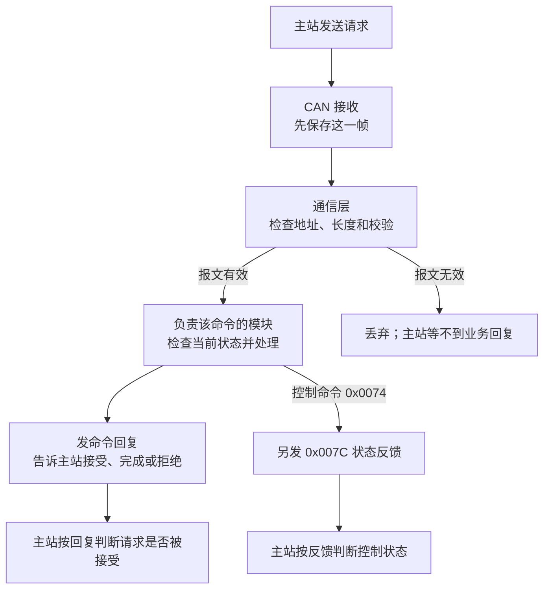

# yg_protocol 通信协议总览与当前状态 v0.1

2026-10-09核心范围更新：system-refactor已按v1.3.0收口，保留电流/速度/位置/VQ、
LUT、电/机械零位、参数保存和升级恢复；齿槽、摩擦/电阻辨识与组合计划已删除。
下文历史记录只对应原测试版本；当前任务kind及未测项以[维护v1.2](yg_protocol_calibration_wire_v1_2.md)
和[核心模块](../architecture/module_core_responsibilities.md)为准，不沿用旧通过结果。

更新：2026-10-08。这份文档供固件、主站和测试同事一起核对通信行为：主站发什么，电机板做什么，主站怎样知道处理到哪一步。这里先讲用法和当前实现；需要核对每个字节时，再看第 6 节。核对基线为 `codex/system-refactor` 分支的 `a246a962` 及当前工作树改动。

## 1. 协议结构

当前用 **CAN FD** 通信：29 位扩展 ID，仲裁段 1 Mbit/s，数据段 5 Mbit/s，打开 BRS。CAN ID 写明发送方、接收方和优先级；数据区中的 CMD ID 写明具体命令。当前固件尚未接入 RS485 或以太网。

| 层 | 关键约定 |
| --- | --- |
| CAN ID | `priority[28:26] / R=0 / DP=0 / PF=0xEF / dst[15:8] / src[7:0]` |
| 公司应用帧 | 16 B 头 + 0～46 B 业务数据（payload）+ 2 B CRC16；多字节数值默认小端，升级镜像清单除外 |
| 应用头 | 帧标识 magic `0xA55A`、版本号、标志位、收发节点、CMD ID、序号、业务数据长度、保留位、CRC8 |
| 校验 | CRC8 覆盖头前 15 B（poly `0x9B`，init 0）；CRC16 覆盖头及 payload（poly `0xBAAD`，init `0xFFFF`）；CAN 硬件 CRC 不替代应用 CRC |
| 长度 | 一帧 CAN FD 最多 64 B；DLC 填充不计入 payload_len 和应用 CRC |
| 节点 | 主站 `0x02`；公司多轴方案中的电机为 `0x03～0x07`。历史单板曾用 `0x01`，多轴部署前要统一编号 |

单播请求通常置 `flags=0x20`，业务回复置 `flags=0x10`，沿用请求的 CMD ID 和 seq。重试保留 seq、置重试位并重算 CRC。CRC 错、地址不符或未知命令可能无业务回复，主站要处理超时。

### 1.1 一帧 CAN FD 从外到内怎么拆

先看外层 CAN FD 帧，再看数据区里的公司应用帧。下面以**读取参数 `0x0078`** 为例：
主站 `0x02` 向示例电机 `0x03` 读取参数 `0x01`，本次请求序号为 `0x002A`。
`0x03` 只是讲解用的地址，实际通信要用设备当前的 Node ID。

```text
CAN FD 线上帧
SOF | 仲裁段：29 位 ID、IDE=1 | 控制：FDF=1、BRS=1、DLC=12
    | 数据区 24 B | CAN 硬件 CRC | ACK | EOF
          ID = 0x18EF0302
数据区 24 B = [公司应用头 16 B] [业务 payload 4 B] [应用 CRC16 2 B] [补零 2 B]
```

CAN ID `0x18EF0302` 包含优先级 6、目标节点 `0x03` 和发送节点 `0x02`
（完整字段为 `priority=6 / R=0 / DP=0 / PF=0xEF / dst=0x03 / src=0x02`）。
这里 `DLC=12` 对应**24 字节数据区**，不是 12 字节。下方的十六进制只列数据区；
SOF、CAN ID、控制位、硬件 CRC、ACK 和 EOF 由 CAN 控制器处理。

| 数据区偏移 | 十六进制字节 | 含义 |
| --- | --- | --- |
| 0～1 | `5A A5` | magic，数值 `0xA55A` 按小端发送 |
| 2～3 | `01 20` | 版本 `0x01`；`flags=0x20` 请求业务回复 |
| 4～5 | `02 03` | 应用头 src/dst，须与 CAN ID 一致 |
| 6～7 | `78 00` | CMD ID `0x0078 READ_PARAM`，小端 |
| 8～9 | `2A 00` | seq `0x002A`，小端 |
| 10～13 | `04 00 00 00` | payload_len = 4 B，不含头、CRC 和填充 |
| 14～15 | `00 7C` | 保留字节为 0；CRC8 `0x7C` 校验偏移 0～14 |
| 16～19 | `01 00 00 00` | 业务 payload：参数 ID `0x01` + 3 B 保留零 |
| 20～21 | `4E 8A` | 应用 CRC16 `0x8A4E`，小端；校验偏移 0～19 |
| 22～23 | `00 00` | 为匹配 DLC 补零；不计入 payload_len 或应用 CRC |

```text
CAN ID  = 0x18EF0302
IDE=1  FDF=1  BRS=1  DLC=12（数据区 24 B）
DATA    = 5A A5 01 20 02 03 78 00 2A 00 04 00 00 00 00 7C
          01 00 00 00 4E 8A 00 00
```

组装其他命令时，先确定收发节点、CMD ID、序号和业务数据；CAN ID 与应用头里的节点地址要一致。
填好字段后重新计算 CRC8、CRC16，再选择能装下应用帧的最小 DLC。**29 位 CAN ID 不占数据区的 24 B**。
上面的示例字节已按当前编解码规则校验。

## 2. 软件与消息流程

以主站给电机发送控制命令为例，消息按下面的路径走：



接收中断只保存报文，主循环再检查和处理。通信层负责确认报文能否读取、要交给哪个模块；
电机状态机、参数服务、标定模块或升级模块决定能否执行。CAN FD 驱动负责最后的收发。
如果请求有错，设备会在能够识别请求的情况下回复拒绝原因；地址或校验本身有错时，可能直接丢弃。

例如，主站发送 `0x0074 SET_CONTROL`，要求把速度目标改成 30 rpm。电机板先检查报文，
再确认电机已经运行、当前也在速度控制。条件符合才接收 30 rpm 目标，并发回 `0x0074` 回复；
随后发出 `0x007C`，说明电机当前状态以及这条目标是否已经交给控制周期。
**“设备接受目标”“控制周期采用新目标”“转速达到 30 rpm”是三件事。**命令回复说明设备是否接受；
`0x007C` 反馈说明目标的处理情况；是否达到目标还要看后续测得的速度。
CAN 硬件 ACK 只说明总线上有节点收到了帧，不代表目标电机接受了命令；如果帧本身不合法，
电机板也可能不回复。

APP 与 Loader 使用同一套帧格式和 CRC 计算方法，但分别处理自己的命令。将来接入 RS485 或以太网时，
电机、参数和升级的处理规则可以保留，收发和寻址部分需要重新适配。

## 3. CMD ID 逐项评审

下表逐条说明：什么时候发、设备会怎么处理、收到回复后能确认什么。
表中的长度都指业务数据（payload），不包括 16 B 应用头和 2 B CRC16。
命令回复沿用请求的 CMD ID 和序号。`result=1` 表示请求已接受、工作还没结束，主站需要查询进度；
`result=0` 表示这条命令规定的处理已完成，具体完成到哪一步看表中的说明。
状态反馈是另一条消息，有自己的 CMD ID。例如 `0x0074` 的命令回复和 `0x007C` 的电机反馈，作用不同。
`revision` 是参数版本号，`ticket` 是标定任务编号，`session` 是升级会话编号。

当前代码涉及 24 个 CMD ID。其中 `0x0038/0x0039` 只在配套的 LoaderApp 构建中开放；
`0x0075` 虽有代码和台架记录，还没有开放为产品功能。

电机控制可以先记住三条：`0x0075` 请求开始控制，`0x0074` 在运行中更新目标，`0x006E` 停机。
例如从速度控制改为位置控制，不能只把 `0x0074` 中的控制方式改为位置；要先停机，再请求以位置控制方式启动。
目前远程启动只在速度控制的台架路径中实现，位置控制的远程启动尚未开放。

### 3.1 设备发现

| CMD ID | 用途 | 收到后做什么 | 回复与完成条件 | 使用与扩展要点 |
| --- | --- | --- | --- | --- |
| `0x0001 GET_INFO` | 确认设备是谁、运行什么固件 | 主站指定页号；设备按页提供身份、版本、序列号和镜像信息 | 每页回复 32 B；这类页面没有统一 result 字段 | 增加信息时用新页或新版本；`boot_id=0` 时不能靠它判断设备是否重启 |
| `0x0002 GET_CAPS` | 告诉主站当前能用哪些功能 | 主站查询能力页；目前只提供第 0 页 | 回复 16 B；页面没有统一 result 字段 | 当前 `supported_modes=0`，主站不能据此启动普通电机控制 |
| `0x0003 GET_DEVICE_STATUS` | 查询 APP 状态和本次启动编号 | 空请求；设备读取启动编号 epoch 和有效标志 | 回复 16 B；没有可靠的 epoch 时返回 result=6，并清除有效标志 | 查 Loader 是否在线用 `0x0035`；不能用主站随机数冒充启动编号 |

### 3.2 电机控制与反馈

| CMD ID | 用途 | 收到后做什么 | 回复与完成条件 | 使用与扩展要点 |
| --- | --- | --- | --- | --- |
| `0x0065 SET_ENABLE` | 关闭电机输出；预留低侧制动功能 | `enable=0` 时停机并关闭输出；`enable=1` 原计划让 PWM 工作、三相下管导通 | 回复 4 B；`enable=0` 成功表示数字输出已关闭，`enable=1` 目前返回“不支持” | 低侧制动还需验证允许的转速、电流和持续时间，不能用于正常启动 |
| `0x006B CLEAR_FAULT` | 清除已经排除原因的故障 | 设备检查故障是否允许清除，符合条件才清除锁存记录 | 回复 4 B；成功只表示故障锁存已清除 | 清故障不会启动电机，也不会恢复之前的控制目标 |
| `0x006C GET_MOTOR_STATE` | 读取电机当前状态 | 空请求；设备读取故障、控制模式、位置、速度、转矩电流、母线电压/电流和温度等 | 回复 45 B；根据 `result` 和 `valid_bits` 判断哪些测量值有效 | 没有真实测量来源的字段要标为无效；单帧业务数据最多 46 B |
| `0x006E MOTOR_STOP` | 让电机停机并关闭输出 | 空请求；设备取消尚未执行的启动和控制目标，再关闭输出 | 回复 4 B；`result=0` 表示数字输出已关闭，不表示转子已经停稳 | 即使请求序号旧，也要执行 STOP；如需主动制动，要另外约定制动方式和完成条件 |
| `0x0074 SET_CONTROL` | 给正在运行的电机更新目标 | 20 B，包含控制模式及位置、速度、电流或电压目标；只有已运行且模式相同才接收 | 回复 4 B 说明接收或拒绝；另发 `0x007C` 报告状态和目标应用情况 | 发目标不会顺便启动电机，也不会改变控制模式；反馈不保证已经到位 |
| `0x0075 START_CONTROL` | 启动普通电机控制 | 4 B 模式号；当前线路接受 mode 1 电流、2 速度、3 位置、6 q 轴电压，以零目标或当前位置开始 | 先回复 4 B；`result=1` 表示正在启动。用原请求序号重试可查启动结果，再用 `0x006C` 确认运行状态 | 目前只供台架验证，`GET_CAPS.supported_modes=0`；正式开放前还需完成安全验收 |
| `0x007C MOTOR_FEEDBACK` | 回报上一条控制命令的处理情况 | 每收到一条通过帧校验的 `0x0074`，设备发送一次 45 B 电机状态 | 设备主动发送，主站不用回复；`correlated_seq` 标明它对应哪条 `0x0074` | 这是逐条控制命令的反馈，不是一直按 1 kHz 自行发送的状态流 |

### 3.3 参数

| CMD ID | 用途 | 收到后做什么 | 回复与完成条件 | 使用与扩展要点 |
| --- | --- | --- | --- | --- |
| `0x0078 READ_PARAM` | 查看当前使用的参数 | 请求中给出参数 ID；设备查活动参数表 | 成功回 16 B，含类型、权限、版本号和数值；失败回 4 B | 新参数要写清单位、倍率和读写权限；读到的是当前使用值，不一定已存入 Flash |
| `0x0079 WRITE_PARAM` | 修改当前使用的参数 | 请求中给出参数 ID、数值和预期版本号；设备检查状态、范围及版本是否匹配 | 改值成功回 16 B；仅受理或失败回 4 B。回复成功也不表示已经存入 Flash | 用版本号防止旧请求覆盖较新的参数 |
| `0x007A SAVE_PARAM` | 将已修改的参数存入 Flash | 请求中给出预期版本号；设备启动保存并核对写入结果 | 受理或完成回 8 B，失败可能回 4 B；只有 `result=0` 且写入核对通过才算保存 | 保存单独发命令，避免每次改值都擦写 Flash |

### 3.4 标定任务

标定通常要运行一段时间：先发开始命令，取得任务编号 `ticket`；之后用它查询进度或取消。
三条命令均回复 12 B，其中 `phase` 表示运行到哪一步，`effects` 表示结果是否已经应用或保存。
目前标定类型（kind）为：1 编码器 LUT、2 电角零位、3 齿槽、4 相电阻、5 摩擦辨识。
类型 4 的结果只在 RAM 中，类型 5 只生成候选结果，不会自动写入 Flash。

| CMD ID | 用途 | 收到后做什么 | 回复与完成条件 | 使用与扩展要点 |
| --- | --- | --- | --- | --- |
| `0x00A0 CALIBRATION_START` | 开始一项标定 | 请求中指定标定类型；设备检查当前状态和所需资源 | 回 12 B；`result=1` 和任务编号表示设备已接受请求，标定仍在进行 | 新标定类型要写清测什么、怎么保存结果以及运行风险 |
| `0x00A1 CALIBRATION_STATUS` | 查看标定进度和结果 | 请求中带任务编号 | 回 12 B；看 `phase` 是否完成、`effects` 是否应用或保存 | 查询命令返回成功，不代表标定已经成功 |
| `0x00A2 CALIBRATION_CANCEL` | 取消一项指定标定 | 请求中带要取消的任务编号 | 回 12 B；收到取消请求后，仍要查询任务是否已经结束 | 必须指定任务编号，不能一条命令取消所有标定 |

### 3.5 升级与 APP/Loader 交接

升级先进入 Loader，再开始传固件。`0x0032～0x0037` 由 Loader 处理，回复均为 40 B，
包含处理结果、当前阶段、升级会话编号和已写入位置等。
镜像清单（manifest）占 96 B，保留其大端格式；其他数值按协议约定使用小端。
装不进一帧 CAN FD 的请求需要分片传输。

| CMD ID | 用途 | 收到后做什么 | 回复与完成条件 | 使用与扩展要点 |
| --- | --- | --- | --- | --- |
| `0x0032 UPDATE_BEGIN` | 开始一次固件升级 | 主站发送随机事务号（nonce）和镜像清单；Loader 核对目标设备与镜像信息，准备写入区域 | 回 40 B；设备接受请求后，用 `0x0035` 查看擦除和接收进度 | 如果改变镜像格式或认证方法，固件、主站和打包工具要一起升级 |
| `0x0033 UPDATE_WRITE` | 传输并写入固件数据 | 主站按写入位置（offset）发送数据块；Loader 写入 Flash 并读回检查 | 回 40 B；`result=0` 和 `next_offset` 表示这一块已写入并核对 | 重发同一位置的数据时，内容必须与前一次一致 |
| `0x0034 UPDATE_FINISH` | 检查整份新固件 | Loader 检查总长度、CRC、镜像描述及目标设备是否匹配 | 回 40 B；若还在检查，继续用 `0x0035` 查询，直到 VERIFIED 或 ERROR | CRC 能检查传输内容是否完整，不能证明固件来自可信发布者 |
| `0x0035 UPDATE_STATUS` | 查询升级进度，也可发现 Loader | 空请求仅查询 Loader；带会话信息时查询指定升级任务 | 回 40 B，说明当前阶段、写入位置和错误原因 | 查询不会开始升级或擦除 Flash |
| `0x0036 UPDATE_ACTIVATE` | 切换到已经校验的新固件 | 只有镜像验证通过才接受；先发回复，确认回复已上总线后再复位 | 回 40 B；接单不代表新 APP 已经正常启动，重启后还要检查 | 不能刚把回复放进发送队列就立即复位 |
| `0x0037 UPDATE_ABORT` | 放弃当前升级 | 主站指定会话；Loader 终止这次升级 | 回 40 B；查看阶段是否已转为终止 | 终止升级不保证旧 APP 还能启动 |
| `0x0038 ENTER_LOADER` | 请求设备进入 Loader，准备升级 | 仅配套 LoaderApp 支持；先停机、关输出，再回复并启动 Loader | 回 4 B；收到 READY 后仍须重新发现设备，确认 Loader 已启动 | 请求里的 8 B 身份字段在现有文档有两种叫法，定版前要统一 |
| `0x0039 APP_CONFIRM` | 确认新 APP 运行正常 | 仅配套 LoaderApp 支持；检查固件版本、CRC 和运行状态 | 回 4 B；`result=0` 后重读身份信息，确认健康状态已保存 | 它不是启动电机或清故障的命令 |

### 3.6 五轴同步候选，尚未接入

| CMD ID | 用途 | 收到后做什么 | 回复与完成条件 | 接入前必须解决 |
| --- | --- | --- | --- | --- |
| `0x00C1 SET_GROUP_POSITION` | 同时下发至少五个轴的位置目标 | 主站每 1 ms 广播一次，带各轴目标位置和共同执行时刻 | 不逐帧回复；每个轴用 `0x007D` 报告实际采用了哪一周期的目标 | 上线前还要确定组配置、时钟同步、丢帧和停机规则 |
| `0x007D MOTION_FEEDBACK_SYNC` | 按周期报告每个轴的运动状态 | 每轴每 1 ms 发一条，包含位置、速度、Iq 电流、运行状态和故障摘要 | 主站不回复；按组、轴和周期配对，缺哪一条就标记该周期数据缺失 | 采样时刻、接收截止时间和故障处理还需实测 |

## 4. 主站如何使用

- **查询和停机：**先发现电机的实际 Node ID，再查询设备信息、能力和电机状态。需要停机时发送 `0x006E`；回复成功表示输出已经关闭，不能据此认定转子已经停稳。
- **单轴速度控制（仅台架验证）：**发送 `0x0075(mode=2)` 请求开始速度控制，用 `0x006C` 确认电机已进入 RUNNING；随后按周期发送 `0x0074` 更新速度目标，同时查看命令回复和 `0x007C` 反馈。结束时发送 `0x006E` 停机。如果以后要改用另一种控制方式，先停机，再按新方式启动。目前这套流程尚未开放为产品功能，其他控制方式也尚未开放远程启动。
- **修改参数：**先用 `0x0078` 读取当前值和版本号，再用 `0x0079` 修改；确实需要掉电保存时，另发 `0x007A` 并等保存完成。
- **标定：**用 `0x00A0` 启动并记下任务编号；用 `0x00A1` 查看进度和结果，必要时用 `0x00A2` 取消这项任务。
- **升级：**配套 APP 用 `0x0038` 切入 Loader，重新发现设备后开始传输、校验和激活固件；新 APP 启动并通过健康检查后，发送 `0x0039` 完成确认。中途放弃用 `0x0037`，升级结束不会自动恢复电机运动。

## 5. 目前还需要确定的事

| 事项 | 目前情况 |
| --- | --- |
| 电机启动 | `0x0075` 已有代码和空载台架记录，但重复测试还未稳定通过；能力页仍报告 `supported_modes=0`。三相下管导通的制动方式也没有开放 |
| 五轴 1 kHz | `0x00C1/0x007D` 仍是设计方案；组配置、时钟同步和每周期按时收发都没有完成验收 |
| 升级 | 旧的配套固件做过一次升级和确认；当前代码及断电后的恢复能力还需要重新验证 |
| 节点 ID | 历史单板用过 `0x01`，与公司多轴编号冲突；多轴部署前要统一 |
| 协议定版 | 项目 CMD ID、`0x0075` 何时开放、`0x0038` 的身份字段及五轴命令都需要团队确认 |

测试记录见：[单板 CAN FD](../reports/2026-09/yg_protocol_canfd_bench_20260928.md)、[电机台架](../reports/2026-09/angle_speed_acceptance_20260930.md)、[Loader/APP 升级](../reports/2026-09/loader_app_upgrade_bench_20260930.md)。这些记录对应当时的固件版本；改动后的版本仍要重新验证。

## 6. 详细契约

- [公司原文与歧义](company_protocol_source_readback.md)、[通信分层](../architecture/communication_layering.md)、[设备发现](yg_protocol_device_discovery_v1.md)
- [电机控制](yg_protocol_motor_wire_v1.md)、[45 B 反馈](yg_protocol_motor_feedback_v0_2.md)、[启动候选 v0.2](yg_protocol_ordinary_start_wire_v0_2.md)
- [参数](yg_protocol_parameter_wire_v1.md)、[标定 v1](yg_protocol_calibration_wire_v1.md)、[标定 v1.1](yg_protocol_calibration_wire_v1_1.md)
- [升级 v3](yg_protocol_upgrade_wire_v3.md)、[进入 Loader](yg_protocol_boot_entry_wire_v1.md)、[五轴候选](canfd_1khz_sync_design_proposal.md)

