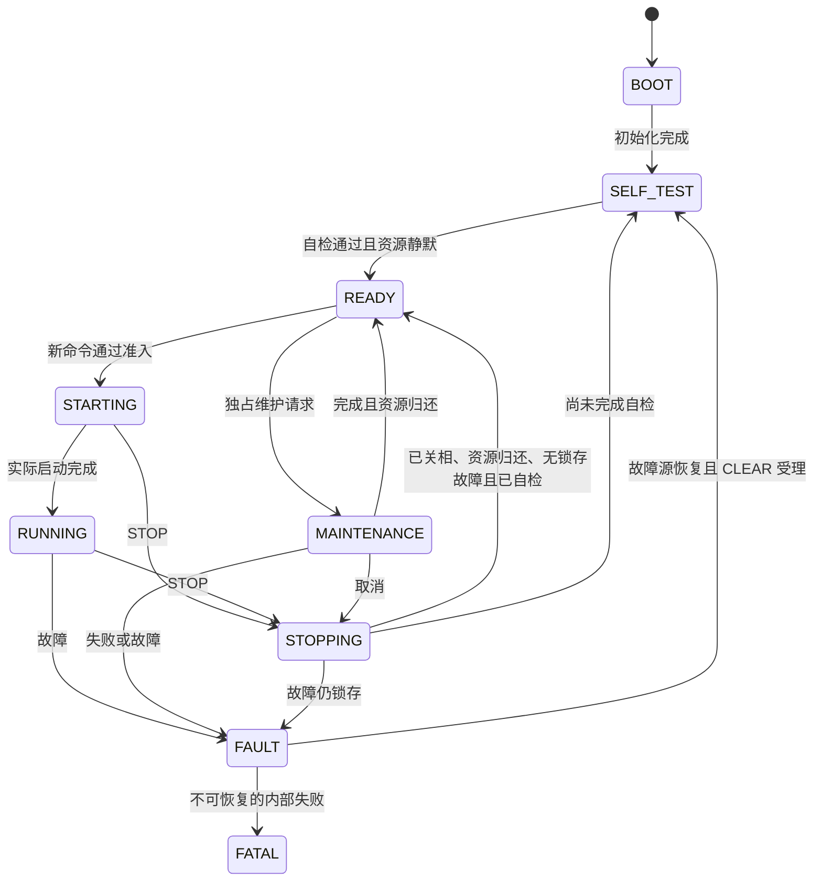

> 历史阶段记录，2026-09-29 归档。下文是当时的设计、状态和证据，不代表当前待办或当前版本通过。现状见[框架收尾](../../plans/completed/2026-09-29-framework-closure-v1.md)与[历史清理](../../plans/active/2026-09-29-legacy-cleanup-v1.md)。

# E/H/D 整体重构开发候选（2026-09-28）

本批完成三方源码与工程输入的集成，状态是**未构建、未测试的开发候选**。
用户要求本阶段只做重构，统一测试后续安排。历史 a174 的实机标定结果不适用于本候选。
Loader 容量仍未闭合，不能宣称可安装、升级成功或可发布。

## 工程入口

以下路径均相对本集成仓库根目录，分支 `codex/system-refactor`。

| 工程 | 路径 | 用途 |
| --- | --- | --- |
| 普通主 APP | `firmware/platform/stm32g4/cubemx/MDK-ARM/Vector_Mini_ST.uvprojx` | 独立 APP，保留原链接位置；仅链接 `boot_hw_unavailable.c`，不宣称已安装 Loader |
| Loader 配套 APP | `firmware/platform/stm32g4/cubemx/MDK-ARM/Vector_Mini_ST_LoaderApp.uvprojx` | 链接实际启动端口、交接服务、镜像记录与描述符，采用 D 的 `app.sct`；容量待解决 |
| 独立 Loader | `loader/targets/vector_mini_st_g431/YG2026_ESC_LOADER.uvprojx` | 独立启动、镜像下载及试启动产品 |

普通工程不链接完整镜像库；配套工程不链接不可用端口，不能把两种 BootHw 同时加入。
`tools/build/generate_loader_app_project.py` 从普通工程源码清单和共享目标配置生成配套工程，
只写工程输入，不构建或操作设备。后续改变普通工程源清单时同步生成配套工程。
配套工程显式设置 `YG_APP_LOADER_IMAGE=1`、`YG_APP_IMAGE_VERSION=0U`、
`YG_APP_IMAGE_ROLE=1U`：版本 0 表示未发布开发镜像，角色 1 为正常控制 APP；打包身份须与
描述符一致。它不是产品发布版本，亦不把目标兼容 profile 1 冒充物理 PCB 版本。
新工程不继承普通工程的自动执行钩子或下载设置，输出位于各自 `outputs/build/` 子目录。

## 实际架构与源码导航

```text
firmware/app/                     组合、唯一运行所有者、值命令适配与观测
  board_config.c                 初始化 → 服务绑定 → 协议硬件启动
  motor_state_machine.c         生命周期调度、统一命令准入、Watch、故障与代际撤销
  motor_state.c                  私有电机对象、参数活动版本、维护资源与保存实际结果
  yg_protocol_owner_adapter.c    参数/维护/生命周期服务适配
firmware/services/
  lifecycle/                     纯状态转换、动作与实际资源 guards
  parameters/                    参数值契约与单值操作服务
  boot_handoff/                  升级停机、回复完成、试启动确认的事务所有者
firmware/motor/                   保留原控制数学、辨识和保护算法
firmware/communication/           CAN 接入、业务路由；不直接改电机可变对象
firmware/platform/api/           能力、单位与失败语义，不公开 HAL 类型
firmware/platform/stm32g4/        MCU/BSP/端口及 CubeMX 适配
shared/protocol/                 APP/Loader 共用帧、CRC、分片与升级 codec
shared/boot/                     邮箱与启动交接值契约
shared/image/                    镜像解析、摘要、提交记录与传输逻辑
shared/targets/                  目标几何、兼容标识与 APP 描述符
loader/                         独立运行时、升级核心、板级端口、目标工程及打包工具
```

核心可变电机对象已私有化。通信、Watch 和维护交换值命令、票据和快照，不能写内部对象。
生命周期、控制模式、维护作业是不同维度，不再用一个 Mode 编号承担所有程序流程。
资源借用和保存仍有显式所有者；请求受理与真正完成分开。保留的调试邮箱按发布协议写入，
不是通用可写全局状态。进一步拆分 `motor_state.c` 或物理目录迁移不属于本批已完成声明。

## 主状态机与启动交接



图只展示主要路径；任意适用状态都可能进入 FAULT/FATAL。STOP/FAULT 撤销旧目标和作业身份，
取消中的前台作业必须真实归还。CLEAR 只清符合恢复条件的锁存并进入自检，不恢复旧目标。
FATAL 不接受普通 CLEAR。详细 guards 以 `services/lifecycle/app_lifecycle.c` 为准。

Loader 配套 APP 的交接调用链为：56 请求当前完整 boot_epoch → APP 所有者撤销目标并停机
→ 确认输出关闭、维护资源释放和保存空闲 → 回复 READY → 确切物理 CAN 发送完成票据
→ 再核对身份、期限与停机条件 → 平台写邮箱并受控复位。入队不算发送成功；失败保持停机。
普通 APP 的启动能力明确不可用。Loader 试启动期间禁止启动、维护和配置写入；本地自检、
调度进展、控制器健康与资源条件满足才持久确认，确认不会启动电机。不要求主机在线往返。

## 通信与调试入口

| 入口 | 已接入语义 |
| --- | --- |
| 107 CLEAR | 空请求、既有 4 B 结果；不启动 |
| 120 / 121 / 122 | 单值读取 / 写入 / 异步保存；WRITE 按来源、序号、完整内容去重，只在成功修改后增加活动 revision；SAVE 以真实写入回读结果完成 |
| 160 / 161 / 162 | 明确种类的标定开始 / 票据查询 / 原票据取消，不取消后来新作业 |
| 3 / 56 | 查询真实启动身份 / APP 请求进入 Loader；普通 APP 不伪造有效启动身份 |
| 50～55 | Loader BEGIN、WRITE、FINISH、STATUS、ACTIVATE、ABORT；边界、摘要、读回、提交、试启动与失败救援 |

线上协议使用共享 codec，没有恢复旧 YI 线协议。升级为单槽方案，SHA 用于完整性，
不声称签名认证、旧版本回滚或断点续传。逐字节协议见
[参数协议](../../protocols/yg_protocol_parameter_wire_v1.md)、
[升级协议](../../protocols/yg_protocol_upgrade_wire_v1.md)、
[启动交接协议](../../protocols/yg_protocol_boot_entry_wire_v1.md)。

**原 `FocBenchSpeed`（版本 3）SWD 台架邮箱已随容量批次退役**，不再是 Watch 入口，
也不再提供 command 1..12 直达。控制、维护与清错改由运行所有者公开 API（CAN 或前台）
提交，退役记录见 [台架邮箱退役记录](../../guides/watch_motor_commands.md)。本说明不授权本轮执行运动。

## 已完成、限制和后续统一测试

E：私有运行状态、统一生命周期/命令、参数与维护真实后端、APP 启动交接与试启动确认。
H：业务路由、共享 codec 单份实现、参数/维护/启动线路契约。
D：独立 Loader、共享目标/镜像/邮箱、固定写域、读回/摘要/提交/试启动/失败救援代码。
ROOT：选择性集成、实际 CAN 发送完成边界、普通与配套 APP 工程输入及本导航。

本次仅阅读源码与差异、编辑并生成工程输入；未执行测试、格式检查、lint、构建或硬件操作。
源码与调用链接入完成不等于符合全部验收要求，以下保留：

- **容量未闭合**：128 KiB Flash 中 Loader 28 KiB、启动记录 4 KiB、镜像记录 2 KiB、
  APP 78 KiB、参数 16 KiB。历史 APP ROM 98,980 B，超过 79,872 B 槽 19,108 B；
  历史 RAM 32,608 B，尚未计入当前新增状态及 32 B 邮箱。当前无新 map，不猜资源已足够。
- 编译/链接、ABI、时序、STOP/FAULT/CLEAR、参数提交、标定取消、升级掉电与实机行为未测。
- 删除旧泛化 update 接口后，部分 native/contract 夹具仍引用旧 API；统一测试前需适配，
  不把历史测试日志记为当前 PASS。
- 101 ENABLE、低侧制动等未明确产品行为不借重构开放；维护镜像角色有代码支持，
  本批仅登记正常控制角色的配套工程。完整目录迁移与其他目标适配未完成。
- 保留 schema11 RAW 4304 B 与 16 KiB 参数区、原控制数学及保护阈值；未迁 dual journal。

代码基线为 a174e00d；E 主体源提交 d505acdc、9581374f，H 截止 12b06de8，
D 为 17dc8528 与说明 fc6a344。E 在本树集成提交为 82e94822、a30e9ce4，
其余记录见[整体计划](../../plans/completed/2026-09-28-system-refactor-e-h-d.md)。
最终两项窄修复 5d2b3deb、c9a1bbe0 分别集成为 0bce3ad6、e8293007：新参数请求主动
收敛旧 SAVE 取消/失败结果；FAULT 中资源归还继续锁存实际故障，不再由适配层清零 guards。
两项仅作源码差异审阅，未测试。完整源码候选 SHA 为
`e8293007651aa89d34f33b2860c263733eb6b549`，工程输入提交为 `8a813808`。
本批自动协调至此暂停，等待用户统一测试指令；容量与本页未完成项继续保留。
后续按本批提交逆序回退；不得 reset/clean 用户现场、历史实机工程或其他工作树。

本页记录集成时的开发候选；当前主状态机实现与离线验收范围见
[功能任务驱动的主状态机 v1](../../architecture/motor_state_machine_v1.md)。
