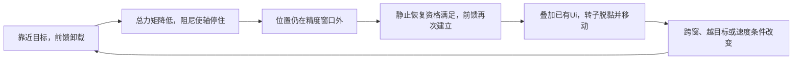

# 目标末端摩擦前馈往复：截图审读

版本：v1.0，2026-10-10。仅审读用户截图、通道契约及控制源码，不连接设备、不修改控制算法。
截图没有通道名称、模式阶段、积分Ui、固件哈希或明确时间单位，以下结论区分观察与推断。

## 截图能支持的观察

原图归档：`outputs/friction_chatter_review_20261010/source.png`。
按波形与十路RTT契约判断，很可能对应手工v3：前两路目标/反馈位置、第三路位置误差，
第六路PLL速度，第七/八路Iq参考/反馈，第九路Id，第十路摩擦前馈。
布局仍需原始采集和匹配固件确认，不能仅按颜色识别通道。

- 标注“抖动”前后，疑似最末路先维持约−3 A，随后负向幅值反复建立/卸载，最后归零。
- 疑似Iq参考/反馈在同一区域同步发生电流变化，后续仍维持约−2 A支撑电流。
  这支持从电流命令生成与前馈切换入手，不能仅凭图认定电流环自身失稳。
- 目标曲线在该区间看起来不变；没有高分辨率目标值，不能排除编码分辨率以下的新目标变化。
- 图上最终目标接近0，并未证明实际处于机械或软件限位。目标末端收敛与真正越限停机是不同情况。
- 没有phase/Ui与精细误差，不能据图证明HOLD反复切换、精确振荡频率、实际机械位移或唯一根因。

## 最吻合的旧版机理

这是阈值切换与静摩擦耦合形成的恢复循环；PLL/编码器噪声可以触发或放大切换，
真实脱黏运动也可以反过来造成速度变化。不能只按其中一种方向归因。

旧SETTLE分支同时要求窗口外和近似静止才恢复；当速度噪声超过停止阈值时，
可能撤除方向/前馈，回到停止阈值内又等待恢复。即使后续保持了SETTLE接近补偿，
若近区仍允许完整约3 A模型恢复，也可能在窄精度窗口附近反复进入和退出。

风险组合包括：误差落在精度窗外、阻尼/静摩擦明显、完整前馈相对微小位置纠偏较大、
已有Ui未清零、滤波反馈滞后、位置/速度噪声反复跨阈值。若目标实际顶住机械限位，
误差无法消除也会持续触发纠偏；仅截图无法确认这个外部条件。

以8 A限流、位置Kp=8、内速度Kp=0.5、近似零速、误差0.1°为例，
位置误差产生的速度比例电流约0.056 A；完整摩擦模型约3 A，且还与已有Ui叠加。
这个量级差解释了“小误差触发一大块恢复电流”可能导致脱黏过冲，
但该计算不是对截图实际力矩、负载或稳定性的实测证明。

## 源码与截图固件的区别

审读时工作树已包含新的 `settle_friction_quiet` 私有锁存：

- SETTLE实际误差进入基准近区0.18°后，模型前馈只平滑退出。
- 在0.18°/0.26°之间不重新建立模型前馈；剩余误差交给有界速度PI/静摩擦Ui。
- 新目标会重置，或误差超过0.26°时允许远区恢复。
- 该前馈退出窗口不等于到位窗口；默认实际捕获精度仍由0.001 rad参数决定。

工作树另有到位资格位置滤波，控制误差仍用原始位置。此前运行逻辑梳理是旧源码
快照，不能把其所有判断直接套在新增锁存/资格滤波后的源码。

近区锁存的候选验证记录为 `outputs/position_noise03_20261010/summary.json`，
状态 `offline_passed_not_downloaded`。该记录及其03采集不自动等同于本截图，
也不能据此宣称本图抖动已经修复。方案见
[近区锁存计划](../plans/2026-10-10-settle-friction-quiet-v1.md)。

## 精确定位需要的数据

匹配固件/RTT布局的原始采集，重点对齐：最终误差、滤波速度、Iq参考/反馈、摩擦前馈。
如能记录内部状态，再检查phase、捕获标志、landing/recovery/quiet、Ui、目标变化事件。
观察是误差越窗、速度越阈值还是新目标首先发生，再判断前馈改变是否先于电流/位置变化。
当前只有截图，结论是优先排查前馈卸载/恢复循环，不声称已确定唯一根因。
