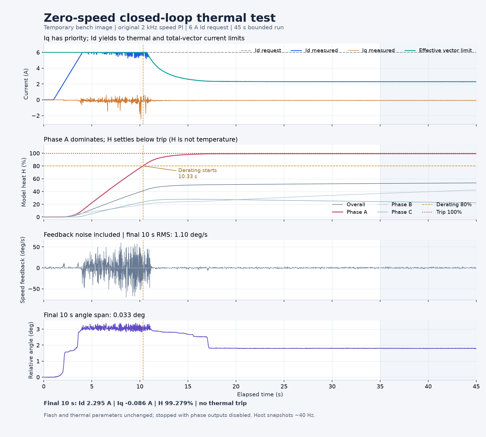

# 零速闭环 Id 注入热测试报告

文档版本：0.1.0

测试日期：2026-10-16（北京时间）

整理日期：2026-10-17

适用分支：`codex/ovp-36v`；本报告记录临时台架镜像试验，不构成固件发布或物理热安全认证。

## 结论

在板端原生 2 kHz 速度闭环、速度给定为 0 的条件下，逐步增加 Id 请求至 6 A，
完成了约 45 s 的有界热注入。约 10.333 s 进入热降额，10.741 s 后有效限流低于 6 A，
最终 Id 约 2.295 A、最大归一化热负荷 H 约 99.2795%，均趋于稳定。
本次观察到持续降额，没有触发 100% 热故障锁存。

200 ms 主机心跳失效后的自动停止已实测通过。试验结束确认 mode 0、故障 0、三相高阻；
自然计算冷却至 H≤3% 后恢复原 APP。恢复后的完整 128 KiB Flash 与试验前备份逐字节一致，
角度 LUT、电零位、标定标志及其余参数均保留。

H 是电流平方驱动的归一化热模型状态，不是绕组温度、MCU 温度或实际温升百分比。
热降额形成低于跳闸阈值的平衡并不表示保护失效；本次不能据此宣称热故障锁存、
冷却解锁及实际电机温升能力均已验证。模型定义见
[绕组热保护设计 v1](../architecture/motor_winding_thermal_design_v1.md)。

## 台架与试验边界

沿用本轮已确认的无阻尼轮电机台架：21 极对、6 mΩ 采样电阻，轮子架空、可连续旋转。
现场可切断功率电源，其他运动命令暂停。受测 MCU 为 STM32G431，接口为 J-Link/SWD；
具体探针和目标身份保留在忽略的证据目录，不写入本报告。
供电约 27 V，试验起始回读母线为 26.861 V。

用户授权为“用速度 0 闭环，增加 Id 来做热测试，电机有轻微抖动可以不用关心”。
因此允许轻微抖动，但保留电流、持续运动、角度偏移、故障和通信失联停止条件。

| 项目 | 本轮边界或配置 |
| --- | --- |
| 模式、速度给定 | mode 2，0°/s；板端原生速度 PI，非主机代算速度环 |
| Id 请求 | 先保持 0 A 约 1 s，再按 2 A/s 上升，最高 6 A |
| 配置运行限流 | 6 A，约束 d/q 总矢量；没有提高到热模型峰值 7 A |
| 主机电流停止门限 | 单相绝对值或主机组合 d/q 幅值超过 6.4 A；用于观测裕量，不改变固件 6 A 限流 |
| 瞬时速度反馈停止门限 | 1718.87°/s（原始脚本 30 rad/s） |
| 持续速度反馈停止门限 | 超过 114.59°/s（2 rad/s）连续 0.5 s |
| 相对角度偏移停止门限 | 相对起始位置绝对偏移超过 60° |
| 总试验预算 | 45 s，达到时限主动停止 |
| 供电、MCU 温度监测 | 母线 25.6～33.8 V；MCU 温度有效且低于 100℃ |
| 其他准入 | 镜像匹配、无故障、标定有效、档位有效、编码器通信无错误 |

主机的 6.4 A 和速度停止条件是本次脚本的离散观测判据，不是 MCU 硬保护的时间或精度保证。
固件电流控制、总矢量热限幅及其他故障保护始终保留。

## 镜像、标定与热参数

候选固件从 `7e8808a5fc54358febf8363624213f16dad763c2` 冻结源码制作，
仅在专用副本加入 RAM 台架请求和失联停止逻辑。候选 APP CRC32 为 `AB4132E9`，
构建结果 0 错误、0 警告。实际试验前后原 APP 的 CRC32 为 `C6779B59`，
按其匹配 AXF 读取符号；不能将原 APP 的源码身份与候选基准提交混为一谈。

同日此前已重新执行 mode 13 角度 LUT 标定及 mode 15 电零位标定，保存并回读通过。
新电零位为 **18725 Q15**、标定标志 **3**，机械零位为 0、编码器方向为 0。
重新标定保留机械零位和方向，热测试及两次镜像替换没有再次改写这些标定值。
标定证据见 `outputs/thermal_max_current_20261016_fa850a6c/recalibration_summary.json`。

| 热模型配置 | 本轮保持值 |
| --- | ---: |
| 连续 d/q 向量参考 | 3 A |
| 连续单相 RMS 参考 | 2.12132 A |
| 模型峰值 | 7 A |
| 升温 / 冷却时间常数 | 65.9849 s / 120 s |
| 相电流采样 / 模型更新 | 20 kHz / 1 kHz，每次更新累计 20 个样本 |
| 降额进入 / 退出 | H=80% / 70% |
| 热故障锁存 / 允许清故障 | H=100% / 50% |

本次没有用降低门限、直接修改 H 或清除热锁存的方法强迫保护动作。

## 临时镜像的控制与停止机制

普通 mode 2 会在外环结果发布时将 `idRef` 清零，不能靠主机反复改该字段形成稳定热负载。
临时副本在 `foc_task.c` 增加三个默认值为 0 的独立 RAM 量：
`thermal_test_id_request_a`、`thermal_test_heartbeat`、`thermal_test_active`。
它们不进入参数 ABI，也不保存到 Flash。

全模式快环检查位于外环发布之后、模式分派和 `FOC_Current()` 之前。
仅允许无故障、有效档位且 `speedRef=speedShadow=0` 的 mode 2 注入，Id 请求必须有限且在 0～6 A。
先保留原速度环输出的 Iq，再利用剩余总电流额度给 Id：

```text
L = 原运行限流与热降额共同决定的有效上限
Iq = clamp(原速度环输出, -L, +L)
Id = min(Id请求, sqrt(max(0, L² - Iq²)))
```

Iq 纠速优先，因此请求 6 A 不保证实际 Id 始终为 6 A。
原速度 PI、抗积分饱和以及 `FOC_Current()` 最终总矢量限幅继续执行。

主机在 mode 0 关相时预装请求和递增心跳，明确写 `active=1` 后进入 mode 2；
约每 25 ms 更新心跳。预备状态同样受 200 ms 租约约束。
已预备后的禁用、停止、模式退出、故障、非法请求或心跳超时，均清除请求和使能，
执行 `Set_ModeNow(Motor_Disable)` 及 `Stop_PWM_Generate()`。
停止发生在模式分派前，当拍不再执行运行 FOC；三相六路 PWM 关闭并切换为高阻。
后续再次运行必须重新预备，不会自动续测。

离线检查提取真实 C helper、限流函数、模式赋值及停机路径，用原生编译执行了 32 项检查，
覆盖零限流、Iq 余量、热降额、非法输入、禁用、模式退出、计时回绕与心跳失效。
`thermal_test_check.json` 的 `firmware_built=false` 仅指该离线检查不构建固件；
候选固件的实际构建另由 `build_provenance.json` 记录。

## 执行过程与采样口径

1. 备份原完整 Flash，确认重新标定结果和 6 A 配置限流。
2. 保持 mode 0、三相高阻，自然计算冷却至 H=2.9815%，再安装候选 APP 并复位启动。
3. 以零 Id 验证失联停止：预备并进入 mode 2 后暂停心跳约 280 ms，读回 `active=0`、mode 0、零电流参考及三相高阻。
4. 重新预备，执行 1 s 零 Id、2 A/s 升至 6 A、持续观测至 45 s 的主试验。
5. 正常停止并核验 Flash、热参数未变，保持模型运行并关相冷却。
6. H 降至 2.9875% 后恢复原 APP，再复位回读和比较完整 Flash、参数及关相状态。

失联检查证明 200 ms 租约路径会自动停止；主机约 280 ms 后回读，不能据此给出精确的关相延迟。

主试验共 1765 个主机快照，最后采样时刻为 44.985 s。
采样间隔中位数为 25.417 ms、最大 34.212 ms，约为 40 Hz；这些是非原子 SWD 轮询，
不是 20 kHz 电流环的完整同步采样。各字段可能来自相邻控制拍。
`max_heat` 与四个 `heat[]` 字段可能来自不同更新拍；分析以四路最大值重建 H 并交叉核验，
不把非原子快照当作精确的同拍状态。

## 实测结果

| 项目 | 本轮主机采样结果 |
| --- | ---: |
| Id 峰值 | 6.01581 A |
| Iq 绝对峰值 | 2.42461 A |
| 主机组合 d/q 幅值峰值 | 6.25551 A |
| A / B / C 相绝对峰值 | 6.00366 / 5.17094 / 3.77411 A |
| 全程速度反馈绝对峰值 | 70.0378°/s |
| 全程相对角度最小 / 最大 | −0.02198° / +3.37280° |
| 全程角度范围 | 3.39478° |
| 首次降额标志 | 10.333 s，H=80.2050% |
| 有效限流首次低于 6 A | 10.741 s |
| 运行段最终有效限流 | 2.29707 A |
| 100% 热跳闸 | 未观察到；达到时限后正常停止 |

上述峰值只能表述为“本次主机已采样最大值”。尤其组合 d/q 幅值取自非原子读取，
6.256 A 既不能证明硬保护准确在此值动作，也不能单凭该数确认控制拍内真实总电流曾超过 6 A。
同样不能证明两个主机样本之间没有更短的峰值；高频纹波和准确瞬态限流需同步高速采样验证。

以“请求为 6 A，实际 Id 在 5.7～6.3 A”定义接近 6 A 的样本带，
首次与末次落入该带的时刻为 4.011 s 和 10.818 s。
最长连续主机样本段为 4.011～7.520 s，跨度 3.509 s、139 点。
整个首末跨度不是连续维持 6 A；高电流段 Id 曾为 Iq 纠速让位。
有效热限流开始低于 6 A 之前，6 A 请求阶段的 Id 样本均值为 5.911 A。

末 10 s 窗口为 34.991～44.985 s，共 391 点，采用窗口内主机样本算术统计：

| 稳态观测量 | 末 10 s 结果 |
| --- | ---: |
| Id 均值 / 标准差 | 2.29533 A / 0.00752 A |
| Iq 均值 / RMS | −0.08551 A / 0.08602 A |
| 有效限流均值 | 2.29708 A |
| H 均值 / 最大值 | 99.27947% / 99.27953% |
| 主导热通道 | A 相 |
| 速度反馈均值 / RMS | +0.01756°/s / 1.10030°/s |
| 相对角度区间 | +1.77429°～+1.80725° |
| 角度峰峰范围 | 0.03296° |

速度 RMS 包含测速噪声，不能等同于实际机械振动 RMS；末段角度范围应同时参考。
零速速度控制本身不保持固定位置，因此全程发生约 3.395° 的角度范围不等于位置环定位误差。



H 进入 80% 降额时，模型可用电流从 7 A 开始逐步下降，而运行配置仍限制为 6 A，
因此降额标志早于有效限流低于 6 A 的时刻。后期 A 相热点主导，Id 降至约 2.30 A，
H 在 100% 以下形成反馈平衡。这个结果支持持续降额路径有效，不包含热故障锁存的通过结论。

## 热历史、恢复与前序试验的区别

本模型 H 保存在 RAM，MCU 复位会丢失热历史。安装候选和恢复原 APP 均包含下载后的复位，
故试验初始 H 近 0 及恢复后 H 近 0，不能描述为跨升级保留了热历史。
两次下载前均先在 mode 0、关相条件下继续运行模型，达到 H≤3% 的额外冷却门槛；
这个门槛也只是模型操作边界，不是传感器证明绕组已达到某一温度。
主试验运行、降额及随后的冷却等待期间没有清 H 或中途复位。

恢复后完整 Flash 为 131072 B，与 `original_flash.bin` 逐字节相同。
参数区 `0x0801C000～0x0801FFFF` 的 SHA-256 与安装前、安装后、恢复后均匹配。
最终原 APP 为 `C6779B59`，mode 0、`ErrorNow=0`、Id/Iq 参考为 0、三相高阻；
电零位 18725、标志 3、机械零位及方向不变，运行限流恢复保持 6 A。

前序 mode 1 纯 Id 注入曾在约 0.29 A 时因运动提前停止；重新完成角度及电零位标定后，
mode 1 升流仍在约 5.762 A 时触发运动停止条件。两次都没有完成最大电流热试验。
本次增加零速闭环后完成有界降额试验，不能反推前序运动的根因已定位或电零位误差已被完全排除。
前序证据保留在 `outputs/thermal_max_current_20261016_fa850a6c/`，未用本轮成功记录覆盖。

本次未验证：100% 热故障锁存及其冷却解锁全过程、实际绕组温升与时间常数辨识、
长期连续 3 A 能力、其他负载或阻尼环工况、复位后的保守热历史恢复、同步高速电流极值，
以及临时镜像的正式发布准入。此前其他门限试验的结果不自动继承到本轮默认门限场景。

## 可复核证据与哈希

本轮证据根目录为 `outputs/thermal_zero_speed_20261016_bench01/`。
`summary.json` 汇总试验与恢复；`result.json` 和 `samples.jsonl` 为主试验记录；
`analysis.json` 为统计；`install/result.json`、`restore/result.json` 为两次替换证据；
`build_provenance.json` 记录源码节点、候选产物和构建日志哈希；
`thermal_test_check.json` 记录 32 项离线检查；`run.py`、`download.py`、`bench_patch.diff` 保留实际执行路径。
原始证据包含设备身份，仅在忽略目录归档；下列路径均相对该证据根目录。

| 证据或比较对象 | SHA-256 |
| --- | --- |
| `summary.json` | `f9673a4585a1bfe8558b22d803f4e6f2669d13b480b0e83443b8b68763f8937e` |
| `result.json` | `0cf188f55725fa121cda8fc5875a2d12fec580ed75a294f2ff815fd70b1af9b6` |
| `samples.jsonl` | `b40bdabd1b95baefdffd7bde88c9c7dcd61818c48f163b2d7ee3a22e20d56ff8` |
| `analysis.json` | `25ec95dffb94e2bd8bee102ea4ced1b9487c84cfbbdb50e3d475d27205e602b0` |
| `build_provenance.json` | `80ab781e2f6d8f0794d8a909f792d497a430b03c84f6c1e611545ca06adfa02a` |
| `restore/result.json` | `45a7b20c1bde825eaec6c69e3be7083dba680b5495f74bbfc9b6b4103a4b75aa` |
| 原完整 Flash / 恢复后完整 Flash | `91a9132e6504e920c050713c7c35937858530bd0b79b38575533f0d4c3e8af25` |
| 参数区 | `812f1ba028fcf5c4a3fbdbd478a91db4120827b6c8c6626a6e49b31415d0a6c6` |

整理时已重新计算上述哈希，核对 `summary.json` 中的证据清单，
并比较 `original_flash.bin` 与 `restore/flash_after.bin`。本报告的通过范围仅为该次有界实测及完整恢复。
