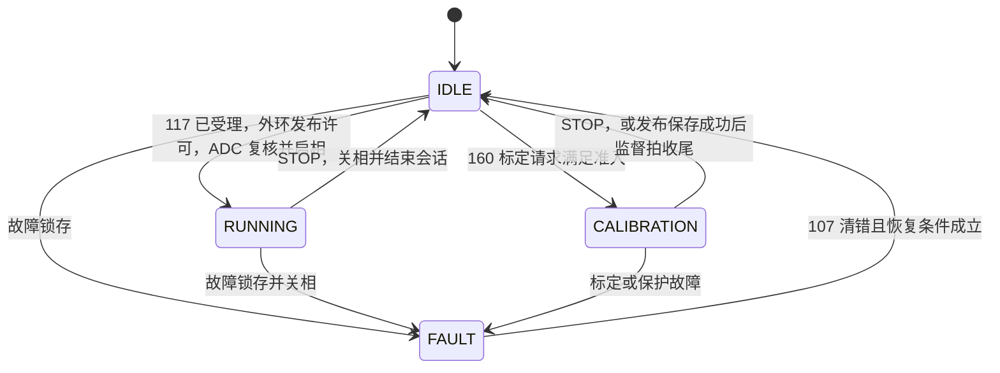

# APP 与 Loader 固件架构审查

2026-11-10，`the-system-refactor`，提交 `176f3c7e`。适用于 STM32G431 和 AT32F456。两种 MCU 都有独立启动 APP、配套 Loader 的 APP（LoaderApp）和 Loader 工程。配套部署时，复位先进入 Loader，再由 Loader 跳入 APP。两个镜像各自创建运行状态，跨复位交接依赖 RAM 邮箱、Flash 标记和共享的目标布局。

本次优先发现集中在两个交接处：Loader 将激活票据交给 CAN 发送端口时，重发可撤销原票据；将激活权交给镜像层时，最终写入可越过票据截止时间。APP 侧则有一处独立镜像上报错误，以及损坏参数下两端选取不同 CAN 节点的问题。下文给出触发条件和验证边界。

## 文件架构与职责

| 文件归属 | 状态所有者与读码入口 |
| --- | --- |
| `projects/{stm32g4,at32f456}` | APP 的 Keil 工程、启动和板级中断入口。板级静态 `g_app` 持有本机 `AppContext`。从两个 main 可核对相同的启动顺序和不同的 IRQ 接线。[G431 入口](../../../projects/stm32g4/application/main.c)、[AT32 入口](../../../projects/at32f456/application/main.c) |
| `firmware/app` | `app.c` 组装服务并调度前台，`app_protocol.c` 将线路值映射为领域命令，`app_loader.c` 持有 56/57 的交接状态。`motor_axis.c` 调度快慢环，`motor_state_machine.c` 持有轴状态、代际和功率许可，`motor_calibration.c` 执行标定及停止后的发布。[组合入口](../../../firmware/app/app.c)、[轴实例](../../../firmware/app/motor_axis.h) |
| `firmware/motor`、`parameters`、`config` | 电机层计算 FOC、外环和反馈；参数层执行默认值、记录校验及序列化；配置层定义板型、周期和编译期能力。活动配置属于轴实例，Flash 记录是持久化表示。[控制计算](../../../firmware/motor/control/motor_control.c)、[参数记录](../../../firmware/parameters/parameter_record.c)、[控制周期](../../../firmware/config/config.h) |
| `firmware/communication`、`platform/bsp` | 通信端点持有收发队列、编码解码和回复跟踪；BSP 公共头定义硬件操作，两套 MCU 实现分别访问 ADC、PWM、编码器、CAN 和 Flash。[通信入口](../../../firmware/communication/yg_protocol.c)、[交接回复跟踪](../../../firmware/communication/yg_protocol_boot.c)、[BSP 公共接口](../../../firmware/platform/bsp/include/) |
| `loader/runtime`、`core`、`product` | `runtime/main.c` 组装端口、启动策略、收包及回复；`core/upgrade.c` 拥有会话、租约、进度和激活票据；`product/parameters.c` 只读识别参数并选 CAN 节点。[运行入口](../../../loader/runtime/main.c)、[升级事务](../../../loader/core/upgrade.c)、[节点选择](../../../loader/product/parameters.c) |
| `loader/boards`、`ports`、`targets` | boards 定义板级时钟、引脚和安全输出；ports 实现 MCU 的 CAN、Flash、时钟、复位与跳转；targets 保存具体 Loader 工程及配套链接输入。[端口接口](../../../loader/ports/include/)、[目标工程](../../../loader/targets/) |
| `shared/protocol`、`boot`、`image`、`targets` | 共用帧、CRC、分片、升级载荷，跨复位邮箱及身份编码，镜像描述符与标记，目标分区。`shared/image/image_transfer.c` 还实现分步擦写、校验和启动检查，分析激活时必须和 Loader core 一起读。[协议](../../../shared/protocol/)、[邮箱](../../../shared/boot/image_mailbox.h)、[镜像实现](../../../shared/image/image_transfer.c)、[分区清单](../../../shared/targets/) |

## APP 代码架构与电机状态机

启动顺序是 `Bsp_Init → App_Init → Bsp_Start → App_Start`。前台循环依次处理位置轨迹建表、标定发布、协议、可选 Loader 事务。CAN 接收 ISR 将帧放入队列，协议业务在前台执行。ADC 快环为 20 kHz，先采样再执行控制或标定。监督拍为 2 kHz；G431 在监督拍执行外环，AT32 每五个有效快拍派发一次 PendSV，外环为 4 kHz。[APP 前台](../../../firmware/app/app.c)、[快慢环调度](../../../firmware/app/motor_axis.c)、[板型分频](../../../firmware/config/config.h)

源码定义五个状态，初始化直接进入 IDLE。SELF_TEST 保留枚举和协议映射，当前生产路径没有迁入该状态的事件。启动零偏在关相的 IDLE 中累计。RUNNING 的成立晚于 117 的受理；收到 STOP 后先撤销启相许可，监督拍或外环结束会话。故障清除后回到 IDLE，重新启动须再次满足准入。[状态机](../../../firmware/app/motor_state_machine.c)、[状态到线路值的转换](../../../firmware/app/app_protocol.c)

标定还需区分算法阶段与电机主状态。带 Hall 的 LUT 标定可在同一 `epoch` 内从扫圈转入联合电零位。ADC 完成后关相并发布交接，前台准备候选；最终提交复核代际、标定类型、故障及实际关相，再写 Flash 并回读。监督拍处理完成。中途 STOP 或代际变化会使旧候选失效。完整扫圈得到的不合格 Hall 结果按现有规则保存失败信息。[标定发布](../../../firmware/app/motor_calibration.c)、[标定流程](../../guides/calibration_process.md)

## 通信协议与命令归属

CAN FD 使用 29 位扩展 ID，仲裁段 1 Mbit/s、数据段 5 Mbit/s。ID 携带优先级、目的和来源，应用头中的节点须与 ID 一致。逻辑帧由 16 B 头、最多 46 B 载荷和 2 B CRC16 构成，头内另有 CRC8。APP 普通命令使用单帧，Loader 为较长的 BEGIN 和 WRITE 重组分片。以下命令号均为十进制。[帧编解码](../../../shared/protocol/yg_protocol_frame_codec.c)、[分片实现](../../../shared/protocol/yg_protocol_fragment.c)、[线路字段](../../protocols/README.md)

| 接收镜像 | 命令 | 执行与回复 |
| --- | --- | --- |
| APP | 1、2、3、108 | 读取身份及布局、能力、设备状态、电机状态。108 由状态机提供一致快照；连续读取受抢占时可回 BUSY。 |
| APP | 117、116、124 | 117 请求零目标启动。116 在活动模式中设定目标，对重复和旧序号做检查；除命令回复外，设备发 124 关联反馈。 |
| APP | 110、101、107 | 110 请求 STOP，101 的失能值也走停机。STOP 的 1/1 表示已受理、仍待关相，0/0 表示已读到关相。107 负责清错。 |
| APP | 160、161、162、120–122 | 160 当前接入编码器 LUT、电零位和机械零位。161/162 的进度及取消操作、120–122 的在线参数操作当前返回不支持。活动标定的停止走 110。 |
| 两板 LoaderApp | 56、57 | 56 以非零 nonce 请求进入 Loader，锁定新启动、请求停机；READY 回复物理发送完成后，复核时限与停机状态，写邮箱并复位。57 由试运行 APP 核对版本、CRC、连续健康和关相条件，写确认标记。 |
| Loader | 1、50–55 | 1 返回身份页。50 BEGIN、51 WRITE、52 FINISH、53 STATUS、54 ACTIVATE、55 ABORT。升级绑定来源节点、主机 nonce 与 Loader 分配的 session；WRITE 同时核对 offset 和数据。 |

APP 业务由 `Protocol_Process → AppProtocol → MotorStateMachine` 交付。Loader 升级由 `receive → dispatch → LoaderUpgrade → LoaderImage → Flash 端口` 执行。两端共享帧格式，各自拥有状态。56 的回复关联 APP 停机交接，54 的回复关联 Loader 激活，57 才完成新 APP 的持久确认。[APP 命令映射](../../../firmware/app/app_protocol.c)、[APP 交接](../../../firmware/app/app_loader.c)、[Loader 分发](../../../loader/runtime/main.c)

## Loader 启动与升级状态机

冷启动先保持关相、读取复位原因和邮箱、选取节点并初始化 CAN。正常条件下有 50 ms 救援窗口。有效驻留请求、看门狗复位、有效软件交接等路径可留在 Loader；准备跳转时重新检查镜像、向量及标记。已有确认标记的有效 APP 可正常启动，新激活镜像在消耗一次试运行机会后才跳转。[启动策略](../../../loader/runtime/main.c)、[试运行与标记](../../../shared/image/image_transfer.c)

| 阶段 | 谁推进 | 放行条件 |
| --- | --- | --- |
| IDLE → READY → ERASING | 50 和镜像层 | 清单与本机产品、角色、布局及 ABI 匹配。BEGIN 建立会话，Poll 按页擦除。 |
| RECEIVING → VERIFYING → VERIFIED | 51、52 和 Poll | 分块写入并回读，FINISH 发起镜像校验。STATUS 可查询阶段和下一个 offset。 |
| VERIFIED → 激活 → 复位 | 54、CAN TX 完成、Loader core | 分配激活票据，收到对应实体帧的成功完成事件后复核并写 Flash 标记。激活后通过复位进入启动流程。 |
| 试运行 → 已确认 | Loader 启动检查、APP 的 57 | Loader 持久记录试运行机会；新 APP 通过健康检查后写确认标记。未确认的已尝试镜像在下次启动时留在 Loader。 |
| 事务中断 | 55、租约超时、链路错误 | 撤销当前写入权限。单 APP 槽恢复依赖重新下载完整镜像。 |

三种时间约束由不同层负责：56 停机交接窗口为 1000 ms，APP 的 READY 回复发送期限为 100 ms；Loader 升级租约为 5000 ms，54 激活回复票据期限为 500 ms。APP 的 `epoch` 标识电机会话，56 的 nonce 标识交接事务，Loader 的 session 标识写入会话，三个字段用途不同。[APP 交接期限](../../../firmware/app/app_loader.c)、[READY 发送期限](../../../firmware/communication/yg_protocol_boot.c)、[Loader 租约及票据](../../../loader/core/upgrade.h)

## 审查发现

### 1　重复 ACTIVATE 可撤销正在发送的原票据

原 54 回复仍占用 AT32 的单个发送槽时，重发 54 会从 core 拿到同一张票据。第二次 `LoaderCan_Send` 返回忙，runtime 将这次提交失败作为该票据的发送失败通知 core。core 撤销会话，稍后原回复真实发送成功也无法激活，设备需要重新建立升级事务。建议将票据绑定到首次成功提交的物理帧，重发复用进行中的结果。APP 处理重复 56 时已有“票据在途”检查，可对照其语义。[Loader 回复](../../../loader/runtime/main.c)、[票据处理](../../../loader/core/upgrade.c)、[AT32 发送槽](../../../loader/ports/at32f456/can_port.c)、[APP 在途检查](../../../firmware/communication/yg_protocol_boot.c)

### 2　激活标记可能在票据截止后写入

`LoaderUpgrade_TxComplete` 先整包校验，再上锁并检查 500 ms 期限。随后 `LoaderImage_Activate` 在锁内再次整包校验，写标记前的 `allowed` 只核对 5 s 租约及输出、链路。如果第二次 CRC 跨过截止点，仍可写标记并复位。AT32 该锁屏蔽全部可屏蔽中断，G431 屏蔽 CAN 中断。建议把整包校验保留在锁外，在实际提交标记前统一核对票据期限、会话、输出、链路和标记状态。[事务提交](../../../loader/core/upgrade.c)、[镜像激活](../../../shared/image/image_transfer.c)

### 3　G431 独立 APP 上报了 LoaderApp 的分区

G431 独立工程的 IROM 从 `0x08000000` 起，容量 112 KiB。APP 组合层直接包含 G431 配套 Loader 的目标头，所以 GET_INFO 第 2 页报告 APP 从 `0x08004000` 起、容量 96 KiB、Loader 占 16 KiB；第 0 页同时把 Loader 版本和 API 设为 0。读取布局的诊断工具会得到两个不同的镜像身份。建议由工程明确选择独立或配套的布局描述，测试四种 APP 目标的第 2 页与实际链接输入。[APP 身份页](../../../firmware/app/app.c)、[G431 独立工程](../../../projects/stm32g4/MDK-ARM/ESC-APP-STM32G431.uvprojx)、[目标头](../../../shared/targets/vector_mini_st_g431.h)

### 4　损坏参数可使 G431 在交接后改变 CAN 节点

例如 schema14 记录保留合法 magic 和节点 6，记录 CRC 损坏。G431 APP 回退至默认节点 1，并在 56 的邮箱里写入活动节点。Loader 对参数只校验外形和节点编码，启动时重新读出 6，并使用它初始化 CAN。这样 56 可在节点 1 成功，复位后向节点 1 查询同一设备会没有回复。建议针对有效软件交接明确节点来源；冷启动救援仍可采用独立策略。用同一份损坏记录覆盖 APP、邮箱、Loader 三段。[APP 参数回退](../../../firmware/parameters/parameter_record.c)、[默认节点](../../../firmware/config/application_config.h)、[Loader 参数识别](../../../loader/product/parameters.c)、[邮箱与 CAN 初始化顺序](../../../loader/runtime/main.c)

### 5　协议入口遗漏 AT32 LoaderApp 的交接能力

当前协议说明将 56/57 限定为 G431 LoaderApp。AT32 配套工程同样定义 `YG_APP_LOADER_IMAGE=1`、编入 `boot_loader.c`，并绑定相同的 56/57 服务。建议协议能力表按板型和镜像角色列出两个独立 APP、两个 LoaderApp 和两个 Loader，避免把独立 APP 的限制套到同板的 LoaderApp。[协议入口](../../protocols/README.md)、[AT32 配套工程](../../../projects/at32f456/application/ESC-APP-AT32F456.uvprojx)、[服务绑定](../../../firmware/app/app.c)

## 验证范围

分层和公共接口检查均通过，11 个 Keil 目标的文件与包含路径检查为零错误。双板电机状态机用例覆盖 30 个状态与事件组合、非法输入、标定发布、STOP、故障与恢复。APP 编排覆盖两种 MCU 各自的独立及配套构建配置；Loader 升级内存模型、G431 运行时模型和 AT32 端口模型通过。[状态机测试](../../../tests/unit/native/test_run_state.py)、[APP 编排](../../../tests/unit/native/test_app_orchestration.py)、[Loader 核心模型](../../../tests/unit/loader_upgrade_test.c)

两项额外故障注入使用仓库 Loader 内存模型的临时副本，链接原生产源码。重复票据依次收到“第二次提交失败”和“原回复成功”时，结果为会话已撤销、复位次数 0。将票据处理推进至第 499 ms，在锁内第二次读取镜像时推进到第 501 ms，结果为激活成功、复位次数 1。上述数值是注入的边界条件。此次未构建 Keil 镜像或接板测量时序。
